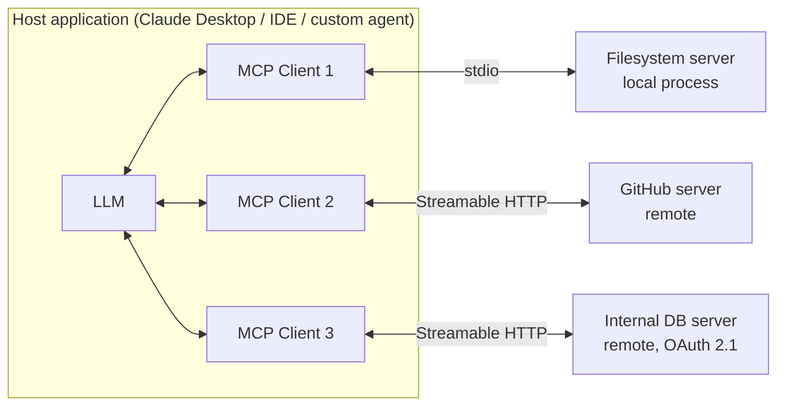
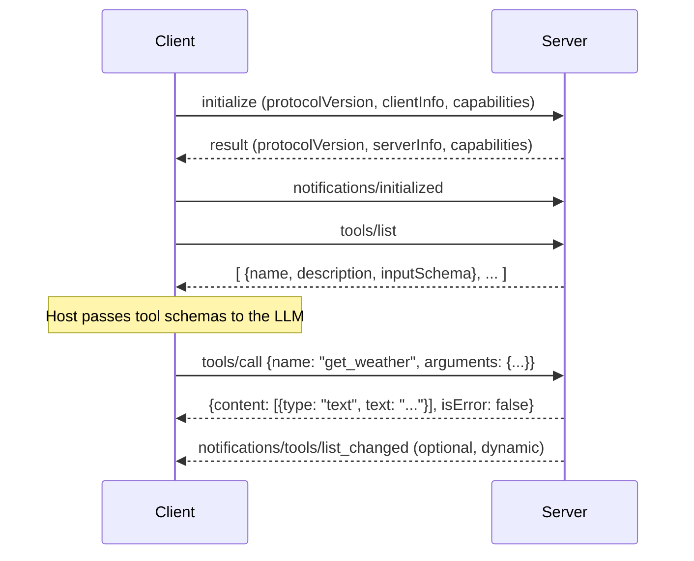

# Q1. What is MCP, and why is it used?

[← Back to questions](../questions.md)

## TL;DR

- **MCP (Model Context Protocol)** is an open protocol, introduced by Anthropic in November 2024, that standardizes how LLM applications connect to external tools, data and prompts. People often call it "USB-C for AI applications".
- It solves the **N×M integration problem**. Without it, every AI app (N) needs custom glue code for every tool or data source (M). With MCP, each app implements the client side once and each tool implements the server side once, so you build N + M integrations instead of N × M.
- Architecture: **Host** (the AI app, e.g. Claude Desktop, an IDE, your agent) → **Client** (one per server connection, inside the host) → **Server** (exposes capabilities). Messages are **JSON-RPC 2.0**.
- Servers expose three primitives: **Tools** (actions the model calls), **Resources** (read-only context the app attaches) and **Prompts** (reusable templates the user picks). Clients can offer **Sampling**, **Elicitation** and **Roots** back to servers.
- Transports: **stdio** for local subprocesses and **Streamable HTTP** for remote servers. HTTP+SSE is the legacy transport. Remote servers use **OAuth 2.1** authorization.
- Why use it: reusable integrations, vendor and model portability, dynamic tool discovery, a clear security boundary, and a growing ecosystem of ready-made servers (GitHub, Slack, Postgres, filesystem and others).

## Detailed Answer

### 1. The problem MCP solves

Before MCP, connecting an LLM to Jira meant writing a function-calling schema for OpenAI, another for Anthropic and another for your LangChain agent. You then repeated the work for Slack, GitHub and Postgres. Every combination of app and tool was bespoke.

```
Without MCP (N x M)                    With MCP (N + M)

 App A ──┬── Jira                       App A ─┐            ┌─ Jira server
         ├── GitHub                     App B ─┼── MCP ─────┼─ GitHub server
         └── Postgres                   App C ─┘  protocol  └─ Postgres server
 App B ──┬── Jira
         ├── GitHub                     Each app: 1 MCP client implementation
         └── Postgres                   Each tool: 1 MCP server implementation
 App C ── ... (9 custom integrations)
```

The same idea worked before. **LSP (Language Server Protocol)** solved the editor × language problem in the same way, and MCP borrows heavily from LSP's design, including JSON-RPC and capability negotiation.

### 2. Architecture



| Component | Role |
|---|---|
| **Host** | The user-facing AI application. It owns the LLM, the UI, user consent and security policy, and it creates clients. |
| **Client** | A protocol connector inside the host, with a 1:1 stateful session to one server. It handles capability negotiation and message routing. |
| **Server** | A program that exposes tools, resources and prompts. It can be local (stdio) or remote (HTTP). It does not need to know which LLM is calling it. |

### 3. Primitives

**Server-side (what a server offers):**

| Primitive | Controlled by | Purpose | Example |
|---|---|---|---|
| **Tools** | Model | Functions with side effects or computation, which the LLM decides to call | `create_issue`, `run_sql` |
| **Resources** | Application | Read-only data identified by URI, which the host attaches as context | `file:///repo/README.md`, `db://schema/orders` |
| **Prompts** | User | Parameterized templates, often shown as slash commands | `/summarize_pr`, `/code_review` |

**Client-side (what a client offers to servers):**

| Primitive | Purpose |
|---|---|
| **Sampling** | The server asks the host's LLM for a completion, so the server needs no API key of its own. The host keeps control of this. |
| **Elicitation** | The server asks the user for structured input or confirmation during a call. |
| **Roots** | The client tells the server which filesystem or URI boundaries it may operate in. |

### 4. Protocol lifecycle



All messages are JSON-RPC 2.0. For example:

```json
{"jsonrpc": "2.0", "id": 7, "method": "tools/call",
 "params": {"name": "get_weather", "arguments": {"city": "Pune"}}}
```

### 5. MCP vs plain function calling

MCP does not replace function calling. The LLM still uses its native tool-calling ability. MCP standardizes how tools are **discovered, described, executed and secured** across process and network boundaries.

| Aspect | Native function calling | MCP |
|---|---|---|
| Where tools live | In your app's code | In separate servers, local or remote |
| Reuse across apps | Copy and paste per app or framework | Write once, any MCP host can use it |
| Discovery | Static list passed per request | Dynamic `tools/list`, with `list_changed` notifications |
| Vendor coupling | Schema format differs per provider | Provider-agnostic. The host translates to the provider format. |
| Beyond tools | Tools only | Tools, resources, prompts, sampling, elicitation, roots |
| Security boundary | Same process as the app | Separate process or service with its own auth (OAuth 2.1) |
| Best for | A few app-specific functions | Shared integrations and enterprise tool platforms |

### 6. Example: a minimal MCP server (official Python SDK)

```python
# weather_server.py   (pip install "mcp[cli]" httpx)
import httpx
from mcp.server.fastmcp import FastMCP

mcp = FastMCP("weather")

@mcp.tool()
async def get_forecast(latitude: float, longitude: float) -> str:
    """Get a short weather forecast for a location.

    Args:
        latitude: Latitude in decimal degrees (-90..90).
        longitude: Longitude in decimal degrees (-180..180).
    """
    url = (
        "https://api.open-meteo.com/v1/forecast"
        f"?latitude={latitude}&longitude={longitude}&current_weather=true"
    )
    async with httpx.AsyncClient(timeout=10) as client:
        r = await client.get(url)
        r.raise_for_status()
    cw = r.json()["current_weather"]
    return f"Temperature {cw['temperature']}°C, wind {cw['windspeed']} km/h"

@mcp.resource("weather://cities")
def supported_cities() -> str:
    """List of cities with saved coordinates."""
    return "Pune: 18.52,73.85\nLondon: 51.50,-0.12"

@mcp.prompt()
def travel_brief(city: str) -> str:
    """Prompt template for a travel weather briefing."""
    return f"Give me a packing list for {city} based on the current forecast."

if __name__ == "__main__":
    mcp.run()                                  # stdio (default), for local hosts
    # mcp.run(transport="streamable-http")     # remote, served over HTTP
```

FastMCP builds the JSON Schema for `inputSchema` from the type hints and uses the docstring as the description, which is what the LLM reads.

### 7. Example: host configuration (Claude Desktop / Claude Code style)

```json
{
  "mcpServers": {
    "weather": {
      "command": "uv",
      "args": ["run", "--with", "mcp[cli]", "--with", "httpx", "python", "weather_server.py"]
    },
    "github": {
      "command": "docker",
      "args": ["run", "-i", "--rm", "-e", "GITHUB_PERSONAL_ACCESS_TOKEN", "ghcr.io/github/github-mcp-server"],
      "env": { "GITHUB_PERSONAL_ACCESS_TOKEN": "<fine-grained token>" }
    }
  }
}
```

### 8. Example: a programmatic client

```python
import asyncio
from mcp import ClientSession, StdioServerParameters
from mcp.client.stdio import stdio_client

params = StdioServerParameters(command="python", args=["weather_server.py"])

async def main():
    async with stdio_client(params) as (read, write):
        async with ClientSession(read, write) as session:
            await session.initialize()                    # capability negotiation
            tools = await session.list_tools()
            print([t.name for t in tools.tools])           # ['get_forecast']
            result = await session.call_tool(
                "get_forecast", {"latitude": 18.52, "longitude": 73.85}
            )
            print(result.content[0].text)

asyncio.run(main())
```

In a real agent you convert `tools.tools` into your LLM provider's tool format, let the model choose a tool, then forward its call to `session.call_tool`. Adapters such as `langchain-mcp-adapters` and the OpenAI and Anthropic agent SDKs already do this conversion.

### 9. Why teams adopt MCP

1. **Reusability.** One GitHub server works in Claude, Cursor, VS Code and your custom LangGraph agent.
2. **Decoupling.** Tool teams ship servers on their own schedule, and agent teams consume them.
3. **Portability.** You can switch LLM providers without rewriting integrations.
4. **Security and governance.** Servers are a natural place for authentication, authorization, rate limiting and audit, separate from the prompt.
5. **Richer context.** Resources and prompts go beyond what plain function calling offers.
6. **Ecosystem.** Many official and community servers already exist, and major vendors such as OpenAI, Google and Microsoft have adopted the protocol.

## Common Pitfalls

- **Treating MCP as a model feature.** It is a protocol between the app and its tools. The LLM never speaks MCP directly. The host translates.
- **Installing untrusted community servers.** A server runs code on your machine and its tool descriptions go into the prompt. Malicious descriptions ("tool poisoning") can hijack the agent.
- **Exposing too many tools.** Fifty tools from five servers bloat the context and hurt tool selection. Filter tools per task.
- **Passing user tokens through.** A server should not forward the client's token to downstream APIs. The spec forbids token passthrough.
- **Using the legacy SSE transport for new remote servers.** Use Streamable HTTP instead.
- **Writing vague tool descriptions.** The docstring is effectively the prompt. A poor description leads to wrong tool choice.

## Likely Follow-up Questions

1. **Is MCP only for Claude?**
   No. It is an open spec with SDKs in Python, TypeScript, Java, C#, Go and other languages. OpenAI, Google, Microsoft and many IDEs support it.
2. **What is the difference between a tool and a resource?**
   A tool is model-controlled and can have side effects. A resource is application-controlled, read-only context addressed by URI.
3. **How is a remote MCP server secured?**
   With OAuth 2.1. The MCP server acts as a resource server and validates audience-bound access tokens issued by an authorization server. It never passes the client's token through to other services.
4. **When would you not use MCP?**
   For a single app with two or three private, in-process functions. Native function calling is simpler there, and MCP adds process and network overhead.
5. **How does MCP relate to A2A?**
   MCP connects an agent to tools and data. A2A connects agents to other agents. The two are complementary (see Q21).

[← Back to questions](../questions.md)
