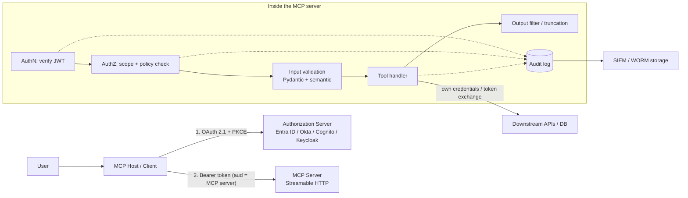

# Q2. How would you design an MCP server with authentication, authorization, input validation, and audit logging?

[← Back to questions](../questions.md)

## TL;DR

- **Authentication:** For remote servers, use **Streamable HTTP + OAuth 2.1**. The MCP server is an **OAuth resource server**. It publishes Protected Resource Metadata (RFC 9728), validates JWT access tokens (signature, `iss`, `aud`/resource, `exp`) and **never passes the token through** to downstream APIs.
- **Authorization:** Use scopes and roles per tool, apply **deny by default**, and check every call at the server, not in the prompt. Attach tenant and user context from the token and enforce resource-level checks (which repo, which customer). Use a policy engine (OPA/Cedar) for anything non-trivial.
- **Input validation:** Use strict typed schemas (Pydantic) with enums, ranges, regex and length limits, then add semantic validation on top: allowlists, path canonicalization, parameterized SQL. Treat all LLM-supplied arguments as **untrusted user input**.
- **Audit logging:** Write structured, append-only logs for every call: who (user, client), what (tool, redacted args), decision (allow or deny and why), outcome, latency and correlation ID. Ship them to tamper-evident storage (SIEM or WORM) and never log secrets or raw PII.
- Also include rate limits, timeouts, output size limits, tool annotations (`readOnlyHint`, `destructiveHint`) and human approval (elicitation) for destructive tools.

## Detailed Answer

### 1. Reference architecture



Defense in depth means each layer fails closed. If the token is invalid, the request is rejected with 401 before any tool code runs.

### 2. Authentication (MCP authorization spec)

Key points from the MCP authorization specification (2025 revisions):

| Concern | Requirement / best practice |
|---|---|
| Role | The MCP server is an **OAuth 2.1 resource server**. A separate authorization server (your IdP) issues the tokens. |
| Discovery | The server returns `401` with `WWW-Authenticate` pointing to `/.well-known/oauth-protected-resource` (RFC 9728), which lists its authorization servers. |
| Client flow | Authorization code with **PKCE**. Clients may register dynamically (RFC 7591) or use pre-registered or metadata-document client IDs. |
| Audience binding | Clients send a `resource` parameter (RFC 8707). The server **must reject tokens not issued for it**, using `aud` validation. |
| No token passthrough | The server must not forward the incoming token to upstream APIs. Use its own credentials or **token exchange** (RFC 8693, on-behalf-of) to get a downstream token. |
| Transport | HTTPS only. Validate the `Origin` header and bind local servers to `127.0.0.1` to prevent DNS rebinding. |
| stdio servers | No OAuth. Credentials come from the environment or a secrets manager, and the trust boundary is the local user. |

### 3. Server skeleton with the official Python SDK

```python
# secure_server.py
import re, time, uuid, json, logging
from typing import Literal
from pydantic import BaseModel, Field, field_validator
import jwt                                    # PyJWT
from jwt import PyJWKClient

from mcp.server.fastmcp import FastMCP, Context
from mcp.server.auth.provider import AccessToken, TokenVerifier
from mcp.server.auth.settings import AuthSettings
from mcp.server.auth.middleware.auth_context import get_access_token
from mcp.types import ToolAnnotations

ISSUER = "https://login.example.com/"
AUDIENCE = "https://mcp.example.com/mcp"      # this server's canonical URI
jwks = PyJWKClient(f"{ISSUER}.well-known/jwks.json")

# ---------- AuthN ----------
class JWTVerifier(TokenVerifier):
    async def verify_token(self, token: str) -> AccessToken | None:
        try:
            key = jwks.get_signing_key_from_jwt(token).key
            claims = jwt.decode(
                token, key, algorithms=["RS256"],
                audience=AUDIENCE, issuer=ISSUER,
                options={"require": ["exp", "iat", "sub", "aud"]},
            )
        except jwt.PyJWTError:
            return None                        # SDK responds 401
        return AccessToken(
            token=token,
            client_id=claims.get("azp", claims.get("client_id", "unknown")),
            scopes=claims.get("scope", "").split(),
            expires_at=claims["exp"],
        )

mcp = FastMCP(
    "orders-mcp",
    token_verifier=JWTVerifier(),
    auth=AuthSettings(
        issuer_url=ISSUER,
        resource_server_url=AUDIENCE,
        required_scopes=["mcp:access"],
    ),
)

# ---------- Audit ----------
audit = logging.getLogger("audit")
audit.setLevel(logging.INFO)
audit.addHandler(logging.FileHandler("audit.jsonl"))   # in prod: stdout -> SIEM

SENSITIVE_KEYS = {"password", "token", "ssn", "card_number"}

def redact(args: dict) -> dict:
    return {k: ("***" if k in SENSITIVE_KEYS else v) for k, v in args.items()}

def audit_event(**fields):
    fields.setdefault("ts", time.time())
    audit.info(json.dumps(fields, default=str))

# ---------- AuthZ ----------
TOOL_SCOPES = {
    "get_order": {"orders:read"},
    "refund_order": {"orders:write"},
}

class Forbidden(Exception):
    pass

def authorize(tool: str) -> AccessToken:
    tok = get_access_token()
    if tok is None:
        raise Forbidden("unauthenticated")
    needed = TOOL_SCOPES.get(tool)
    if needed is None:                         # deny by default
        raise Forbidden(f"no policy for tool {tool}")
    if not needed.issubset(set(tok.scopes)):
        raise Forbidden(f"missing scopes {needed - set(tok.scopes)}")
    return tok

# ---------- Validation models ----------
class RefundInput(BaseModel):
    order_id: str = Field(pattern=r"^ORD-\d{8}$")
    amount: float = Field(gt=0, le=500)        # hard business ceiling
    reason: Literal["damaged", "late", "not_received", "other"]
    note: str = Field(default="", max_length=500)

    @field_validator("note")
    @classmethod
    def no_control_chars(cls, v: str) -> str:
        if any(ord(c) < 32 and c not in "\n\t" for c in v):
            raise ValueError("control characters not allowed")
        return v

# ---------- Tools ----------
@mcp.tool(annotations=ToolAnnotations(readOnlyHint=True))
async def get_order(order_id: str) -> dict:
    """Fetch an order by ID (format ORD-12345678). Read-only."""
    req_id = str(uuid.uuid4())
    try:
        tok = authorize("get_order")
        if not re.fullmatch(r"ORD-\d{8}", order_id):
            raise ValueError("order_id must look like ORD-12345678")
        order = await db_get_order(order_id, tenant=tenant_of(tok))  # row-level filter
        audit_event(req_id=req_id, tool="get_order", client=tok.client_id,
                    args={"order_id": order_id}, decision="allow", outcome="ok")
        return order
    except Forbidden as e:
        audit_event(req_id=req_id, tool="get_order", decision="deny", reason=str(e))
        raise
    except ValueError as e:
        audit_event(req_id=req_id, tool="get_order", decision="allow",
                    outcome="invalid_input", error=str(e))
        raise

@mcp.tool(annotations=ToolAnnotations(destructiveHint=True, idempotentHint=False))
async def refund_order(order_id: str, amount: float, reason: str,
                       note: str = "", ctx: Context = None) -> str:
    """Refund an order. Max 500. Requires orders:write and user confirmation."""
    req_id = str(uuid.uuid4())
    tok = authorize("refund_order")
    data = RefundInput(order_id=order_id, amount=amount, reason=reason, note=note)

    # Human confirmation for a destructive action (MCP elicitation)
    class Confirm(BaseModel):
        confirm: bool

    answer = await ctx.elicit(
        message=f"Refund {data.amount} on {data.order_id} ({data.reason})?",
        schema=Confirm,
    )
    if answer.action != "accept" or not answer.data.confirm:
        audit_event(req_id=req_id, tool="refund_order", decision="user_declined")
        return "Refund cancelled by user."

    result = await payments_refund(data, idempotency_key=req_id)
    audit_event(req_id=req_id, tool="refund_order", client=tok.client_id,
                args=redact(data.model_dump()), decision="allow",
                outcome="ok", refund_id=result["id"])
    return f"Refund {result['id']} created."

if __name__ == "__main__":
    mcp.run(transport="streamable-http")
```

`db_get_order`, `payments_refund` and `tenant_of` are your own functions. In production, pull the authorization and audit code into a decorator or middleware so tool handlers stay small and no tool can skip the checks.

### 4. Authorization model

| Layer | What it answers | Example |
|---|---|---|
| Coarse (scopes) | Can this client or user call this tool at all? | `orders:write` is required for `refund_order` |
| Fine (policy / ABAC) | Can this user act on **this resource** with **these arguments**? | Only refunds for orders in the user's tenant, under their approval limit |
| Data (row-level) | What data does the query return? | `WHERE tenant_id = :tenant` enforced in the DB (RLS) |
| Human-in-loop | Does a person need to confirm? | Elicitation for destructive or high-value actions |

Cedar-style policy example:

```
permit (principal in Role::"support_agent", action == Action::"refund_order", resource)
when { resource.tenant == principal.tenant && context.amount <= 500 };
```

### 5. Input validation checklist

- Schema: types, `enum`/`Literal`, min and max, regex and `max_length`. FastMCP publishes these in `inputSchema` so the LLM sees the constraints.
- Semantic checks: IDs exist and belong to the caller, dates fall in valid ranges, amounts sit under limits.
- Injection: parameterized SQL only. Avoid `shell=True`. Canonicalize paths and check them against roots or an allowlist. Allowlist URLs to block SSRF.
- Size: cap input length, list sizes and output size (truncate and paginate).
- Errors: return **actionable** messages to the model (what was wrong and the expected format) without stack traces or internal details.

### 6. Audit log design

Example record:

```json
{"ts":"2026-11-24T10:15:03Z","req_id":"8f1c...","session_id":"mcp-sess-42",
 "user":"alice@corp.com","client_id":"claude-desktop","tool":"refund_order",
 "args":{"order_id":"ORD-00012345","amount":120.0,"reason":"damaged","note":"***"},
 "decision":"allow","policy":"refund-limit-v3","approval":"user_confirmed",
 "outcome":"ok","latency_ms":412,"trace_id":"4bf92f3577b34da6"}
```

| Do | Don't |
|---|---|
| Log both allow and deny decisions, with the reason | Log access tokens, secrets or full prompts containing PII |
| Use structured JSON with correlation and trace IDs (OpenTelemetry) | Write to a local file only, where it can be deleted |
| Ship to append-only or WORM storage (S3 Object Lock, SIEM) | Let the tool handler decide whether to log |
| Alert on deny spikes, unusual tools or volume anomalies | Keep logs forever without a retention policy |

### 7. Other hardening

- Per-user and per-client **rate limits** and quotas, plus timeouts on every downstream call.
- **Short-lived tokens** and rotation. Revocation works through short expiry or introspection.
- Run the server with least-privilege IAM, a non-root container and egress restrictions.
- Pin and sign server releases. Review tool descriptions as code, since they are prompt surface.

## Common Pitfalls

- **Accepting any valid JWT from the IdP.** If you skip `aud` validation, tokens meant for other services work against your server (the confused deputy problem).
- **Token passthrough.** Forwarding the user's token to GitHub or your database breaks audience boundaries and auditability.
- **Authorizing in the prompt.** Instructions like "only refund if the user is a manager" are not access control.
- **Validating only the schema.** A well-formed `order_id` can still belong to a different tenant.
- **Logging raw arguments**, which may include PII or secrets, or leaving audit out of the deny path.
- **Using the session ID as authentication.** The `Mcp-Session-Id` header is not a credential.

## Likely Follow-up Questions

1. **How does an MCP client discover where to get a token?**
   From the 401 `WWW-Authenticate` header, which points to Protected Resource Metadata. That metadata lists the authorization servers, and the client then reads the authorization server's metadata (RFC 8414).
2. **The tool needs to call GitHub as the user. What do you do?**
   Use OAuth token exchange or on-behalf-of to obtain a GitHub-scoped token, or store per-user GitHub tokens that the server obtained through its own OAuth flow. Never reuse the MCP access token.
3. **How do you authenticate a stdio server?**
   It inherits the local user's trust. Pass credentials through environment variables or a secrets manager, and scope them minimally.
4. **How would you test the authorization?**
   With unit tests for policy (allow and deny matrices), integration tests using tokens with missing scopes or the wrong audience, and prompt-injection red-team tests.
5. **Where do you enforce rate limits?**
   At an API gateway in front of the server (per client or IP) and in the server itself (per user and per tool), especially for expensive or destructive tools.

[← Back to questions](../questions.md)
