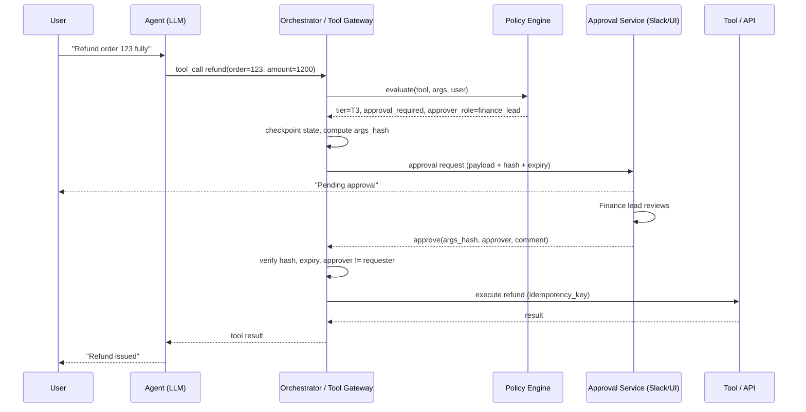

# Q4. How would you ensure that an agent requires approval before executing a sensitive action?

[← Back to questions](../questions.md)

## TL;DR

- **Classify actions into risk tiers** (read, reversible write, irreversible or high-impact) and attach the tier to each tool as metadata. Do not leave it to the model to decide what is sensitive.
- **Enforce approval outside the LLM.** The orchestrator or tool gateway intercepts the call **before execution** and pauses. A prompt instruction like "ask before deleting" is not a control.
- Use a durable **interrupt and resume** flow. LangGraph `interrupt()` with a checkpointer, Step Functions task tokens, or MCP **elicitation** persist state, notify the approver, then resume with approve, edit or reject.
- The **approval payload** shows exactly what will run: tool, final arguments, target resource, impact or diff, the agent's reason, and a risk score. Bind the approval to a hash of those arguments so nothing changes after approval.
- Add **timeouts** (default to reject), separation of duties (the requester cannot approve their own high-risk action), an **audit trail** and idempotency keys on execution.

## Detailed Answer

### 1. Why the LLM cannot be the gatekeeper

Prompt injection, hallucination or a simple misunderstanding can make a model skip "please confirm" instructions. Approval must be a **deterministic control** in code that the model cannot bypass. The model can *suggest* that approval is needed, but the system decides.

### 2. Risk tiers

| Tier | Examples | Control |
|---|---|---|
| T0: read-only | search, get_order, list_files | Auto-execute, logged |
| T1: low-impact, reversible write | draft email, create a ticket, add a label | Auto, or a soft confirm in the UI |
| T2: sensitive | send an external email, refund ≤ $500, modify a config | **Explicit user approval** |
| T3: high-risk / irreversible | delete data, payments > $500, prod deploy, IAM changes | **Approval by a privileged second person** (four-eyes), MFA, change window |
| Forbidden | drop database, disable audit | Not exposed as a tool at all |

The tier can also depend on the arguments: a $20 refund is T1 and a $5,000 refund is T3. Put this logic in a policy function or engine (OPA/Cedar) rather than hardcoding it.

### 3. Flow



### 4. Approval payload

```json
{
  "approval_id": "apr_7Hk2",
  "requested_by": "alice@corp.com",
  "agent_session": "thr_9921",
  "tool": "refund_order",
  "arguments": {"order_id": "ORD-00000123", "amount": 1200.00, "currency": "USD"},
  "args_hash": "sha256:4f1a...",
  "risk_tier": "T3",
  "impact": "Refunds the full order amount to card ending 4242. Irreversible.",
  "agent_rationale": "Customer reported item never arrived; tracking shows lost.",
  "evidence": ["ticket#5531", "tracking:1Z999"],
  "required_approver_role": "finance_lead",
  "expires_at": "2026-11-24T12:00:00Z",
  "options": ["approve", "edit", "reject"]
}
```

Good payloads are **human-readable**: show the impact in plain words and include a diff for config or code changes. They are also **unambiguous**, meaning the final resolved arguments, not "the refund we discussed".

### 5. LangGraph implementation (interrupt + checkpointer)

```python
import hashlib, json
from typing import TypedDict, Annotated
from langgraph.graph import StateGraph, START, END
from langgraph.graph.message import add_messages
from langgraph.checkpoint.memory import MemorySaver   # use Postgres/Redis saver in prod
from langgraph.types import interrupt, Command
from langchain_core.messages import ToolMessage

SENSITIVE = {"refund_order": "T3", "send_email": "T2"}

class State(TypedDict):
    messages: Annotated[list, add_messages]

def args_hash(name, args):
    return hashlib.sha256(json.dumps([name, args], sort_keys=True).encode()).hexdigest()

def call_model(state: State):
    return {"messages": [llm_with_tools.invoke(state["messages"])]}

def tools_node(state: State):
    last = state["messages"][-1]
    out = []
    for call in last.tool_calls:
        name, args = call["name"], call["args"]
        tier = SENSITIVE.get(name)
        if tier:
            h = args_hash(name, args)
            # Pauses the graph; state is checkpointed. Value returned on resume.
            decision = interrupt({
                "tool": name, "arguments": args, "risk_tier": tier,
                "args_hash": h, "question": f"Approve {name}?",
            })
            if decision.get("action") == "reject":
                out.append(ToolMessage(
                    content=f"Action rejected by approver: {decision.get('comment', '')}. "
                            "Do not retry; inform the user.",
                    tool_call_id=call["id"]))
                continue
            if decision.get("action") == "edit":
                args = decision["arguments"]           # approver-edited args
            elif decision.get("args_hash") != h:
                raise RuntimeError("Approval does not match requested arguments")
            audit("approved", name, args, decision.get("approver"))
        result = TOOLS[name].invoke(args)
        out.append(ToolMessage(content=str(result), tool_call_id=call["id"]))
    return {"messages": out}

def route(state: State):
    return "tools" if state["messages"][-1].tool_calls else END

g = StateGraph(State)
g.add_node("agent", call_model)
g.add_node("tools", tools_node)
g.add_edge(START, "agent")
g.add_conditional_edges("agent", route, ["tools", END])
g.add_edge("tools", "agent")
graph = g.compile(checkpointer=MemorySaver())

cfg = {"configurable": {"thread_id": "thr_9921"}}
res = graph.invoke({"messages": [("user", "Refund order ORD-00000123 fully")]}, cfg)

# The run pauses; the interrupt payload is surfaced to the caller
pending = res["__interrupt__"][0].value          # send to Slack/UI
# ... later, possibly in another process, after the human decides:
graph.invoke(Command(resume={"action": "approve", "args_hash": pending["args_hash"],
                             "approver": "bob@corp.com"}), cfg)
```

Notes:
- `interrupt()` needs a **checkpointer**, and the run is resumed with the same `thread_id`. On resume the node **re-runs from its start**, so keep side effects after the interrupt and make them idempotent.
- An alternative is `graph.compile(interrupt_before=["tools"])` to pause before *every* tool node. That is simpler but coarser.
- Prebuilt human-in-the-loop middleware in newer LangChain and LangGraph versions offers per-tool approve, edit and reject configuration.

### 6. MCP: elicitation for in-protocol confirmation

When the sensitive action lives in an MCP server, the server can ask the user directly through the client:

```python
from pydantic import BaseModel
from mcp.server.fastmcp import FastMCP, Context

mcp = FastMCP("ops")

class Approve(BaseModel):
    approve: bool
    reason: str = ""

@mcp.tool()
async def delete_bucket(name: str, ctx: Context) -> str:
    """Delete an S3 bucket (irreversible). Requires user confirmation."""
    r = await ctx.elicit(message=f"Permanently delete bucket '{name}'?", schema=Approve)
    if r.action == "accept" and r.data.approve:
        do_delete(name)
        return f"Deleted {name}"
    return "Deletion not approved; no changes made."
```

Elicitation confirms with **the current user**. For four-eyes approval by a different person, use an external approval service. Hosts also add their own layer, such as Claude Desktop or IDE "allow this tool?" prompts. Tool annotations like `destructiveHint=True` help the host decide, but they are hints and not enforcement.

### 7. Operational concerns

| Concern | Approach |
|---|---|
| Timeouts | Expiry on each request. On timeout, auto-reject and tell the agent "approval expired". Never auto-approve. |
| Durability | Persistent checkpointer (Postgres, DynamoDB) so approvals survive restarts and can take hours. |
| Notification | Slack or Teams interactive message, email or an in-app queue, with a deep link to full context. |
| Separation of duties | The approver must not be the requester for T3, enforced by role checks in the approval service. |
| Integrity | Bind to `args_hash` and sign the approval token (JWT with short expiry). Reject replays. |
| Idempotency | Use the approval ID as the idempotency key, so a double resume does not double-refund. |
| Audit | Record request, approver, decision, comment, timestamps and the final execution result. |
| Approval fatigue | Keep T2 and T3 rare, batch similar approvals, auto-approve low-risk actions under limits. |

## Common Pitfalls

- Putting "always ask for confirmation" in the system prompt and calling it done.
- Approving a *description* ("refund the customer") while the executed arguments differ (amount changed after approval).
- Running side effects *before* `interrupt()` in a LangGraph node, so they run again on resume.
- Using an in-memory checkpointer in production, where a restart loses pending approvals.
- No timeout, so requests pile up or a stale approval gets used days later.
- Having the agent's own LLM evaluate whether to approve, which is not a human in the loop.

## Likely Follow-up Questions

1. **How do you decide what is "sensitive"?**
   Consider reversibility, blast radius, financial or legal impact, external visibility and data sensitivity. Encode the answers in a policy table or engine that depends on the arguments, and review it with security and the business.
2. **What does the agent see after a rejection?**
   A clear tool result ("rejected by approver: reason. Do not retry"), so it informs the user instead of looping or trying a workaround tool.
3. **Can the approver edit the action?**
   Yes, through approve, edit or reject. The edited arguments are re-validated and re-hashed, and the audit records both versions.
4. **How do you handle approvals in a fully autonomous batch job?**
   Queue the pending actions, continue other work, and process them when approved. Alternatively, pre-approve policies within limits, for example auto-approve refunds under $50.
5. **How do you test this?**
   With unit tests that every T2 or T3 tool call triggers an interrupt, that tampered resumes are rejected and that expiry works, plus red-team prompts that try to get the agent to bypass approval.

[← Back to questions](../questions.md)
