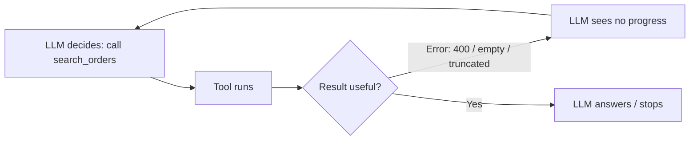

# Q5. An agent repeatedly calls the same tool. What could cause this infinite loop, and how would you prevent it?

[← Back to questions](../questions.md)

## TL;DR

- **Common causes:** unhelpful or generic tool errors ("Error"), the tool result never reaching the model's context, tools that return empty or ambiguous results, unclear **stop criteria**, context truncation that drops earlier results, overlapping tools, a model that is too weak, or a bug in the graph routing (always edging back to the agent).
- **Hard limits:** `recursion_limit` in LangGraph (default 25, raises `GraphRecursionError`), `max_iterations` in agent executors, per-tool call budgets, plus token, cost and wall-clock limits.
- **Detection:** fingerprint each `(tool, normalized_args)` pair. If it repeats N times, block the call and inject a corrective message. Also detect no-progress states, where the same result appears again.
- **Root-cause fixes:** return **actionable errors** that say what failed and what to do next, return explicit "no results" messages, give a clear termination condition and a "finish" or answer tool, track progress flags in state, and keep tool results in context (summarize old ones rather than dropping them).
- **Observe:** trace with LangSmith or OpenTelemetry, and alert on high step counts per run.

## Detailed Answer

### 1. Anatomy of a loop



The model is stateless between calls. It only knows what is in its context. If the context does not clearly show "you already tried this, and here is why it failed", the most likely next action is the same one again.

### 2. Root causes

| Cause | What it looks like | Why the model loops |
|---|---|---|
| **Unhelpful tool errors** | `"Error"`, a stack trace, an HTTP 500 | No information to correct the arguments, so it retries the same call |
| **Result missing from context** | Bug: the ToolMessage is not appended, or the `tool_call_id` does not match | The model never "sees" that it already called the tool |
| **Empty or ambiguous results** | `[]`, `null`, `""` | It assumes a glitch and retries, possibly with trivially different arguments |
| **No clear stop criteria** | "Find all relevant info" | It never knows when it is done and keeps searching |
| **Context truncation** | A sliding window drops old messages | Earlier results disappear, so it re-fetches them |
| **Overlapping or confusing tools** | `search`, `search_v2`, `find` | It oscillates between them or repeats one |
| **Pagination not handled** | The tool returns page 1 with no cursor info | It keeps calling for "more" and gets the same page |
| **Routing bug** | A conditional edge always returns `"tools"` | The graph itself never terminates |
| **Async or long-running tool** | Returns "processing..." | It polls endlessly with no backoff or limit |
| **Weak model / low temperature determinism** | Repeats the same reasoning | It lacks the reasoning to change strategy |

### 3. Prevention layers

```
┌───────────────────────────────────────────────────────────┐
│ 1. Hard caps: recursion_limit, max steps, tokens, $ , time │  ← always on
├───────────────────────────────────────────────────────────┤
│ 2. Loop detection: duplicate (tool,args) fingerprint       │  ← guard node / middleware
├───────────────────────────────────────────────────────────┤
│ 3. Good tool contracts: actionable errors, explicit empty, │  ← fixes root cause
│    pagination cursors, idempotency                         │
├───────────────────────────────────────────────────────────┤
│ 4. Prompt + state: stop criteria, progress flags, plan     │
├───────────────────────────────────────────────────────────┤
│ 5. Observability: traces, step-count alerts, eval tests    │
└───────────────────────────────────────────────────────────┘
```

### 4. Hard limits in LangGraph

```python
from langgraph.prebuilt import create_react_agent
from langgraph.errors import GraphRecursionError

agent = create_react_agent(model, tools=[search_orders, get_order])

try:
    result = agent.invoke(
        {"messages": [("user", "Where is my order for the blue lamp?")]},
        config={"recursion_limit": 12},      # max super-steps; default is 25
    )
except GraphRecursionError:
    result = {"messages": [("assistant",
        "I couldn't complete this automatically. Escalating to a human agent.")]}
```

In classic LangChain `AgentExecutor`, the equivalents are `max_iterations=10` and `early_stopping_method="generate"`. In the OpenAI Agents SDK the equivalent is `max_turns`. Always catch the limit and **degrade gracefully**: return a partial answer, escalate, or ask the user.

### 5. Duplicate-call detection (custom tool node)

```python
import json, hashlib
from collections import Counter
from typing import TypedDict, Annotated
from langgraph.graph import StateGraph, START, END
from langgraph.graph.message import add_messages
from langchain_core.messages import ToolMessage

MAX_SAME_CALL = 2
MAX_TOOL_CALLS = 15

class State(TypedDict):
    messages: Annotated[list, add_messages]
    call_counts: dict          # fingerprint -> count
    total_calls: int

def fingerprint(name: str, args: dict) -> str:
    norm = json.dumps(args, sort_keys=True, default=str).lower().strip()
    return hashlib.md5(f"{name}:{norm}".encode()).hexdigest()

def guarded_tools(state: State):
    counts = Counter(state.get("call_counts") or {})
    total = state.get("total_calls", 0)
    out = []
    for call in state["messages"][-1].tool_calls:
        fp = fingerprint(call["name"], call["args"])
        counts[fp] += 1
        total += 1
        if counts[fp] > MAX_SAME_CALL:
            out.append(ToolMessage(
                tool_call_id=call["id"],
                content=(f"BLOCKED: you already called {call['name']} with these exact "
                         f"arguments {counts[fp]-1} times and got the same result. "
                         "Do not call it again. Either try different arguments, use a "
                         "different tool, or answer the user with what you have."),
            ))
            continue
        try:
            res = TOOLS[call["name"]].invoke(call["args"])
            content = res if res not in (None, "", [], {}) else \
                "NO_RESULTS: the query matched nothing. Broaden the query or tell the user."
        except Exception as e:
            content = f"ERROR ({type(e).__name__}): {e}. Fix the arguments; do not retry unchanged."
        out.append(ToolMessage(tool_call_id=call["id"], content=str(content)))
    return {"messages": out, "call_counts": dict(counts), "total_calls": total}

def route(state: State):
    last = state["messages"][-1]
    if not getattr(last, "tool_calls", None):
        return END
    if state.get("total_calls", 0) >= MAX_TOOL_CALLS:
        return "finalize"                      # force an answer
    return "tools"

def finalize(state: State):
    msg = model.invoke(state["messages"] + [
        ("system", "Tool budget exhausted. Give the best possible answer now "
                   "using only the information above, and state what is missing.")])
    return {"messages": [msg]}

g = StateGraph(State)
g.add_node("agent", lambda s: {"messages": [model_with_tools.invoke(s["messages"])]})
g.add_node("tools", guarded_tools)
g.add_node("finalize", finalize)
g.add_edge(START, "agent")
g.add_conditional_edges("agent", route, ["tools", "finalize", END])
g.add_edge("tools", "agent")
g.add_edge("finalize", END)
app = g.compile()
```

This covers three things. It **blocks** exact repeats with an explanation, so the model changes strategy. It turns empty results and exceptions into **explicit, actionable** messages. And it gives a **graceful exit** when the budget runs out.

### 6. Fix the tool contract (usually the real fix)

Bad:
```json
{"error": "Bad Request"}
```
Good:
```json
{"error": "INVALID_DATE_FORMAT",
 "message": "start_date '24/11/2026' is not ISO-8601.",
 "hint": "Use YYYY-MM-DD, e.g. 2026-11-24.",
 "retryable": true}
```
For empty results:
```json
{"results": [], "total": 0,
 "message": "No orders found for customer C123 in the last 30 days. Try days=365 or check the customer ID."}
```
For pagination:
```json
{"results": [...20 items...], "next_cursor": "eyJvIjoyMH0=", "has_more": true}
```
For long-running jobs, return a `job_id` with "check back with get_job_status, at most 5 times", or make the tool block until done with a timeout.

### 7. Prompt and state

- State the **stop criteria** explicitly: "Once you have the order status, answer immediately. Do not search more than twice."
- Add an explicit **final answer path**, such as a `final_answer` tool or structured response format, so stopping is a clear action.
- Keep **progress flags** in state (`order_found=True`) and let the router end once the goal is met.
- For long conversations, **summarize** old tool results instead of truncating them away.

### 8. Observability

- Trace every step (LangSmith, Langfuse, Arize, OTel). Dashboards should show steps per run, the repeat-call rate and runs that hit the limit.
- Add regression **evals** that assert the max step count for known tasks.
- Alert when the p95 step count jumps after a prompt or model change.

## Common Pitfalls

- Setting `recursion_limit=1000` "to make the error go away". You only burn more money before failing.
- Catching exceptions in tools and returning `""`, so the model sees nothing and retries.
- Exact-match fingerprints with no normalization, so `"Pune"` and `"pune "` look different.
- Blocking repeats without telling the model why, which leads it to switch to a semantically identical tool.
- Treating every repeat as a bug. Polling a job status a few times is legitimate, so budget it per tool.
- Forgetting a `finalize` path, so hitting a limit means the user sees a stack trace.

## Likely Follow-up Questions

1. **What does `recursion_limit` count?**
   LangGraph super-steps, meaning node executions. In a ReAct loop each agent-plus-tools cycle uses about 2. The default is 25, and exceeding it raises `GraphRecursionError`.
2. **How do you detect near-duplicate calls?**
   Normalize the arguments (case, whitespace, key order). For free-text queries, compare embedding similarity above a threshold, or check whether the *result* hash repeats with no new information.
3. **Should the agent retry on transient errors?**
   Yes, but retry inside the tool with exponential backoff and a cap, and mark the error `retryable`. Do not let the LLM drive retries.
4. **How would you debug a loop in production?**
   Pull the trace and check whether each ToolMessage was appended with the right ID, what the tool actually returned, and whether context was truncated. Then reproduce it in an eval.
5. **Does a better model fix it?**
   Often partially, but the robust fix is better tool contracts plus hard limits. Never rely on model quality alone.

[← Back to questions](../questions.md)
