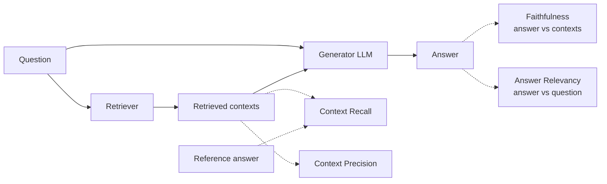

# Q7. Have you worked with evaluation frameworks such as Ragas or DeepEval?

[← Back to questions](../questions.md)

## TL;DR

- **Yes, I've used both.** I used Ragas mainly for **offline RAG evaluation** (retrieval and generation quality on a golden dataset) and DeepEval for **pytest-style regression tests in CI**, with custom criteria through G-Eval.
- **Ragas core metrics:** `faithfulness` (are claims supported by the retrieved context), `answer_relevancy` / `ResponseRelevancy` (does the answer address the question), `context_precision` (are the relevant chunks ranked high) and `context_recall` (did retrieval get everything the reference needs).
- **DeepEval:** `LLMTestCase` + metrics (`AnswerRelevancyMetric`, `FaithfulnessMetric`, `HallucinationMetric`, `ContextualPrecisionMetric`/`ContextualRecallMetric`, `GEval` for custom rubrics) + `assert_test` and `deepeval test run` in CI.
- Both use **LLM-as-a-judge**, so I calibrate the judge against human labels, pin the judge model, and track **trends against thresholds** rather than absolute numbers.
- Workflow: build a golden set, evaluate a baseline, change one component (chunking, retriever, prompt, model), compare, gate merges on thresholds, and sample production traces back into the dataset.

## Detailed Answer

### 1. Experience-style narrative (how I'd say it in an interview)

> "On a customer-support RAG assistant, we had no objective way to tell whether a change to chunking or the prompt helped or hurt. I built an evaluation dataset of about 300 questions. We started from real tickets, SMEs wrote reference answers, and we augmented it with synthetic questions from Ragas' test-set generator, which we then reviewed by hand. We ran Ragas faithfulness, answer relevancy, context precision and context recall on every candidate configuration. That surfaced that our recall was fine but context precision was low, so the relevant chunk was often ranked 6th or later. Adding a cross-encoder reranker raised context precision from about 0.62 to 0.81 and faithfulness from about 0.78 to 0.88.
>
> We then moved the critical subset (around 60 cases) into DeepEval as pytest tests in GitHub Actions. PRs that touched prompts or retrieval had to pass thresholds on faithfulness, answer relevancy and a custom G-Eval 'policy compliance' metric. We calibrated the judges by having two humans label 100 samples and checking agreement before trusting the scores."

Adapt the numbers to your own experience. The structure that matters is: problem, dataset, metrics, insight, change, measured improvement, then automation.

### 2. What gets evaluated in RAG



| Metric | Measures | Needs reference? | Low score means |
|---|---|---|---|
| Faithfulness | Fraction of answer claims supported by the contexts | No | Hallucination, or the model is using prior knowledge |
| Answer relevancy | How well the answer addresses the question | No | Off-topic or evasive answers |
| Context precision | Whether relevant chunks are ranked at the top | Usually (reference or LLM judgement) | Noisy retrieval. Add a reranker or better embeddings |
| Context recall | Whether the contexts cover what the reference answer needs | Yes | Missing documents, bad chunking, top-k too small |

### 3. How the metrics work (LLM-as-judge)

- **Faithfulness:** an LLM splits the answer into atomic claims, checks each claim against the contexts, and the score is supported claims divided by total claims.
- **Answer relevancy (Ragas):** an LLM generates N questions from the answer, the score is the mean cosine similarity of their embeddings with the original question, and noncommittal answers are penalized.
- **Context precision:** for each retrieved chunk, a judge decides whether it was relevant, then computes a precision@k-weighted average, so a relevant chunk at rank 1 counts more.
- **Context recall:** the reference answer is split into claims, and the score is the fraction of those claims attributable to the retrieved contexts.

### 4. Ragas code (v0.2+ API)

```python
# pip install ragas langchain-openai
from ragas import EvaluationDataset, evaluate
from ragas.metrics import (
    Faithfulness, ResponseRelevancy,
    LLMContextPrecisionWithReference, LLMContextRecall,
)
from ragas.llms import LangchainLLMWrapper
from ragas.embeddings import LangchainEmbeddingsWrapper
from langchain_openai import ChatOpenAI, OpenAIEmbeddings

samples = [
    {
        "user_input": "What is the refund window for electronics?",
        "retrieved_contexts": [
            "Electronics can be returned within 15 days of delivery.",
            "Clothing has a 30-day return window.",
        ],
        "response": "You can return electronics within 15 days of delivery.",
        "reference": "Electronics have a 15-day return window from delivery.",
    },
    # ... built by running your RAG pipeline over the golden questions
]
dataset = EvaluationDataset.from_list(samples)

judge = LangchainLLMWrapper(ChatOpenAI(model="gpt-4o", temperature=0))
emb = LangchainEmbeddingsWrapper(OpenAIEmbeddings(model="text-embedding-3-small"))

result = evaluate(
    dataset=dataset,
    metrics=[Faithfulness(), ResponseRelevancy(),
             LLMContextPrecisionWithReference(), LLMContextRecall()],
    llm=judge,
    embeddings=emb,
)
print(result)                      # aggregate scores
df = result.to_pandas()            # per-sample scores for error analysis
print(df.sort_values("faithfulness").head(10))
```

Older Ragas (0.1.x) used lowercase metric objects (`faithfulness`, `answer_relevancy`, `context_precision`, `context_recall`) and a HuggingFace `Dataset` with columns `question`, `answer`, `contexts`, `ground_truth`. You will still see that style in many tutorials. Ragas also has a **test-set generator** for synthetic QA pairs, plus agent and tool metrics (for example tool-call accuracy and topic adherence).

### 5. DeepEval code (pytest-style)

```python
# test_rag.py    run with:  deepeval test run test_rag.py
import pytest
from deepeval import assert_test
from deepeval.test_case import LLMTestCase, LLMTestCaseParams
from deepeval.metrics import (
    AnswerRelevancyMetric, FaithfulnessMetric, HallucinationMetric,
    ContextualPrecisionMetric, ContextualRecallMetric, GEval,
)
from my_app import rag_answer          # returns (answer, retrieved_chunks)

GOLDEN = [
    {"q": "What is the refund window for electronics?",
     "expected": "15 days from delivery."},
    {"q": "Can I return opened software?",
     "expected": "No, opened software is non-returnable."},
]

correctness = GEval(
    name="Correctness",
    criteria="Determine whether the actual output is factually consistent with the "
             "expected output. Penalize missing key facts and contradictions.",
    evaluation_params=[LLMTestCaseParams.INPUT, LLMTestCaseParams.ACTUAL_OUTPUT,
                       LLMTestCaseParams.EXPECTED_OUTPUT],
    threshold=0.7,
)

@pytest.mark.parametrize("case", GOLDEN)
def test_rag(case):
    answer, chunks = rag_answer(case["q"])
    tc = LLMTestCase(
        input=case["q"],
        actual_output=answer,
        expected_output=case["expected"],
        retrieval_context=chunks,      # used by faithfulness / contextual metrics
    )
    assert_test(tc, [
        AnswerRelevancyMetric(threshold=0.7),
        FaithfulnessMetric(threshold=0.8),
        ContextualPrecisionMetric(threshold=0.7),
        ContextualRecallMetric(threshold=0.7),
        correctness,
    ])

def test_no_hallucination():
    ctx = ["Our support hours are 9am-6pm IST, Monday to Friday."]
    answer, _ = rag_answer("What are your support hours?")
    tc = LLMTestCase(input="What are your support hours?",
                     actual_output=answer, context=ctx)   # HallucinationMetric uses `context`
    # For HallucinationMetric lower is better; threshold is the max allowed
    assert_test(tc, [HallucinationMetric(threshold=0.3)])
```

DeepEval also offers `evaluate(test_cases, metrics)` for notebook use, `EvaluationDataset`/`Golden` objects, conversational and agentic metrics (for example `ToolCorrectnessMetric` and `TaskCompletionMetric`), red-teaming, and an optional hosted dashboard (Confident AI).

### 6. Ragas vs DeepEval

| Aspect | Ragas | DeepEval |
|---|---|---|
| Primary style | Dataset-level evaluation (`evaluate()` → DataFrame) | Unit-test style (`assert_test`, pytest runner) |
| Sweet spot | RAG research, comparing retrievers and chunking, synthetic test-set generation | CI regression gates, custom rubric metrics, broad metric catalog |
| Custom metrics | Aspect critic, rubric-based metrics, custom metric classes | **G-Eval** (criteria → CoT judge), DAG metric, custom `BaseMetric` |
| RAG metrics | faithfulness, response relevancy, context precision and recall, noise sensitivity, etc. | Faithfulness, AnswerRelevancy, ContextualPrecision/Recall/Relevancy, Hallucination |
| Agent metrics | Tool-call accuracy, agent goal accuracy, topic adherence | Tool correctness, task completion, conversational metrics |
| Safety / red-team | Limited | Bias, toxicity, built-in red-teaming |
| Reporting | DataFrame, integrations (LangSmith, etc.) | CLI report, Confident AI platform |
| Judge model | Any via wrappers (OpenAI, Bedrock, etc.) | Any via `model=` or a custom `DeepEvalBaseLLM` |

In practice I use **both**: Ragas for experiments and dataset generation, DeepEval for gating.

### 7. CI integration

```yaml
# .github/workflows/llm-eval.yml
name: llm-eval
on:
  pull_request:
    paths: ["prompts/**", "rag/**", "retriever/**"]
jobs:
  eval:
    runs-on: ubuntu-latest
    steps:
      - uses: actions/checkout@v4
      - uses: actions/setup-python@v5
        with: { python-version: "3.11" }
      - run: pip install -r requirements.txt deepeval
      - run: deepeval test run tests/test_rag.py
        env:
          OPENAI_API_KEY: ${{ secrets.OPENAI_API_KEY }}
```

Practical tips:
- Use a **small, critical set** in PRs (fast and cheap) and the **full set nightly**.
- Pin the judge model and temperature 0, and expect ±0.03 noise. Gate on thresholds or on "no drop beyond Δ against the baseline".
- Cache pipeline outputs where possible, and run in parallel.
- Feed **production traces** (thumbs-down, escalations) back into the golden set.

### 8. Making LLM-judge scores trustworthy

1. **Calibrate** against human labels on 50-200 samples (agreement or Cohen's kappa).
2. Use a judge at least as strong as the generator, ideally from a different family to reduce self-preference bias.
3. Inspect the **reasons** (both frameworks expose them) when scores look odd.
4. Combine with deterministic checks: exact match for IDs or numbers, JSON schema validity, citation presence, latency and cost.

## Common Pitfalls

- Treating a single aggregate score as truth instead of looking at per-sample failures.
- Golden sets that are all synthetic or easy, so scores look great while users complain.
- Changing the judge model or metric version between runs and comparing numbers anyway.
- Confusing `context` (ground-truth context, used by HallucinationMetric) with `retrieval_context` (what your retriever returned) in DeepEval.
- Forgetting that HallucinationMetric is "lower is better".
- Running hundreds of judge calls on every commit, which gets slow and expensive. Tier your suites.
- Measuring generation without measuring retrieval, so you can't tell where the problem is.

## Likely Follow-up Questions

1. **Faithfulness vs answer correctness?**
   Faithfulness checks consistency with the *retrieved context*, with no reference needed. Correctness checks against the *reference answer*. An answer can be faithful to wrong context and still be incorrect.
2. **How do you evaluate without ground truth?**
   With reference-free metrics (faithfulness, answer relevancy, LLM-judged context relevance), plus user feedback and pairwise comparisons.
3. **What is G-Eval?**
   An LLM-judge method in which you give criteria, the judge generates evaluation steps (chain of thought) and then scores. DeepEval's `GEval` implements it for custom rubrics like tone or policy compliance.
4. **How do you evaluate agents rather than RAG?**
   Through tool-call correctness, task completion, step count and cost, trajectory evaluation, and final-answer correctness, using Ragas agent metrics or DeepEval's ToolCorrectness and TaskCompletion.
5. **What other tools have you used or considered?**
   LangSmith evaluators, TruLens (RAG triad), Arize Phoenix, promptfoo, OpenAI Evals and MLflow LLM evaluate. Choose based on stack and observability needs.

[← Back to questions](../questions.md)
