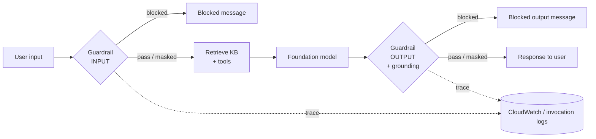

# Q8. What guardrails have you implemented for applications built with Amazon Bedrock?

[← Back to questions](../questions.md)

## TL;DR

- I used **Amazon Bedrock Guardrails** as a managed policy layer on both **input and output**, with these policies:
  - **Content filters**: hate, insults, sexual, violence, misconduct, and **prompt attack** (jailbreak or injection) with configurable strength.
  - **Denied topics**: for example investment advice or competitor discussion.
  - **Word filters**: custom words plus the managed profanity list.
  - **Sensitive information filters**: PII entities and custom regex, set to **BLOCK or ANONYMIZE (mask)**.
  - **Contextual grounding checks**: grounding and relevance thresholds for RAG hallucinations.
  - **Automated Reasoning checks**: formal, logic-based validation against policy rules.
- Integration: attach the guardrail through `guardrailConfig` in `converse` / `invoke_model`, with Knowledge Bases or Agents, or call the model-independent **`ApplyGuardrail`** API, which also works for non-Bedrock or self-hosted models and for tool outputs.
- Governance: version guardrails (immutable versions), enforce them with the IAM condition key `bedrock:GuardrailIdentifier`, log traces to CloudWatch, and tune thresholds with evals to balance false positives.
- Combined with app-level controls: input validation, least-privilege IAM, output schema validation, human approval and monitoring.

## Detailed Answer

### 1. Where guardrails sit



### 2. Policies and what I used them for

| Policy | What it does | Example config in a banking assistant |
|---|---|---|
| **Content filters** | Classify text into HATE, INSULTS, SEXUAL, VIOLENCE, MISCONDUCT and PROMPT_ATTACK with strength NONE/LOW/MEDIUM/HIGH, per input and output. Can also apply to images. | HIGH for all categories. PROMPT_ATTACK HIGH on input. |
| **Denied topics** | Natural-language topic definitions plus examples. Blocks prompts or responses on those topics. | "Investment advice", "Legal advice", "Competitor products" |
| **Word filters** | Exact words or phrases plus the managed PROFANITY list | Internal project codenames, profanity |
| **Sensitive info filters** | Built-in PII entities (EMAIL, PHONE, NAME, US_SOCIAL_SECURITY_NUMBER, CREDIT_DEBIT_CARD_NUMBER, AWS keys, etc.) and custom regex, with action BLOCK or ANONYMIZE | Card numbers BLOCK on input. Emails and phones ANONYMIZE on output. Regex for internal account IDs. |
| **Contextual grounding** | Scores a response's **grounding** (is it supported by the source) and **relevance** (does it answer the query) against thresholds | Grounding 0.75, relevance 0.7 for RAG answers |
| **Automated Reasoning checks** | Validates responses against a formal policy model built from your documents. Returns valid, invalid or satisfiable findings with explanations. | HR leave-policy eligibility answers |

### 3. Creating a guardrail (boto3 control plane)

```python
import boto3

bedrock = boto3.client("bedrock", region_name="us-east-1")

resp = bedrock.create_guardrail(
    name="banking-assistant-guardrail",
    description="Input/output safety for retail banking assistant",
    contentPolicyConfig={"filtersConfig": [
        {"type": "HATE",       "inputStrength": "HIGH", "outputStrength": "HIGH"},
        {"type": "INSULTS",    "inputStrength": "HIGH", "outputStrength": "HIGH"},
        {"type": "SEXUAL",     "inputStrength": "HIGH", "outputStrength": "HIGH"},
        {"type": "VIOLENCE",   "inputStrength": "HIGH", "outputStrength": "HIGH"},
        {"type": "MISCONDUCT", "inputStrength": "HIGH", "outputStrength": "HIGH"},
        # prompt attack applies to input only -> output strength NONE
        {"type": "PROMPT_ATTACK", "inputStrength": "HIGH", "outputStrength": "NONE"},
    ]},
    topicPolicyConfig={"topicsConfig": [{
        "name": "InvestmentAdvice",
        "definition": "Recommendations about buying, selling or holding specific "
                      "stocks, funds, crypto or other investment products.",
        "examples": ["Should I buy Tesla shares?", "Which mutual fund is best?"],
        "type": "DENY",
    }]},
    wordPolicyConfig={
        "wordsConfig": [{"text": "Project Falcon"}],
        "managedWordListsConfig": [{"type": "PROFANITY"}],
    },
    sensitiveInformationPolicyConfig={
        "piiEntitiesConfig": [
            {"type": "CREDIT_DEBIT_CARD_NUMBER", "action": "BLOCK"},
            {"type": "US_SOCIAL_SECURITY_NUMBER", "action": "BLOCK"},
            {"type": "EMAIL", "action": "ANONYMIZE"},
            {"type": "PHONE", "action": "ANONYMIZE"},
        ],
        "regexesConfig": [{
            "name": "InternalAccountId",
            "description": "Internal account numbers",
            "pattern": r"ACC-\d{10}",
            "action": "ANONYMIZE",
        }],
    },
    contextualGroundingPolicyConfig={"filtersConfig": [
        {"type": "GROUNDING", "threshold": 0.75},
        {"type": "RELEVANCE", "threshold": 0.70},
    ]},
    blockedInputMessaging="Sorry, I can't help with that request.",
    blockedOutputsMessaging="Sorry, I can't provide that response.",
)
gid = resp["guardrailId"]

# Freeze an immutable version for production (DRAFT is mutable, for testing)
ver = bedrock.create_guardrail_version(guardrailIdentifier=gid,
                                       description="v1 - initial prod")["version"]
```

In practice I managed this with **IaC** (CloudFormation `AWS::Bedrock::Guardrail` / CDK / Terraform) so changes are reviewed, and I promoted versions from dev to prod.

### 4. Using it at runtime with Converse

```python
rt = boto3.client("bedrock-runtime", region_name="us-east-1")

def ask(question: str, retrieved_chunks: list[str]) -> str:
    context = "\n\n".join(retrieved_chunks)
    resp = rt.converse(
        modelId="anthropic.claude-3-5-sonnet-20240620-v1:0",
        system=[{"text": "Answer only from the provided context."}],
        messages=[{
            "role": "user",
            "content": [
                # Mark the sources for the contextual grounding check
                {"guardContent": {"text": {"text": context,
                                           "qualifiers": ["grounding_source"]}}},
                {"guardContent": {"text": {"text": question,
                                           "qualifiers": ["query"]}}},
            ],
        }],
        guardrailConfig={
            "guardrailIdentifier": gid,
            "guardrailVersion": ver,
            "trace": "enabled",
        },
    )
    if resp["stopReason"] == "guardrail_intervened":
        log_intervention(resp.get("trace", {}).get("guardrail"))
    return resp["output"]["message"]["content"][0]["text"]
```

`guardContent` blocks let you choose **which parts** of the prompt the guardrail evaluates, for example only the user's turn and not your long system prompt. `converse_stream` supports guardrails with sync or async processing modes for streamed output.

### 5. ApplyGuardrail: model-independent checks

I used `apply_guardrail` to guard things that are not a single Bedrock model call: **tool outputs** and retrieved web content (indirect prompt injection), responses from **SageMaker or self-hosted models**, and pre-checks before expensive agent workflows.

```python
def check(text: str, source: str = "INPUT") -> tuple[bool, str]:
    r = rt.apply_guardrail(
        guardrailIdentifier=gid,
        guardrailVersion=ver,
        source=source,                          # "INPUT" or "OUTPUT"
        content=[{"text": {"text": text}}],
    )
    if r["action"] == "GUARDRAIL_INTERVENED":
        # outputs contains the masked text (ANONYMIZE) or the blocked message
        safe = r["outputs"][0]["text"] if r.get("outputs") else ""
        return False, safe
    return True, text

ok, user_msg = check(raw_user_message, "INPUT")
tool_ok, tool_text = check(web_page_text, "INPUT")        # screen untrusted tool output
```

`r["assessments"]` gives per-policy details (which topic matched, which PII was found, grounding scores), which are useful for logging and tuning.

### 6. Integration options

| Integration | How |
|---|---|
| `converse` / `converse_stream` | `guardrailConfig={...}` |
| `invoke_model` | `guardrailIdentifier=..., guardrailVersion=...` parameters |
| Knowledge Bases `retrieve_and_generate` | Guardrail configuration in the generation config |
| Bedrock Agents | Associate a guardrail with the agent |
| Any model / tool output | `apply_guardrail` |
| Enforcement | IAM policy with condition `bedrock:GuardrailIdentifier` so `InvokeModel` / `Converse` calls **must** include the approved guardrail |

### 7. Guardrails beyond the Bedrock Guardrails feature

Bedrock Guardrails is one layer. A production setup I would describe:

1. **Identity and access**: IAM roles per app, model access restricted to approved model IDs, VPC endpoints (PrivateLink) and no public egress.
2. **Input layer**: length limits, schema validation, Bedrock Guardrails INPUT (prompt attack, PII, topics).
3. **Prompt design**: system prompt with role boundaries, delimiting untrusted content, no secrets in prompts.
4. **Agent and tool layer**: least-privilege tool roles, allowlisted actions, human approval for sensitive actions, `apply_guardrail` on tool results.
5. **Output layer**: Bedrock Guardrails OUTPUT (content, PII masking, grounding), JSON schema validation, citation requirement.
6. **Observability**: model invocation logging to S3/CloudWatch (with care for PII), guardrail intervention metrics, alarms on spikes, CloudTrail.
7. **Evaluation**: a red-team prompt set and a false-positive set run on every guardrail version change, plus Bedrock model evaluation or Ragas for grounding.

### 8. Tuning and trade-offs

| Issue | Mitigation |
|---|---|
| False positives (for example a medical app blocked by the VIOLENCE filter) | Lower the strength per category, refine denied-topic definitions, test with a benign set |
| Latency | Guard only the needed content (`guardContent`), use async streaming mode, avoid duplicate checks |
| Cost (billed per text unit per policy) | Enable only the policies you need, and skip re-checking trusted content |
| Grounding threshold too high | Many correct but paraphrased answers get blocked. Calibrate with a labeled set. |
| Language coverage | Check supported languages, and add custom classifiers if needed |

## Common Pitfalls

- Using the **DRAFT** version in production, where any console edit changes behaviour immediately.
- Relying on guardrails as the *only* defense against prompt injection. They are probabilistic, so pair them with least privilege and approvals.
- Running the guardrail over the whole system prompt plus retrieved docs on every turn, which costs more, adds latency and causes false positives.
- Not checking `stopReason == "guardrail_intervened"` or `action == "GUARDRAIL_INTERVENED"`, so the blocked message is treated as a normal answer.
- Logging full prompts and responses that contain PII in invocation logs without masking or retention controls.
- Not enforcing guardrail use through IAM, so a developer can call the model without it.

## Likely Follow-up Questions

1. **BLOCK vs ANONYMIZE for PII?**
   BLOCK rejects the whole input or output. ANONYMIZE replaces the entity with a tag such as `{EMAIL}` and continues. Use BLOCK for things that must never be processed (card numbers in chat), and ANONYMIZE for outputs where the rest of the answer is still useful.
2. **How does contextual grounding work?**
   You supply a grounding source and the query (qualifiers or ApplyGuardrail content). The service scores the response's grounding and relevance from 0 to 1 and blocks if either falls below its threshold.
3. **Can Bedrock Guardrails protect a model that isn't on Bedrock?**
   Yes. `ApplyGuardrail` evaluates arbitrary text independently of any model invocation.
4. **How do Automated Reasoning checks differ from grounding?**
   Grounding is a probabilistic similarity and entailment check against the provided context. Automated Reasoning translates policy documents into formal logic and mathematically verifies whether a response's claims are consistent with those rules, explaining any violations.
5. **How did you measure guardrail effectiveness?**
   With a labeled set of attacks and harmful prompts (block rate) and a benign set (false-positive rate), tracked per guardrail version, plus production intervention metrics and manual review samples.

[← Back to questions](../questions.md)
