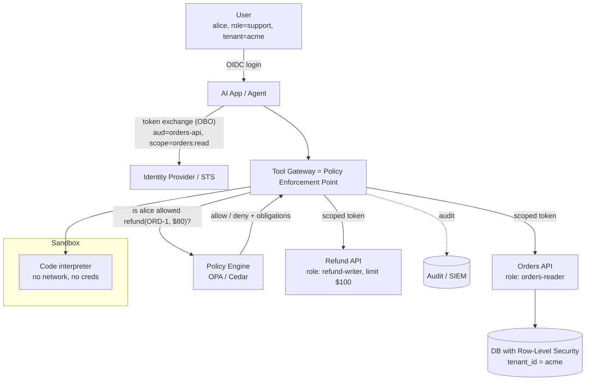

# Q9. How would you enforce least-privilege access so an AI application cannot perform unauthorized actions?

[← Back to questions](../questions.md)

## TL;DR

- **Assume the LLM is compromised.** Prompt injection means the model's choices are untrusted input, so authorization must be enforced in **deterministic code and infrastructure**, never in the prompt.
- **Identity propagation (on-behalf-of):** the agent acts **as the end user** with the *intersection* of the user's rights and the agent's rights. Use OAuth token exchange or OBO to get **scoped, short-lived, audience-bound** tokens per downstream service, and do not use a god-mode service account.
- **Per-tool privilege:** give each tool or MCP server its own **IAM role** or credential with only the permissions it needs, expose only the tools the task needs, and make tools **read-only by default**.
- **Policy engine, deny by default:** a central PDP (**OPA/Rego, Cedar / Amazon Verified Permissions**) evaluates `principal, action, resource, context` on every tool call. The data layer enforces **row-level security** so queries cannot see other tenants' data.
- **Contain the blast radius:** **sandbox** code execution, use **egress allowlists**, apply rate and spend limits, require **human approval** for high-risk actions, and keep audit logs with anomaly alerts.

## Detailed Answer

### 1. Mental model: the agent is a confused deputy waiting to happen

An agent combines **privileged access** (tools, data), **untrusted input** (user prompts, documents, web pages, tool results) and **autonomy**. Any text it reads can try to redirect it. Least privilege limits the damage when, not if, it is tricked.



### 2. Layers of least privilege

| Layer | Control | Example |
|---|---|---|
| **Identity** | The agent acts with the user's identity, not a shared super-user | OAuth 2.0 token exchange (RFC 8693), Entra ID OBO, AWS STS `AssumeRole` with session tags |
| **Token scope** | Narrow scopes, audience-bound, short TTL | `aud=orders-api`, `scope=orders:read`, 15-minute expiry |
| **Tool exposure** | Only register the tools a given agent or task needs | A support agent gets `get_order` and `create_ticket`, but no `delete_customer` |
| **Tool credentials** | A separate IAM role or credential per tool or MCP server | `s3-reader` role limited to `arn:aws:s3:::reports/*` with `s3:GetObject` only |
| **Policy (fine-grained)** | ABAC/ReBAC per call, deny by default | Cedar: refund allowed only if same tenant and amount ≤ the user's limit |
| **Data** | Row- and column-level security, views, masking | Postgres RLS on `tenant_id`, PII columns masked for the role |
| **Execution** | Sandbox for code and shell tools | Firecracker or gVisor container, read-only FS, no credentials, CPU and time limits |
| **Network** | Egress allowlist, private endpoints | Only `api.internal`, `bedrock-runtime` via VPC endpoint. Block `169.254.169.254`. |
| **Human** | Approval for high-impact actions | Payments over the threshold, deletes, permission changes |
| **Budget** | Rate, cost and step limits | Max 20 tool calls per run, $ cap per user per day |
| **Detect** | Audit logging and anomaly detection | Alert on deny spikes, unusual tools, data volume |

### 3. Identity propagation: the effective permission is an intersection

```
effective_permissions = user_permissions ∩ agent_permissions ∩ task_scope
```

- If Alice cannot see HR data, the agent working for Alice cannot either, even though the agent service *could*.
- If the agent is a "support bot", it cannot delete records, even when an admin uses it.
- Implementation: the app receives the user's ID token or access token and exchanges it at the IdP for a **downstream token** whose audience is the specific API, with reduced scopes. The downstream API enforces its own authorization using the **user's** identity, so audit logs show "alice via support-agent".

```python
# OAuth 2.0 Token Exchange (RFC 8693) - generic HTTP example
import httpx

def exchange_for_downstream(user_access_token: str, audience: str, scope: str) -> str:
    r = httpx.post("https://idp.example.com/oauth2/token", data={
        "grant_type": "urn:ietf:params:oauth:grant-type:token-exchange",
        "subject_token": user_access_token,
        "subject_token_type": "urn:ietf:params:oauth:token-type:access_token",
        "audience": audience,                  # e.g. "orders-api"
        "scope": scope,                        # e.g. "orders:read"
    }, auth=("agent-client-id", "agent-client-secret"), timeout=5)
    r.raise_for_status()
    return r.json()["access_token"]            # short-lived, narrowed
```

On AWS, a similar pattern is `sts.assume_role(RoleArn=tool_role, RoleSessionName=user_id, Tags=[{"Key": "tenant", "Value": tenant}], Policy=session_policy_json)`. The **session policy** narrows the role further for this call, and the tags drive ABAC conditions such as `aws:PrincipalTag/tenant`.

### 4. Policy enforcement point in the tool layer

```python
# Every tool call passes through one gateway function; tools can't be called directly.
from dataclasses import dataclass

@dataclass
class Principal:
    user_id: str
    roles: set[str]
    tenant: str
    refund_limit: float

class Denied(Exception): ...

def authorize(principal: Principal, action: str, resource: dict, context: dict) -> None:
    """Deny-by-default PDP call (OPA/Cedar in prod; inline rules shown for clarity)."""
    decision = pdp.is_authorized(            # e.g. Amazon Verified Permissions / OPA REST
        principal={"type": "User", "id": principal.user_id,
                   "attrs": {"roles": list(principal.roles), "tenant": principal.tenant,
                             "refund_limit": principal.refund_limit}},
        action=action,
        resource=resource,
        context=context,
    )
    if decision != "ALLOW":
        raise Denied(f"{action} on {resource.get('id')} denied by policy")

def call_tool(principal: Principal, tool_name: str, args: dict):
    tool = REGISTRY.get(tool_name)
    if tool is None or tool_name not in AGENT_ALLOWED_TOOLS[current_agent()]:
        raise Denied(f"Tool {tool_name} not available to this agent")
    resource = tool.resolve_resource(args)   # look up the real owner/tenant from the DB
    authorize(principal, tool.action, resource, {"args": args})
    if tool.risk == "high":
        require_human_approval(principal, tool_name, args)
    creds = tool.credentials_for(principal)  # scoped OBO token / STS session
    audit("tool_call", principal.user_id, tool_name, args, "allow")
    return tool.run(args, creds)
```

Key detail: `resolve_resource` reads the **actual** owner or tenant from the system of record. Never trust a `tenant_id` argument that the LLM supplied.

Cedar policy example:

```
// deny by default; explicit permits only
permit (
  principal,
  action == Action::"refund_order",
  resource
) when {
  principal.roles.contains("support") &&
  resource.tenant == principal.tenant &&
  context.args.amount <= principal.refund_limit
};

forbid (principal, action == Action::"delete_customer", resource)
unless { principal.roles.contains("admin") && context.approved == true };
```

### 5. Data layer: row-level security

```sql
ALTER TABLE orders ENABLE ROW LEVEL SECURITY;
CREATE POLICY tenant_isolation ON orders
  USING (tenant_id = current_setting('app.tenant_id'));

-- Per request, the tool's DB session sets context from the VERIFIED token, not the LLM:
SET app.tenant_id = 'acme';
```

For text-to-SQL agents, add a **read-only DB role**, an allowlist of views (no base tables), statement timeouts and a row limit, and reject DDL and DML through a SQL parser before execution.

For RAG, apply **document-level ACL filtering at retrieval time** using metadata filters such as `allowed_groups` that match the user's groups. Never retrieve everything and then ask the LLM to "only use what the user can see".

### 6. Sandboxing and egress

- Run code interpreters and shell tools in an isolated microVM or container: no credentials, no instance metadata, read-only base image, ephemeral, with CPU, memory and time quotas.
- Use **network egress allowlists** (proxy, security groups, Kubernetes NetworkPolicy), which stop data exfiltration even if the model is tricked into "send this to evil.com".
- Keep secrets out of the model context and environment. Tools fetch them from a secrets manager at call time.

### 7. Agent-specific threats and the control that addresses each

| Threat | Control |
|---|---|
| Prompt injection asks the agent to email customer data externally | No generic "send email to any address" tool, a recipient allowlist, output DLP and approval |
| The agent passes another tenant's ID in tool arguments | Resolve the resource from the DB plus policy check plus RLS |
| Tool chaining escalation (read secret, then call admin API) | Per-tool credentials, so the read tool cannot call admin APIs |
| Over-broad MCP server token | A separate server per domain, OAuth audience binding, no token passthrough |
| A runaway agent causes cost or DoS | Step, rate and spend limits, circuit breakers |

## Common Pitfalls

- One shared service account with admin rights for "the AI", which makes it a single point of catastrophic failure.
- Authorization described in the system prompt ("you may only access the user's own records").
- Trusting IDs or tenant values chosen by the LLM.
- Retrieving all documents and filtering in the prompt instead of filtering at query time.
- Long-lived API keys in environment variables available to code-execution tools.
- Logging only successes, so attempted abuse goes unnoticed.
- Granting tools "just in case". Every unused tool is attack surface and also degrades tool selection.

## Likely Follow-up Questions

1. **Why not just use the user's token everywhere?**
   It is usually too broad (all of the user's scopes), its audience is wrong for downstream APIs, and passing it through breaks audit. Token exchange gives a narrowed, audience-specific token.
2. **OPA vs Cedar?**
   OPA uses Rego, a general-purpose policy language that is popular in Kubernetes and microservices. Cedar is purpose-built for authorization, analyzable and fast, and is available as Amazon Verified Permissions. Both externalize policy from code.
3. **How do you handle background agents with no user present?**
   Give them a dedicated workload identity with tightly scoped permissions, time-bound grants, approval for high-risk steps and extra monitoring.
4. **How do you test least privilege?**
   With policy unit tests (allow and deny matrices), IAM Access Analyzer and unused-permission reports, red-team prompt injection exercises, and tests that cross-tenant calls fail.
5. **Where does Bedrock Guardrails or a content filter fit?**
   It is a complementary *probabilistic* layer that reduces malicious input. Least privilege is the *deterministic* layer that bounds the impact when filters miss.

[← Back to questions](../questions.md)
