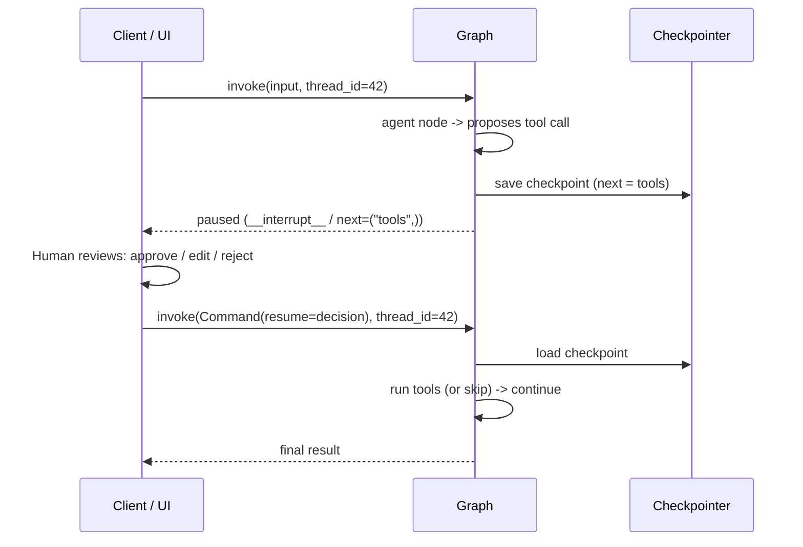

# Q10. How would you implement human approval before executing a tool or node in LangGraph?

[← Back to questions](../questions.md)

## TL;DR

- Human approval in LangGraph depends on **persistence**. Compile the graph with a **checkpointer** so execution can pause, save state, and pick up later, even in another process or days afterwards.
- **Static breakpoints** (`interrupt_before=["tools"]` / `interrupt_after=[...]` at `compile()`) pause before or after a named node. You resume with `graph.invoke(None, config)`. They are simple but coarse, and the docs mainly recommend them for debugging.
- **Dynamic interrupts** (`interrupt(payload)` inside a node or tool) are the production pattern. They pause only when needed, send a payload to the UI, and get the human's answer back through `Command(resume=...)`.
- Support **approve / edit / reject**. Approve runs the tool call unchanged, edit runs it with modified args, and reject sends a `ToolMessage` explaining the refusal so the LLM can re-plan.
- You can also **wrap risky tools** so only those ask for approval, or use LangChain v1's `HumanInTheLoopMiddleware` (`create_agent(..., middleware=[...])`), which builds this pattern for you.

## Detailed Answer

### 1. Why approval needs a checkpointer

A LangGraph run is a series of **super-steps**. After each one, the checkpointer writes a snapshot of the state, keyed by `thread_id`. When execution pauses, the process does not block or wait in memory. It **stops**. The state is saved, the caller gets control back, and a later call with the same `thread_id` continues from the saved snapshot. Without a checkpointer there is nothing to resume from, and `interrupt()` raises an error.



### 2. Option A: static breakpoints (compile-time)

```python
from langgraph.graph import StateGraph, START, MessagesState
from langgraph.prebuilt import ToolNode, tools_condition
from langgraph.checkpoint.memory import InMemorySaver
from langchain_openai import ChatOpenAI
from langchain_core.tools import tool

@tool
def transfer_funds(account_id: str, amount: float) -> str:
    """Transfer money to an account."""
    return f"Transferred {amount} to {account_id}"

tools = [transfer_funds]
llm = ChatOpenAI(model="gpt-4o").bind_tools(tools)

def agent(state: MessagesState):
    return {"messages": [llm.invoke(state["messages"])]}

builder = StateGraph(MessagesState)
builder.add_node("agent", agent)
builder.add_node("tools", ToolNode(tools))
builder.add_edge(START, "agent")
builder.add_conditional_edges("agent", tools_condition)   # -> "tools" or END
builder.add_edge("tools", "agent")

graph = builder.compile(
    checkpointer=InMemorySaver(),
    interrupt_before=["tools"],          # static breakpoint
)

config = {"configurable": {"thread_id": "t1"}}
graph.invoke({"messages": [("user", "Send $500 to ACC-9")]}, config)

snapshot = graph.get_state(config)
print(snapshot.next)                       # ('tools',)
pending = snapshot.values["messages"][-1].tool_calls
print(pending)                             # [{'name': 'transfer_funds', 'args': {...}, 'id': '...'}]

# APPROVE: resume with None. "Continue from where you stopped."
graph.invoke(None, config)
```

**Edit** with static breakpoints means rewriting the last AI message before resuming. Keep the **same message `id`** so `add_messages` replaces it instead of appending:

```python
last = snapshot.values["messages"][-1]
new_calls = [{**last.tool_calls[0], "args": {"account_id": "ACC-9", "amount": 50}}]
graph.update_state(
    config,
    {"messages": [last.model_copy(update={"tool_calls": new_calls})]},
)
graph.invoke(None, config)
```

**Reject** means adding a `ToolMessage` for each pending call, written *as if the tools node had run*, so the graph skips the tool:

```python
from langchain_core.messages import ToolMessage
graph.update_state(
    config,
    {"messages": [ToolMessage(content="User rejected this transfer.",
                              tool_call_id=c["id"]) for c in pending]},
    as_node="tools",                       # pretend tools ran; next = agent
)
graph.invoke(None, config)
```

Limitations: the breakpoint fires **every** time the node runs. It cannot pause per tool (a safe `search` and a risky `transfer` both stop). The client also has to inspect the state itself to work out what to show the human.

### 3. Option B: dynamic `interrupt()` (recommended)

`interrupt(value)` pauses the graph **from inside** a node. `value` is any JSON-serialisable payload and goes back to the caller. When the caller resumes with `Command(resume=x)`, the node **re-executes from the beginning**, and this time `interrupt()` returns `x`.

#### Approval node with approve / edit / reject routing

```python
from typing import Literal
from langgraph.types import interrupt, Command
from langchain_core.messages import ToolMessage

RISKY = {"transfer_funds", "delete_user"}

def human_review(state: MessagesState) -> Command[Literal["tools", "agent"]]:
    ai_msg = state["messages"][-1]
    risky_calls = [c for c in ai_msg.tool_calls if c["name"] in RISKY]
    if not risky_calls:
        return Command(goto="tools")

    decision = interrupt({                       # pauses here
        "question": "Approve these tool calls?",
        "tool_calls": risky_calls,
    })
    # On resume, decision == the value passed in Command(resume=...)
    action = decision["action"]

    if action == "approve":
        return Command(goto="tools")

    if action == "edit":
        edited = [
            {**c, "args": decision["args"]} if c["id"] == decision["id"] else c
            for c in ai_msg.tool_calls
        ]
        updated = ai_msg.model_copy(update={"tool_calls": edited})  # same id => replace
        return Command(goto="tools", update={"messages": [updated]})

    # reject: answer every tool call so the message history stays valid
    rejections = [
        ToolMessage(content=f"Rejected by human: {decision.get('reason', '')}",
                    tool_call_id=c["id"])
        for c in ai_msg.tool_calls
    ]
    return Command(goto="agent", update={"messages": rejections})

def route_after_agent(state: MessagesState):
    return "human_review" if state["messages"][-1].tool_calls else "__end__"

builder = StateGraph(MessagesState)
builder.add_node("agent", agent)
builder.add_node("human_review", human_review)
builder.add_node("tools", ToolNode(tools))
builder.add_edge(START, "agent")
builder.add_conditional_edges("agent", route_after_agent)
builder.add_edge("tools", "agent")
graph = builder.compile(checkpointer=InMemorySaver())
```

#### Driving it from the client

```python
config = {"configurable": {"thread_id": "t2"}}
result = graph.invoke({"messages": [("user", "Send $500 to ACC-9")]}, config)

if "__interrupt__" in result:
    payload = result["__interrupt__"][0].value
    # ...show payload in UI, collect decision...
    result = graph.invoke(Command(resume={"action": "approve"}), config)
    # or Command(resume={"action": "edit", "id": "<call_id>", "args": {...}})
    # or Command(resume={"action": "reject", "reason": "too large"})
```

### 4. Option C: wrap the tool itself

Here the approval lives **inside** the tool, so any agent (including prebuilt ones) gets it automatically:

```python
from langchain_core.tools import tool
from langgraph.types import interrupt

@tool
def delete_user(user_id: str) -> str:
    """Permanently delete a user."""
    response = interrupt({"action": "delete_user", "args": {"user_id": user_id},
                          "message": "Approve deletion?"})
    if response["type"] == "approve":
        return _really_delete(user_id)
    if response["type"] == "edit":
        return _really_delete(response["args"]["user_id"])
    return f"Deletion of {user_id} was rejected by the user."
```

A generic wrapper `add_human_in_the_loop(tool)` that builds a new `@tool` around any `BaseTool` is a common pattern from the LangGraph docs. Because `ToolNode` executes the tool inside a graph node, `interrupt()` works there too.

### 5. Option D: LangChain v1 middleware

```python
from langchain.agents import create_agent
from langchain.agents.middleware import HumanInTheLoopMiddleware
from langgraph.checkpoint.memory import InMemorySaver
from langgraph.types import Command

agent = create_agent(
    model="openai:gpt-4o",
    tools=[transfer_funds, search_docs],
    middleware=[HumanInTheLoopMiddleware(
        interrupt_on={
            "transfer_funds": {"allowed_decisions": ["approve", "edit", "reject"]},
            "search_docs": False,               # never interrupt
        }
    )],
    checkpointer=InMemorySaver(),
)
cfg = {"configurable": {"thread_id": "t3"}}
out = agent.invoke({"messages": [{"role": "user", "content": "pay ACC-9 $500"}]}, cfg)
# out["__interrupt__"] describes the action requests
agent.invoke(Command(resume={"decisions": [{"type": "approve"}]}), cfg)
```

### 6. Comparison

| Aspect | Static breakpoint | Dynamic `interrupt()` | Tool wrapper | `HumanInTheLoopMiddleware` |
|---|---|---|---|---|
| Where defined | `compile(interrupt_before=...)` | Inside a node | Inside a tool | Agent middleware config |
| Conditional pause | No (always at node) | Yes | Yes (per tool) | Yes (per tool) |
| Payload to UI | None (client inspects state) | Arbitrary JSON | Arbitrary JSON | Standard action-request schema |
| Resume | `invoke(None, cfg)` + `update_state` | `Command(resume=...)` | `Command(resume=...)` | `Command(resume={"decisions": [...]})` |
| Best for | Debugging, quick demos | Custom graphs in prod | Reusable risky tools | `create_agent` users |

## Common Pitfalls

- **No checkpointer, or a fresh `thread_id` on resume.** The graph cannot find the paused state and starts over.
- **Side effects before `interrupt()`.** The node re-runs from the top on resume, so an email sent before the interrupt gets sent twice. Put side effects after the interrupt or in a separate node.
- **Rejecting without answering the tool call.** OpenAI and Anthropic need a `ToolMessage` for every `tool_call_id`. Leaving one out causes a 400 error on the next LLM call.
- **Editing by appending a new AI message.** Without the same `id`, `add_messages` appends, and the history ends up with two AI messages holding dangling tool calls.
- **Wrapping `interrupt()` in a bare `try/except Exception`.** `interrupt` works by raising `GraphInterrupt`. Swallowing it breaks the pause.
- **Using `InMemorySaver` in production.** Approvals that span process restarts need `PostgresSaver` or similar.
- **Approving tool calls in parallel.** An AI message with three tool calls may need one decision per call. Design the payload and the resume to handle a list.

## Likely Follow-up Questions

1. **Static or dynamic, which should you choose?** Dynamic `interrupt()` for production because it is conditional and carries a payload. Static breakpoints for debugging or step-through.
2. **How do you resume after a static breakpoint?** `graph.invoke(None, config)`, optionally after `graph.update_state(...)`.
3. **How would you handle approval timeouts?** The graph stays paused at no cost. Have a scheduler resume it with `Command(resume={"action": "reject", "reason": "timeout"})`.
4. **Can approval happen across services or days later?** Yes. The state lives in the checkpointer (Postgres). Any worker with the same `thread_id` can resume.
5. **How do you audit approvals?** Write the decision to state (for example an `approvals` list with an `operator.add` reducer). `get_state_history` and LangSmith traces then show who approved what.

[← Back to questions](../questions.md)
