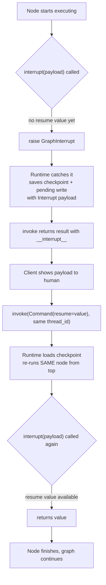

# Q11. How does an agent initiate a human-approval request in LangGraph?

[← Back to questions](../questions.md)

## TL;DR

- The agent (a node or a tool) calls **`interrupt(payload)`**, from `langgraph.types`. This raises a special **`GraphInterrupt`** exception that the runtime catches.
- The runtime **saves a checkpoint** that records the pending task and the interrupt payload, then **returns control** to the caller. The output contains an **`__interrupt__`** key holding `Interrupt(value=payload, id=...)` objects.
- The client **surfaces the payload** (UI, Slack, email), collects the human's decision, and calls `graph.invoke(Command(resume=decision), config)` with the **same `thread_id`**.
- On resume, the **interrupted node re-executes from the start**. This time `interrupt()` *returns* the resume value instead of raising. Anything with side effects that runs before the interrupt therefore **must be idempotent**.
- Several interrupts in one node are matched to resume values **by order of appearance**. Interrupts in parallel nodes can be resumed together with a dict `{interrupt_id: value}`.

## Detailed Answer

### 1. Lifecycle of an interrupt



What happens inside:

1. `interrupt()` looks in the current task's **scratchpad** for a resume value that matches this interrupt's index.
2. If none is found, it raises `GraphInterrupt(Interrupt(value=payload, id=...))`.
3. The Pregel loop catches it, marks the task as interrupted, and writes the interrupt as a **pending write** in the checkpoint. Writes from *other* nodes that finished in the same super-step are saved too, so they do not re-run.
4. On `Command(resume=...)`, the resume value is written to the checkpoint and the interrupted task is scheduled again. `interrupt()` now finds the value and returns it.

### 2. Minimal end-to-end example

```python
from typing import TypedDict
from langgraph.graph import StateGraph, START, END
from langgraph.types import interrupt, Command
from langgraph.checkpoint.memory import InMemorySaver

class State(TypedDict):
    draft: str
    approved: bool
    final: str

def write_draft(state: State):
    return {"draft": "Dear customer, your refund of $120 is approved."}

def request_approval(state: State):
    # Agent initiates the approval request
    decision = interrupt({
        "type": "approval_request",
        "summary": "Send refund email?",
        "draft": state["draft"],
        "options": ["approve", "edit", "reject"],
    })
    if decision["action"] == "approve":
        return {"approved": True}
    if decision["action"] == "edit":
        return {"approved": True, "draft": decision["text"]}
    return {"approved": False}

def send(state: State):
    if state["approved"]:
        # real side effect lives AFTER the approval node
        return {"final": f"SENT: {state['draft']}"}
    return {"final": "Cancelled by reviewer"}

b = StateGraph(State)
b.add_node(write_draft); b.add_node(request_approval); b.add_node(send)
b.add_edge(START, "write_draft")
b.add_edge("write_draft", "request_approval")
b.add_edge("request_approval", "send")
b.add_edge("send", END)
graph = b.compile(checkpointer=InMemorySaver())

cfg = {"configurable": {"thread_id": "refund-881"}}
out = graph.invoke({"draft": "", "approved": False, "final": ""}, cfg)

print(out["__interrupt__"])
# [Interrupt(value={'type': 'approval_request', ...}, id='a1b2...')]

state = graph.get_state(cfg)
print(state.next)          # ('request_approval',)
print(state.interrupts)    # same Interrupt objects (recent versions)

out = graph.invoke(Command(resume={"action": "edit", "text": "Hi! Refund of $120 done."}), cfg)
print(out["final"])        # SENT: Hi! Refund of $120 done.
```

With `stream()`, the interrupt arrives as an event: `{"__interrupt__": (Interrupt(...),)}` in `stream_mode="updates"`.

### 3. Agent-initiated from inside a tool

Most often the *LLM* decides to call a tool, and the **tool** asks for approval:

```python
from langchain_core.tools import tool
from langgraph.prebuilt import create_react_agent

@tool
def issue_refund(order_id: str, amount: float) -> str:
    """Issue a refund for an order."""
    answer = interrupt({"tool": "issue_refund",
                        "args": {"order_id": order_id, "amount": amount}})
    if answer["type"] != "approve":
        return "Refund rejected by a human reviewer."
    return payments.refund(order_id, amount)     # side effect after approval

agent = create_react_agent("openai:gpt-4o", tools=[issue_refund],
                           checkpointer=InMemorySaver())
```

The agent "initiates" the request just by picking the tool. The interrupt rises through `ToolNode` → graph → caller.

### 4. Re-execution and idempotency (the critical detail)

```python
def bad_node(state):
    db.insert_audit_row("about to ask")     # runs TWICE (before pause + on resume)
    ok = interrupt("approve?")
    ...

def good_node(state):
    ok = interrupt("approve?")              # nothing side-effectful above
    if ok:
        db.insert_audit_row("approved")     # runs once
```

Rules:

- Code **before** `interrupt()` runs again on every resume. Keep it pure or idempotent (upserts, idempotency keys).
- Use a separate node for expensive work (LLM calls) so its result is checkpointed and not recomputed.
- Do not wrap `interrupt()` in `try/except Exception`. `GraphInterrupt` has to propagate.
- The payload must be **serialisable** (JSON-like). It is stored in the checkpoint.

### 5. Multiple interrupts

**Several in one node**, resolved one at a time by index:

```python
def collect(state):
    name = interrupt("What is the customer's name?")   # index 0
    amount = interrupt("Refund amount?")                # index 1
    return {"name": name, "amount": amount}

graph.invoke(Command(resume="Alice"), cfg)   # pauses again at index 1
graph.invoke(Command(resume=120), cfg)       # completes
```

On the second resume the node runs from the top again. Interrupt 0 returns `"Alice"` from the scratchpad and interrupt 1 returns `120`. **Do not change the order or number of `interrupt()` calls conditionally between runs**, or the indices stop lining up.

**Parallel nodes**, each interrupting in the same super-step:

```python
out = graph.invoke(inputs, cfg)
resume_map = {i.id: f"answer for {i.value}" for i in out["__interrupt__"]}
graph.invoke(Command(resume=resume_map), cfg)
```

### 6. Ways to resume

| Resume form | Effect |
|---|---|
| `Command(resume=value)` | Value is returned by the pending `interrupt()` |
| `Command(resume={id1: v1, id2: v2})` | Resolve several parallel interrupts at once |
| `Command(resume=v, update={...})` | Also patch state |
| `Command(goto="node")` | Redirect execution (from a node's return) |
| `graph.invoke(None, cfg)` | Resume a **static** breakpoint (not a dynamic interrupt) |

## Common Pitfalls

- Forgetting the checkpointer. `interrupt` needs persistence.
- Resuming with a different `thread_id`, which starts a fresh run.
- Expensive LLM calls before `interrupt()` inside the same node. They get re-billed on resume.
- Non-deterministic interrupt order, such as interrupting inside a loop over a set.
- Treating `__interrupt__` as an error. It is a normal return value, and the client has to check for it.
- Payloads that are not serialisable (DB connections, open files).

## Likely Follow-up Questions

1. **Why re-execute the node instead of resuming at the exact line?** Python cannot serialise a suspended stack frame across processes. Replaying the node with a stored resume value is simple and survives restarts.
2. **How does the UI know what to show?** It reads `result["__interrupt__"][i].value`, or `graph.get_state(cfg).tasks[*].interrupts`.
3. **Can a subgraph interrupt?** Yes. The interrupt rises to the parent. Resuming the parent re-enters the subgraph. The parent node calling the subgraph also re-runs from its start.
4. **What is the difference from `NodeInterrupt`?** `NodeInterrupt` was the older way of raising a dynamic breakpoint and is deprecated in favour of `interrupt()`, which also supports resume values.
5. **How do you validate human input?** Loop: `while True: v = interrupt(q); if valid(v): break; q = "Invalid, try again"`. This is allowed because each iteration adds a new interrupt index deterministically.

[← Back to questions](../questions.md)
