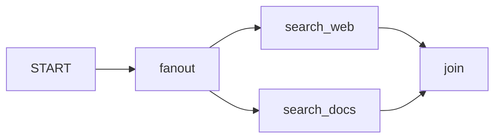

# Q14. How would you design a LangGraph state class so new values are appended or merged instead of replacing existing values?

[← Back to questions](../questions.md)

## TL;DR

- By default, every state key is a **"last value wins"** channel: a node's update **overwrites** the key.
- To append or merge, attach a **reducer** with `Annotated[type, reducer_fn]`. The reducer has the signature `(current, update) -> new`.
- `Annotated[list, operator.add]` concatenates lists. `Annotated[list[AnyMessage], add_messages]` appends messages, **replaces by message ID**, and supports deletion with `RemoveMessage`.
- Write **custom reducers** for dict deep-merge, dedup, capped lists, or a "reset" sentinel. Newer LangGraph also has `Overwrite` (in `langgraph.types`) to bypass a reducer for a single update.
- Reducers are required when **parallel branches write the same key** in one super-step. Without one you get `InvalidUpdateError` (`INVALID_CONCURRENT_GRAPH_UPDATE`).

## Detailed Answer

### 1. How state updates work

Nodes return **partial updates** (`dict`). For each key in the update, LangGraph's channel applies:

```
new_value = reducer(old_value, update_value)   # if a reducer is annotated
new_value = update_value                        # otherwise (LastValue channel)
```

```
          state["logs"] = ["a"]
node returns {"logs": ["b"]}

  no reducer      -> ["b"]            (overwritten)
  operator.add    -> ["a", "b"]       (appended)
```

### 2. Built-in patterns

```python
import operator
from typing import Annotated, TypedDict
from langchain_core.messages import AnyMessage
from langgraph.graph.message import add_messages

class AgentState(TypedDict):
    question: str                                         # overwrite
    messages: Annotated[list[AnyMessage], add_messages]  # smart append
    findings: Annotated[list[str], operator.add]          # append
    tokens_used: Annotated[int, operator.add]             # running sum
```

`operator.add` works on anything that supports `+`: lists, ints, strings, tuples.

### 3. `add_messages` in depth

`add_messages(left, right)`:

1. Converts dicts, tuples, and strings into `BaseMessage` objects (`("user", "hi")` → `HumanMessage`).
2. Assigns a UUID `id` to messages that lack one.
3. If an incoming message's `id` **matches an existing one**, it **replaces** it in place. Otherwise it **appends**.
4. If an incoming message is a `RemoveMessage(id=...)`, it **deletes** that message.

```python
from langchain_core.messages import RemoveMessage, AIMessage
from langgraph.graph.message import REMOVE_ALL_MESSAGES

# Replace (edit) a message: reuse its id
def fix_last(state):
    last = state["messages"][-1]
    return {"messages": [AIMessage(content="corrected", id=last.id)]}

# Delete old messages (trim memory)
def trim(state):
    return {"messages": [RemoveMessage(id=m.id) for m in state["messages"][:-6]]}

# Wipe and replace the entire history
def reset(state):
    return {"messages": [RemoveMessage(id=REMOVE_ALL_MESSAGES),
                         ("system", "Summary of earlier conversation: ...")]}
```

`MessagesState` is a ready-made `TypedDict` with `messages: Annotated[list[AnyMessage], add_messages]`. Subclass it to add fields:

```python
from langgraph.graph import MessagesState
class State(MessagesState):
    summary: str
```

### 4. Custom reducers

#### Deep-merge dicts

```python
def merge_dicts(left: dict | None, right: dict | None) -> dict:
    left = dict(left or {})
    for k, v in (right or {}).items():
        if isinstance(v, dict) and isinstance(left.get(k), dict):
            left[k] = merge_dicts(left[k], v)
        else:
            left[k] = v
    return left

class State(TypedDict):
    agent_outputs: Annotated[dict, merge_dicts]

# node A returns {"agent_outputs": {"triage": {"severity": "P1"}}}
# node B returns {"agent_outputs": {"rca": {"cause": "disk full"}}}
# -> {"triage": {...}, "rca": {...}}
```

#### Dedup and cap

```python
def add_unique_capped(left: list, right: list, cap: int = 50) -> list:
    seen, out = set(), []
    for item in (left or []) + (right or []):
        if item not in seen:
            seen.add(item); out.append(item)
    return out[-cap:]

class State(TypedDict):
    visited_urls: Annotated[list[str], add_unique_capped]
```

#### Reset sentinel (overwrite on demand)

```python
CLEAR = object()   # in-process sentinel; for durability prefer a string like "__clear__"

def append_or_clear(left, right):
    if right == "__clear__":
        return []
    return (left or []) + (right if isinstance(right, list) else [right])

class State(TypedDict):
    scratch: Annotated[list, append_or_clear]

# node: return {"scratch": "__clear__"}
```

#### `Overwrite` (newer LangGraph)

```python
from langgraph.types import Overwrite

def reset_findings(state):
    # bypasses operator.add for this one update
    return {"findings": Overwrite(["fresh start"])}
```

If your installed version lacks `Overwrite`, use the sentinel pattern above.

### 5. Reducers with Pydantic or dataclass state

```python
from pydantic import BaseModel, Field
class PState(BaseModel):
    messages: Annotated[list[AnyMessage], add_messages] = Field(default_factory=list)
    notes: Annotated[list[str], operator.add] = Field(default_factory=list)
```

### 6. Parallel branches: why reducers are mandatory



Both `A` and `B` run in the **same super-step**. If both return `{"results": [...]}`:

- Without a reducer, LangGraph cannot decide which value wins and raises `InvalidUpdateError: At key 'results': Can receive only one value per step. Use an Annotated key to handle multiple values.`
- With `Annotated[list, operator.add]`, both lists are concatenated. The order across branches is deterministic per run but should not be relied on semantically.

```python
class FanState(TypedDict):
    query: str
    results: Annotated[list[str], operator.add]

def search_web(s):  return {"results": [f"web:{s['query']}"]}
def search_docs(s): return {"results": [f"doc:{s['query']}"]}
def join(s):        return {}

from langgraph.graph import StateGraph, START, END
g = StateGraph(FanState)
g.add_node(search_web); g.add_node(search_docs); g.add_node(join)
g.add_edge(START, "search_web"); g.add_edge(START, "search_docs")
g.add_edge(["search_web", "search_docs"], "join")   # wait for both
g.add_edge("join", END)
print(g.compile().invoke({"query": "x", "results": []}))
# {'query': 'x', 'results': ['web:x', 'doc:x']}
```

### 7. Choosing a reducer

| Need | Reducer |
|---|---|
| Overwrite (default) | none |
| Append list | `operator.add` |
| Chat messages with edit/delete | `add_messages` |
| Counter / sum | `operator.add` on `int` |
| Merge per-agent outputs | custom `merge_dicts` |
| Unique / bounded list | custom dedup+cap |
| Occasionally reset an accumulating key | `Overwrite(...)` or sentinel reducer |
| Keep max / min | `lambda a, b: max(a, b)` |

## Common Pitfalls

- **Returning the full list with an `operator.add` key.** `return {"findings": state["findings"] + [x]}` duplicates everything. Return **only the delta** (`[x]`).
- **Returning a bare string to an `operator.add` list key.** `["a"] + "b"` raises a `TypeError`. Wrap it: `["b"]`.
- **Expecting reducers on input.** The initial `invoke` input also goes through reducers, so re-sending history on the same thread duplicates it.
- **Unbounded growth.** Appended lists and messages grow forever and get checkpointed every step. Cap or trim them.
- **Reducers that are not pure or deterministic.** They are replayed when resuming or time-travelling.
- **Lambdas as reducers.** Lambdas work, but named functions are clearer and easier to test.

## Likely Follow-up Questions

1. **What happens if two parallel nodes write a key that has no reducer?** `InvalidUpdateError` at runtime.
2. **How do you remove a message?** Return `RemoveMessage(id=msg.id)` with the `add_messages` reducer.
3. **How do you update a message instead of appending?** Return a message with the **same `id`**.
4. **Can you overwrite a reducer key with `update_state`?** `update_state` also goes through reducers. Use `Overwrite`, `RemoveMessage(REMOVE_ALL_MESSAGES)`, or a sentinel.
5. **Do reducers apply across subgraphs?** Shared keys returned by a subgraph to its parent go through the **parent's** reducer for that key.

[← Back to questions](../questions.md)
