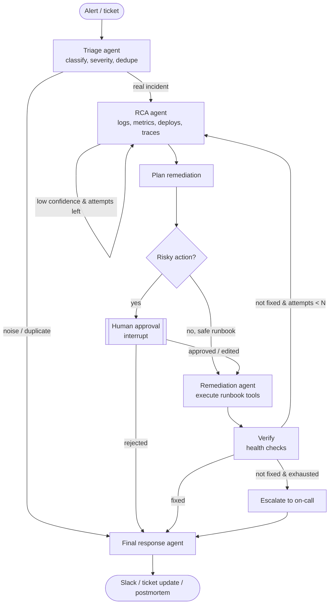

# Q15. How would you coordinate a multi-agent system containing a triage agent, a root-cause analysis agent, a remediation agent, and a final response agent?

[← Back to questions](../questions.md)

## TL;DR

- Model it as a **LangGraph `StateGraph`** with one node per agent: `triage → rca → (human approval) → remediation → verify → final_response`. A typed **shared state** (incident, severity, hypotheses, actions, attempts) carries the context between agents.
- Each agent is either a **focused sub-agent** (its own prompt and tools, for example `create_react_agent` over logs/metrics tools) or a **structured-output LLM call**. It writes only to **its own keys**.
- Routing is **deterministic code** (conditional edges on structured fields). Low-severity or duplicate incidents skip straight to the response. Remediation failures **loop back to RCA** with the failure evidence, bounded by a `max_attempts` counter.
- **Human approval before remediation** uses `interrupt()`, with auto-approval allowed for safe, low-risk runbook actions. A **checkpointer** (Postgres) makes the whole flow durable and auditable.
- The final response agent turns the state into a stakeholder update or postmortem, and LangSmith traces each agent's work.

## Detailed Answer

### 1. Architecture



Why a graph and not one big agent:

- Each agent has a **narrow prompt and toolset**, which means fewer hallucinated tool calls and easier evaluation.
- **Control flow is explicit and testable**: severity gates, retry limits, approval. It is not left to an LLM to decide.
- Checkpointing gives **durability** for long incidents and **an audit trail** for compliance.

### 2. State design

```python
import operator
from typing import Annotated, Literal, TypedDict
from pydantic import BaseModel, Field
from langchain_core.messages import AnyMessage
from langgraph.graph.message import add_messages

class Triage(BaseModel):
    is_incident: bool
    severity: Literal["P1", "P2", "P3", "P4"]
    service: str
    category: Literal["latency", "errors", "outage", "capacity", "security", "other"]
    summary: str

class RCA(BaseModel):
    root_cause: str
    evidence: list[str]
    confidence: float = Field(ge=0, le=1)

class RemediationPlan(BaseModel):
    action: Literal["rollback", "restart", "scale_up", "flush_cache", "config_change", "none"]
    target: str
    params: dict = {}
    risk: Literal["low", "medium", "high"]
    rationale: str

class IncidentState(TypedDict):
    alert: dict                                       # raw input
    messages: Annotated[list[AnyMessage], add_messages]
    triage: Triage | None
    rca: RCA | None
    plan: RemediationPlan | None
    approval: dict | None                             # {"decision", "by", "comment"}
    remediation_result: dict | None                   # {"success", "details"}
    attempts: int
    history: Annotated[list[dict], operator.add]      # audit log: what each agent did
    final_report: str | None
```

Design choices:

- **Per-agent output keys** (`triage`, `rca`, `plan`, ...) mean agents don't overwrite each other.
- `history` uses an `operator.add` reducer as an append-only **work ledger**.
- `attempts` bounds the RCA↔remediation loop.

### 3. Agents (nodes)

```python
from langchain_openai import ChatOpenAI
from langchain_core.tools import tool
from langgraph.prebuilt import create_react_agent

llm = ChatOpenAI(model="gpt-4o", temperature=0)
MAX_ATTEMPTS = 3

# ---------- Triage ----------
triage_llm = llm.with_structured_output(Triage)

def triage_agent(state: IncidentState):
    t = triage_llm.invoke(
        f"You are an SRE triage agent. Classify this alert:\n{state['alert']}"
    )
    return {"triage": t, "attempts": 0,
            "history": [{"agent": "triage", "output": t.model_dump()}]}

# ---------- RCA (tool-using ReAct sub-agent) ----------
@tool
def query_logs(service: str, query: str, minutes: int = 30) -> str:
    """Search recent logs for a service."""
    return logs_client.search(service, query, minutes)

@tool
def get_metrics(service: str, metric: str, minutes: int = 60) -> str:
    """Fetch a time series (p99_latency, error_rate, cpu, mem)."""
    return metrics_client.get(service, metric, minutes)

@tool
def recent_deploys(service: str) -> str:
    """List deployments in the last 24h."""
    return deploy_client.list(service)

rca_react = create_react_agent(
    llm, tools=[query_logs, get_metrics, recent_deploys],
    prompt="You are a root-cause analysis agent. Investigate with tools, cite evidence.",
    response_format=RCA,                      # final structured answer
)

def rca_agent(state: IncidentState):
    context = {"triage": state["triage"].model_dump()}
    if state.get("remediation_result") and not state["remediation_result"]["success"]:
        context["previous_failed_fix"] = {
            "plan": state["plan"].model_dump(),
            "result": state["remediation_result"],
        }
    out = rca_react.invoke({"messages": [("user", f"Investigate: {context}")]})
    rca: RCA = out["structured_response"]
    return {"rca": rca, "history": [{"agent": "rca", "output": rca.model_dump()}]}

# ---------- Remediation planning ----------
plan_llm = llm.with_structured_output(RemediationPlan)

def plan_remediation(state: IncidentState):
    plan = plan_llm.invoke(
        f"Given RCA {state['rca'].model_dump()} for service {state['triage'].service}, "
        f"choose ONE runbook action. Allowed: rollback, restart, scale_up, flush_cache, "
        f"config_change, none."
    )
    return {"plan": plan, "history": [{"agent": "planner", "output": plan.model_dump()}]}
```

### 4. Human approval gate

```python
from langgraph.types import interrupt, Command

def approval_gate(state: IncidentState) -> Command[Literal["remediate", "final_response"]]:
    plan = state["plan"]
    sev = state["triage"].severity
    if plan.risk == "low" and plan.action in {"restart", "flush_cache", "scale_up"}:
        return Command(goto="remediate",
                       update={"approval": {"decision": "auto", "by": "policy"}})

    decision = interrupt({
        "type": "remediation_approval",
        "severity": sev,
        "service": state["triage"].service,
        "root_cause": state["rca"].root_cause,
        "evidence": state["rca"].evidence,
        "proposed_action": plan.model_dump(),
    })
    entry = {"agent": "human", "output": decision}
    if decision["decision"] == "approve":
        return Command(goto="remediate", update={"approval": decision, "history": [entry]})
    if decision["decision"] == "edit":
        edited = plan.model_copy(update=decision["changes"])
        return Command(goto="remediate",
                       update={"plan": edited, "approval": decision, "history": [entry]})
    return Command(goto="final_response", update={"approval": decision, "history": [entry]})
```

### 5. Remediation and verification

```python
RUNBOOK = {
    "rollback": lambda t, p: deploy_client.rollback(t, p.get("to_version")),
    "restart": lambda t, p: k8s.rollout_restart(t),
    "scale_up": lambda t, p: k8s.scale(t, p.get("replicas", 2)),
    "flush_cache": lambda t, p: cache.flush(t),
    "config_change": lambda t, p: config.apply(t, p),
}

def remediate(state: IncidentState):
    plan = state["plan"]
    try:
        details = RUNBOOK[plan.action](plan.target, plan.params) if plan.action != "none" else "no-op"
        ok = True
    except Exception as e:                     # tool failure is data, not a crash
        details, ok = str(e), False
    return {"remediation_result": {"success": ok, "details": details},
            "history": [{"agent": "remediation", "output": {"ok": ok, "details": str(details)}}]}

def verify(state: IncidentState):
    healthy = state["remediation_result"]["success"] and health.check(state["triage"].service)
    return {"remediation_result": {**state["remediation_result"], "success": healthy},
            "attempts": state["attempts"] + 1}
```

### 6. Final response agent

```python
def final_response(state: IncidentState):
    report = llm.invoke(
        "Write a concise incident update for stakeholders (status, impact, root cause, "
        "actions taken, approvals, next steps). Use this record:\n"
        f"{[h for h in state['history']]}"
    ).content
    return {"final_report": report,
            "history": [{"agent": "final_response", "output": "report generated"}]}
```

### 7. Routing and wiring

```python
from langgraph.graph import StateGraph, START, END
from langgraph.checkpoint.postgres import PostgresSaver

def after_triage(state) -> Literal["rca", "final_response"]:
    t = state["triage"]
    return "rca" if t.is_incident and t.severity in {"P1", "P2", "P3"} else "final_response"

def after_verify(state) -> Literal["final_response", "rca", "escalate"]:
    if state["remediation_result"]["success"]:
        return "final_response"
    if state["attempts"] < MAX_ATTEMPTS:
        return "rca"                          # loop back with failure evidence
    return "escalate"

def escalate(state):
    pager.page_oncall(state["triage"].service, state["rca"].root_cause)
    return {"history": [{"agent": "escalation", "output": "paged on-call"}]}

b = StateGraph(IncidentState)
b.add_node("triage", triage_agent)
b.add_node("rca", rca_agent)
b.add_node("plan", plan_remediation)
b.add_node("approval_gate", approval_gate)
b.add_node("remediate", remediate)
b.add_node("verify", verify)
b.add_node("escalate", escalate)
b.add_node("final_response", final_response)

b.add_edge(START, "triage")
b.add_conditional_edges("triage", after_triage)
b.add_edge("rca", "plan")
b.add_edge("plan", "approval_gate")       # approval_gate routes via Command
b.add_edge("remediate", "verify")
b.add_conditional_edges("verify", after_verify)
b.add_edge("escalate", "final_response")
b.add_edge("final_response", END)

with PostgresSaver.from_conn_string(DB_URI) as cp:
    cp.setup()
    graph = b.compile(checkpointer=cp)
    cfg = {"configurable": {"thread_id": f"incident-{alert_id}"}}
    out = graph.invoke({"alert": alert, "messages": [], "history": [], "attempts": 0}, cfg)
    if "__interrupt__" in out:
        notify_slack(out["__interrupt__"][0].value)   # on-call clicks Approve
    # later, from the Slack webhook handler:
    # graph.invoke(Command(resume={"decision": "approve", "by": "alice"}), cfg)
```

### 8. Alternatives

| Approach | Pros | Cons |
|---|---|---|
| **Explicit graph (above)** | Deterministic, auditable, testable | More code |
| **Supervisor** (`create_supervisor`) | LLM picks next agent, flexible | Less predictable; approval and loops harder to guarantee |
| **Swarm / handoffs** | Agents hand off directly | Hard to enforce the approval gate |
| **Single agent with all tools** | Simplest | Huge prompt, poor tool selection, unsafe |

For incidents, a **deterministic skeleton with LLM-powered nodes** is usually the right call. Use LLM routing only inside a phase, for example letting the RCA agent choose which tools to call.

### 9. Production concerns

- **Idempotency**: remediation actions use idempotency keys, because a resume after a crash could repeat them.
- **Timeouts and retries**: `builder.add_node("rca", rca_agent, retry_policy=RetryPolicy(max_attempts=3))`.
- **Guardrails**: an allow-list of actions and targets, risk scoring done in code rather than trusted from the LLM, and dry-run mode.
- **Observability**: LangSmith traces with `thread_id = incident id`. Stream with `stream_mode="updates"` to a live incident channel.
- **Evaluation**: replay historical incidents and score triage accuracy, RCA correctness, and MTTR.

## Common Pitfalls

- Letting the LLM decide whether approval is needed. Enforce it in code.
- Infinite RCA↔remediation loops without an `attempts` cap (also set `recursion_limit`).
- Losing failure context. The RCA re-run has to see what was tried and why it failed.
- Running side effects before `interrupt()` in the approval node.
- One huge shared `messages` list for all agents, which bloats context. Pass **summaries or structured outputs** between agents instead.

## Likely Follow-up Questions

1. **Why not let a supervisor LLM route everything?** Incidents need guarantees (approval, retry limits). Deterministic edges provide them, and LLMs stay useful inside nodes.
2. **How do you handle parallel investigation?** Fan out with `Send` to several RCA specialists (DB, network, app), then merge their hypotheses with a reducer.
3. **How is approval audited?** The decision is stored in state and `history`, and persisted in checkpoints plus LangSmith.
4. **What if the human never responds?** A timer job resumes with `{"decision": "reject", "by": "timeout"}` or escalates.
5. **How do you test this?** Unit test each node with fake tools, test the graph with recorded incidents, and test routing functions as pure functions.

[← Back to questions](../questions.md)
