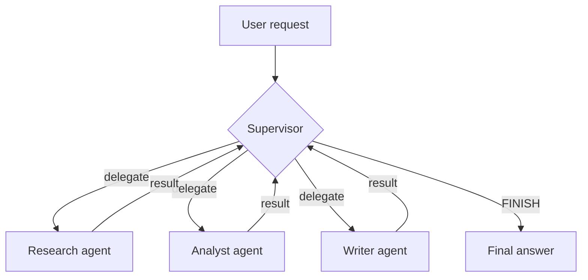

# Q17. What is the role of a supervisor or master agent in a multi-agent system?

[← Back to questions](../questions.md)

## TL;DR

- The supervisor is the **orchestrator**. It reads the user's goal and the current state, **decides which worker agent acts next** (or whether to finish), and **combines worker outputs** into the final answer.
- Its core duties are **task decomposition and planning, routing/delegation, context management** (what each worker sees), **progress tracking and termination**, **quality control** (validate or retry), and **policy enforcement** (guardrails, approvals, budgets).
- Workers stay **narrow and stateless**. The supervisor holds the **global view**, so workers don't need to know about each other.
- In LangGraph it is usually a node that returns `Command(goto=worker)` or a structured routing decision. Workers route **back** to it. `langgraph-supervisor`'s `create_supervisor` provides a prebuilt version that uses handoff tools.
- Trade-offs: central control and auditability, but the supervisor can become a **bottleneck**. It adds **an extra LLM hop per step** and is a **single point of failure** in reasoning.

## Detailed Answer

### 1. Responsibilities in detail

| Responsibility | What it means | Example |
|---|---|---|
| **Understand the goal** | Interpret the user request and success criteria | "Write a market report on EV batteries" |
| **Decompose / plan** | Break into subtasks, possibly ordered | research → analyse data → write → review |
| **Route / delegate** | Pick the best worker for each subtask | `researcher` for web facts, `analyst` for pandas |
| **Shape context** | Give each worker only the relevant inputs | Pass the "data summary", not 40 raw tool messages |
| **Track progress** | Know what's done, pending, failed | A task ledger in state |
| **Validate** | Check output quality and send it back if poor | "Sources missing, researcher please cite" |
| **Terminate** | Decide when the goal is satisfied, or stop on budget | FINISH or escalate after N iterations |
| **Enforce policy** | Approvals, permissions, cost limits | Require human approval before `send_email` |
| **Synthesize** | Merge results into a coherent final answer | Final report combining all sections |

### 2. Control flow



Each worker returns to the supervisor. This "hub and spoke" topology is what separates the pattern from a swarm, where workers hand off to each other directly.

### 3. Implementation in LangGraph (custom supervisor)

```python
from typing import Literal, Annotated
import operator
from pydantic import BaseModel, Field
from langgraph.graph import StateGraph, START, END, MessagesState
from langgraph.types import Command
from langchain_openai import ChatOpenAI

WORKERS = ["researcher", "analyst", "writer"]
llm = ChatOpenAI(model="gpt-4o", temperature=0)

class SupervisorState(MessagesState):
    completed: Annotated[list[str], operator.add]   # ledger of finished workers
    iterations: int

class Decision(BaseModel):
    next: Literal["researcher", "analyst", "writer", "FINISH"]
    instructions: str = Field(description="Specific instructions for the chosen worker")
    reason: str

SYSTEM = (
    "You are a supervisor managing: researcher (web facts), analyst (numbers, charts), "
    "writer (final prose). Decide who acts next, give precise instructions, and choose "
    "FINISH only when the user's request is fully satisfied."
)

def supervisor(state: SupervisorState) -> Command[Literal["researcher", "analyst", "writer", "__end__"]]:
    if state.get("iterations", 0) >= 8:                  # budget guard
        return Command(goto=END)
    d = llm.with_structured_output(Decision).invoke(
        [("system", SYSTEM),
         ("system", f"Already completed: {state.get('completed', [])}")] + state["messages"]
    )
    if d.next == "FINISH":
        return Command(goto=END)
    return Command(
        goto=d.next,
        update={"messages": [("ai", f"[supervisor -> {d.next}] {d.instructions}")],
                "iterations": state.get("iterations", 0) + 1},
    )

def worker_node(name, agent):
    def run(state: SupervisorState) -> Command[Literal["supervisor"]]:
        out = agent.invoke({"messages": state["messages"]})
        return Command(goto="supervisor", update={
            "messages": [("ai", f"[{name}] {out['messages'][-1].content}")],
            "completed": [name],
        })
    return run

g = StateGraph(SupervisorState)
g.add_node("supervisor", supervisor)
for name, agent in {"researcher": research_agent, "analyst": analyst_agent,
                    "writer": writer_agent}.items():
    g.add_node(name, worker_node(name, agent))
g.add_edge(START, "supervisor")
app = g.compile()
```

### 4. Prebuilt supervisor (`langgraph-supervisor`)

```python
from langgraph_supervisor import create_supervisor
from langgraph.prebuilt import create_react_agent

researcher = create_react_agent(llm, [web_search], name="researcher",
                                prompt="Research only. No math.")
math_agent = create_react_agent(llm, [add, multiply], name="math_expert",
                                prompt="Do math only.")

app = create_supervisor(
    agents=[researcher, math_agent],
    model=llm,
    prompt="You are a team supervisor. Use researcher for facts, math_expert for math.",
    output_mode="last_message",       # only the worker's final message goes back
    add_handoff_back_messages=True,
).compile()

app.invoke({"messages": [("user", "What's the combined headcount of FAANG in 2024?")]})
```

Here the supervisor is a ReAct-style agent whose **tools are handoffs** (`transfer_to_researcher`, `transfer_to_math_expert`). Calling one returns `Command(goto=agent)`. The worker finishes and control comes back.

### 5. Supervisor styles

| Style | How it decides | When |
|---|---|---|
| **Router (single step)** | Classify the request once and send it to one agent | Intent routing, FAQs |
| **Iterative supervisor** | Loop: pick worker → review → pick next | Open-ended tasks |
| **Planner-supervisor** | Make a full plan upfront, then dispatch steps | Predictable multi-step tasks |
| **Rule-based supervisor** | Code (`if severity == P1`) | Compliance-critical flows |
| **Hierarchical** | Supervisor of team supervisors | Many agents (>6-8) |

A hybrid usually works best: **deterministic guards in code** (budgets, approvals, mandatory steps) and **LLM judgement** for open choices.

### 6. Benefits vs costs

| Benefits | Costs |
|---|---|
| Single place for policy, logging, budgets | Extra LLM call per hop, so more latency and tokens |
| Workers stay simple, reusable, testable | Supervisor prompt grows with the number of workers |
| Easy to add or remove workers | Bottleneck and single point of reasoning failure |
| Clear audit trail of who did what | Information can be lost if the supervisor summarises poorly |

## Common Pitfalls

- **Supervisor doing the work itself** instead of delegating (prompt it explicitly not to).
- **Vague worker descriptions.** The supervisor misroutes. Give each worker a crisp name, description, and boundaries.
- **No termination rule.** It loops forever, re-delegating. Add iteration caps and a FINISH criterion.
- **Forwarding full worker transcripts**, which blows up context. Return only the final result (`output_mode="last_message"`).
- **Using an LLM supervisor for fixed workflows** where a static graph is cheaper and deterministic.

## Likely Follow-up Questions

1. **How is a supervisor different from a router?** A router makes a one-shot classification. A supervisor loops, tracks progress, validates, and synthesises.
2. **Supervisor vs swarm?** The supervisor is centralised (every turn passes through it). In a swarm the active agent hands off directly, so there are fewer hops but weaker global control.
3. **How do you make supervisor routing reliable?** Structured output with a `Literal` enum, few-shot routing examples, small and clear worker descriptions, and evals on routing accuracy.
4. **Can the supervisor run workers in parallel?** Yes. Return multiple `Send(...)` objects (map-reduce), then aggregate them with a reducer.
5. **How do you scale beyond ~8 workers?** Hierarchical teams, or retrieve relevant workers dynamically instead of listing them all.

[← Back to questions](../questions.md)
