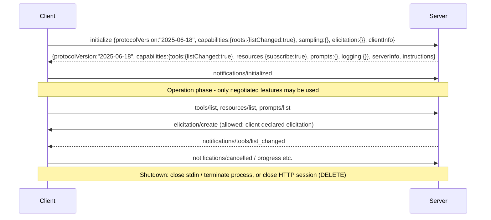

# Q20. What are MCP's transports and primitives, and when do you use each?

[← Back to questions](../questions.md)

## TL;DR

- **Transports** (how JSON-RPC 2.0 messages travel):
  - **stdio**: the host launches the server as a local subprocess and they exchange newline-delimited JSON over stdin and stdout. Use it for local, single-user tools (filesystem, git, CLI wrappers).
  - **Streamable HTTP**: a single HTTP endpoint that accepts POST requests and can respond with JSON or an SSE stream, with optional GET for server-initiated messages and the `Mcp-Session-Id` header. Use it for **remote, multi-user, shared** servers, secured with OAuth 2.1.
  - **HTTP+SSE** (two endpoints) is the **legacy** transport from spec 2024-11-05. Support it only for backward compatibility.
- **Server primitives:**
  - **Tools** are model-controlled actions.
  - **Resources** are application-controlled, read-only context identified by URI.
  - **Prompts** are user-controlled templates.
- **Client primitives:**
  - **Sampling**: the server requests an LLM completion from the host.
  - **Elicitation**: the server requests input or confirmation from the user.
  - **Roots**: the client tells the server which directories or URIs it may operate in.
- **Lifecycle:** `initialize` (version and **capability negotiation**), `notifications/initialized`, the operation phase, then shutdown. Each side may only use features the other side advertised.

## Detailed Answer

### 1. Layers

```
┌──────────────────────────────────────────────────────────┐
│  Primitives:  tools | resources | prompts  (server)      │
│               sampling | elicitation | roots (client)    │
│  Utilities:   progress, cancellation, logging, ping,     │
│               completion, pagination, list_changed        │
├──────────────────────────────────────────────────────────┤
│  Data layer:  JSON-RPC 2.0 (requests, responses, notifs) │
│               + lifecycle & capability negotiation        │
├──────────────────────────────────────────────────────────┤
│  Transport:   stdio  |  Streamable HTTP  (SSE = legacy)  │
└──────────────────────────────────────────────────────────┘
```

### 2. Transports compared

| | **stdio** | **Streamable HTTP** | HTTP+SSE (legacy) |
|---|---|---|---|
| Spec | All versions | 2025-03-26 onward | 2024-11-05 |
| Topology | Host spawns a subprocess, 1 client to 1 server | Independent server process, many clients | Separate POST and SSE endpoints |
| Messages | Newline-delimited JSON-RPC on stdin/stdout. Logs go to stderr. | `POST /mcp` with a JSON-RPC body. The response is `application/json` or `text/event-stream` (SSE). Optional `GET /mcp` stream for server-to-client messages. | `GET /sse` long-lived stream plus `POST /messages` |
| Sessions | Implicit (process lifetime) | `Mcp-Session-Id` header (optional, server-assigned). The `MCP-Protocol-Version` header goes on later requests. | Endpoint event |
| Auth | Environment variables or local credentials. No OAuth. | **OAuth 2.1** (MCP server as resource server). Validate `Origin`. | Ad hoc |
| Scaling | Per user machine | Behind a load balancer. Can run stateless (`stateless_http=True` in FastMCP) for horizontal scaling. | Sticky connections, hard to scale |
| Use when | Local dev tools, IDE and desktop integrations, sensitive local files | SaaS integrations, shared enterprise tool platforms, serverless or containers | Only for old clients |

**Rule of thumb:** use stdio if the tool runs on the user's machine with the user's own privileges. Use Streamable HTTP if it is a service that many users or agents share.

Running both with the Python SDK:

```python
from mcp.server.fastmcp import FastMCP

mcp = FastMCP("demo")             # FastMCP("demo", stateless_http=True) for stateless scaling

if __name__ == "__main__":
    import sys
    if "--http" in sys.argv:
        mcp.run(transport="streamable-http")   # serves on http://127.0.0.1:8000/mcp by default
    else:
        mcp.run()                              # stdio
```

Connecting a client over Streamable HTTP:

```python
from mcp import ClientSession
from mcp.client.streamable_http import streamablehttp_client

async def main():
    async with streamablehttp_client("https://mcp.example.com/mcp",
                                     headers={"Authorization": "Bearer <token>"}) as (r, w, _):
        async with ClientSession(r, w) as s:
            await s.initialize()
            print(await s.list_tools())
```

Security notes: a stdio server must **never write non-protocol output to stdout** (use stderr for logs). Local HTTP servers should bind to `127.0.0.1` and validate `Origin` to prevent DNS rebinding.

### 3. Server primitives

| Primitive | Control | Discovery / use | Typical use | Side effects |
|---|---|---|---|---|
| **Tools** | **Model** decides | `tools/list`, `tools/call` | Actions and computations: `create_issue`, `query_db` | Yes (annotate read-only or destructive) |
| **Resources** | **Application** decides (the host or user attaches them) | `resources/list`, `resources/templates/list`, `resources/read`, `resources/subscribe` | Files, DB schemas, docs, logs as context | No (read-only) |
| **Prompts** | **User** picks (slash command, menu) | `prompts/list`, `prompts/get` | Reusable workflows: `/review_pr`, `/incident_summary` | No (they return messages) |

```python
from mcp.server.fastmcp import FastMCP

mcp = FastMCP("kb")

# TOOL: the model calls this when it decides it needs to search
@mcp.tool()
def search_docs(query: str, top_k: int = 5) -> list[str]:
    """Semantic search over the internal knowledge base."""
    return vector_search(query, top_k)

# RESOURCE (static URI): app can attach as context
@mcp.resource("kb://glossary")
def glossary() -> str:
    """Company glossary of terms."""
    return open("glossary.md").read()

# RESOURCE TEMPLATE (parameterized URI)
@mcp.resource("kb://docs/{doc_id}")
def get_doc(doc_id: str) -> str:
    """Full text of a document by ID."""
    return load_doc(doc_id)

# PROMPT: user-selected template
@mcp.prompt()
def summarize_incident(incident_id: str) -> str:
    """Summarize an incident for an exec audience."""
    return (f"Read incident {incident_id} using the tools available and write a "
            "5-bullet executive summary: impact, root cause, timeline, fix, follow-ups.")
```

**Tool or resource?** If the model should decide on its own to fetch it, or it has parameters that need reasoning, make it a **tool**. If it is context that the user or app explicitly selects, or the client can subscribe to changes, make it a **resource**. Many hosts support tools better than resources, so teams often also expose a `read_x` tool.

### 4. Client primitives

| Primitive | Direction | Purpose | Example |
|---|---|---|---|
| **Sampling** (`sampling/createMessage`) | Server → client | The server needs an LLM completion. It uses the host's model, with no API key of its own, and the host keeps control (human review, model choice). | A server summarizes a large diff before returning it |
| **Elicitation** (`elicitation/create`) | Server → client | Ask the user for structured input (flat JSON schema) or confirmation in the middle of an operation. The user can accept, decline or cancel. | "Confirm deletion?", "Which environment: dev or prod?" |
| **Roots** (`roots/list`) | Server → client (the client notifies on changes) | The client declares the filesystem or URI boundaries the server should work in | A filesystem server is limited to `file:///home/alice/project` |

```python
from pydantic import BaseModel
from mcp.server.fastmcp import FastMCP, Context
from mcp.types import SamplingMessage, TextContent

mcp = FastMCP("helper")

class Env(BaseModel):
    environment: str          # flat, primitive fields only for elicitation schemas

@mcp.tool()
async def deploy(service: str, ctx: Context) -> str:
    """Deploy a service; asks the user which environment."""
    r = await ctx.elicit(message=f"Deploy {service} to which environment?", schema=Env)
    if r.action != "accept":
        return "Deployment cancelled."
    return f"Deploying {service} to {r.data.environment}"

@mcp.tool()
async def summarize_text(text: str, ctx: Context) -> str:
    """Summarize text using the client's LLM via sampling."""
    result = await ctx.session.create_message(
        messages=[SamplingMessage(role="user",
                                  content=TextContent(type="text", text=f"Summarize:\n{text}"))],
        max_tokens=200,
    )
    return result.content.text if result.content.type == "text" else ""
```

The server can only use sampling, elicitation or roots if the **client advertised** the capability during `initialize`.

### 5. Lifecycle and capability negotiation



- **Version negotiation:** the client proposes a version. The server replies with the same one or one it supports, and the client disconnects if it cannot support that.
- **Capabilities** decide which features are available. For example, `tools.listChanged` means the server may emit change notifications.
- **Utilities** include `ping`, progress notifications (`progressToken`), cancellation, logging (`notifications/message`), argument **completion** and cursor **pagination** for lists.

### 6. Choosing quickly

| Need | Use |
|---|---|
| Let the agent act (create, update, query) | Tool |
| Give the agent or user a document or schema as context | Resource |
| Offer a reusable workflow to users | Prompt |
| The server needs an LLM but should not hold API keys | Sampling |
| Confirm a dangerous step or gather missing parameters | Elicitation |
| Restrict which folders a server may touch | Roots |
| Local, single user | stdio |
| Remote, shared, authenticated | Streamable HTTP + OAuth 2.1 |

## Common Pitfalls

- Printing debug logs to stdout in a stdio server, which corrupts the JSON-RPC stream.
- Building new remote servers on the legacy SSE transport.
- Putting everything in tools when parts are really static context, or putting needed data in resources that the host never attaches.
- Calling sampling or elicitation without checking that the client advertised the capability.
- Treating roots as a security boundary. They are guidance from the client, and the server must still enforce path checks.
- Using elicitation to request secrets or passwords, which the spec says servers must not do.

## Likely Follow-up Questions

1. **Why did Streamable HTTP replace HTTP+SSE?**
   It uses a single endpoint, works with plain request and response for simple calls, streams only when needed, can run stateless, and works better with load balancers and serverless platforms.
2. **Can a Streamable HTTP server be stateless?**
   Yes. Run without session state (FastMCP `stateless_http=True`). You lose server-initiated requests that depend on a session, but scaling becomes easy.
3. **How does a client learn that the tool list changed?**
   If the server advertised `tools.listChanged`, it sends `notifications/tools/list_changed` and the client calls `tools/list` again.
4. **What content types can tools return?**
   Text, image, audio, resource links and embedded resources, plus `structuredContent` that matches an optional `outputSchema` (2025-06-18 onward).
5. **Who controls the model used in sampling?**
   The client or host. The server can only send `modelPreferences` hints (cost, speed, intelligence priorities). The host may also require the user to approve the request.

[← Back to questions](../questions.md)
