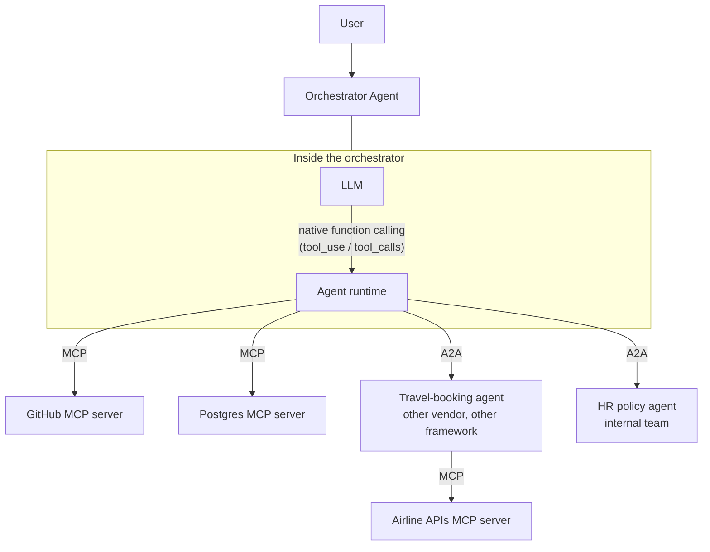

# Q21. MCP vs native function calling vs A2A (Agent2Agent) protocol — how do they differ?

[← Back to questions](../questions.md)

## TL;DR

- **Native function calling** is a **model capability**. You pass tool schemas in the API request, the model returns a structured "call this function with these arguments", and **your code** executes it. It is in-process and provider-specific in format.
- **MCP (Model Context Protocol)**, from Anthropic (Nov 2024), is an **agent-to-tool/data protocol**. It standardizes how an AI application *discovers and invokes* tools, resources and prompts hosted in separate servers, using JSON-RPC 2.0 over stdio or Streamable HTTP. It is built *on top of* function calling.
- **A2A (Agent2Agent)**, introduced by Google in April 2025 and now a Linux Foundation project, is an **agent-to-agent protocol**. Independent, opaque agents built on any framework advertise skills in an **Agent Card**, then collaborate through **tasks**, messages and artifacts over HTTP (JSON-RPC, SSE streaming, push notifications).
- In short: function calling is how a model asks for an action, MCP is how an agent reaches tools and context, and A2A is how agents delegate to other agents.
- They are **complementary layers**, not competitors. A typical system uses all three: an orchestrator agent uses function calling internally, reaches tools through MCP, and delegates whole sub-tasks to remote specialist agents through A2A.

## Detailed Answer

### 1. Layered picture



### 2. Native function calling

```python
# Anthropic Messages API example
import anthropic
client = anthropic.Anthropic()

tools = [{
    "name": "get_weather",
    "description": "Get current weather for a city.",
    "input_schema": {"type": "object",
                     "properties": {"city": {"type": "string"}},
                     "required": ["city"]},
}]

resp = client.messages.create(
    model="claude-sonnet-4-5", max_tokens=512, tools=tools,
    messages=[{"role": "user", "content": "Weather in Pune?"}],
)
for block in resp.content:
    if block.type == "tool_use":
        result = get_weather(**block.input)     # YOUR code executes it
        # ...send back a tool_result block in the next request
```

- The schema format differs by provider: OpenAI `tools=[{"type":"function","function":{...}}]` and `tool_calls`, Anthropic `tool_use` / `tool_result`, Bedrock Converse `toolConfig` / `toolUse`.
- Tools are defined **per request, in your app**. There is no discovery, no remote execution and no standard auth.
- It is simple, fast and has no extra infrastructure, which makes it right for a handful of app-specific functions.

### 3. MCP

- The **host/client/server** architecture separates tools from apps. Any MCP host (Claude, ChatGPT, Cursor, VS Code, LangGraph through adapters) can use any MCP server.
- Its primitives go beyond tools: **resources** (context), **prompts** (templates), and client features such as **sampling**, **elicitation** and **roots**.
- **Dynamic discovery** through `tools/list` and `list_changed` notifications.
- **Transports and security:** stdio for local, Streamable HTTP + OAuth 2.1 for remote, with the server as a resource server and no token passthrough.
- The host still converts MCP tool definitions into the model's native function-calling format. **MCP does not replace function calling. It feeds it.**

```python
# MCP tool, reusable by any MCP host
from mcp.server.fastmcp import FastMCP
mcp = FastMCP("weather")

@mcp.tool()
def get_weather(city: str) -> str:
    """Get current weather for a city."""
    return lookup(city)

mcp.run(transport="streamable-http")
```

### 4. A2A (Agent2Agent)

Core concepts:

| Concept | Meaning |
|---|---|
| **Agent Card** | JSON metadata, served at a well-known URL (`/.well-known/agent-card.json`, previously `agent.json`), describing the agent's name, endpoint URL, **skills**, supported modalities, capabilities (streaming, push notifications) and **security schemes** (OAuth2, API key, OIDC, mTLS) |
| **Task** | The unit of work, with an ID and a lifecycle: `submitted → working → input-required → completed / failed / canceled` (plus states such as `rejected` and `auth-required`) |
| **Message** | A turn between the client agent and the remote agent (role `user` or `agent`), made of **Parts** |
| **Part** | `TextPart`, `FilePart`, `DataPart` (structured JSON) |
| **Artifact** | An output produced by the task (a document, image, structured data) |
| **Transport** | HTTP(S) with JSON-RPC 2.0 methods such as `message/send`, `message/stream` (SSE), `tasks/get`, `tasks/cancel` and push-notification config. Later versions also define gRPC and REST bindings. |

Example JSON-RPC request (simplified):

```json
{"jsonrpc": "2.0", "id": "1", "method": "message/send",
 "params": {"message": {
   "role": "user", "messageId": "m-001",
   "parts": [{"kind": "text", "text": "Book a flight BOM→SFO on Dec 12, economy, under $1200"}]
 }}}
```

Response (simplified):

```json
{"jsonrpc": "2.0", "id": "1", "result": {
  "kind": "task", "id": "task-42", "contextId": "ctx-9",
  "status": {"state": "input-required",
             "message": {"role": "agent", "parts": [{"kind": "text",
               "text": "Two options found. Do you prefer a layover in Doha or Frankfurt?"}]}}
}}
```

Key design ideas:
- **Opaque agents.** The remote agent does not expose its internal tools, memory or prompts, only skills and results. This protects IP and keeps teams decoupled.
- **Long-running and multi-turn** work, with `input-required` and streaming or push updates. That suits work that takes minutes or hours.
- **Framework-agnostic**: ADK, LangGraph, CrewAI, Semantic Kernel or custom code can all speak A2A.

### 5. Comparison table

| Dimension | Native function calling | MCP | A2A |
|---|---|---|---|
| What it connects | Model ↔ your code | Agent / app ↔ tools and data | Agent ↔ agent |
| Origin | LLM providers (OpenAI 2023, then the others) | Anthropic, Nov 2024 (open spec) | Google, Apr 2025, now Linux Foundation |
| Level | Model API feature | Integration protocol | Collaboration protocol |
| Unit of interaction | A single function call | Tool call, resource read, prompt get | **Task** with lifecycle, messages, artifacts |
| Counterparty | Deterministic function | Usually deterministic tool or data source | Autonomous agent with its own LLM and reasoning |
| Discovery | None (static per request) | `tools/list`, `resources/list`, etc. after `initialize` | **Agent Card** at a well-known URL |
| Wire format | Provider-specific JSON in the chat API | JSON-RPC 2.0 over stdio / Streamable HTTP | JSON-RPC 2.0 over HTTP(S), SSE, push notifications (plus gRPC/REST bindings) |
| State | Stateless per request | Session (capabilities, subscriptions) | Stateful tasks, possibly long-running |
| Transparency | Full (your code) | Tool schemas are visible to the model | Opaque. Only skills and outputs are exposed. |
| Auth | Your app's concern | OAuth 2.1 (server = resource server) | Declared in the Agent Card (OAuth2/OIDC, API keys, mTLS) |
| Multi-turn / human input | Handled by the app | Elicitation (user input mid-call) | Native `input-required` state |
| Best for | A few in-app functions | Reusable tool and data integrations across apps | Cross-team, cross-vendor delegation to specialist agents |

### 6. When to use which

```
Is the thing you're calling a deterministic function/API/data source?
├── Yes ─┬─ Used only by this one app, small & private?      → native function calling
│        └─ Shared across apps/teams, needs auth/discovery?    → MCP server
└── No, it's an autonomous agent that plans/reasons on its own,
    possibly long-running, owned by another team/vendor?       → A2A
```

Examples:
- A chatbot with `get_time` and `calc`: **function calling**.
- An enterprise "tool platform" exposing Jira, GitHub, Confluence and Snowflake to every internal assistant: **MCP**.
- A procurement orchestrator that delegates to a supplier's quoting agent and a legal-review agent built by other teams: **A2A**, with each of those agents probably using MCP internally.

### 7. Can MCP be used for agent-to-agent communication?

Technically yes. You can wrap an agent as an MCP tool (`ask_research_agent(question)`), and MCP sampling and elicitation add some interactivity. This works for simple, synchronous delegation. A2A is designed for the harder cases: capability advertisement through Agent Cards, long-running tasks with status, streaming, push notifications, multi-turn negotiation, artifacts, and opaque agents across organizational boundaries.

### 8. Security considerations

| | Key risks | Controls |
|---|---|---|
| Function calling | The model picks wrong or harmful arguments | Validate arguments, least privilege, approvals in your code |
| MCP | Tool poisoning (malicious descriptions), over-privileged servers, token passthrough, prompt injection via tool output | Vet servers, pin versions, OAuth 2.1 audience binding, per-server credentials, guardrails on outputs |
| A2A | Impersonated or malicious agents, fake Agent Cards, data leakage to third-party agents, injection through messages | Agent Card signing or verification, mTLS/OAuth, allowlisted agents, data classification before delegation, treat responses as untrusted |

## Common Pitfalls

- Saying "MCP replaces function calling". MCP tools still reach the model through function calling.
- Saying "A2A competes with MCP". Google and Anthropic both position them as complementary (agent-to-agent vs agent-to-tool).
- Wrapping every internal function as a remote MCP server, which adds latency and operational overhead with no reuse benefit.
- Using A2A for simple deterministic API calls, which over-engineers them.
- Trusting remote agents' outputs as authoritative. They are untrusted input to your agent.
- Forgetting that discovery mechanisms (Agent Cards, tool lists) are themselves an attack surface.

## Likely Follow-up Questions

1. **What is an Agent Card?**
   A JSON document at a well-known URL that describes an A2A agent: name, description, endpoint, skills (with examples and input and output modes), capabilities (streaming, push) and the authentication schemes it requires.
2. **How do A2A tasks handle long-running work?**
   The task moves through states. Clients poll `tasks/get`, subscribe with SSE (`message/stream`), or register a webhook for push notifications. The `input-required` state pauses for more information.
3. **Would you expose your agent over MCP or A2A?**
   MCP if consumers want to use it as a tool (a short, deterministic-ish call within their agent loop). A2A if it is a full agent doing multi-step, long-running work with its own reasoning. Some teams expose both.
4. **How does LangGraph fit?**
   LangGraph builds the agent internally (function calling plus state). `langchain-mcp-adapters` loads MCP tools into it, and a LangGraph agent can be exposed as an A2A server or call A2A agents as nodes.
5. **Are there other protocols in this space?**
   Yes, for example IBM's ACP (Agent Communication Protocol, since merged into A2A under the Linux Foundation) and ANP (Agent Network Protocol). In the industry, MCP and A2A have become the de facto pair.

[← Back to questions](../questions.md)
