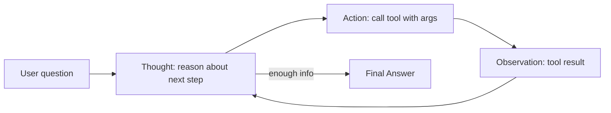
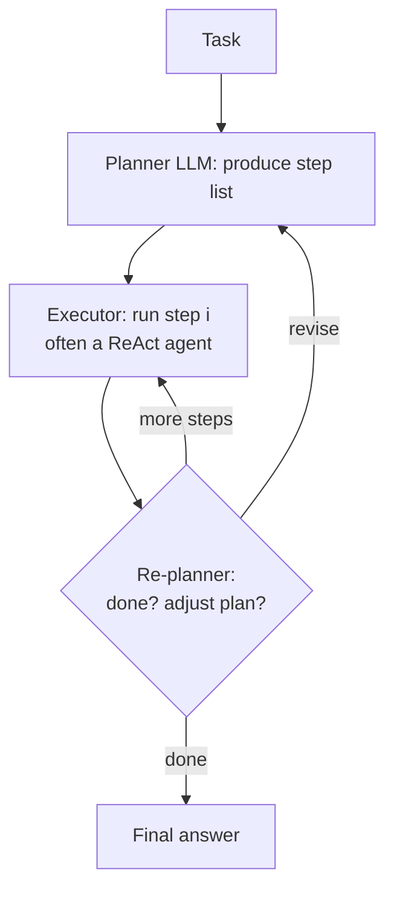
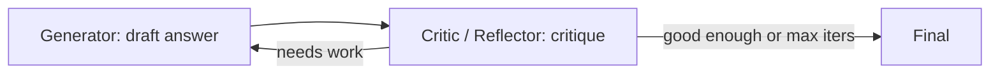

# Q22. What is the ReAct pattern and how does it compare to plan-and-execute and reflection?

[← Back to questions](../questions.md)

## TL;DR

- **ReAct (Reason + Act)**, from Yao et al. 2022, is a loop of **Thought → Action (tool call) → Observation**. The model reasons, calls a tool, sees the result, and repeats until it can answer.
- Modern ReAct uses **native tool calling** instead of parsing `Thought/Action:` text. `create_agent` and LangGraph's `create_react_agent` are ReAct loops (agent node ⇄ tool node).
- **Plan-and-execute** has the LLM write a **full plan first**, then executes the steps (often with a cheaper model or a ReAct sub-agent) and **re-plans** as needed. It suits long, multi-step tasks and makes fewer expensive calls.
- **Reflection** (Reflexion, self-critique) adds a **critic step** that reviews the output and feeds criticism back for another attempt. It is a quality booster, often layered on top of ReAct or plan-and-execute.
- Rule of thumb: **ReAct** for interactive tool use with short horizons, **plan-and-execute** for structured long tasks, **reflection** when output quality matters more than latency and cost.

## Detailed Answer

### 1. ReAct loop



Original text format (legacy prompting):

```
Question: What is the population of the capital of France squared?
Thought: I need the capital of France and its population.
Action: search
Action Input: "capital of France population"
Observation: Paris has about 2.1 million residents.
Thought: Now square 2.1 million.
Action: calculator
Action Input: 2100000**2
Observation: 4.41e12
Thought: I now know the final answer.
Final Answer: About 4.41 trillion.
```

Why it works: interleaving reasoning with actions **grounds** the reasoning in real observations, which reduces hallucination compared with chain-of-thought alone. Acting with a reason attached gives better tool choices than acting without one.

### 2. ReAct in LangGraph

```python
from langgraph.graph import StateGraph, START, MessagesState
from langgraph.prebuilt import ToolNode, tools_condition
from langchain_openai import ChatOpenAI
from langchain_core.tools import tool

@tool
def search(query: str) -> str:
    """Web search."""
    return "Paris has about 2.1 million residents."

@tool
def calculator(expression: str) -> str:
    """Evaluate a math expression."""
    return str(eval(expression, {"__builtins__": {}}))   # demo only

tools = [search, calculator]
llm = ChatOpenAI(model="gpt-4o").bind_tools(tools)

def agent(state: MessagesState):
    return {"messages": [llm.invoke(state["messages"])]}

g = StateGraph(MessagesState)
g.add_node("agent", agent)
g.add_node("tools", ToolNode(tools))
g.add_edge(START, "agent")
g.add_conditional_edges("agent", tools_condition)   # tool_calls? -> tools : END
g.add_edge("tools", "agent")
react = g.compile()

# Equivalent one-liners:
# from langgraph.prebuilt import create_react_agent; create_react_agent("openai:gpt-4o", tools)
# from langchain.agents import create_agent; create_agent("openai:gpt-4o", tools)
```

### 3. Plan-and-execute



```python
import operator
from typing import Annotated, TypedDict
from pydantic import BaseModel
from langgraph.graph import StateGraph, START, END
from langgraph.prebuilt import create_react_agent

class Plan(BaseModel):
    steps: list[str]

class Replan(BaseModel):
    done: bool
    final_answer: str | None = None
    remaining_steps: list[str] = []

class PEState(TypedDict):
    task: str
    plan: list[str]
    past_steps: Annotated[list[tuple[str, str]], operator.add]
    answer: str | None

planner = ChatOpenAI(model="gpt-4o").with_structured_output(Plan)
replanner = ChatOpenAI(model="gpt-4o").with_structured_output(Replan)
executor = create_react_agent(ChatOpenAI(model="gpt-4o-mini"), tools)

def plan_step(s: PEState):
    return {"plan": planner.invoke(f"Make a short step-by-step plan for: {s['task']}").steps}

def execute_step(s: PEState):
    step = s["plan"][0]
    out = executor.invoke({"messages": [("user", f"Task: {s['task']}\nDo this step: {step}")]})
    return {"past_steps": [(step, out["messages"][-1].content)]}

def replan_step(s: PEState):
    r = replanner.invoke(
        f"Task: {s['task']}\nDone so far: {s['past_steps']}\nRemaining: {s['plan'][1:]}\n"
        "If finished, give final_answer; else return updated remaining_steps."
    )
    if r.done:
        return {"answer": r.final_answer, "plan": []}
    return {"plan": r.remaining_steps}

g = StateGraph(PEState)
g.add_node("planner", plan_step); g.add_node("executor", execute_step); g.add_node("replan", replan_step)
g.add_edge(START, "planner"); g.add_edge("planner", "executor"); g.add_edge("executor", "replan")
g.add_conditional_edges("replan", lambda s: END if s["answer"] or not s["plan"] else "executor")
pe_agent = g.compile()
```

Variants: **ReWOO** (plan with variable placeholders, run every tool, then solve, with no LLM call between tools) and **LLMCompiler** (plans a DAG of tasks and runs independent ones in parallel).

### 4. Reflection



```python
class RState(MessagesState):
    iterations: int

gen = ChatOpenAI(model="gpt-4o")
critic = ChatOpenAI(model="gpt-4o")

def generate(s: RState):
    return {"messages": [gen.invoke([("system", "Write the best possible answer.")] + s["messages"])],
            "iterations": s.get("iterations", 0) + 1}

def reflect(s: RState):
    critique = critic.invoke([
        ("system", "You are a strict reviewer. List concrete flaws. Reply 'APPROVED' if none."),
        ("user", s["messages"][-1].content),
    ])
    # feed critique back as a user turn so the generator revises
    return {"messages": [("user", f"Critique: {critique.content}\nRevise accordingly.")]}

def should_continue(s: RState):
    if s["iterations"] >= 3 or "APPROVED" in s["messages"][-1].content:
        return END
    return "generate"

g = StateGraph(RState)
g.add_node(generate); g.add_node(reflect)
g.add_edge(START, "generate"); g.add_edge("generate", "reflect")
g.add_conditional_edges("reflect", should_continue)
reflection_agent = g.compile()
```

Flavours:

- **Basic reflection**: the LLM critiques itself.
- **Reflexion** (Shinn et al. 2023): the critique is grounded in external feedback (test results, tool outputs) and **stored as memory** for later attempts.
- **LATS** (Language Agent Tree Search): reflection plus Monte Carlo tree search over candidate trajectories.
- **Evaluator-optimizer**: Anthropic's name for a generator/evaluator loop.

### 5. Comparison

| Dimension | ReAct | Plan-and-Execute | Reflection |
|---|---|---|---|
| Core idea | Interleave reasoning and tool calls | Plan upfront, execute, re-plan | Critique and revise output |
| LLM calls | One big-model call per step | Planner calls are big, steps can use a small model | 2× or more per iteration |
| Horizon | Short to medium | Long, multi-step | Any (wraps others) |
| Adaptivity | High (reacts to each observation) | Medium (at re-plan points) | High on quality, not on tools |
| Explicit plan visible | No | Yes (auditable, editable by a human) | No |
| Parallelism | Parallel tool calls in one step | Possible (LLMCompiler DAG) | No |
| Failure mode | Loops, myopic choices, context bloat | Stale plan, over-planning | Cost and latency, sycophantic critic |
| Best for | Q&A with tools, support bots | Research, report writing, data pipelines | Code generation, writing, high-stakes answers |

### 6. Combining them

Production agents often combine all three: a **planner** produces steps, each step runs as a **ReAct** sub-agent, and a **reflection or evaluator** node checks the final output (for example by running unit tests) before returning.

## Common Pitfalls

- **ReAct without iteration limits.** The agent loops calling the same tool. Set `recursion_limit` and detect repeated calls.
- **Text-parsed ReAct with modern models.** It is brittle. Prefer native tool calling.
- **Plans that never adapt.** Always add a re-plan step after observations.
- **Self-reflection without grounding.** The model often "approves" its own mistakes. Use external signals such as tests, validators, or a different model.
- **Reflection in latency-critical paths**, where it multiplies cost and response time.

## Likely Follow-up Questions

1. **Is `create_react_agent` "true" ReAct?** It follows the ReAct loop, but the "thought" is implicit in the model's reasoning. Actions are native tool calls, not parsed text.
2. **Why plan-and-execute over ReAct?** Better for long tasks: an explicit plan you can audit, fewer large-model calls, and cheaper executors.
3. **When does reflection hurt?** When the critic has no new information. Then it adds cost and can make output worse or sycophantic.
4. **What is ReWOO?** Reasoning WithOut Observation. It plans every tool call upfront with variable references and avoids an LLM call between steps.
5. **How do you evaluate these patterns?** Task success rate, number of steps, tokens and cost, latency, and trajectory evals in LangSmith.

[← Back to questions](../questions.md)
