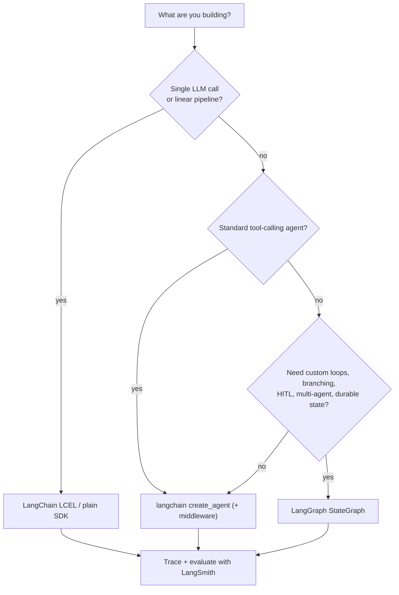

# Q23. LangChain vs LangGraph vs LangSmith — what does each do, and when do you choose LangGraph?

[← Back to questions](../questions.md)

## TL;DR

- **LangChain** is the **integration and abstraction layer**: chat models, prompts, tools, retrievers, vector stores, output parsers, LCEL (`prompt | llm | parser`). In **v1** it also offers a high-level **`create_agent`** with middleware, built on LangGraph.
- **LangGraph** is the **low-level orchestration runtime** for stateful, long-running, multi-step and multi-agent apps: graphs of nodes and edges, cycles, shared state with reducers, **checkpointing, human-in-the-loop, streaming, time travel, subgraphs**. It can be used without LangChain.
- **LangSmith** is the **observability and evaluation platform**: tracing, debugging, datasets, evals (LLM-as-judge, custom), prompt hub, monitoring, plus **deployment** of LangGraph apps (formerly "LangGraph Platform").
- Choose **LangGraph** when you need **loops, branching, durable state, HITL, multiple agents, or fine-grained control** over an agent's flow. Use plain LangChain (LCEL or `create_agent`) for simple chains, RAG, and standard tool-calling agents.
- They are **complementary**. A typical stack uses LangChain integrations inside LangGraph nodes, traced and evaluated in LangSmith.

## Detailed Answer

### 1. How the pieces fit

```
┌───────────────────────────── LangSmith ─────────────────────────────┐
│  Tracing · Evals · Datasets · Prompt Hub · Monitoring · Deployment   │
└───────────────────────────────▲─────────────────────────────────────┘
                                │ traces (env: LANGSMITH_TRACING=true)
┌───────────────────────────────┴─────────────────────────────────────┐
│ Your app                                                             │
│  ┌─────────────── LangGraph (orchestration runtime) ───────────────┐ │
│  │ StateGraph · checkpointer · interrupt · Send · streaming        │ │
│  │   node A ─────► node B ─────► node C (loop)                     │ │
│  │    uses          uses          uses                             │ │
│  └────┬──────────────┬──────────────┬──────────────────────────────┘ │
│  ┌────▼──────────────▼──────────────▼──────────────────────────────┐ │
│  │ LangChain: ChatModels · Tools · Retrievers · VectorStores ·      │ │
│  │            Prompts · LCEL · create_agent (+ middleware)         │ │
│  └──────────────────────────────────────────────────────────────────┘ │
└──────────────────────────────────────────────────────────────────────┘
```

### 2. LangChain

What it offers:

- **Standard interfaces** over many providers: `ChatOpenAI`, `ChatAnthropic`, `init_chat_model("provider:model")`.
- **Runnables / LCEL** for composable pipelines with `.invoke`, `.stream`, `.batch`, and async versions.
- **Tools** (`@tool`), `bind_tools`, `with_structured_output`.
- **RAG components**: document loaders, text splitters, embeddings, vector stores, retrievers.
- **Agents (v1)**: `create_agent(model, tools, middleware=[...])`.

```python
from langchain_core.prompts import ChatPromptTemplate
from langchain_core.output_parsers import StrOutputParser
from langchain.chat_models import init_chat_model

llm = init_chat_model("openai:gpt-4o-mini")
chain = (ChatPromptTemplate.from_template("Summarize in 1 line: {text}")
         | llm | StrOutputParser())
chain.invoke({"text": "LangGraph is a low-level orchestration framework..."})
```

LCEL is great for **DAGs** (linear or branching without cycles). It has no built-in persistence, cycles, or pause/resume.

### 3. LangGraph

Core concepts: **State** (typed schema + reducers), **Nodes** (functions), **Edges** (static or conditional), **Command** (update + goto), **Send** (dynamic fan-out), **checkpointer**, **store**, **interrupt**.

```python
from langgraph.graph import StateGraph, START, END, MessagesState
from langgraph.checkpoint.memory import InMemorySaver
from langgraph.prebuilt import ToolNode, tools_condition

def agent(state: MessagesState):
    return {"messages": [llm_with_tools.invoke(state["messages"])]}

g = StateGraph(MessagesState)
g.add_node("agent", agent)
g.add_node("tools", ToolNode(tools))
g.add_edge(START, "agent")
g.add_conditional_edges("agent", tools_condition)
g.add_edge("tools", "agent")                       # cycle
app = g.compile(checkpointer=InMemorySaver())      # durable, resumable
```

What it gives you that LangChain alone doesn't:

| Capability | Why it matters |
|---|---|
| **Cycles** | Agents loop until done |
| **Explicit control flow** | Deterministic routing, guards, retries |
| **Persistence** | Memory across turns, crash recovery |
| **Human-in-the-loop** | `interrupt()` / breakpoints for approvals |
| **Time travel** | Replay and fork from earlier checkpoints |
| **Streaming** | Tokens, node updates, custom events |
| **Multi-agent / subgraphs** | Compose agents as nodes |
| **Parallelism** | Fan-out/fan-in, `Send` map-reduce |
| **Functional API** | `@entrypoint` / `@task` decorators for people who prefer plain code |

### 4. LangSmith

```bash
export LANGSMITH_TRACING=true
export LANGSMITH_API_KEY=...
export LANGSMITH_PROJECT=my-agent
```

- **Tracing**: every LLM, tool, and node call, with inputs and outputs, latency, tokens, and cost. It works for LangChain/LangGraph and also for plain code via `@traceable` or OpenTelemetry.
- **Evaluation**: datasets, experiments, LLM-as-judge and heuristic evaluators, pairwise comparisons, online evals on production traffic.
- **Prompt management**: versioned prompts in the hub, plus a playground.
- **Monitoring**: dashboards, alerts, feedback collection.
- **Deployment** (formerly LangGraph Platform / Cloud): hosts LangGraph apps with managed persistence, task queues, cron, a REST API, and **LangGraph Studio** for visual debugging.

```python
from langsmith import traceable, Client

@traceable(name="rerank")
def rerank(docs): ...

client = Client()
# client.evaluate(target_fn, data="my-dataset", evaluators=[correctness])
```

### 5. Comparison

| | LangChain | LangGraph | LangSmith |
|---|---|---|---|
| Category | Framework (integrations + abstractions) | Orchestration runtime | Platform (SaaS / self-host) |
| Main unit | Runnable / chain / agent | Graph of nodes + state | Trace / run / dataset |
| Cycles | No (LCEL); agents via LangGraph | Yes | n/a |
| State & persistence | No (beyond memory helpers) | Checkpointer + store | Stores traces, not app state |
| HITL | Via middleware (runs on LangGraph) | Native | Annotation queues for human review |
| Open source | Yes (MIT) | Yes (MIT) | Proprietary (SDK is open) |
| Needed for production? | Optional | Optional | Strongly recommended for observability |

### 6. Decision guide



Choose **LangGraph** when:

- The flow has **loops** (retry, reflect, re-plan) or **conditional branches** you want to control in code.
- You need **human approval**, pause/resume, or **long-running** jobs that span minutes to days.
- You're building **multi-agent** systems (supervisor, swarm, hierarchical).
- You need **fault tolerance** (resume after a crash) or **auditability** (state history).
- You want **production streaming** of intermediate steps to a UI.

You don't need it for a one-shot RAG answer, simple classification or extraction, or a basic chatbot with no tools.

## Common Pitfalls

- Thinking LangGraph needs LangChain. It doesn't. Nodes can call any SDK (OpenAI, Anthropic, plain HTTP).
- Building complex agents with LCEL `RunnableBranch`/`RunnableLambda` hacks instead of a graph.
- Over-engineering simple pipelines with LangGraph when a 3-step chain is enough.
- Skipping LangSmith (or other tracing). Agents can't be debugged without traces.
- Confusing `langchain.agents.create_react_agent` (legacy) with `langgraph.prebuilt.create_react_agent`.

## Likely Follow-up Questions

1. **Is `create_agent` LangChain or LangGraph?** It's LangChain's high-level API, and it **compiles to a LangGraph graph**, so you get checkpointing and streaming.
2. **Can LangSmith trace non-LangChain code?** Yes, via `@traceable`, `wrap_openai`, or OpenTelemetry.
3. **What's LangGraph Studio?** A visual IDE for graphs: run, inspect state, edit state, time-travel. It works with local dev servers (`langgraph dev`).
4. **LangGraph vs CrewAI/AutoGen?** LangGraph is lower-level with explicit state and edges and strong persistence and HITL. The others are higher-level role/conversation abstractions.
5. **What's the Functional API?** `@entrypoint` and `@task` decorators give LangGraph persistence and interrupts to ordinary Python control flow without defining a graph.

[← Back to questions](../questions.md)
