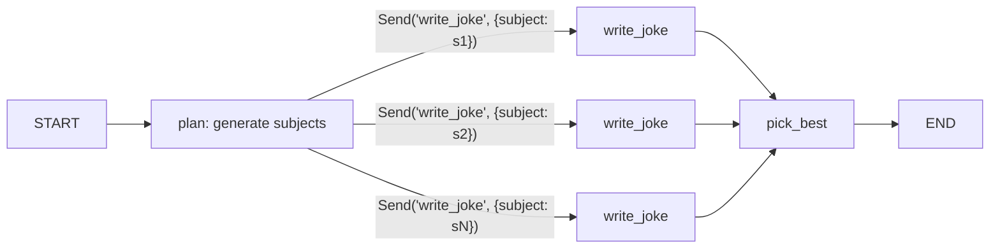

# Q25. How do you run parallel branches / map-reduce in LangGraph with the Send API?

[← Back to questions](../questions.md)

## TL;DR

- **Static parallelism**: add several edges out of one node (`add_edge("a", "b")`, `add_edge("a", "c")`). `b` and `c` run in the **same super-step**. Fan back in with `add_edge(["b", "c"], "d")`, which waits for both.
- **Dynamic parallelism (map-reduce)**: when the **number of branches is only known at runtime**, a conditional edge returns a list of **`Send(node_name, payload)`** objects. Each `Send` starts one invocation of the node with **its own input** (which can differ from the graph state).
- The **reduce** step comes from a **reducer** on the shared key (for example `Annotated[list, operator.add]`). Each worker returns a partial result and LangGraph merges them.
- Parallel branches run **concurrently** in one super-step. If one fails, the super-step fails, and the successful branches' writes are kept as **pending writes** so retries don't redo them.
- Control concurrency with `config={"max_concurrency": N}`. `Command(goto=[Send(...), ...])` also works from inside a node.

## Detailed Answer

### 1. Static fan-out / fan-in

```python
import operator
from typing import Annotated, TypedDict
from langgraph.graph import StateGraph, START, END

class S(TypedDict):
    query: str
    results: Annotated[list[str], operator.add]   # reducer required for parallel writes

def web(s):  return {"results": [f"web hit for {s['query']}"]}
def docs(s): return {"results": [f"doc hit for {s['query']}"]}
def kb(s):   return {"results": [f"kb hit for {s['query']}"]}
def merge(s): return {"results": []}               # could rerank/dedupe here

g = StateGraph(S)
for fn in (web, docs, kb, merge):
    g.add_node(fn)
g.add_edge(START, "web"); g.add_edge(START, "docs"); g.add_edge(START, "kb")
g.add_edge(["web", "docs", "kb"], "merge")       # join: waits for all three
g.add_edge("merge", END)
print(g.compile().invoke({"query": "refund policy", "results": []}))
```

```
           ┌──► web ──┐
 START ────┼──► docs ─┼──► merge ──► END     (web, docs, kb = same super-step)
           └──► kb  ──┘
```

Note the difference: `add_edge("web", "merge")` added separately for each branch would trigger `merge` as soon as **any** branch finishes in that step. That works when all branches are in the same super-step, but uneven branch lengths can run `merge` twice. The list form `add_edge([...], "merge")` waits for **all**.

### 2. Dynamic map-reduce with `Send`

Typical case: generate N subtopics, research each in parallel, then combine.



```python
import operator
from typing import Annotated, TypedDict
from pydantic import BaseModel
from langgraph.graph import StateGraph, START, END
from langgraph.types import Send
from langchain_openai import ChatOpenAI

llm = ChatOpenAI(model="gpt-4o-mini")

class Subjects(BaseModel):
    subjects: list[str]

class OverallState(TypedDict):
    topic: str
    subjects: list[str]
    jokes: Annotated[list[str], operator.add]     # REDUCE: concatenate worker outputs
    best: str

class JokeState(TypedDict):                       # per-worker private input
    subject: str

def plan(state: OverallState):
    subs = llm.with_structured_output(Subjects).invoke(
        f"List 4 sub-topics of {state['topic']}").subjects
    return {"subjects": subs}

def fan_out(state: OverallState):                 # MAP: one Send per item
    return [Send("write_joke", {"subject": s}) for s in state["subjects"]]

def write_joke(state: JokeState):
    joke = llm.invoke(f"Write a one-line joke about {state['subject']}").content
    return {"jokes": [joke]}                      # written into OverallState.jokes

def pick_best(state: OverallState):
    best = llm.invoke("Pick the funniest, return it verbatim:\n" + "\n".join(state["jokes"])).content
    return {"best": best}

g = StateGraph(OverallState)
g.add_node("plan", plan)
g.add_node("write_joke", write_joke)
g.add_node("pick_best", pick_best)
g.add_edge(START, "plan")
g.add_conditional_edges("plan", fan_out, ["write_joke"])  # path_map lists possible targets
g.add_edge("write_joke", "pick_best")
g.add_edge("pick_best", END)
app = g.compile()

out = app.invoke({"topic": "databases"}, config={"max_concurrency": 4})
print(out["jokes"], out["best"])
```

What's going on:

- `Send("write_joke", {"subject": s})` schedules a **task** whose input is the given payload, **not** the full graph state. The worker can therefore use a different input schema (`JokeState`).
- The worker's **return value is applied to the parent state** through its reducers. `jokes` accumulates.
- All `Send` tasks run in **one super-step**. `pick_best` runs once in the next super-step, after every worker has finished.

### 3. Send from inside a node with `Command`

```python
from langgraph.types import Command

def plan(state: OverallState) -> Command:
    subs = ["sql", "nosql", "graph"]
    return Command(update={"subjects": subs},
                   goto=[Send("write_joke", {"subject": s}) for s in subs])
```

### 4. Nested map-reduce: subgraph workers

The `Send` target can be a **compiled subgraph**, for example a full ReAct research agent per company:

```python
research_agent = build_research_subgraph().compile()   # input: {"company": str}
g.add_node("research", research_agent)

def fan_out(state):
    return [Send("research", {"company": c, "messages": []}) for c in state["companies"]]
```

The subgraph's output keys that match the parent's (for example `reports` with an `operator.add` reducer) are merged back.

### 5. Failure, retries, and concurrency

| Concern | Behaviour / tool |
|---|---|
| One branch raises | The super-step fails. Successful branches' writes are saved as **pending writes** (with a checkpointer). Re-invoking re-runs only the failed tasks |
| Transient errors | `g.add_node("write_joke", write_joke, retry_policy=RetryPolicy(max_attempts=3))` (import from `langgraph.types`) |
| Rate limits | `config={"max_concurrency": 5}` caps how many tasks run at once |
| Ordering | Results arrive in reducer order. Don't depend on order, and sort by an ID if needed |
| Big fan-outs | Batch items per `Send`, and watch the token cost |
| Recursion limit | Each super-step counts toward `recursion_limit` (default 25 in older versions). Fan-out width doesn't |

### 6. Static vs dynamic parallelism

| | Static edges | `Send` |
|---|---|---|
| Number of branches | Fixed at build time | Decided at runtime |
| Branch input | Full graph state | Custom payload per branch |
| Same node many times | No | Yes |
| Typical use | Multi-retriever RAG, parallel validators | Map over documents, subtopics, entities |
| Reduce | Reducer + join edge | Reducer + next edge |

## Common Pitfalls

- **No reducer on the aggregated key** raises `InvalidUpdateError` (`INVALID_CONCURRENT_GRAPH_UPDATE`).
- **Workers returning the full list** (`state["jokes"] + [j]`) duplicates results. Return only the delta.
- **Expecting the worker to see the overall state.** It only gets the `Send` payload. Include everything it needs.
- **Forgetting the `path_map`** (third arg to `add_conditional_edges`). Without it, graph visualisation and validation may not know the possible targets.
- **Unbounded fan-out** hits provider rate limits. Use `max_concurrency` and chunking.
- **Mismatched joins.** Separate edges from branches of different lengths cause the join node to run more than once.

## Likely Follow-up Questions

1. **Are Send branches really parallel?** They run concurrently in one super-step: threads for sync nodes, asyncio tasks for async nodes. Use async nodes for I/O-bound LLM calls.
2. **How does the reduce step know all workers finished?** Super-step semantics. The next node is only scheduled after every task in the current step has completed.
3. **Can workers have different schemas?** Yes. The `Send` payload can match a different TypedDict, but its outputs must match keys in the parent state.
4. **How would you do map-reduce summarisation of 1,000 docs?** Chunk the docs into batches, `Send` one batch per worker, reduce the summaries, and recursively collapse if they're still too long.
5. **How do you stream progress from parallel workers?** `stream_mode="updates"` emits each worker's update as it finishes, and `"custom"` gives fine-grained progress.

[← Back to questions](../questions.md)
