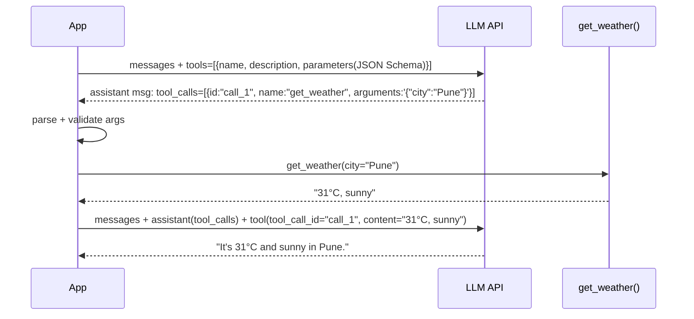

# Q29. How does LLM tool/function calling actually work under the hood?

[← Back to questions](../questions.md)

## TL;DR

- The app sends the model **tool definitions** (name, description, **JSON Schema** for the parameters) along with the messages. The provider places them in the model's context using a special format the model was **fine-tuned** on.
- The model **does not execute anything**. It produces a structured **tool call** (`name`, `arguments` as JSON, `id`), and the response's stop reason indicates a tool call (`finish_reason="tool_calls"` / `stop_reason="tool_use"`).
- **Your application** parses the call, **validates the arguments**, runs the function, and sends the result back as a **tool message** linked by **`tool_call_id`**. The model then continues: it answers or calls more tools. Repeating this is the **agent loop**.
- Models can emit **parallel tool calls** (several in one turn). **`tool_choice`** controls behaviour: `auto`, `required`/`any`, a specific tool, or `none`.
- In LangChain, `llm.bind_tools([...])` converts Python functions or Pydantic models to schemas. `AIMessage.tool_calls` holds the parsed calls, and `ToolMessage(content, tool_call_id)` returns results. `with_structured_output` is built on the same mechanism.

## Detailed Answer

### 1. End-to-end flow



### 2. What the model actually sees

The provider serialises your tools into the prompt using a template, typically a system section listing the function signatures and schemas, with special tokens marking tool calls and results. The model was trained (SFT + RLHF) on many such conversations, so it learned to:

1. Decide **whether** a tool is needed.
2. Pick **which** one, based on name and description.
3. Produce **arguments as JSON** that match the schema.

Many providers apply **constrained decoding** ("strict" mode / structured outputs) so the arguments are guaranteed to be valid against the schema. Without it, the JSON is usually valid but not guaranteed.

Because tool definitions are part of the prompt, they **consume input tokens** on every call, and their **descriptions act as prompts**. Clear descriptions lead to better tool selection.

### 3. Raw OpenAI example (Chat Completions)

```python
import json
from openai import OpenAI
client = OpenAI()

tools = [{
    "type": "function",
    "function": {
        "name": "get_weather",
        "description": "Get the current weather for a city.",
        "parameters": {
            "type": "object",
            "properties": {
                "city": {"type": "string", "description": "City name"},
                "unit": {"type": "string", "enum": ["c", "f"]},
            },
            "required": ["city"],
            "additionalProperties": False,
        },
        "strict": True,
    },
}]

def get_weather(city: str, unit: str = "c") -> str:
    return f"31°{unit.upper()}, sunny in {city}"

messages = [{"role": "user", "content": "Weather in Pune and Mumbai?"}]
resp = client.chat.completions.create(model="gpt-4o", messages=messages,
                                      tools=tools, tool_choice="auto")
msg = resp.choices[0].message
messages.append(msg)                               # keep the assistant tool-call turn

for call in msg.tool_calls or []:                  # may be parallel (2 calls here)
    args = json.loads(call.function.arguments)
    result = get_weather(**args)
    messages.append({"role": "tool", "tool_call_id": call.id, "content": result})

final = client.chat.completions.create(model="gpt-4o", messages=messages, tools=tools)
print(final.choices[0].message.content)
```

Anthropic's format is equivalent. The assistant returns `content` blocks of `{"type": "tool_use", "id", "name", "input"}` with `stop_reason="tool_use"`, and you reply with a user message containing `{"type": "tool_result", "tool_use_id", "content"}` blocks.

### 4. The same in LangChain

```python
from langchain_core.tools import tool
from langchain_core.messages import HumanMessage, ToolMessage
from langchain_openai import ChatOpenAI

@tool
def get_weather(city: str, unit: str = "c") -> str:
    """Get the current weather for a city."""
    return f"31°{unit.upper()}, sunny in {city}"

print(get_weather.args_schema.model_json_schema())   # schema derived from signature + docstring

llm = ChatOpenAI(model="gpt-4o")
llm_tools = llm.bind_tools([get_weather], tool_choice="auto")  # parallel_tool_calls=False to disable

msgs = [HumanMessage("Weather in Pune and Mumbai?")]
ai = llm_tools.invoke(msgs)
print(ai.tool_calls)
# [{'name': 'get_weather', 'args': {'city': 'Pune'}, 'id': 'call_a', 'type': 'tool_call'},
#  {'name': 'get_weather', 'args': {'city': 'Mumbai'}, 'id': 'call_b', 'type': 'tool_call'}]

msgs.append(ai)
for tc in ai.tool_calls:
    msgs.append(get_weather.invoke(tc))     # invoking with a ToolCall returns a ToolMessage
    # equivalent: ToolMessage(content=get_weather.invoke(tc["args"]), tool_call_id=tc["id"])

print(llm_tools.invoke(msgs).content)
```

LangChain standardises calls from different providers into `AIMessage.tool_calls`. `ToolNode` in LangGraph runs this execute-and-respond step for you, with parallel execution and error handling.

### 5. `tool_choice` options

| Value (OpenAI / LangChain) | Anthropic equivalent | Behaviour |
|---|---|---|
| `"auto"` (default) | `{"type": "auto"}` | Model decides whether to call |
| `"required"` / `"any"` | `{"type": "any"}` | Must call at least one tool |
| `{"type": "function", "function": {"name": "x"}}` / `"x"` | `{"type": "tool", "name": "x"}` | Must call that tool |
| `"none"` | `{"type": "none"}` | Must not call tools |

Forcing a specific tool is how **structured output** used to be implemented: define a "tool" whose schema is your output model and force the model to call it. `llm.with_structured_output(Model)` does this, or uses native JSON-schema response formats.

### 6. Parallel tool calls

- One assistant turn can contain **several** tool calls (independent lookups, for example).
- You should run them **concurrently** and return **one tool message per `tool_call_id`**. Order doesn't matter, because the IDs do the matching.
- Disable with `parallel_tool_calls=False` (OpenAI) or `disable_parallel_tool_use` (Anthropic) when the calls depend on each other or have side effects.

### 7. Message protocol rules

```
user:      "Weather in Pune and Mumbai?"
assistant: tool_calls=[call_a(get_weather Pune), call_b(get_weather Mumbai)]
tool:      tool_call_id=call_a  "31°C"
tool:      tool_call_id=call_b  "29°C"
assistant: "Pune is 31°C, Mumbai 29°C."
```

- Every tool call in an assistant message **must** be followed by a matching tool result before the next model call. Otherwise you get an API error.
- Tool results are plain text or JSON strings (some providers also accept images or structured blocks).
- On errors, return the error **as the tool result** (`"Error: city not found"`) so the model can recover, instead of crashing the loop.

### 8. Security and reliability

| Risk | Mitigation |
|---|---|
| Hallucinated or invalid args | Strict schemas, Pydantic validation, return validation errors to the model |
| Prompt injection via tool outputs | Treat tool output as untrusted, isolate privileges, require human approval for sensitive tools |
| Dangerous actions | Allow-lists, least-privilege credentials, HITL interrupts |
| Too many tools leading to wrong selection | Keep the toolset small, write clear descriptions, retrieve tools dynamically |
| Infinite loops | Max iterations / `recursion_limit` |
| Token cost of schemas | Concise descriptions, fewer tools, prompt caching |

## Common Pitfalls

- Thinking the LLM runs the function. It only **requests** the call.
- Dropping the assistant tool-call message from history before adding tool results.
- Mismatched or missing `tool_call_id`s with parallel calls.
- Vague tool names and descriptions, which lead to wrong tool choices.
- Trusting arguments blindly (SQL injection, path traversal). Always validate.
- Raising exceptions out of tools inside agents. Return error strings, or configure `ToolNode(handle_tool_errors=True)`.

## Likely Follow-up Questions

1. **How does the model know about tools?** The schemas are injected into its context in a trained format, so they are part of the prompt.
2. **What is the difference between function calling and structured output?** The mechanism is the same (schema-constrained JSON). Structured output forces a single "tool" or response format and doesn't execute anything.
3. **How do you support a model without native tool calling?** Use ReAct-style prompting with text parsing (`Action:` / `Action Input:`) or JSON-mode prompting. It is less reliable.
4. **How does MCP relate?** MCP (Model Context Protocol) standardises how tools are **discovered and invoked** from external servers. The model still uses normal tool calling, and the MCP client converts MCP tools into tool schemas.
5. **How do you handle long-running tools?** Run them asynchronously, return a job ID immediately, and add a polling tool or a LangGraph interrupt/resume when the job completes.

[← Back to questions](../questions.md)
