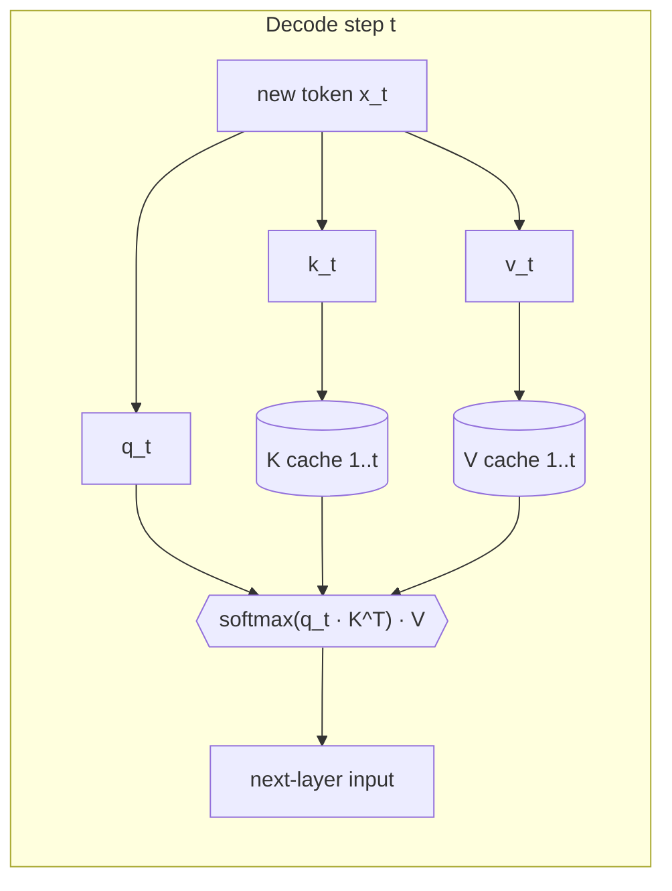

# Q2. What is the KV cache, and why does it limit concurrency?
[← Back to questions](../questions.md)

## TL;DR
- In autoregressive decoding, each new token attends to all previous tokens. The **KV cache** stores the Key and Value projections of past tokens for every layer, so they aren't recomputed each step. Without it, decode would cost O(n²) per token instead of O(n).
- Size per token = **`2 × n_layers × n_kv_heads × head_dim × bytes_per_elem`**. Multiply that by the tokens in flight across *all* concurrent sequences.
- For example, Llama-3-8B (32 layers, 8 KV heads, head_dim 128, FP16) uses **128 KiB/token**, so an 8K context costs **1 GiB per sequence**. Llama-3-70B uses **320 KiB/token**, which is **2.5 GiB per 8K sequence**.
- Weights are a fixed cost. The KV cache grows with **concurrency × context length**, so it is usually the thing that caps batch size, and batch size caps throughput.
- Ways to get more sequences into memory: **GQA/MQA** (fewer KV heads), **PagedAttention** (no fragmentation), **prefix caching** (share common prompts), **FP8/INT4 KV quantization**, **CPU/SSD offloading**, sliding window or MLA architectures, and tensor parallelism (spreads the KV across GPUs).

## Detailed Answer

### 1. What the KV cache is
For each layer, attention computes `Q = xW_q, K = xW_k, V = xW_v`, then `softmax(QKᵀ/√d)V`. At decode step *t*, the new token's query must attend to K and V of tokens 1..t. The K and V of earlier tokens **never change** (causal masking), so we compute them once and cache them.



- **Prefill** writes the KV for all prompt tokens in one pass.
- **Decode** appends one K and one V per layer per step, and *reads the whole cache* for that sequence.

So the KV cache costs **memory capacity** (it must be resident) and **memory bandwidth** (it is read every step). For long contexts, KV reads can exceed weight reads per step.

### 2. The formula

```
KV bytes per token = 2 (K and V) × n_layers × n_kv_heads × head_dim × bytes_per_element
KV bytes total     = KV bytes per token × Σ (tokens of every live sequence)
```

#### Worked example: Llama-3-8B
| Param | Value |
|---|---|
| layers | 32 |
| query heads | 32 |
| KV heads (GQA) | 8 |
| head_dim | 128 |
| dtype | FP16/BF16 = 2 bytes |

```
per token = 2 × 32 × 8 × 128 × 2 = 131,072 B = 128 KiB
8K-token sequence   = 128 KiB × 8192  = 1 GiB
```
On a single **80 GB H100**:
```
weights (BF16)       ≈ 16 GB
activations/overhead ≈ 2–4 GB  (+ CUDA graphs)
gpu_memory_utilization=0.9 → ~72 GB usable → KV budget ≈ 72 − 16 − 3 ≈ 53 GB
53 GB / 1 GiB per 8K seq ≈ ~49 concurrent full-8K sequences
53 GB / 128 KiB          ≈ ~400K tokens total in flight
    → e.g. ~200 concurrent chats averaging 2K tokens
```

#### Worked example: Llama-3-70B
80 layers, 8 KV heads, head_dim 128:
```
per token = 2 × 80 × 8 × 128 × 2 = 327,680 B = 320 KiB
8K sequence  = 2.5 GiB
128K sequence = 40 GiB (!)
```
On **4× H100 80GB with TP=4**: weights ≈ 140 GB in BF16 (about 35 GB per GPU), leaving about 35 GB per GPU for KV, which is about 140 GB total. That gives **~56 concurrent 8K sequences**, or **~3 sequences at full 128K**. This is why long-context serving is expensive.

#### Comparison: MHA without GQA (Llama-2-7B)
32 layers × **32** KV heads × 128 × 2 × 2 = **512 KiB/token**, 4× Llama-3-8B. The same GPU serves about 4× fewer concurrent sequences.

### 3. Why it limits concurrency
```
max_concurrent_seqs ≈ (VRAM × util − weights − activation_overhead) / (KV_per_token × avg_tokens_per_seq)
```
- Weights are paid **once**. KV is paid **per sequence, per token**.
- Throughput in decode scales with batch size (see Q1), and batch size is bounded by KV memory. So **KV memory ≈ throughput ceiling**.
- KV grows *during* generation. A sequence admitted at 1K tokens may need 4K later, so the engine must either reserve memory pessimistically or preempt sequences when memory runs out.
- Bandwidth: per decode step, the GPU reads `weights + Σ KV of batch`. With 200 seqs × 2K tokens × 128 KiB ≈ 50 GB of KV, which is **3× the weights**, attention reads dominate step time.

### 4. Attention variants: MHA vs MQA vs GQA vs MLA
| Variant | KV heads | KV size vs MHA | Quality | Examples |
|---|---|---|---|---|
| MHA (multi-head) | = query heads (e.g. 32) | 1× | baseline | GPT-3, Llama-2-7B |
| MQA (multi-query) | 1 | 1/32 | some degradation, training instability | PaLM, Falcon-7B |
| **GQA** (grouped-query) | groups (e.g. 8) | 1/4 – 1/8 | ≈ MHA | Llama-2-70B, Llama-3, Mistral, Qwen2 |
| MLA (multi-head latent) | compressed latent | ~1/10–1/30 | ≈ MHA | DeepSeek-V2/V3 |
| Sliding-window / local layers | — | bounded by window | trade-off on long-range recall | Mistral-7B v0.1, Gemma-2/3 (interleaved) |

GQA is the industry default because it cuts KV 4–8× at almost no quality cost. Existing MHA checkpoints can be "uptrained" to GQA by mean-pooling heads.

### 5. PagedAttention: no wasted memory
Before vLLM, servers allocated contiguous `max_seq_len` slabs per request:
```
Request A slab (2048 reserved): [■■■■■■□□□□□□□□□□□□□□]  used 600 → 70% wasted
Request B slab (2048 reserved): [■■■□□□□□□□□□□□□□□□□□]
```
PagedAttention uses fixed **blocks** (default 16 tokens) and a per-sequence **block table**:
```
Logical blocks (seq A): 0 → 1 → 2 → 3
Physical KV pool:  [A0][B0][A1][free][A2][B1][A3][free]...
```
- Waste < 1 block per sequence (the vLLM paper reports <4% vs 60–80% before).
- Blocks can be **shared**. Parallel samples, beam search and common prefixes point to the same physical blocks (copy-on-write).
- It enables **preemption** at block granularity.

### 6. Prefix caching
Many requests share a long prefix (system prompt, few-shot examples, a RAG document, earlier chat turns). With **Automatic Prefix Caching** (vLLM `--enable-prefix-caching`, SGLang RadixAttention), KV blocks are hashed by their token content plus the prefix before them, and reused:
- TTFT drops sharply (no prefill for cached tokens), compute is saved, and **memory is shared** across sequences.
- A 2K-token system prompt shared across 100 concurrent sessions is stored **once** (≈256 MB for an 8B model) instead of 100× (≈25 GB).
- Put static content **first** and variable content last. One changed token early in the prompt invalidates everything after it.
- Use cache-aware routing (route a session to the replica that holds its prefix): vLLM production-stack, SGLang router, llm-d, and Dynamo all do this.

### 7. KV cache quantization
| KV dtype | Bytes | Capacity gain | Quality impact | Notes |
|---|---|---|---|---|
| FP16/BF16 | 2 | 1× | none | default |
| **FP8 (E4M3/E5M2)** | 1 | **2×** | usually negligible | vLLM `--kv-cache-dtype fp8`, Hopper/Ada native, use calibrated scales |
| INT8 | 1 | 2× | small | TRT-LLM, LMDeploy |
| INT4 / 2-bit (KIVI etc.) | 0.5 | 4× | measurable on long-context or reasoning | research / some engines |

```bash
vllm serve meta-llama/Meta-Llama-3-70B-Instruct \
  --tensor-parallel-size 4 \
  --kv-cache-dtype fp8 \
  --enable-prefix-caching \
  --max-model-len 16384 \
  --gpu-memory-utilization 0.92
```
Weight quantization (Q4) and KV quantization (Q7) are **independent**. Weight quantization frees memory that then becomes KV budget, and KV quantization makes each token cheaper.

### 8. Offloading, preemption, swap, recompute
When KV demand exceeds GPU capacity:
- **Preempt + recompute**: drop a victim's KV and re-run its prefill later. That costs compute, but nothing has to move, and with prefix caching part of it may already be cached.
- **Preempt + swap**: move the victim's blocks to pinned CPU RAM, then swap them back. It costs PCIe bandwidth: about 64 GB/s on Gen5 ×16, so 2.5 GiB takes about 40 ms each way.
- **Tiered KV offload**: GPU → CPU → local NVMe → remote store (LMCache, Mooncake, NVIDIA Dynamo KVBM). This mainly serves **cross-request reuse** (multi-turn chat, repeated documents), because re-loading is cheaper than re-prefilling long contexts.
- Rule: offload pays off when `transfer_time(KV) < prefill_time(tokens)`. That is true for long prompts on fast links and false for short prompts.

### 9. Estimating capacity in code
```python
from dataclasses import dataclass

@dataclass
class ModelCfg:
    layers: int
    kv_heads: int
    head_dim: int
    params_b: float

def kv_bytes_per_token(cfg: ModelCfg, kv_bytes: float = 2) -> float:
    return 2 * cfg.layers * cfg.kv_heads * cfg.head_dim * kv_bytes

def max_concurrency(cfg, vram_gb, n_gpus=1, util=0.90, w_bytes=2, kv_bytes=2,
                    avg_tokens=2048, overhead_gb_per_gpu=3):
    total = vram_gb * n_gpus * util
    weights = cfg.params_b * 1e9 * w_bytes / 1e9
    kv_budget_gb = total - weights - overhead_gb_per_gpu * n_gpus
    per_seq_gb = kv_bytes_per_token(cfg, kv_bytes) * avg_tokens / 1e9
    return int(kv_budget_gb / per_seq_gb)

llama3_8b  = ModelCfg(layers=32, kv_heads=8, head_dim=128, params_b=8.0)
llama3_70b = ModelCfg(layers=80, kv_heads=8, head_dim=128, params_b=70.6)

print(kv_bytes_per_token(llama3_8b) / 1024, "KiB/token")              # 128.0
print(max_concurrency(llama3_8b, 80))                                   # ~200 @2K
print(max_concurrency(llama3_8b, 80, kv_bytes=1))                       # ~400 @2K with FP8 KV
print(max_concurrency(llama3_70b, 80, n_gpus=4, avg_tokens=8192))       # ~50 @8K
```
vLLM prints the real number at startup ("# GPU blocks: N" / "Maximum concurrency for X tokens per request: Y"). Always check it.

### 10. Levers summary
| Lever | Effect on KV | Cost |
|---|---|---|
| Reduce `max_model_len` | bounds worst case | product limits |
| GQA/MLA model choice | 4–30× smaller | model choice |
| FP8 KV | 2× | tiny quality risk, needs HW support for speed |
| Weight quantization (AWQ/FP8) | frees VRAM for KV | quality eval needed |
| Prefix caching | shares duplicates | prompt layout discipline |
| Tensor parallelism | splits KV heads across GPUs | more GPUs, comms |
| Offload / tiered cache | extends capacity for reuse | latency on reload |
| Summarize or truncate history | fewer tokens | product/quality |

## Common Pitfalls
- Forgetting the **factor 2** (K and V) or using **query heads instead of KV heads** in the formula. With GQA this overestimates by 4×.
- Planning capacity around *average* context while admission control reserves for *max*, or the reverse.
- Assuming a 128K-context model can serve many 128K users on one node. It can serve very few.
- Changing the beginning of the prompt per request (timestamps, user IDs in the system prompt), which kills prefix-cache hit rates.
- Enabling FP8 KV on hardware without native FP8 and expecting a speedup. You get capacity, not speed.
- With TP, the KV heads must divide evenly by the TP degree. With 8 KV heads, TP=16 duplicates heads and wastes memory.

## Likely Follow-up Questions
1. **Why not cache Q too?**
   Past queries are never needed again. Only the current token's query attends to the past.
2. **How does KV cache size affect latency, not just capacity?**
   Every decode step reads the full KV of each sequence. Long contexts make attention memory-bandwidth-heavy, and ITL grows roughly linearly with context length.
3. **What does `vllm:gpu_cache_usage_perc` (`kv_cache_usage_perc` in newer versions) tell you?**
   The fraction of KV blocks in use. When it is near 100% and `num_requests_waiting` is above 0, you are memory-bound: add replicas, use FP8 KV, or shorten contexts.
4. **How is prefix caching different from provider "prompt caching"?**
   It is the same idea. Providers (Anthropic, OpenAI, Gemini) keep KV for repeated prefixes and charge less for cached input tokens. Self-hosted engines do it automatically within one replica.
5. **Does MoE change the KV math?**
   No. KV depends on attention layers and heads, not on expert count. MoE increases weight memory, not KV per token.
6. **What is the difference between swap and recompute preemption?**
   Swap moves KV to CPU and back (bound by PCIe). Recompute discards the KV and re-prefills (bound by compute). Recompute is usually better for short sequences, and swap for long ones.

[← Back to questions](../questions.md)
