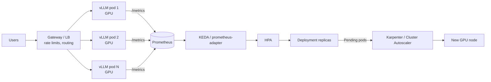

# Q3. How do you autoscale LLM inference on Kubernetes, and why is CPU the wrong scaling signal?
[← Back to questions](../questions.md)

## TL;DR
- LLM serving is **GPU-bound** (memory bandwidth and KV cache). The CPU just runs the HTTP server and tokenizer, so CPU usage stays flat while the GPU is saturated and requests pile up in the queue. Scaling on CPU means you scale too late, or never.
- Even **GPU utilization (DCGM `GPU_UTIL`)** is a poor signal. It reads "100%" whenever any kernel is running, at batch 1 just as at batch 256.
- Scale on **saturation and SLO signals** that the engine exposes: `vllm:num_requests_waiting` (queue depth), KV cache usage (`vllm:gpu_cache_usage_perc` / `vllm:kv_cache_usage_perc`), running requests per replica, **TTFT p95**, and tokens/s per replica.
- Use **KEDA** with a Prometheus trigger, or HPA with custom metrics via prometheus-adapter. Pair it with a **node autoscaler** (Karpenter or Cluster Autoscaler) for GPU nodes.
- The hard part is **cold start**: node provisioning (1–5 min), plus image pull (multi-GB), plus weight download and load (minutes for 70B). Mitigate with min replicas or headroom, cached weights (local NVMe, a PVC, or a node image), fast loaders (safetensors, Run:ai streamer), and scale-up policies that act early and scale-down policies that act slowly.
- Scale-to-zero suits dev and spiky internal tools. For user-facing SLOs it costs minutes of TTFT on the first request.

## Detailed Answer

### 1. Why CPU is wrong (and GPU util is misleading)
```
Load ↑ ─────────────────────────────────────────▶
CPU util:          12% ── 14% ── 15% ── 15% ── 16%      (flat: tokenization + HTTP)
DCGM GPU_UTIL:     98% ── 99% ── 100% ─ 100% ─ 100%     (saturated from tiny load)
KV cache usage:    20% ── 45% ── 80% ── 97% ── 99%      (meaningful)
requests waiting:   0  ──  0  ──  2  ── 15  ── 60       (meaningful, leading)
TTFT p95:         0.3s ─ 0.4s ─ 0.9s ─ 4s ─── 15s      (what users feel)
```
- The engine loop runs on one CPU core, while the heavy work is in CUDA kernels. CPU tracks request *arrival* rate a little, but says nothing about capacity.
- `GPU_UTIL` measures "% of time at least one kernel is executing," not how much of the SMs or bandwidth is in use. `DCGM_FI_PROF_SM_ACTIVE` and `DCGM_FI_PROF_DRAM_ACTIVE` are better, but they still don't map to the SLO.
- LLM capacity depends on **request shape** (input/output tokens). 10 RPS of 200-token chats and 10 RPS of 20K-token RAG prompts need very different capacity. Queue- and KV-based metrics capture this automatically, and RPS does not.

### 2. Picking the signal
| Signal | Source | Leading/lagging | Good for | Caveat |
|---|---|---|---|---|
| `num_requests_waiting` | vLLM / TGI `tgi_queue_size` | **leading** | primary scale-up trigger | 0 most of the time → use threshold > 0 with averaging |
| `num_requests_running` per pod | engine | concurrent load | target concurrency per replica | must know the knee (from load test) |
| KV cache usage % | engine | leading | memory saturation | high with long prompts even at low RPS |
| TTFT p95 | engine histogram | lagging (SLO) | guardrail / scale-up | noisy at low traffic; needs `rate()` windows |
| Generation tokens/s per pod | engine counter | throughput | capacity planning | doesn't show queuing |
| RPS | gateway | proxy | simple setups | ignores token shape |
| CPU / memory | kubelet | ✗ | not for LLM pods | — |

A good default is to **scale on average waiting plus running requests per replica** compared with a target concurrency taken from load testing (e.g. "the knee is 48 concurrent requests per pod for p95 TTFT < 1 s"), and to add TTFT p95 as a second trigger. KEDA/HPA take the max across triggers.

### 3. Architecture

Two control loops:
1. **Pod autoscaling** (HPA/KEDA) decides the replica count.
2. **Node autoscaling** (Karpenter/CA) adds GPU nodes when pods are `Pending` for lack of `nvidia.com/gpu`.

### 4. KEDA ScaledObject with Prometheus
```yaml
apiVersion: keda.sh/v1alpha1
kind: ScaledObject
metadata:
  name: llama3-8b-scaler
  namespace: llm
spec:
  scaleTargetRef:
    name: llama3-8b-vllm            # Deployment
  minReplicaCount: 2                # warm floor: never cold-start user traffic
  maxReplicaCount: 20
  pollingInterval: 15               # seconds
  cooldownPeriod: 600               # only applies to scale-to-zero (1 -> 0)
  advanced:
    horizontalPodAutoscalerConfig:
      behavior:
        scaleUp:
          stabilizationWindowSeconds: 0
          policies:
            - type: Pods
              value: 4
              periodSeconds: 60
        scaleDown:
          stabilizationWindowSeconds: 600   # avoid thrashing expensive GPU pods
          policies:
            - type: Pods
              value: 1
              periodSeconds: 300
  triggers:
    # 1) Queue + in-flight load per replica vs. target concurrency
    - type: prometheus
      metadata:
        serverAddress: http://prometheus-operated.monitoring:9090
        query: |
          sum(vllm:num_requests_waiting{model_name="llama3-8b"})
          + sum(vllm:num_requests_running{model_name="llama3-8b"})
        threshold: "48"              # target concurrent requests per replica (AverageValue)
    # 2) SLO guardrail: TTFT p95 over 2 minutes
    - type: prometheus
      metadata:
        serverAddress: http://prometheus-operated.monitoring:9090
        query: |
          histogram_quantile(0.95,
            sum by (le) (rate(vllm:time_to_first_token_seconds_bucket{model_name="llama3-8b"}[2m])))
        threshold: "1.0"
        metricType: Value             # compare raw value, not per-replica average
```
Notes:
- The default `metricType` for the Prometheus scaler is `AverageValue`. KEDA divides the query result by the current replica count, so the first trigger reads as "target 48 concurrent per pod."
- For the TTFT trigger, `Value` means "scale up proportionally when p95 > 1 s." Because it is a ratio of latency, treat it as a guardrail, not as the primary signal.
- `cooldownPeriod` only governs scaling to zero. HPA `behavior` governs normal scale-down.
- Metric names differ across vLLM versions (V1 renamed `gpu_cache_usage_perc` → `kv_cache_usage_perc` and `time_per_output_token_seconds` → `inter_token_latency_seconds`). Check `/metrics` on the version you deploy.

### 5. Plain HPA with custom metrics (prometheus-adapter)
```yaml
# prometheus-adapter rule (values.yaml excerpt)
rules:
  custom:
    - seriesQuery: 'vllm:num_requests_waiting{namespace!="",pod!=""}'
      resources:
        overrides:
          namespace: {resource: "namespace"}
          pod: {resource: "pod"}
      name:
        matches: "vllm:num_requests_waiting"
        as: "vllm_requests_waiting"
      metricsQuery: 'avg_over_time(<<.Series>>{<<.LabelMatchers>>}[1m])'
---
apiVersion: autoscaling/v2
kind: HorizontalPodAutoscaler
metadata:
  name: llama3-8b-hpa
  namespace: llm
spec:
  scaleTargetRef:
    apiVersion: apps/v1
    kind: Deployment
    name: llama3-8b-vllm
  minReplicas: 2
  maxReplicas: 20
  metrics:
    - type: Pods
      pods:
        metric:
          name: vllm_requests_waiting
        target:
          type: AverageValue
          averageValue: "5"          # >5 queued per pod on average -> add pods
  behavior:
    scaleUp:
      stabilizationWindowSeconds: 0
      policies: [{type: Percent, value: 100, periodSeconds: 60}]
    scaleDown:
      stabilizationWindowSeconds: 600
      policies: [{type: Pods, value: 1, periodSeconds: 300}]
```

### 6. The cold-start problem (the real constraint)
Rough time to a serving replica:

| Stage | Typical time | Mitigation |
|---|---|---|
| GPU node provision (cloud) | 1–5 min (longer if capacity is scarce) | warm node pool / overprovisioning pause pods, reservations, Karpenter |
| Image pull (vLLM image 8–15 GB) | 1–4 min | pre-pulled images in node AMI, image streaming (GKE), slim images, local registry mirror |
| Weight download (8B ≈ 16 GB, 70B ≈ 140 GB) | 1–10+ min from HF/S3 | cache on node NVMe/hostPath, ReadOnlyMany PVC, bake into node image, in-cluster cache |
| Weight load to GPU | 20 s – few min | safetensors, Run:ai Model Streamer (`--load-format runai_streamer`), tensorizer, quantized weights (smaller) |
| CUDA graph capture / warmup | 10–60 s | `--enforce-eager` (faster start, slower serving) or accept |
| Readiness | — | readiness probe on `/health` **after** model load; don't route early |

Total time from cold start ranges from **under 1 minute** (warm node, cached weights) to **over 15 minutes** (new node, 70B from HF). A reactive autoscaler cannot hide that from users, so:
- Keep **min replicas** sized for baseline traffic plus a buffer, and set thresholds so scale-up begins at about **60–70% of the knee**, not at saturation.
- Use **scheduled scaling** (KEDA cron trigger) for predictable daily peaks.
- Run **overprovisioning placeholder pods** (low-priority pause pods that request GPUs) so a real pod can preempt one and land on a warm node right away.
- Set a long **startupProbe** so Kubernetes doesn't kill pods that are still loading.

```yaml
# Deployment excerpt
containers:
  - name: vllm
    image: vllm/vllm-openai:latest   # pin a version tag in production
    args: ["--model", "/models/llama3-8b", "--max-num-seqs", "128",
           "--enable-prefix-caching", "--gpu-memory-utilization", "0.90"]
    resources:
      limits:
        nvidia.com/gpu: 1
    volumeMounts:
      - {name: model-cache, mountPath: /models, readOnly: true}
      - {name: dshm, mountPath: /dev/shm}
    startupProbe:
      httpGet: {path: /health, port: 8000}
      periodSeconds: 10
      failureThreshold: 90        # up to 15 min to load
    readinessProbe:
      httpGet: {path: /health, port: 8000}
      periodSeconds: 5
volumes:
  - name: model-cache
    persistentVolumeClaim: {claimName: llama3-8b-weights}   # ReadOnlyMany, pre-populated
  - name: dshm
    emptyDir: {medium: Memory, sizeLimit: 8Gi}              # needed for TP / NCCL
terminationGracePeriodSeconds: 120   # let in-flight streams finish on scale-down
```

### 7. Scale-to-zero trade-offs
| | Scale-to-zero | Min replicas ≥ 1 |
|---|---|---|
| Cost at idle | ~0 | 1+ GPUs × 24h (an H100 costs about $2–4/h on-demand, roughly $1.5–3K/month) |
| First-request latency | minutes | normal |
| Fit | dev/test, internal batch tools, long-tail fine-tuned models | user-facing, SLO-bound |
| Tooling | KEDA `minReplicaCount: 0` + HTTP add-on / activator, Knative/KServe | standard |

A middle ground for many models is **multi-LoRA on a shared base model** (vLLM `--enable-lora`). Dozens of fine-tunes share one warm replica, so no adapter needs its own scale-to-zero.

### 8. Node autoscaling and GPU sharing
- **Karpenter**: a NodePool with GPU instance types, `nvidia.com/gpu` taints, and consolidation (be careful, consolidation can evict serving pods; use `karpenter.sh/do-not-disrupt` annotations or disruption budgets).
- **Cluster Autoscaler**: node groups per GPU type. It is slower and less flexible.
- **Spot GPUs**: cheap but interruptible. Use them for overflow replicas only, with on-demand for the floor.
- **Sharing a GPU among small models**:
  - **MIG** (A100/H100): hardware partitions with isolated memory and SMs (e.g. `nvidia.com/mig-3g.40gb`). Gives predictable performance for small models or embeddings.
  - **Time-slicing** (device plugin config): oversubscription with no memory isolation. Fine for dev, risky for production.
  - **MPS**: concurrent kernels and better utilization, but limited isolation.
  - Don't share for big models: one 8B vLLM replica wants the whole GPU for KV.

### 9. Routing matters as much as scaling
Round-robin over replicas ignores KV state. Better options:
- **Least outstanding requests / least KV usage** routing (Envoy, Gateway API Inference Extension, llm-d, vLLM production-stack router).
- **Prefix/session affinity**, so prefix caches stay hot.
- A new replica starts with a cold prefix cache, so expect slightly worse TTFT right after scale-up.

### 10. Validating the autoscaler
1. Load test one replica to find the knee: concurrency vs p95 TTFT and ITL, using realistic token distributions.
2. Set the per-replica target to about 70% of the knee.
3. Run step-load and burst tests (e.g. 2× traffic in 30 s). Measure time-to-scale and SLO violations during the ramp.
4. Watch for flapping. Use long scale-down windows, because GPU pods are expensive to churn.

## Common Pitfalls
- HPA on CPU or memory, or on DCGM `GPU_UTIL`. It is either always at 100% or never moves.
- Scaling on RPS while request sizes vary 100×.
- No `startupProbe`, so the liveness probe kills pods mid-load and they loop in CrashLoopBackOff.
- Downloading weights from Hugging Face at every pod start (and hitting rate limits during a scale-up storm).
- Aggressive scale-down that kills pods with active streams. Set `terminationGracePeriodSeconds` and rely on graceful drain (vLLM finishes in-flight requests on SIGTERM).
- Forgetting the node autoscaler, so pods stay `Pending` forever, or the GPU quota or capacity in the region is exhausted.
- Karpenter consolidation evicting serving pods during traffic.
- Using the TTFT histogram with too short a `rate()` window at low traffic, which makes a noisy trigger.

## Likely Follow-up Questions
1. **Which single metric would you pick?**
   Queue depth plus running requests per replica, compared with a load-tested concurrency target. It leads TTFT and it accounts for request shape.
2. **How do you handle a 10× traffic spike faster than cold start allows?**
   Combine warm headroom (overprovisioning pods), admission control or shedding (429 with Retry-After), and overflow to a hosted API or a smaller model. Autoscaling alone can't absorb it.
3. **How do you autoscale a 70B model that needs TP=4 or multi-node?**
   The scaling unit is a 4-GPU pod (or a LeaderWorkerSet group for multi-node), so scaling is coarse and slow. Rely more on headroom and scheduled scaling. KServe and LWS support this.
4. **Why not use GPU memory usage as a signal?**
   vLLM pre-allocates `gpu_memory_utilization` of VRAM at startup, so memory usage is constant. Use the engine's *KV block usage* instead.
5. **Scaling for batch/offline workloads?**
   Scale on queue backlog (SQS or Kafka lag via KEDA scalers) to maximize throughput per GPU. Scale-to-zero is fine there.
6. **How do you avoid cold prefix caches after scaling?**
   Use prefix-aware routing, pre-warm new replicas with common system prompts, or use a shared KV store (LMCache).

[← Back to questions](../questions.md)
