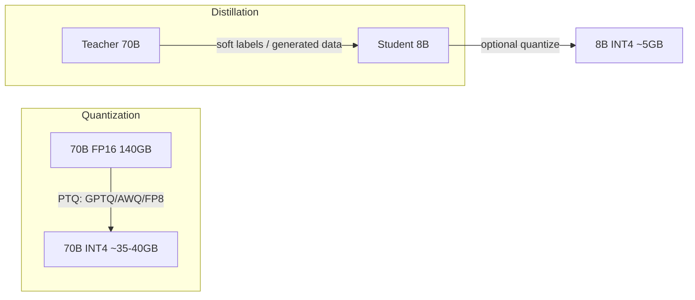

# Q4. Distillation vs quantization: what do you trade away?
[← Back to questions](../questions.md)

## TL;DR
- **Quantization** keeps the *same model* and stores weights (and sometimes activations or KV) in fewer bits: FP16 → FP8/INT8/INT4. It is cheap (minutes to hours, no training for PTQ). You give up **numerical precision**, which costs a little accuracy, mostly on outlier-sensitive and long-tail behaviour.
- **Distillation** trains a *smaller, different model* (the student) to imitate a bigger one (the teacher). It is expensive (data generation plus training). You give up **capacity**: long-tail knowledge, multi-step reasoning depth, breadth across languages and domains, and robustness outside the distillation distribution.
- Rough numbers: INT8/FP8 is close to lossless (<1% on most benchmarks). INT4 weight-only (AWQ/GPTQ) usually loses 1–3 points, more on math, code and small models. Distilling 70B → 8B can match the teacher *on the target task*, but it drops general capability a lot.
- Use quantization for **cheaper, faster serving of a model you trust**. Use distillation to **specialize a narrow task onto a much smaller, faster model**. In production you often do **both**: distill, then quantize the student.
- Always evaluate on **your own task suite**, including tail slices (rare entities, long context, multilingual, safety, calibration). Average benchmark scores hide these losses.

## Detailed Answer

### 1. What each technique does


| | Quantization | Distillation |
|---|---|---|
| Model architecture | unchanged | smaller/different |
| Requires training | PTQ: no (calibration only). QAT: yes | yes (SFT / KD loss) |
| Cost | minutes–hours on 1 GPU | teacher inference over millions of tokens + student training (GPU-days to weeks) |
| Memory reduction | 2× (8-bit), ~4× (4-bit) | 5–20× (parameter count) |
| Speedup | 1.3–2.5× decode (bandwidth); more with FP8 matmul on Hopper | proportional to size, often 5–10× |
| What's lost | precision → small, diffuse degradation | capacity → whole capabilities missing |
| Reversible | keep the FP16 checkpoint | — |
| Licensing | same as base model | teacher ToS may forbid using its outputs for training competing models |

### 2. Quantization in depth

#### 2.1 Formats
| Scheme | What's quantized | Typical quality | Speed benefit | Notes |
|---|---|---|---|---|
| **FP8 (W8A8)** | weights + activations | ≈ lossless | 1.5–2× on H100/L40S/Blackwell (FP8 tensor cores) | dynamic or static scales; vLLM `quantization="fp8"` |
| INT8 W8A8 (SmoothQuant) | weights + activations | ≈ lossless with smoothing | good on Ampere | migrates activation outliers into weights |
| INT8 weight-only | weights | ≈ lossless | memory-bandwidth gain | LLM.int8() (bitsandbytes) is slow; mostly used for fitting models |
| **INT4 weight-only (W4A16)** GPTQ / AWQ | weights | −1 to −3 pts typical | 2–3× decode at small batch; less at large batch | Marlin kernels in vLLM |
| NF4 (QLoRA/bitsandbytes) | weights | similar to INT4 | for fine-tuning, not fast serving | |
| GGUF k-quants (Q4_K_M, Q5_K_M…) | weights | Q5/Q6 near-lossless | CPU/Apple/edge | llama.cpp |
| FP4 / MXFP4 / NVFP4 | weights (+acts) | improving | Blackwell native | gpt-oss ships MXFP4 MoE weights |
| KV cache FP8 | KV | ≈ lossless | 2× KV capacity | see Q2 |

#### 2.2 PTQ algorithms
- **RTN (round-to-nearest)**: the naive approach. Fine at 8-bit, poor at 4-bit.
- **GPTQ**: quantizes layer by layer, using second-order (Hessian) information from calibration data to correct the error of the remaining weights. It is accurate, takes about an hour for 70B, and is sensitive to the calibration set.
- **AWQ (activation-aware)**: about 1% of weight channels matter a lot (those that meet large activations). AWQ scales those channels before quantizing. It is robust, fast, and less prone to overfitting calibration data.
- **SmoothQuant**: shifts activation outliers into the weights so W8A8 works.
- **QAT (quantization-aware training)**: simulates quantization in the forward pass during fine-tuning (straight-through estimator). It recovers most of the INT4 loss, but costs training. Google released QAT checkpoints for Gemma 3, and Llama 3.2 shipped QAT+LoRA quantized variants.

#### 2.3 What quantization loses
- **Outlier features**: LLMs have a few large-magnitude activation dimensions. Clipping them hurts badly, which is why naive INT8 activations broke models above about 6.7B parameters (LLM.int8() paper).
- **Long-tail knowledge and rare tokens**: rarely used weights carry facts that benchmarks don't test. Quantization noise shows up as **more hallucination on obscure entities** before you see it in MMLU.
- **Math, code and long reasoning chains**: small per-token errors compound over long generations. GSM8K, HumanEval and long-CoT benchmarks drop more than MMLU.
- **Small models suffer more**: a 1–3B model at INT4 loses much more than a 70B at INT4, because there is less redundancy.
- **Multilingual and low-resource languages** degrade more than English.
- **Long context**: retrieval accuracy at 32K+ can degrade, especially with KV quantization below 8 bits.
- **Calibration bias**: GPTQ calibrated on English web text can degrade code or other languages. Calibrate on data that matches your domain.

#### 2.4 Example: AWQ quantization and serving
```python
# pip install llmcompressor  (vLLM project's quantization library)
from llmcompressor import oneshot
from llmcompressor.modifiers.awq import AWQModifier

recipe = [AWQModifier(targets=["Linear"], scheme="W4A16", ignore=["lm_head"])]

oneshot(
    model="meta-llama/Meta-Llama-3-8B-Instruct",
    dataset="open_platypus",           # better: a sample of YOUR production prompts
    recipe=recipe,
    output_dir="Llama-3-8B-Instruct-AWQ-W4A16",
    max_seq_length=2048,
    num_calibration_samples=256,
)
```
```bash
# serve: vLLM auto-detects compressed-tensors format
vllm serve ./Llama-3-8B-Instruct-AWQ-W4A16 --max-model-len 8192
# FP8 dynamic quantization at load time (no calibration), Hopper/Ada:
vllm serve meta-llama/Meta-Llama-3-8B-Instruct --quantization fp8
```

#### 2.5 Throughput nuance
Weight-only INT4 speeds up **memory-bound** decode at small batch sizes. At large batch sizes serving becomes compute-bound, and dequantization overhead can make W4A16 *no faster or even slower* than FP16 or FP8. Benchmark at your real concurrency. For high-throughput serving on Hopper, **FP8 W8A8 often wins**.

### 3. Distillation in depth

#### 3.1 Variants
- **Logit (token-level) KD** (Hinton et al.): the student minimizes KL divergence to the teacher's softened distribution. This needs a **shared tokenizer** and white-box access to the teacher's logits.
  ```
  L = α · CE(y, p_s) + (1−α) · T² · KL( softmax(z_t/T) || softmax(z_s/T) )
  ```
  Soft labels carry "dark knowledge": relative probabilities of wrong answers that convey similarity structure.
- **Sequence-level KD** (Kim & Rush): the teacher generates outputs and the student does SFT on them. This works with **black-box API teachers**, and it is what most "distilled" open models do (Alpaca, Vicuna, and the DeepSeek-R1-Distill models trained on about 800K R1-generated samples).
- **On-policy distillation** (GKD, MiniLLM): the student generates and the teacher scores or provides logits on *student* samples. This reduces exposure bias, because the student learns to recover from its own mistakes.
- **Feature/hidden-state distillation**: match intermediate representations (DistilBERT, TinyBERT). Less common for decoder LLMs.
- **Pruning + distillation** (NVIDIA Minitron): prune width and depth from a big model, then distill to recover. Much cheaper than training a student from scratch.
- **Task-specific distillation**: distill only your use case (e.g. intent classification, extraction, SQL generation). This is where the biggest real-world wins are.

#### 3.2 Example: logit KD loss in PyTorch
```python
import torch
import torch.nn.functional as F

def kd_loss(student_logits, teacher_logits, labels, T=2.0, alpha=0.5, ignore_index=-100):
    # student_logits, teacher_logits: [B, L, V] (same tokenizer!)
    mask = labels.ne(ignore_index)
    s = student_logits[mask] / T
    t = teacher_logits[mask] / T
    soft = F.kl_div(F.log_softmax(s, dim=-1), F.log_softmax(t, dim=-1),
                    log_target=True, reduction="batchmean") * (T * T)
    hard = F.cross_entropy(student_logits.view(-1, student_logits.size(-1)),
                           labels.view(-1), ignore_index=ignore_index)
    return alpha * hard + (1 - alpha) * soft
```

#### 3.3 Example: sequence-level distillation data pipeline
```python
from vllm import LLM, SamplingParams

teacher = LLM(model="meta-llama/Meta-Llama-3-70B-Instruct", tensor_parallel_size=4)
params = SamplingParams(temperature=0.7, max_tokens=1024, n=4)  # sample multiple, filter best

prompts = load_task_prompts()            # real or synthetic prompts from YOUR distribution
outs = teacher.generate(prompts, params)

dataset = []
for p, o in zip(prompts, outs):
    candidates = [c.text for c in o.outputs]
    best = [c for c in candidates if passes_verifier(p, c)]  # unit tests, schema check, judge
    if best:
        dataset.append({"prompt": p, "completion": best[0]})
# then SFT the 8B student on `dataset` (e.g. TRL SFTTrainer)
```
Filtering (rejection sampling with verifiers) matters more than volume.

#### 3.4 What distillation loses
- **Long-tail world knowledge**: knowledge scales with parameter count. An 8B student cannot hold what a 70B holds, however good the soft labels.
- **Out-of-distribution generalization**: the student is good where the distillation data was, and brittle elsewhere.
- **Reasoning depth**: students imitate the *style* of reasoning traces. On harder problems they may produce confident chains that look right but are wrong.
- **Calibration and uncertainty**: SFT on teacher outputs teaches the student to sound sure. It loses the teacher's hedging and gets worse at saying "I don't know."
- **Safety and refusal behaviour**: it may not transfer unless the distillation data includes it.
- **Multilingual breadth**: lost if distillation data is English-only.
- **Teacher errors and biases** are inherited, and the student's ceiling is roughly the teacher's quality on that data.

### 4. Choosing
| Situation | Prefer |
|---|---|
| Need same model, lower cost, ship this week | **Quantization** (FP8 first, then AWQ INT4) |
| Fit 70B on fewer GPUs | INT4/FP8 quantization |
| Narrow, high-volume task (classification, extraction, routing) | **Distillation** to 1–8B, then quantize |
| Latency SLO requires 5–10× speedup | Distillation (quantization alone gives ~2×) |
| Edge/mobile | Distill + aggressive quant (INT4/GGUF) |
| Broad general assistant | Quantize the big model; avoid distilling general capability |
| No access to teacher logits (API model) | Sequence-level distillation (check ToS) |

### 5. Evaluation strategy (the senior part)
1. **Freeze a baseline**: FP16 teacher or original-model outputs on a golden set.
2. **Task metrics on your data**: exact match, F1, pass@k, schema validity, LLM-judge win rate against the baseline (pairwise, position-swapped).
3. **Slice the eval**: rare entities, long inputs, non-English, edge cases, adversarial and safety prompts. Losses concentrate in the tails.
4. **Distribution distance**: per-token KL between the quantized and original model on held-out prompts. Perplexity delta is a quick smoke test, but it does not stand in for task evals.
5. **Calibration**: ECE / Brier on classification-like tasks, and abstention rate.
6. **Systems metrics at target concurrency**: TTFT, ITL, tokens/s per GPU, cost per 1M tokens.
7. **Shadow / A/B in production** before full rollout. Watch user feedback signals (thumbs, retries, escalations).

### 6. Combining both
A common pipeline:
```
Teacher (70B, FP16) ──seq-level KD on task data──▶ Student (8B, BF16)
     ──QAT or AWQ──▶ Student (8B, INT4/FP8) ──▶ vLLM + prefix caching + spec decoding
```
Losses compound, so evaluate after *each* step. Quantizing a small distilled model is riskier than quantizing a large one, so prefer FP8 or QAT over plain INT4 PTQ for the student.

## Common Pitfalls
- Judging quantization by perplexity or MMLU only, then finding regressions in code, math or rare-entity QA in production.
- Calibrating GPTQ on generic data when the workload is a specific domain or language.
- Assuming INT4 is always faster. At high batch on H100, FP8 or BF16 can beat it.
- Distilling from a black-box API in violation of its terms of service.
- Building the distillation set from too few prompt sources, which gives a student that only works on templated inputs.
- Not filtering teacher outputs, so the student learns the teacher's mistakes.
- Forgetting that **tokenizers must match** for logit KD.
- Quantizing `lm_head` or embeddings aggressively, which disproportionately hurts quality.

## Likely Follow-up Questions
1. **Why is FP8 nearly lossless while INT8 needed tricks?**
   FP8 has an exponent, so its dynamic range handles activation outliers well. INT8 has uniform steps, so outliers force a large scale and crush the small values. SmoothQuant or per-channel scaling fixes this.
2. **When would you choose QAT over PTQ?**
   When INT4 (or lower) PTQ loses too much on critical evals, especially for small models or edge targets, and you can afford a fine-tuning run.
3. **Can distillation make a student better than the teacher?**
   On a narrow task, sometimes, by filtering teacher outputs with verifiers and combining several teachers. In general capability, no.
4. **How does quantization interact with LoRA?**
   QLoRA trains LoRA adapters on top of a frozen NF4 base. For serving you can merge into FP16 and then re-quantize, or serve the adapter on a quantized base (vLLM supports LoRA on quantized models).
5. **How would you justify the cost of distillation?**
   Compute break-even: (cost per token of big model − cost per token of student) × monthly tokens versus the one-time cost of data generation, training and eval. High-volume narrow tasks pay back in weeks.
6. **What about pruning?**
   Structured pruning (removing layers or heads) plus distillation (Minitron, Sheared-LLaMA) gives a smaller model at a fraction of from-scratch cost. Unstructured sparsity (2:4) needs hardware support and gives modest gains.

[← Back to questions](../questions.md)
