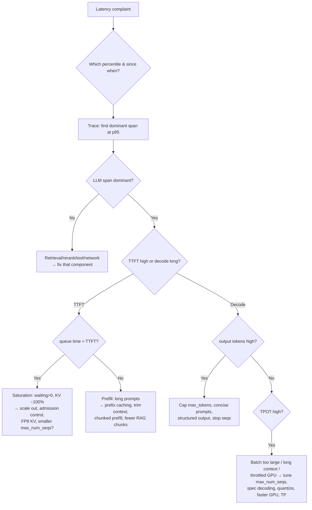

# Q5. How do you diagnose high latency in an LLM application? Which metrics matter?
[← Back to questions](../questions.md)

## TL;DR
- Break latency into its parts before trying to fix it. **E2E = network + gateway/queue + pre-processing (retrieval, tools) + TTFT (queue + prefill) + TPOT × output_tokens + post-processing.** Each part has a different fix.
- The core LLM metrics are **TTFT** (time to first token), **TPOT/ITL** (time per output token / inter-token latency), **queue time**, **input and output token counts**, and **E2E**, all at **p50/p95/p99**, never averages.
- Engine health signals are **running vs waiting requests**, **KV cache usage**, **preemptions**, **batch size**, **prefix-cache hit rate**, and GPU SM/DRAM activity.
- Application signals are **retrieval latency**, **reranker latency**, **tool/API call latency**, **number of LLM calls per user request** (agents), retries, and network or streaming buffering.
- Typical culprits: **long outputs** (most common, and latency is linear in output tokens), **queueing from saturation**, **long prompts** (prefill), **sequential agent or tool chains**, and **cold starts or rate limits** on hosted APIs.
- Method: trace the request (OpenTelemetry spans), find the dominant span at p95, compare it with the token counts, then apply the targeted fix and re-measure.

## Detailed Answer

### 1. The latency equation
```
E2E ≈ T_network + T_gateway + T_retrieval + T_tools + Σ_llm_calls [ T_queue + T_prefill + T_decode ] + T_post

T_prefill ∝ input_tokens   (compute-bound;  e.g. ~25–40k tok/s for 8B on H100)
T_decode  ≈ output_tokens × TPOT   (memory-bound; e.g. 10–30 ms/token per sequence)
TTFT      = T_queue + T_prefill (+ network to first byte)
```
Quick sanity math: 500 output tokens × 30 ms ≈ **15 s**, however fast your prefill is. **Output tokens usually dominate E2E.** Prompt length matters mainly for TTFT and cost.

### 2. Metric catalogue
| Layer | Metric | What it tells you | Where to get it |
|---|---|---|---|
| User | E2E p50/p95/p99 | overall experience | gateway / APM |
| User | TTFT p95 | perceived responsiveness (streaming) | engine histogram / client |
| LLM | TPOT / ITL p95 | decode speed; batch-size pressure | `vllm:time_per_output_token_seconds` (V1: `vllm:inter_token_latency_seconds`) |
| LLM | Queue time | saturation | `vllm:request_queue_time_seconds` |
| LLM | Prefill time | long prompts / no prefix caching | `vllm:request_prefill_time_seconds` |
| LLM | input / output tokens per req | shape of workload | `vllm:request_prompt_tokens`, `vllm:request_generation_tokens` |
| Engine | running / waiting reqs | capacity headroom | `vllm:num_requests_running`, `vllm:num_requests_waiting` |
| Engine | KV cache usage % | memory saturation | `vllm:gpu_cache_usage_perc` / `vllm:kv_cache_usage_perc` |
| Engine | preemptions | KV thrash → recompute | `vllm:num_preemptions_total` |
| Engine | prefix cache hit rate | wasted prefill | vLLM prefix cache queries/hits counters |
| GPU | SM active, DRAM active, mem, temp/throttle | hardware bottleneck / throttling | DCGM exporter |
| App | retrieval, rerank, embedding latency | RAG overhead | OTel spans |
| App | tool call latency, # LLM calls/request | agent loops | OTel spans |
| App | retries, 429s, timeouts | rate limits / provider issues | gateway logs |
| Network | TLS/connect, proxy buffering | streaming broken by proxies | client timing, LB logs |

### 3. Trace breakdown (what you want to see)
```
user_request  ───────────────────────────────────────────────── 8.4 s
├─ auth + gateway                    ▏ 40 ms
├─ query_rewrite (LLM call #1)       ████ 900 ms   (in 60 / out 40 tok)
├─ embed_query                       ▏ 25 ms
├─ vector_search                     █ 180 ms
├─ rerank (cross-encoder, 50 docs)   ███ 650 ms
├─ generate (LLM call #2)            ████████████████████ 6.4 s
│   ├─ queue                         ██ 700 ms   ← saturation?
│   ├─ prefill (6.2k tokens)         █ 350 ms
│   └─ decode (480 tokens × 11 ms)   ████████████ 5.3 s ← output length
└─ post-process / guardrail          ▏ 120 ms
```
Reading this trace: the biggest wins are (1) cap or shorten the output, (2) remove the queue by adding capacity, (3) speed up or parallelize the rerank, (4) drop or merge the rewrite call.

### 4. Instrumentation (OpenTelemetry)
```python
import time
from opentelemetry import trace
from openai import OpenAI

tracer = trace.get_tracer("rag-service")
client = OpenAI(base_url="http://vllm:8000/v1", api_key="x")

def generate(messages, model="llama3-8b", max_tokens=400):
    with tracer.start_as_current_span("llm.generate") as span:
        span.set_attribute("gen_ai.request.model", model)
        span.set_attribute("gen_ai.request.max_tokens", max_tokens)
        t0 = time.perf_counter()
        ttft = None
        out_chunks = 0
        usage = None
        stream = client.chat.completions.create(
            model=model, messages=messages, max_tokens=max_tokens,
            stream=True, stream_options={"include_usage": True},
        )
        text = []
        for chunk in stream:
            if chunk.usage:
                usage = chunk.usage
            if chunk.choices and chunk.choices[0].delta.content:
                if ttft is None:
                    ttft = time.perf_counter() - t0
                    span.add_event("first_token")
                out_chunks += 1
                text.append(chunk.choices[0].delta.content)
        e2e = time.perf_counter() - t0
        span.set_attribute("llm.ttft_ms", (ttft or e2e) * 1000)
        span.set_attribute("llm.e2e_ms", e2e * 1000)
        if usage:
            span.set_attribute("gen_ai.usage.input_tokens", usage.prompt_tokens)
            span.set_attribute("gen_ai.usage.output_tokens", usage.completion_tokens)
            if usage.completion_tokens > 1 and ttft:
                span.set_attribute("llm.tpot_ms",
                                   (e2e - ttft) / (usage.completion_tokens - 1) * 1000)
        return "".join(text)
```
Wrap retrieval, rerank and tools in their own spans the same way. LLM observability tools (Langfuse, Arize Phoenix, LangSmith, OpenLLMetry) build these spans automatically.

### 5. Useful PromQL
```promql
# TTFT p95 by model
histogram_quantile(0.95, sum by (le, model_name) (rate(vllm:time_to_first_token_seconds_bucket[5m])))

# Queue time p95 -- if this ≈ TTFT, you are capacity-bound, not prefill-bound
histogram_quantile(0.95, sum by (le) (rate(vllm:request_queue_time_seconds_bucket[5m])))

# Average output tokens per request (is the model getting chattier?)
sum(rate(vllm:request_generation_tokens_sum[15m])) / sum(rate(vllm:request_generation_tokens_count[15m]))

# Saturation
sum(vllm:num_requests_waiting) by (pod)
max(vllm:gpu_cache_usage_perc) by (pod)
rate(vllm:num_preemptions_total[5m])
```

### 6. Step-by-step diagnosis runbook


**Step 1: scope it.** Which endpoint, model, tenant, percentile? Did it start with a deploy, a traffic change, or a prompt change? Compare with a baseline window.

**Step 2: correlate with workload shape.** Plot input and output tokens per request over time. A prompt change that adds 3K tokens of context, or a model upgrade that is "chattier" (e.g. a reasoning model emitting thinking tokens), explains most sudden regressions.

**Step 3: find the dominant span** at p95 (not p50). Is it the LLM, or retrieval, tools, or network?

**Step 4: if it's the LLM, split TTFT vs decode.**
- TTFT ≈ queue time → **capacity**: `num_requests_waiting > 0` and KV near 100%. Hosted API: rate limits or 429 retries with backoff.
- TTFT high with low queue → **prefill**: long prompts, no prefix cache hits, chunked prefill budget too small.
- Decode dominant → **output length** or **TPOT**.

**Step 5: if TPOT is high**, check batch size (running requests). Large batches raise ITL. Long contexts make attention heavy. GPU clocks may be throttling (check DCGM temperature and clock). Model may be too big for the GPU. Interference from long prefills (enable chunked prefill).

**Step 6: application-level patterns.**
- Sequential agent loops: 6 LLM calls × 2 s = 12 s. Parallelize independent calls, use a smaller model for routing and planning, and cut the number of steps.
- Tools: slow external APIs, missing timeouts, no caching.
- RAG: rerank over too many documents on CPU, vector DB without an appropriate index (HNSW params), cross-region calls.
- Streaming broken: proxies (Nginx `proxy_buffering on`, some API gateways) buffer SSE, so the user sees nothing until the end. Set `X-Accel-Buffering: no` or `proxy_buffering off`.

**Step 7: fix one thing, re-measure** with the same load profile, and watch for regressions in cost and quality.

### 7. Fix catalogue per bottleneck
| Bottleneck | Symptoms | Fixes |
|---|---|---|
| Queueing / saturation | queue time ≈ TTFT, waiting > 0, KV ~100% | scale out (Q3), FP8 KV / quantized weights for more KV, cap `max_model_len`, admission control, priority for interactive traffic |
| Long prefill | high TTFT, low queue, large input tokens | prefix caching (static prefix first), fewer or shorter RAG chunks, summarize history, chunked prefill tuning, faster GPU |
| Long outputs | E2E ∝ output tokens | `max_tokens`, "answer in ≤3 sentences", JSON schema, stop sequences, cheaper reasoning budget |
| High TPOT | ITL > 50–100 ms | lower `max_num_seqs`, speculative decoding (Q33), quantization (FP8/INT4), TP across GPUs, smaller model |
| Prefill/decode interference | ITL spikes when long prompts arrive | chunked prefill, separate pool for long-context, disaggregated serving |
| Agent chains | many sequential LLM spans | parallel tool calls, fewer steps, small router model, cache tool results |
| Retrieval | vector search / rerank spans large | ANN index tuning, fewer candidates, GPU reranker, cache embeddings, co-locate services |
| Cold start | first requests after scale-up slow | warm pools, min replicas, pre-warm prefix cache |
| Hosted API | variable TTFT, 429s | provisioned throughput, regional endpoints, fallback model, prompt caching |
| Network/streaming | client TTFT ≫ server TTFT | disable proxy buffering, HTTP/2 keep-alive, region proximity |

### 8. Latency budgets (rules of thumb)
| Use case | TTFT p95 | ITL p95 | E2E |
|---|---|---|---|
| Chat (streaming) | < 1 s (great < 500 ms) | < 50–100 ms | not critical |
| Voice agent | < 300–500 ms to first audio | must outpace TTS | turn < 1 s |
| Autocomplete / code completion | < 200–300 ms | — | < 500 ms |
| RAG Q&A | < 1.5–2 s (incl. retrieval) | < 100 ms | < 10 s |
| Agent / batch | — | — | task-level SLO |

### 9. Tail latency specifics
- p99 is usually driven by a **minority of long requests** (huge prompts or outputs), **preemptions**, **retries**, or **GC/cold paths**.
- Segment latency by token bucket (e.g. input < 1K, 1–8K, > 8K). An "SLO per 1K tokens" view is more actionable than raw E2E.
- Use **normalized latency** (E2E / output tokens) to separate "the model is slow" from "the answer is long."

## Common Pitfalls
- Looking at averages, or only at server-side metrics, while client-side TTFT includes network and proxy buffering.
- Optimizing prefill when 90% of the time is decode of a 1,000-token answer.
- Blaming the GPU when the trace shows a 3 s reranker or a sequential agent loop.
- Not logging token counts, which makes latency impossible to interpret.
- Missing timeouts on tools and LLM calls, so one hung dependency pins p99.
- Load testing with fixed short prompts that don't match production distributions.
- Ignoring reasoning or thinking tokens, which are output tokens and cost decode time even when hidden.

## Likely Follow-up Questions
1. **TTFT is fine but users say it's slow. What gives?**
   E2E is dominated by output length, or streaming isn't actually reaching the client (buffering). Check client-side time to first byte and output token counts.
2. **How do you distinguish queueing from prefill?**
   Compare queue time to TTFT. If they are about equal, it's queueing. If queue time is near 0 and TTFT is high, it's prefill. Also check `num_requests_waiting`.
3. **Latency got worse after a model upgrade with the same hardware. Why?**
   More output tokens (verbosity or reasoning), larger KV per token (no GQA), a longer default context, a different tokenizer (more tokens for the same text), or lost quantization or spec-decoding configuration.
4. **How does speculative decoding affect these metrics?**
   It lowers TPOT at low to moderate batch sizes, and has no effect on TTFT. At high load it can increase TPOT (see Q33).
5. **How would you set SLOs?**
   Per endpoint, on TTFT p95 and TPOT p95 (or E2E p95 for non-streaming), measured at the client, with an error budget and goodput (requests meeting the SLO per second) as the capacity metric.
6. **What is goodput?**
   Throughput counting only requests that met their latency SLO. It is a better capacity-planning target than raw tokens/s.

[← Back to questions](../questions.md)
