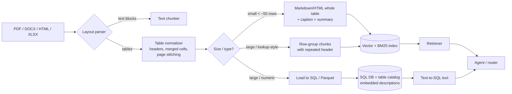

# Q7. Ingest large tables without losing structure.
[← Back to questions](../questions.md)

## TL;DR
- **Detect tables as tables.** Use layout-aware parsers (Docling, Unstructured `hi_res`, Camelot/pdfplumber for digital PDFs, or Textract/Azure Document Intelligence for scans). Plain text extraction turns tables into word soup.
- **Serialize so structure survives.** Use Markdown for simple grids and HTML for merged cells. For large tables, emit **row-wise chunks that repeat the header** (and the table caption) so every chunk can be understood on its own.
- **Index a summary, return the table.** Use multi-vector / parent-document retrieval: embed an LLM-written table summary plus row chunks, and hand the full table (or a relevant slice) to the LLM.
- **Very large or numeric tables belong in a database.** Load them into SQL/DataFrames and answer with text-to-SQL or pandas tools. Embeddings are bad at aggregation, filtering, and exact numbers.
- Handle **multi-page tables** (stitch continuation pages, dedupe repeated headers), **merged/multi-level headers** (flatten to `Parent > Child`), and keep metadata: `table_id`, page, caption, units, source.

## Detailed Answer

### 1. Why tables break naive RAG
| Failure | What happens |
|---|---|
| Text extraction linearizes cells | `Region Q1 Q2 North 10 12 South 9 14` loses column alignment |
| Fixed-size chunking | Splits mid-row; header lives in chunk 1, data rows in chunk 7 |
| Embedding numeric rows | Vectors of "12.4, 13.1, 9.8" carry almost no semantics |
| Aggregation questions | "Total Q2 revenue across regions" needs every row, but top-k returns 5 |
| Multi-page tables | Page 2 has no header, so rows become orphaned numbers |
| Merged cells / multi-level headers | Column meaning (e.g., `2024 > Q1 > Revenue`) lost |

Treat tables as **structured data that happens to be in a document**, not as prose.

### 2. Pipeline overview



### 3. Table detection and extraction tools
| Tool | Best for | Notes |
|---|---|---|
| **Docling** (IBM) | Digital + scanned PDFs, DOCX | TableFormer model, outputs structured table with row/col spans; exports Markdown/HTML/DataFrame |
| **Unstructured** (`strategy="hi_res"`, `infer_table_structure=True`) | Mixed corpora | Gives `Table` elements with `metadata.text_as_html` |
| **Camelot** | Digital (text-layer) PDFs with ruled lines (`lattice`) or whitespace (`stream`) | Not for scans |
| **pdfplumber** | Fine-grained control, custom heuristics | Manual tuning |
| **AWS Textract / Azure Document Intelligence / Google Document AI** | Scans, forms, high volume | Paid; return cell-level spans and confidence |
| **Vision LLM** (GPT-4o, Claude, Gemini) | Messy/complex tables, charts | Expensive; verify numbers; good fallback |
| Native formats (XLSX/CSV/HTML) | Already structured | Don't round-trip through PDF; read directly with pandas |

Docling example:

```python
from docling.document_converter import DocumentConverter

converter = DocumentConverter()
result = converter.convert("annual_report.pdf")
doc = result.document

for i, table in enumerate(doc.tables):
    df = table.export_to_dataframe()        # pandas DataFrame
    md = table.export_to_markdown()
    page = table.prov[0].page_no if table.prov else None
    print(i, page, df.shape)
```

Unstructured example:

```python
from unstructured.partition.pdf import partition_pdf

elements = partition_pdf(
    filename="annual_report.pdf",
    strategy="hi_res",
    infer_table_structure=True,
)
tables = [el for el in elements if el.category == "Table"]
for t in tables:
    html = t.metadata.text_as_html     # preserves rowspan/colspan
    page = t.metadata.page_number
```

Camelot for ruled digital PDFs:

```python
import camelot
tables = camelot.read_pdf("report.pdf", pages="1-end", flavor="lattice")
for t in tables:
    print(t.parsing_report)   # accuracy, whitespace -> use as a quality gate
    df = t.df
```

### 4. Serialization formats
| Format | Pros | Cons | Use when |
|---|---|---|---|
| Markdown | Compact, LLMs read it well | No merged cells | Simple grids |
| HTML | rowspan/colspan, nested headers | More tokens | Complex headers |
| JSON records (`{"col": val}` per row) | Self-describing rows, great for row chunks | Verbose | Row-wise chunking, lookup |
| "Key: value" sentences | Embeds best semantically | Verbose, lossy for numbers | Small spec/attribute tables |
| CSV | Compact | LLMs misalign columns in long tables | Feeding to code tools, not prompts |

Research and practice both suggest LLMs handle Markdown and HTML table input reasonably well, and HTML is safer for complex headers. Whatever you choose, **include the caption, units, and source** with the table.

### 5. Row-wise chunking with header repetition
For a 2,000-row table, a single chunk is too large and arbitrary splits destroy meaning. Group rows and repeat context:

```python
import pandas as pd
from langchain_core.documents import Document

def table_to_row_chunks(df: pd.DataFrame, *, table_id: str, caption: str,
                        source: str, page: int | None, rows_per_chunk: int = 20,
                        key_cols: list[str] | None = None) -> list[Document]:
    docs = []
    header = "| " + " | ".join(map(str, df.columns)) + " |"
    sep = "|" + "---|" * len(df.columns)
    for start in range(0, len(df), rows_per_chunk):
        part = df.iloc[start:start + rows_per_chunk]
        body = "\n".join("| " + " | ".join(map(str, r)) + " |"
                         for r in part.itertuples(index=False))
        text = (f"Table: {caption}\nSource: {source}, page {page}\n"
                f"Rows {start + 1}-{start + len(part)} of {len(df)}\n\n"
                f"{header}\n{sep}\n{body}")
        meta = {"table_id": table_id, "source": source, "page": page,
                "row_start": start, "row_end": start + len(part) - 1,
                "type": "table_rows"}
        if key_cols:  # helps BM25 + metadata filtering on entity names
            meta["keys"] = part[key_cols].astype(str).agg(" ".join, axis=1).tolist()
        docs.append(Document(page_content=text, metadata=meta))
    return docs
```

Tips:
- Choose row groups by **semantic grouping** (e.g., by region or product) when a natural key exists, rather than fixed counts.
- For lookup tables (product specs, price lists), a **one-row-per-chunk JSON record** with the entity name up front retrieves very precisely.
- Keep chunks well under the embedding model's token limit. Long numeric chunks get silently truncated.

### 6. Summary + multi-vector retrieval
Embed *what the table is about* and return *the table itself*:

```python
import uuid
from langchain.retrievers.multi_vector import MultiVectorRetriever
from langchain.storage import InMemoryByteStore
from langchain_core.documents import Document
from langchain_openai import ChatOpenAI, OpenAIEmbeddings
from langchain_chroma import Chroma

llm = ChatOpenAI(model="gpt-4o-mini", temperature=0)
vectorstore = Chroma(collection_name="table_summaries",
                     embedding_function=OpenAIEmbeddings())
retriever = MultiVectorRetriever(vectorstore=vectorstore,
                                 byte_store=InMemoryByteStore(), id_key="doc_id")

def summarize_table(md: str, caption: str) -> str:
    prompt = (f"Summarize this table for search indexing. Name the entities, "
              f"metrics, units, time periods and notable values.\n"
              f"Caption: {caption}\n\n{md}")
    return llm.invoke(prompt).content

table_docs = [Document(page_content=md, metadata={"caption": cap})
              for md, cap in extracted_tables]          # full tables
ids = [str(uuid.uuid4()) for _ in table_docs]
summaries = [Document(page_content=summarize_table(d.page_content, d.metadata["caption"]),
                      metadata={"doc_id": ids[i]}) for i, d in enumerate(table_docs)]

retriever.vectorstore.add_documents(summaries)
retriever.docstore.mset(list(zip(ids, table_docs)))

hits = retriever.invoke("What was EMEA gross margin in Q3 2024?")  # returns full tables
```

If the full table is too large for the prompt, return the summary plus the **row chunks** matching the query, or route to SQL.

### 7. Text-to-SQL for large / numeric tables
Embeddings can't sum, filter, sort, or join. For "Which 5 SKUs had the largest YoY decline?", load the table into SQL:

```python
import pandas as pd
from sqlalchemy import create_engine
from langchain_community.utilities import SQLDatabase
from langchain_community.agent_toolkits import create_sql_agent
from langchain_openai import ChatOpenAI

engine = create_engine("sqlite:///tables.db")
df.columns = [c.strip().lower().replace(" ", "_") for c in df.columns]
df.to_sql("sales_by_sku_2024", engine, if_exists="replace", index=False)

db = SQLDatabase(engine, include_tables=["sales_by_sku_2024"], sample_rows_in_table_info=3)
agent = create_sql_agent(ChatOpenAI(model="gpt-4o", temperature=0), db=db,
                         agent_type="tool-calling", verbose=False)
agent.invoke({"input": "Top 5 SKUs by YoY revenue decline"})
```

Production practices:
- Keep a **table catalog**: one embedded description per table (caption, columns, units, sample values, source doc). The router retrieves *which table* to query, and SQL answers *the question*.
- Use **read-only credentials**, statement timeouts, row limits, and query allow-listing.
- Return the SQL plus the source doc/page as the citation.
- Normalize types during load: strip `$`, `,`, `%`, handle `(1,234)` negatives, and parse dates. Store units in the catalog.

### 8. Merged cells and multi-level headers
```
|        |   2023    |   2024    |
| Region | Q1  | Q2  | Q1  | Q2  |
```
Flatten to `2023 > Q1`, `2023 > Q2`, and so on:

```python
import pandas as pd

def flatten_header(df: pd.DataFrame) -> pd.DataFrame:
    if isinstance(df.columns, pd.MultiIndex):
        df.columns = [" > ".join(str(p) for p in col if p and "Unnamed" not in str(p))
                      for col in df.columns]
    return df

# Merged row-label cells (rowspan) usually arrive as NaN below the first cell:
df["Region"] = df["Region"].ffill()
```

Keep the HTML version as well. For the LLM prompt, HTML preserves spans better than flattened Markdown.

### 9. Tables spanning pages
- Detect continuation: a table at the top of page N+1 with the same column count/widths as the table at the bottom of page N, a missing header, or a "(continued)" marker.
- Stitch the parts, drop repeated header rows, and record `pages=[12,13,14]`.
- Docling and the commercial parsers handle some cases. Always add a heuristic merge pass and spot-check it.

```python
def should_merge(prev_df, next_df, prev_page, next_page):
    return (next_page == prev_page + 1 and prev_df.shape[1] == next_df.shape[1])

def merge_tables(prev_df, next_df):
    if list(next_df.iloc[0]) == list(prev_df.columns):   # repeated header row
        next_df = next_df.iloc[1:]
    next_df.columns = prev_df.columns
    return pd.concat([prev_df, next_df], ignore_index=True)
```

### 10. Metadata to keep
`table_id`, `source`, `page(s)`, `caption`/title, nearest section heading, `units`, `currency`, `period`, `row_start/row_end`, `parser`, `parser_confidence`, `doc_version`. The surrounding paragraph ("figures in USD millions, excluding discontinued ops") is often essential, so attach it to the table.

### 11. Choosing a strategy

| Table profile | Strategy |
|---|---|
| Small (< ~30 rows), descriptive | Whole table as Markdown/HTML + caption, one chunk |
| Medium, lookup by entity | Row/row-group chunks with header + summary vector |
| Large, analytical (sum/filter/rank) | SQL/DataFrame + text-to-SQL; summary in catalog |
| Specs/attributes (key → value) | Row-as-sentence or JSON record per entity |
| Scanned / complex layout | Commercial OCR or vision LLM + validation |
| Charts | Vision LLM description + extract underlying data if available |

### 12. Evaluation
- **Extraction accuracy:** cell-level precision against a hand-labeled sample (TEDS is the standard table-structure metric).
- **Retrieval:** do table questions retrieve the right `table_id` and rows?
- **Answer:** exact-match on numbers, and track unit errors separately.
- Keep a question set that splits into lookup, comparison, and aggregation types. Aggregation is where vector-only approaches fail.

## Common Pitfalls
- Running `pypdf` text extraction on table-heavy PDFs and hoping chunking fixes it.
- Chunking tables with the same splitter as prose (splitting mid-row, losing headers).
- Embedding giant numeric tables and expecting similarity search to find "the max".
- Dropping captions, units, and footnotes ("in thousands"), which leads to answers off by 1000x.
- Not validating OCR'd numbers: a misread `8` vs `3` produces a confidently wrong answer.
- Feeding a 500-row CSV into the prompt; LLMs misalign columns over long contexts.
- Text-to-SQL with write permissions or no row limits.

## Likely Follow-up Questions
1. **Markdown or HTML for tables in prompts?** Markdown for simple grids because it's cheaper. HTML when there are merged cells or multi-level headers.
2. **How do you answer aggregation questions over tables in PDFs?** Extract to a DataFrame/SQL and use a code or SQL tool. Vector retrieval only finds *which* table.
3. **How do you route between vector search and SQL?** Use an LLM router or tool calling with a table catalog. Signals include aggregation words, numeric comparisons, and "how many".
4. **How do you handle tables inside scanned documents?** Use OCR with table structure (Textract, Azure DI, Docling with OCR) plus confidence thresholds and human review for low confidence.
5. **What about very wide tables (100+ columns)?** Split into column groups that each keep the key columns, or store in SQL and expose only the relevant columns via the schema.
6. **How do you evaluate table extraction quality?** Cell-level accuracy or TEDS on a labeled sample, and track per-parser metrics so you can choose the parser per document type.

[← Back to questions](../questions.md)
