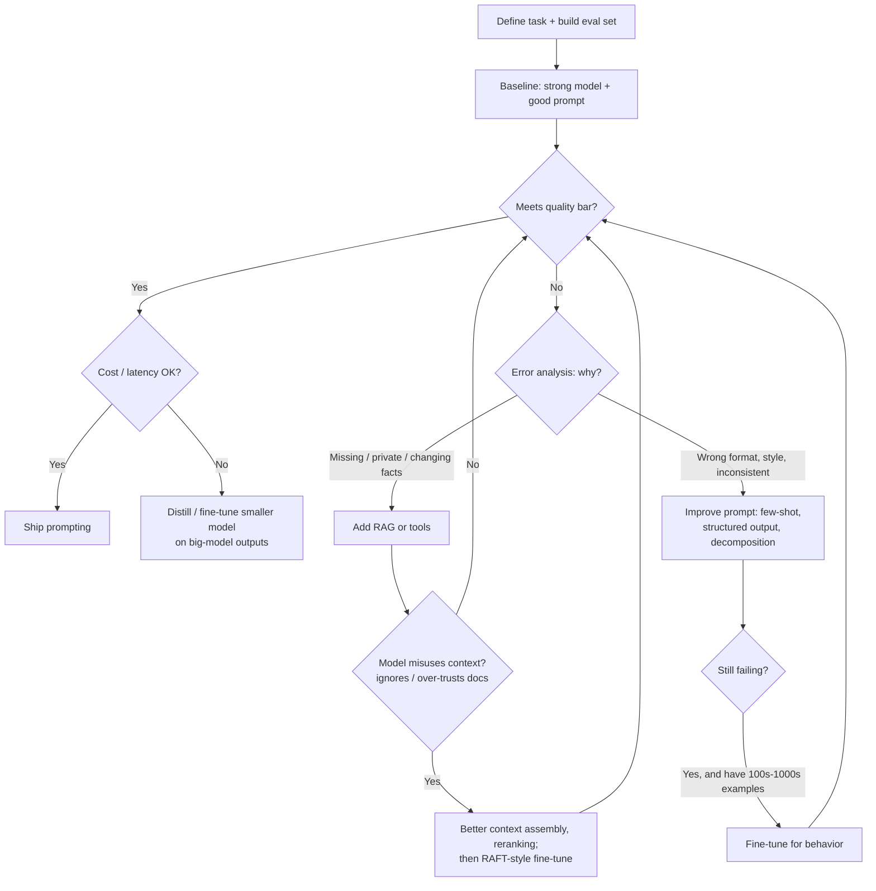

# Q8. Prompting vs RAG vs fine-tuning: how do you choose?
[← Back to questions](../questions.md)

## TL;DR
- **Start with prompting** (instructions, few-shot, structured output). It's the cheapest, fastest to iterate, and sets the baseline you must beat.
- **Use RAG when the gap is knowledge**: private, large, fast-changing, or citation-required facts. RAG changes *what the model knows at inference time* and supports freshness, ACLs, and attribution.
- **Fine-tune when the gap is behavior**: consistent format/style/tone, domain-specific task skill, tool-calling reliability, or making a **smaller, cheaper, faster model** do what a big model does with a long prompt. Fine-tuning is a poor way to inject facts that change.
- They **combine**. A typical mature system is a fine-tuned (or distilled) model, plus RAG for facts, plus a lean prompt. RAFT-style training teaches a model to use retrieved context well.
- Decide from **evals and error analysis**: classify failures as "didn't know" (RAG), "knew but did it wrong" (prompt, then fine-tune), or "too slow/expensive" (distill/fine-tune).

## Detailed Answer

### 1. The core distinction: knowledge vs behavior

```
                 ┌──────────── What is missing? ─────────────┐
                 │                                           │
            KNOWLEDGE                                    BEHAVIOR
   (facts, docs, data the model             (format, style, reasoning pattern,
    hasn't seen or that change)              task skill, tool use, latency/cost)
                 │                                           │
               RAG / tools                     Prompting  →  Fine-tuning
```

- **Prompting** steers behavior already latent in the model. It's limited by context length, instruction-following, and per-call token cost.
- **RAG** injects external knowledge per request. It's limited by retrieval quality and context assembly.
- **Fine-tuning** (SFT, LoRA, DPO/preference tuning) updates the weights to change *default behavior*. It can add some knowledge, but unreliably: facts learned in fine-tuning are hard to update, hard to cite, can't be access-controlled, and new facts introduced through fine-tuning can increase hallucination.

### 2. Decision tree



### 3. Comparison table

| Dimension | Prompting | RAG | Fine-tuning |
|---|---|---|---|
| Fixes | Instructions, light behavior | Knowledge gaps, freshness | Behavior, style, format, skill, efficiency |
| Data needed | 0–20 examples | A corpus (no labels needed to start) | Hundreds to tens of thousands of labeled examples (LoRA: often 500–5k good ones) |
| Time to first result | Hours | Days–weeks | Weeks (data + training + eval) |
| Freshness | N/A | Real-time (re-index) | Stale until retrained |
| Citations / provenance | No | Yes | No |
| Access control | N/A | Yes (filter per user) | No: whatever is in the weights is available to everyone |
| Inference cost | Grows with prompt length | + retrieval + context tokens | Can **lower** cost (shorter prompts, smaller model) |
| Latency | Low | + retrieval (~50–300 ms) + longer prompt | Lowest if smaller model |
| Maintenance | Prompt versioning | Ingestion pipelines, index ops | Retraining, dataset curation, model hosting, base-model upgrades |
| Risk | Prompt injection, brittleness | Retrieval misses, injection via docs | Catastrophic forgetting, overfitting, safety regression |
| Debuggability | High | High (inspect retrieved chunks) | Low |

### 4. When each wins (concrete scenarios)

**Prompting is enough**
- Summarization, classification, extraction with a clear schema, rewriting.
- A frontier model plus a structured-output schema and 3–5 examples usually suffices.

**RAG is the answer**
- Internal knowledge assistant over Confluence/SharePoint.
- Customer support over product docs that change weekly.
- Legal/medical/finance, where answers must cite sources.
- Multi-tenant data with per-user permissions.

**Fine-tuning is the answer**
- Output must follow a strict house style or domain-specific format across millions of calls.
- Classification/extraction at scale, where a fine-tuned 8B model matches GPT-4-class accuracy at 10–50x lower cost.
- Domain language the base model handles poorly (clinical shorthand, internal codes).
- Reliable tool/function calling for a fixed toolset.
- **Distillation**: the prompt grew to 4k tokens of instructions and examples, so train those into the weights.
- On-device / edge / air-gapped deployments that need small models.

**Combination**
- Fine-tune for format and for "use the provided context and say 'I don't know' when it's missing", and use RAG for facts. RAFT (Retrieval-Augmented Fine-Tuning) trains on (question, relevant docs + distractors, chain-of-thought answer citing the docs) so the model learns to ignore distractors.

### 5. Cost reasoning example
Suppose 1M requests/month on a frontier model with a 3,000-token prompt (instructions + few-shot) and a 300-token output. If fine-tuning a smaller model cuts the prompt to 300 tokens and drops the per-token price by ~10x, inference cost can fall by well over an order of magnitude. Weigh that against:
- dataset creation (often generated by the large model, then filtered or reviewed),
- training runs and eval,
- hosting (dedicated GPUs or a provider's fine-tuned endpoint pricing),
- retraining whenever the base model or the task changes.

**Rule of thumb:** fine-tune for cost only when volume is high and the task is stable.

### 6. Fine-tuning methods in brief
| Method | What it does | When |
|---|---|---|
| Full SFT | Updates all weights | Rarely needed; expensive |
| LoRA / QLoRA (PEFT) | Trains low-rank adapters, ~0.1–1% params | Default for open models; cheap, swappable adapters |
| Provider fine-tuning (OpenAI, Bedrock, Vertex) | Managed SFT | No infra; limited control |
| DPO / preference tuning | Learns from chosen vs rejected pairs | Tone, safety, "prefer concise", ranking quality |
| Continued pre-training | Unlabeled domain text | Massive domain shift (new language, code base); expensive |

LoRA with Hugging Face PEFT:

```python
from datasets import load_dataset
from peft import LoraConfig
from trl import SFTTrainer, SFTConfig

dataset = load_dataset("json", data_files="train.jsonl", split="train")
# each row: {"messages": [{"role": "system", ...}, {"role": "user", ...}, {"role": "assistant", ...}]}

peft_config = LoraConfig(r=16, lora_alpha=32, lora_dropout=0.05,
                         target_modules="all-linear", task_type="CAUSAL_LM")

trainer = SFTTrainer(
    model="meta-llama/Llama-3.1-8B-Instruct",
    train_dataset=dataset,
    peft_config=peft_config,
    args=SFTConfig(output_dir="out", num_train_epochs=2,
                   per_device_train_batch_size=4, learning_rate=2e-4),
)
trainer.train()
```

### 7. Prompting baseline done properly
Before concluding "prompting fails", make sure you actually tried:
- Clear role and task, explicit constraints, output schema (JSON mode / structured outputs).
- 3–8 diverse few-shot examples, including edge cases.
- Decomposition (chain of prompts) instead of one mega-prompt.
- A stronger model, to establish a ceiling.
- Dynamic few-shot: *retrieve* the most similar examples, which is RAG over examples.

```python
from langchain_openai import ChatOpenAI
from pydantic import BaseModel, Field

class Ticket(BaseModel):
    category: str = Field(description="one of: billing, bug, feature, account")
    priority: int = Field(ge=1, le=4)
    summary: str

llm = ChatOpenAI(model="gpt-4o-mini", temperature=0).with_structured_output(Ticket)
ticket = llm.invoke("Classify: 'I was charged twice this month, please refund ASAP'")
```

### 8. Error analysis drives the choice
Label 50–100 failures from your eval set:

| Failure bucket | Fix |
|---|---|
| Answer needed a fact not in model / prompt | RAG / tool |
| Fact was retrieved but model ignored or misread it | Context ordering, reranking, prompt; RAFT fine-tune |
| Retrieval missed the fact | Chunking, hybrid search, query rewriting |
| Format/style wrong | Prompt → structured outputs → fine-tune |
| Reasoning wrong | Stronger model, CoT, decomposition, reasoning model |
| Too slow / expensive | Caching, smaller model, distillation/fine-tune |

### 9. Myths to correct in an interview
- **"Fine-tune on our docs so it knows our company."** This usually underperforms RAG for factual QA, gives no citations, goes stale, and leaks across permission boundaries.
- **"RAG removes hallucination."** It reduces hallucination. You still need faithfulness checks and grounding prompts.
- **"Long context makes RAG obsolete."** See Q41: cost, latency, ACLs, and lost-in-the-middle still apply.
- **"Fine-tuning is always expensive."** LoRA on an 8B model with a few thousand examples can cost tens of dollars of GPU time. The real cost is data quality and ongoing maintenance.

## Common Pitfalls
- Jumping to fine-tuning before building an eval set and a strong prompt baseline.
- Fine-tuning to inject volatile facts.
- Fine-tuning on low-quality or inconsistent labels (garbage in, confident garbage out).
- Not re-evaluating general capabilities and safety after fine-tuning (regression).
- Locking into a fine-tuned old base model while newer base models surpass it zero-shot.
- Using RAG for tasks that need no external knowledge, which adds latency and distraction.
- Ignoring the maintenance cost: indexes need ops, and fine-tunes need retraining pipelines.

## Likely Follow-up Questions
1. **How many examples do you need to fine-tune?** For style/format with LoRA, a few hundred high-quality examples can work. Complex tasks need thousands. Quality and diversity matter more than count.
2. **Can fine-tuning and RAG be combined?** Yes. Fine-tune for behavior (citing, abstaining, format), and use RAG for facts. RAFT trains with distractor documents.
3. **How do you prevent catastrophic forgetting?** Use LoRA, low learning rates and few epochs, mix in general instruction data, and run regression evals on general benchmarks.
4. **What's distillation in this context?** Generate outputs with a large model on real inputs, filter for quality, and fine-tune a small model on them, getting near-teacher quality at a fraction of the cost.
5. **How do you decide between RAG and tool calls (APIs/SQL)?** Use tools for structured, live, exact data (balances, inventory, metrics). Use RAG for unstructured text.
6. **What metric tells you fine-tuning worked?** Task-specific eval improvement over the best prompt baseline at the target cost/latency, with no regression on safety or general evals.

[← Back to questions](../questions.md)
