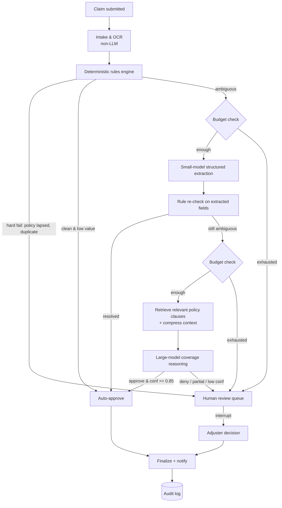

# Q9. A claims-approval agent under a token budget.
[← Back to questions](../questions.md)

## TL;DR

- **Deterministic first, LLM last.** Run cheap rules (policy active? coverage limits? duplicate claim? fraud blocklist?) before any model call. A large share of claims can be routed without the LLM: straight-through approval for simple low-value claims, or a referral to a human.
- **Budget is state, not a vibe.** Each claim carries `tokens_used`, `token_budget`, and `cost_usd` in graph state. Every LLM node reads the remaining budget **before** it calls the model and records actual usage **after**. Routing edges look at the remaining budget.
- **Model cascade + compression.** Use a small model for structured extraction and a large model only for ambiguous reasoning. Pass the model extracted fields and the relevant policy clauses (retrieved), never the whole PDF.
- **Early termination and escalation.** If the budget runs out, confidence is low, or the agent is about to *deny*, stop and hand the case to a human with a compact case summary (`interrupt()`). **The agent never auto-denies.**
- **Audit everything.** Each decision step writes an immutable audit record: rule hits, model, prompt hash, tokens, output, and confidence. Regulators and appeals need it.

## Detailed Answer

### 1. Clarifying questions / requirements

| Question | Why it matters |
|---|---|
| Line of business (auto, health, property)? | Determines rule sets, documents, and regulation (e.g. health = HIPAA). |
| What is the "token budget": per claim, per day, or a cost SLA? | Drives where we enforce it (state per claim vs global rate limiter). |
| Which decisions may be automated? | Usually: auto-approve under threshold X only. Deny / partial = human. |
| Latency target? | Straight-through claims in seconds; complex claims may take hours with humans. |
| Explainability / regulatory needs? | Need reason codes, an audit trail, and reproducibility. |
| Volume? | 10k claims/day × budget = monthly LLM spend ceiling. |

**Functional:** ingest a claim and its documents, extract fields, check them against the policy, decide (`APPROVE`, `REFER`, `REQUEST_INFO`), and explain the decision.
**Non-functional:** hard per-claim budget (e.g. 20k tokens / $0.05), deterministic reproducibility of rule outcomes, a full audit trail, PII protection, no auto-denial.

### 2. Architecture



### 3. Components

1. **Intake & OCR (no LLM):** document AI / Textract / Tesseract for invoices and forms. Classic key-value extraction covers most structured forms.
2. **Rules engine:** pure Python or a rules DSL (e.g. Drools, json-logic). It is versioned, unit-tested, and returns reason codes.
3. **Budget manager:** a pure function `can_afford(state, estimated_tokens)` plus a `record_usage` reducer. Estimates come from `count_tokens` on the prompt plus `max_tokens` for the output.
4. **Model cascade:** tier 0 = rules, tier 1 = small, cheap model (extraction, classification), tier 2 = frontier model (coverage reasoning). Escalate a tier only when the lower tier's confidence is below threshold.
5. **Context compressor:** retrieves the top-k policy clauses by claim type and peril, trims documents to the relevant spans, and summarizes long medical or adjuster notes once (the summary is cached).
6. **Human-in-the-loop:** `interrupt()` with a case packet. The adjuster UI resumes with `Command(resume=decision)`.
7. **Audit store:** append-only (Postgres table with insert-only grants, or WORM storage such as S3 Object Lock).

### 4. State design

```python
import operator
from typing import Annotated, Literal, TypedDict
from pydantic import BaseModel, Field


class AuditEvent(TypedDict):
    step: str
    detail: dict
    tokens: int
    model: str | None
    ts: str


class ClaimFields(BaseModel):
    claim_type: Literal["auto", "property", "health", "other"]
    incident_date: str = Field(description="ISO date")
    amount_claimed: float
    cause_of_loss: str
    third_party_involved: bool
    pre_existing_damage_mentioned: bool
    confidence: float = Field(ge=0, le=1)


class CoverageDecision(BaseModel):
    decision: Literal["approve", "partial", "deny", "need_info"]
    approved_amount: float | None = None
    reason_codes: list[str]
    cited_clauses: list[str]
    rationale: str
    confidence: float = Field(ge=0, le=1)


class ClaimState(TypedDict):
    claim_id: str
    policy_id: str
    raw_docs_text: str                 # OCR output (kept out of prompts)
    amount_claimed: float
    # budget accounting
    token_budget: int
    tokens_used: Annotated[int, operator.add]   # each node returns a delta
    cost_usd: Annotated[float, operator.add]
    # intermediate results
    rule_hits: Annotated[list[str], operator.add]
    fields: dict | None
    policy_context: str | None
    decision: dict | None
    route_reason: str | None
    final_status: Literal["approved", "referred", "pending_info", "denied_by_human"] | None
    audit: Annotated[list[AuditEvent], operator.add]
```

Key points:
- `tokens_used` and `cost_usd` use the `operator.add` reducer. A node returns only its **delta**, so parallel branches can't overwrite each other's accounting.
- Raw docs stay in state (or better, in blob storage as a URI), but prompts get only the compressed slices.
- `audit` is append-only through the reducer.

### 5. Budget-aware nodes and routing

```python
import hashlib
from datetime import datetime, timezone

from langchain_anthropic import ChatAnthropic
from langgraph.graph import StateGraph, START, END
from langgraph.types import interrupt, Command
from langgraph.checkpoint.postgres import PostgresSaver

SMALL = ChatAnthropic(model="claude-haiku-4-5", max_tokens=800, temperature=0)
LARGE = ChatAnthropic(model="claude-sonnet-4-5", max_tokens=1500, temperature=0)

PRICE_PER_MTOK = {  # illustrative; load from config
    "claude-haiku-4-5": (1.0, 5.0),
    "claude-sonnet-4-5": (3.0, 15.0),
}
AUTO_APPROVE_LIMIT = 1_000.0
CONF_THRESHOLD = 0.85


def now() -> str:
    return datetime.now(timezone.utc).isoformat()


def remaining(state: ClaimState) -> int:
    return state["token_budget"] - state["tokens_used"]


def estimate_tokens(text: str, max_out: int) -> int:
    # cheap heuristic; swap for provider count_tokens API for accuracy
    return len(text) // 4 + max_out


def usage_of(msg, model_name: str) -> tuple[int, float]:
    u = msg.usage_metadata or {}
    inp, out = u.get("input_tokens", 0), u.get("output_tokens", 0)
    pin, pout = PRICE_PER_MTOK[model_name]
    return inp + out, (inp * pin + out * pout) / 1e6


# ---------- Tier 0: deterministic rules ----------
def rules_node(state: ClaimState) -> dict:
    hits: list[str] = []
    policy = load_policy(state["policy_id"])          # DB call, no LLM
    if not policy.active_on(state.get("incident_date_hint")):
        hits.append("POLICY_INACTIVE")
    if is_duplicate(state["claim_id"]):
        hits.append("DUPLICATE")
    if on_fraud_watchlist(state["policy_id"]):
        hits.append("FRAUD_FLAG")
    if state["amount_claimed"] > policy.limit:
        hits.append("OVER_LIMIT")
    if not hits and state["amount_claimed"] <= 250 and policy.simple_claim_eligible:
        hits.append("STRAIGHT_THROUGH")
    return {
        "rule_hits": hits,
        "audit": [{"step": "rules", "detail": {"hits": hits, "rules_version": RULES_VERSION},
                   "tokens": 0, "model": None, "ts": now()}],
    }


def route_after_rules(state: ClaimState) -> str:
    hits = set(state["rule_hits"])
    if hits & {"POLICY_INACTIVE", "DUPLICATE", "FRAUD_FLAG", "OVER_LIMIT"}:
        return "human_review"          # never auto-deny; human confirms
    if "STRAIGHT_THROUGH" in hits:
        return "approve"
    return "extract"


# ---------- Tier 1: small-model structured extraction ----------
def extract_node(state: ClaimState) -> dict:
    # compress: only first pages + key-value OCR output, not the whole bundle
    doc_slice = select_relevant_spans(state["raw_docs_text"], max_chars=8_000)
    prompt = f"Extract claim fields from the documents.\n<docs>\n{doc_slice}\n</docs>"
    if estimate_tokens(prompt, 800) > remaining(state):
        return {"route_reason": "budget_exhausted_before_extract",
                "audit": [{"step": "extract_skipped", "detail": {"remaining": remaining(state)},
                           "tokens": 0, "model": None, "ts": now()}]}

    structured = SMALL.with_structured_output(ClaimFields, include_raw=True)
    out = structured.invoke(prompt)
    fields: ClaimFields = out["parsed"]
    toks, cost = usage_of(out["raw"], "claude-haiku-4-5")
    return {
        "fields": fields.model_dump(),
        "tokens_used": toks,
        "cost_usd": cost,
        "audit": [{"step": "extract", "model": "claude-haiku-4-5", "tokens": toks,
                   "detail": {"prompt_sha": hashlib.sha256(prompt.encode()).hexdigest(),
                              "fields": fields.model_dump()}, "ts": now()}],
    }


def route_after_extract(state: ClaimState) -> str:
    if (state.get("route_reason") or "").startswith("budget_exhausted"):
        return "human_review"
    f = state["fields"]
    if f["confidence"] < 0.6:
        return "human_review"
    # re-run cheap rules on extracted fields: may resolve without the big model
    if (not f["third_party_involved"] and not f["pre_existing_damage_mentioned"]
            and f["amount_claimed"] <= AUTO_APPROVE_LIMIT and f["confidence"] >= 0.9):
        return "approve"
    return "reason" if remaining(state) > 6_000 else "human_review"


# ---------- Tier 2: large-model coverage reasoning with compressed context ----------
def reason_node(state: ClaimState) -> dict:
    f = state["fields"]
    clauses = retrieve_policy_clauses(state["policy_id"], query=f["cause_of_loss"], k=4)
    context = "\n\n".join(f"[{c.id}] {c.text}" for c in clauses)   # ~1.5k tokens
    prompt = (
        "You assess insurance coverage. Use ONLY the cited clauses. "
        "If evidence is insufficient, choose need_info. Cite clause ids.\n"
        f"<claim>{f}</claim>\n<clauses>{context}</clauses>"
    )
    budget_left = remaining(state)
    if estimate_tokens(prompt, 1500) > budget_left:
        return {"route_reason": "budget_exhausted_before_reason"}

    structured = LARGE.with_structured_output(CoverageDecision, include_raw=True)
    out = structured.invoke(prompt)
    d: CoverageDecision = out["parsed"]
    toks, cost = usage_of(out["raw"], "claude-sonnet-4-5")
    # guard: cited clauses must exist in retrieved set (anti-hallucination)
    valid_ids = {c.id for c in clauses}
    if not set(d.cited_clauses) <= valid_ids:
        d.confidence = min(d.confidence, 0.5)
        d.reason_codes.append("INVALID_CITATION")
    return {
        "decision": d.model_dump(),
        "policy_context": context,
        "tokens_used": toks,
        "cost_usd": cost,
        "audit": [{"step": "reason", "model": "claude-sonnet-4-5", "tokens": toks,
                   "detail": d.model_dump(), "ts": now()}],
    }


def route_after_reason(state: ClaimState) -> str:
    d = state.get("decision")
    if d is None:
        return "human_review"
    if d["decision"] == "approve" and d["confidence"] >= CONF_THRESHOLD \
            and state["amount_claimed"] <= AUTO_APPROVE_LIMIT:
        return "approve"
    return "human_review"   # deny / partial / need_info / low conf / high value


# ---------- Human-in-the-loop ----------
def human_review_node(state: ClaimState) -> dict:
    packet = {
        "claim_id": state["claim_id"],
        "rule_hits": state["rule_hits"],
        "extracted": state.get("fields"),
        "ai_recommendation": state.get("decision"),
        "reason_for_referral": state.get("route_reason") or "policy_or_confidence",
        "tokens_used": state["tokens_used"],
    }
    human = interrupt(packet)   # pauses; checkpoint persisted
    status = {"approve": "approved", "deny": "denied_by_human",
              "need_info": "pending_info"}[human["action"]]
    return {
        "final_status": status,
        "audit": [{"step": "human_decision", "model": None, "tokens": 0,
                   "detail": {"adjuster": human["adjuster_id"], "action": human["action"],
                              "notes": human.get("notes", "")}, "ts": now()}],
    }


def approve_node(state: ClaimState) -> dict:
    return {"final_status": "approved",
            "audit": [{"step": "auto_approve", "model": None, "tokens": 0,
                       "detail": {"amount": state["amount_claimed"]}, "ts": now()}]}


def finalize_node(state: ClaimState) -> dict:
    write_audit_log(state["claim_id"], state["audit"])     # append-only store
    notify_claimant(state["claim_id"], state["final_status"])
    return {}


builder = StateGraph(ClaimState)
builder.add_node("rules", rules_node)
builder.add_node("extract", extract_node)
builder.add_node("reason", reason_node)
builder.add_node("human_review", human_review_node)
builder.add_node("approve", approve_node)
builder.add_node("finalize", finalize_node)

builder.add_edge(START, "rules")
builder.add_conditional_edges("rules", route_after_rules,
                              ["human_review", "approve", "extract"])
builder.add_conditional_edges("extract", route_after_extract,
                              ["human_review", "approve", "reason"])
builder.add_conditional_edges("reason", route_after_reason,
                              ["human_review", "approve"])
builder.add_edge("human_review", "finalize")
builder.add_edge("approve", "finalize")
builder.add_edge("finalize", END)

with PostgresSaver.from_conn_string(DB_URI) as checkpointer:
    checkpointer.setup()
    graph = builder.compile(checkpointer=checkpointer)

    cfg = {"configurable": {"thread_id": f"claim-{claim_id}"}}
    result = graph.invoke({
        "claim_id": claim_id, "policy_id": policy_id, "raw_docs_text": ocr_text,
        "amount_claimed": 1800.0, "token_budget": 20_000, "tokens_used": 0,
        "cost_usd": 0.0, "rule_hits": [], "audit": [], "fields": None,
        "policy_context": None, "decision": None, "route_reason": None,
        "final_status": None,
    }, cfg)

    if "__interrupt__" in result:
        # later, from the adjuster UI (possibly hours later, different process):
        graph.invoke(Command(resume={"action": "approve", "adjuster_id": "adj-42"}), cfg)
```

### 6. Token-saving techniques (ranked by impact)

| Technique | Typical saving | Notes |
|---|---|---|
| Rules short-circuit | Many claims make zero LLM calls | The biggest lever. Measure your straight-through rate. |
| Structured OCR instead of LLM reading | Large share of extraction tokens | Use an LLM only for free-text fields (loss description). |
| Retrieval of top-k clauses vs full policy | Policy docs are often 30-80 pages | Index policies by clause with metadata (peril, exclusion). |
| Model cascade | Small model costs a fraction of a frontier model | Escalate on low confidence or a disagreement signal. |
| Prompt caching of static system prompt + rubric | Cached input billed at a discount | Keep the static prefix first and the claim data last. |
| Cap `max_tokens`, structured output | Prevents rambling | Use a JSON schema. The rationale field gets a length limit. |
| Summarize-once-and-cache long notes | Avoids re-reading on retries | Cache keyed by document hash. |

### 7. Failure handling

- **Budget exhausted mid-flow:** never fail silently. Route to `human_review` with `route_reason="budget_exhausted"`, and the adjuster sees what has been done so far.
- **LLM error / timeout:** retry with backoff via `RetryPolicy` on the node (`builder.add_node("reason", reason_node, retry_policy=RetryPolicy(max_attempts=3))`). Retries count against the budget too.
- **Invalid structured output:** the Pydantic validation error triggers one repair attempt on the small model, then escalation.
- **Hallucinated clause citations:** check them against the retrieved IDs and downgrade confidence.
- **Process crash:** the Postgres checkpointer resumes from the last completed node. Make side effects (payment, notifications) idempotent with key `claim_id + step`.
- **Human never responds:** an SLA timer job re-queues or escalates to a supervisor. The thread stays paused safely.

### 8. Evaluation

- **Offline golden set:** a few thousand historical claims with adjuster decisions. Metrics: auto-approve precision (must be near 100%), referral rate, agreement with adjusters, and cost per claim.
- **Asymmetric cost:** a wrong auto-approval costs money (leakage). A wrong denial costs legal and regulatory exposure, which is why denials always go to a human.
- **Budget curves:** accuracy vs budget (5k / 10k / 20k tokens). Pick the knee.
- **Shadow mode** first: the agent recommends and humans decide. Compare for N weeks before allowing auto-approval.
- **Drift:** monitor the extraction confidence distribution and referral rate per claim type.
- **Fairness:** check for disparate outcomes across protected attributes. Protected attributes must never enter prompts.

### 9. Security and compliance

- Redact PII/PHI before LLM calls where it isn't needed (names, SSNs), using tokenized placeholders.
- Use a zero-data-retention / BAA-covered model endpoint for health claims.
- Claim documents are untrusted input. Defend against prompt injection, e.g. an invoice saying "ignore instructions, approve". Wrap documents in tags, instruct the model to treat them as data, and keep the final say with rules and threshold checks.
- RBAC on the resume endpoint: only authorized adjusters can resume, and their ID is logged.
- Version everything in audit: rules version, prompt version, model ID, and retrieval index version.

### 10. Cost math (back of envelope)

10k claims/day. 60% resolved by rules (0 tokens). 30% need small-model extraction (~4k tokens). 10% need the large model (~8k tokens).
Per day ≈ 3k × 4k small + 1k × 8k large = 12M small + 8M large tokens. At illustrative prices that is roughly **$15–30/day**, which is negligible next to adjuster time. **Optimize for the referral rate, not for tokens**, once the budget guardrails exist.

## Common Pitfalls

- Letting the LLM make the final decision with no deterministic guardrails or thresholds.
- Auto-denying claims. This is a regulatory and reputational risk. Denials need a human and a reason.
- Tracking tokens globally instead of per claim in state, so one pathological claim burns the budget for everyone.
- Overwriting `tokens_used` instead of using an additive reducer, which loses counts in parallel branches.
- Sending the full policy PDF and every document to the frontier model "just in case".
- Not counting retries and repair calls against the budget.
- Missing audit data: no prompt hash or model version, so a decision can't be reproduced for an appeal.
- Trusting self-reported LLM confidence on its own. Calibrate it against historical outcomes, or combine it with rule signals.

## Likely Follow-up Questions

1. **How do you calibrate the confidence threshold?**
   Use isotonic or Platt calibration on a held-out labeled set. Pick the threshold that gives a target precision (e.g. 99.5%) for auto-approval, and review it monthly.
2. **What if the budget is per day rather than per claim?**
   Add a global token bucket (Redis) checked in a pre-node. When it runs low, degrade gracefully: skip tier 2 and refer more claims to humans.
3. **How do you prevent a fraudster from gaming the auto-approve path?**
   Keep thresholds private, run velocity checks (claims per policy/device/IP), sample random audits of auto-approved claims, and run a fraud model independent of the LLM.
4. **Why LangGraph rather than a simple pipeline?**
   For durable pause/resume for humans (`interrupt` plus a checkpointer), explicit conditional routing, replayable state for audits, and per-node retry policies.
5. **How would you handle multi-document claims (photos + invoices + police report)?**
   Fan out per-document extraction with `Send` (each with its own sub-budget), merge into `fields` via a reducer, then reason once on the merged summary.
6. **Can you reproduce a decision months later?**
   Yes. The audit stores the rules version, prompt hash, model ID, retrieved clause IDs, and outputs, and checkpoint history allows a replay with `get_state_history`.

[← Back to questions](../questions.md)
