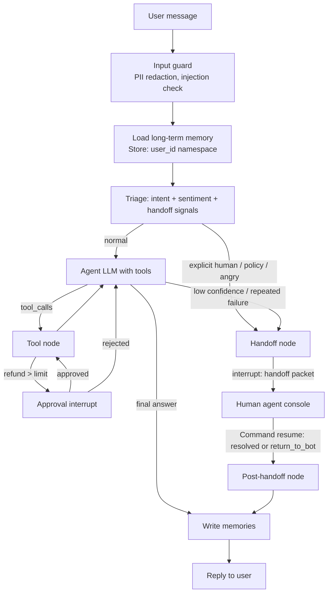

# Q10. A support agent with tools, memory, and human handoff.
[← Back to questions](../questions.md)

## TL;DR

- **ReAct-style agent with scoped tools.** Read tools (`lookup_order`, `search_kb`) run freely. Write tools (`issue_refund`) pass through **policy checks plus an approval gate** (`interrupt()`) above a threshold.
- **Two kinds of memory.** *Short-term* memory is the conversation thread, persisted by a checkpointer keyed by `thread_id` and trimmed or summarized when long. *Long-term* memory is user facts and preferences in a `Store`, namespaced by `user_id` and shared across threads.
- **Explicit handoff triggers.** The agent hands off when the user asks for a human, sentiment is negative and getting worse, confidence is low or the same tool keeps failing, a policy topic comes up (legal threat, chargeback, safety, VIP), or the refund is above the auto limit.
- **Handoff = structured packet.** It contains a summary, intent, what was tried, order IDs, sentiment, and a suggested next action, so the human never asks "can you repeat that?".
- **Resume after human.** The graph pauses on `interrupt()`. The human resolves the case (or returns control) with `Command(resume=...)`, and the bot continues with the full context.

## Detailed Answer

### 1. Clarifying questions / requirements

- Channels (chat, email, voice)? Voice needs stricter latency and turn-taking.
- Which actions may the bot take autonomously? (e.g. refunds ≤ $50, address change before shipment.)
- Human agent platform (Zendesk, Salesforce, Intercom)? This decides the shape of the handoff API.
- Business hours for humans? If no human is available, the bot creates a ticket and sets expectations.
- Data residency and PII rules for stored memory? What may be remembered, and for how long?

**Success metrics:** containment rate (resolved without a human), CSAT, first-contact resolution, average handle time *after* handoff (a good summary lowers it), wrong-action rate (refund errors).

### 2. Architecture



### 3. Components

| Component | Responsibility |
|---|---|
| Input guard | Redact card numbers and similar data. Detect jailbreak or injection in user text and retrieved KB text. |
| Triage | A small, cheap model, or a classifier plus regex, produces `{intent, sentiment, wants_human, policy_flags}`. |
| Agent | Tool-calling LLM with a system prompt holding policies and the user's memory snippet. |
| Tools | `lookup_order`, `track_shipment`, `search_kb`, `issue_refund`, `update_address`, `create_ticket`. |
| Approval gate | `interrupt()` inside the sensitive tool, or before the tool node. |
| Memory | Checkpointer (thread) + `BaseStore` (user profile, past issues), possibly with semantic search. |
| Handoff | Builds the packet, routes to a human queue by skill, and pauses the graph. |
| Observability | Traces (LangSmith/OTel), tool error rates, handoff reasons. |

### 4. State design

```python
import operator
from typing import Annotated, Literal, TypedDict
from langchain_core.messages import AnyMessage
from langgraph.graph.message import add_messages


class SupportState(TypedDict):
    messages: Annotated[list[AnyMessage], add_messages]
    user_id: str
    summary: str                       # rolling summary of older turns
    intent: str | None
    sentiment: float                   # -1..1, latest
    sentiment_history: Annotated[list[float], operator.add]
    tool_failures: int
    handoff_reason: str | None
    handled_by: Literal["bot", "human"]
    resolution: str | None
```

### 5. Tools with policy and an approval gate

```python
from langchain_core.tools import tool
from langgraph.types import interrupt

AUTO_REFUND_LIMIT = 50.0


@tool
def lookup_order(order_id: str) -> dict:
    """Look up an order by id. Returns status, items, total, and delivery date."""
    order = orders_api.get(order_id)        # read-only
    return {"order_id": order.id, "status": order.status, "total": order.total,
            "customer_id": order.customer_id, "delivered_at": order.delivered_at}


@tool
def search_kb(query: str) -> str:
    """Search help-center articles for policy or how-to questions."""
    docs = kb_retriever.invoke(query)
    # wrap as data to reduce prompt injection from KB content
    return "\n\n".join(f"<article id={d.metadata['id']}>{d.page_content}</article>" for d in docs[:3])


@tool
def issue_refund(order_id: str, amount: float, reason: str) -> str:
    """Refund an order. Amounts above the auto limit need human approval."""
    order = orders_api.get(order_id)
    # deterministic policy checks: never trust the LLM's arguments blindly
    if amount > order.total:
        return "REJECTED: amount exceeds order total."
    if order.refunded:
        return "REJECTED: order already refunded."
    if amount > AUTO_REFUND_LIMIT:
        decision = interrupt({
            "type": "refund_approval",
            "order_id": order_id, "amount": amount, "reason": reason,
            "order_total": order.total,
        })
        if not decision.get("approved"):
            return f"NOT APPROVED by supervisor: {decision.get('note', '')}"
        amount = decision.get("amount", amount)    # supervisor may edit
    # idempotency key prevents double refunds on resume/retry
    refund = payments_api.refund(order_id, amount, idempotency_key=f"refund-{order_id}")
    return f"REFUNDED {amount:.2f} (ref {refund.id})"
```

> Note on `interrupt()` in tools: when the graph resumes, the **node re-executes from the start**, and `interrupt()` returns the resume value. Any code *before* `interrupt()` runs again. Keep it side-effect free (the read lookup is fine), and put the payment call *after* the interrupt with an idempotency key.

Ownership check: the tool must also confirm `order.customer_id == authenticated user`. Pass the user identity through `RunnableConfig` or injected state, **not** as an LLM argument.

```python
from typing import Annotated
from langgraph.prebuilt import InjectedState

@tool
def lookup_order_secure(order_id: str, state: Annotated[dict, InjectedState]) -> dict:
    """Look up an order belonging to the current user."""
    order = orders_api.get(order_id)
    if order.customer_id != state["user_id"]:
        return {"error": "Order not found for this account."}
    return {"order_id": order.id, "status": order.status, "total": order.total}
```

### 6. Memory

**Short-term (thread):** the checkpointer stores `messages`. When the conversation exceeds N tokens, summarize the older messages into `summary` and delete them with `RemoveMessage`:

```python
from langchain_core.messages import RemoveMessage, SystemMessage

def summarize_if_long(state: SupportState) -> dict:
    msgs = state["messages"]
    if len(msgs) <= 20:
        return {}
    old, keep = msgs[:-8], msgs[-8:]
    prompt = (f"Existing summary:\n{state.get('summary','')}\n\n"
              "Extend the summary with these messages. Keep order ids, amounts, promises made.")
    new_summary = small_llm.invoke([SystemMessage(prompt), *old]).content
    return {"summary": new_summary,
            "messages": [RemoveMessage(id=m.id) for m in old]}
```

Be careful not to cut between an `AIMessage` with `tool_calls` and its `ToolMessage`. Split at a safe boundary.

**Long-term (cross-thread):** a `Store` namespaced by user:

```python
import uuid
from langgraph.store.postgres import PostgresStore
from langgraph.store.base import BaseStore
from langchain_core.runnables import RunnableConfig

def load_memory(state: SupportState, *, store: BaseStore) -> dict:
    ns = ("users", state["user_id"], "memories")
    last_msg = state["messages"][-1].content
    items = store.search(ns, query=last_msg, limit=5)       # semantic if index configured
    profile = store.get(("users", state["user_id"]), "profile")
    mem_text = "\n".join(f"- {i.value['text']}" for i in items)
    prof_text = profile.value if profile else {}
    return {"messages": [SystemMessage(
        f"Known about user: {prof_text}\nRelevant past notes:\n{mem_text}")]}


def save_memory(state: SupportState, *, store: BaseStore) -> dict:
    # extract durable facts only (preferences, recurring issues), never card data
    facts = memory_extractor.invoke(state["messages"][-6:])   # structured output: list[str]
    ns = ("users", state["user_id"], "memories")
    for fact in facts.items:
        store.put(ns, str(uuid.uuid4()), {"text": fact, "source_thread": "…"})
    return {}
```

Injecting the memory as a `SystemMessage` into `messages` would persist it in the thread and grow it every turn. A cleaner way is to build the system prompt dynamically in the agent node (shown below) rather than appending to history.

| Memory type | Storage | Scope | Example |
|---|---|---|---|
| Working / thread | Checkpointer (`PostgresSaver`) | one conversation | "user said order #123 arrived damaged" |
| Summary | State field | one conversation | rolling summary of the first 40 turns |
| Semantic long-term | `Store` + embeddings index | user, all threads | "prefers email over SMS", "had 2 late deliveries" |
| Episodic | `Store` | user | past ticket resolutions |
| Procedural | Prompt / config | global | refund policy, tone guide |

### 7. Handoff triggers and node

```python
from langgraph.types import interrupt, Command
from pydantic import BaseModel

HANDOFF_PHRASES = ("human", "real person", "agent", "representative", "manager")
POLICY_FLAGS = {"legal_threat", "chargeback", "safety", "data_deletion_request", "vip"}


class Triage(BaseModel):
    intent: str
    sentiment: float
    wants_human: bool
    policy_flags: list[str]


def triage(state: SupportState) -> Command:
    last = state["messages"][-1].content
    t: Triage = small_llm.with_structured_output(Triage).invoke(
        f"Classify this support message:\n{last}")
    wants_human = t.wants_human or any(p in last.lower() for p in HANDOFF_PHRASES)
    hist = state.get("sentiment_history", []) + [t.sentiment]
    angry_trend = len(hist) >= 2 and hist[-1] < -0.5 and hist[-1] < hist[-2]

    reason = None
    if wants_human:
        reason = "explicit_request"
    elif set(t.policy_flags) & POLICY_FLAGS:
        reason = f"policy:{','.join(set(t.policy_flags) & POLICY_FLAGS)}"
    elif angry_trend:
        reason = "negative_sentiment"

    update = {"intent": t.intent, "sentiment": t.sentiment,
              "sentiment_history": [t.sentiment]}
    if reason:
        return Command(goto="handoff", update={**update, "handoff_reason": reason})
    return Command(goto="agent", update=update)


class HandoffPacket(BaseModel):
    summary: str
    customer_goal: str
    actions_taken: list[str]
    entities: dict          # order ids, amounts
    sentiment: str
    suggested_next_step: str


def handoff(state: SupportState) -> Command:
    packet = small_llm.with_structured_output(HandoffPacket).invoke(
        [SystemMessage("Summarize this conversation for a human support agent. Be factual."),
         *state["messages"]])
    ticket_id = helpdesk.create_handoff(        # routes to queue by intent/skill
        user_id=state["user_id"], reason=state["handoff_reason"],
        packet=packet.model_dump(), priority="high" if state["sentiment"] < -0.5 else "normal")

    # Pause until the human finishes. Resume value comes from the helpdesk webhook.
    result = interrupt({"ticket_id": ticket_id, "packet": packet.model_dump(),
                        "reason": state["handoff_reason"]})

    if result["action"] == "resolved":
        return Command(goto="save_memory", update={
            "handled_by": "human", "resolution": result["resolution"],
            "messages": [AIMessage(content=result.get("final_message", "Your issue has been resolved."))]})
    # human hands control back to the bot, optionally with an instruction
    return Command(goto="agent", update={
        "handled_by": "bot", "handoff_reason": None,
        "messages": [SystemMessage(f"Human agent note: {result.get('note','')}. Continue helping.")]})
```

While the human is live, user messages are routed by the platform straight to the human console, not into the graph. Only the final resume re-enters the graph.

### 8. Agent node, low-confidence detection, and wiring

```python
from langchain_core.messages import AIMessage, SystemMessage
from langgraph.graph import StateGraph, START, END
from langgraph.prebuilt import ToolNode, tools_condition
from langgraph.checkpoint.postgres import PostgresSaver

TOOLS = [lookup_order_secure, search_kb, issue_refund]
agent_llm = big_llm.bind_tools(TOOLS)

SYSTEM = """You are a support agent for Acme. Follow policy:
- Refunds only for delivered orders within 30 days.
- Never promise delivery dates you cannot verify with a tool.
- If you are unsure or the request is outside policy, call no tool and say HANDOFF.
Conversation summary so far: {summary}
What we know about this user: {memories}"""


def agent(state: SupportState, *, store: BaseStore) -> Command:
    # build memory into the system prompt each turn instead of appending to history
    query = next((m.content for m in reversed(state["messages"]) if m.type == "human"), "")
    items = store.search(("users", state["user_id"], "memories"), query=query, limit=5)
    memories = "; ".join(i.value["text"] for i in items) or "nothing yet"
    sys = SystemMessage(SYSTEM.format(summary=state.get("summary", ""), memories=memories))
    resp: AIMessage = agent_llm.invoke([sys, *state["messages"]])
    if "HANDOFF" in (resp.content or "") or state.get("tool_failures", 0) >= 2:
        return Command(goto="handoff", update={"handoff_reason": "low_confidence"})
    if resp.tool_calls:
        return Command(goto="tools", update={"messages": [resp]})
    return Command(goto="save_memory", update={"messages": [resp]})


def count_failures(state: SupportState) -> dict:
    last = state["messages"][-1]
    failed = getattr(last, "status", None) == "error" or str(last.content).startswith(("REJECTED", "error"))
    return {"tool_failures": state.get("tool_failures", 0) + (1 if failed else 0)}


builder = StateGraph(SupportState)
builder.add_node("summarize", summarize_if_long)
builder.add_node("triage", triage)
builder.add_node("agent", agent)
builder.add_node("tools", ToolNode(TOOLS, handle_tool_errors=True))
builder.add_node("count_failures", count_failures)
builder.add_node("handoff", handoff)
builder.add_node("save_memory", save_memory)

builder.add_edge(START, "summarize")
builder.add_edge("summarize", "triage")
builder.add_edge("tools", "count_failures")
builder.add_edge("count_failures", "agent")
builder.add_edge("save_memory", END)
# triage/agent/handoff use Command(goto=...) so no explicit edges are needed for them

with PostgresSaver.from_conn_string(DB_URI) as saver, PostgresStore.from_conn_string(DB_URI) as store:
    saver.setup(); store.setup()
    graph = builder.compile(checkpointer=saver, store=store)
```

For nodes that return `Command`, annotate the return type with `Command[Literal["agent", "handoff"]]` so graph rendering shows the edges. It also documents the allowed targets.

### 9. Resume flows

```python
cfg = {"configurable": {"thread_id": "conv-789", "user_id": "u-1"}}

out = graph.invoke({"messages": [("user", "Refund order 555, it arrived broken")],
                    "user_id": "u-1", "tool_failures": 0, "handled_by": "bot"}, cfg)

if "__interrupt__" in out:
    payload = out["__interrupt__"][0].value
    if payload.get("type") == "refund_approval":
        # supervisor UI
        graph.invoke(Command(resume={"approved": True}), cfg)
    else:
        # handoff: later the helpdesk webhook calls:
        graph.invoke(Command(resume={"action": "return_to_bot",
                                     "note": "Replacement shipped, offer 10% coupon"}), cfg)
```

### 10. Failure handling

- **Tool errors:** `ToolNode(handle_tool_errors=True)` returns the error as a `ToolMessage`, so the LLM can recover. After two failures, hand off.
- **Infinite loops:** compile-time `recursion_limit` (config `{"recursion_limit": 25}`). Catch `GraphRecursionError` and hand off.
- **Double refunds on retry/resume:** idempotency key in the payments API, and the side effect sits *after* `interrupt()`.
- **No humans available:** the handoff node checks queue capacity. If there is none, create an async ticket, give the user an ETA, and end.
- **Stale long-term memory:** store a timestamp and source with each fact. Let users say "forget that", which maps to `store.delete`.

### 11. Evaluation

- **Scenario suites:** scripted multi-turn conversations, with a simulated user LLM, covering refund within and outside policy, angry escalation, explicit handoff, and prompt-injection attempts.
- **Assertions:** correct tool and arguments called, no refund above the limit without an interrupt, handoff triggered when expected (precision/recall of handoff), and packet completeness judged by an LLM rubric plus human review.
- **Online:** containment, CSAT, re-contact within 7 days, human handle time after handoff, and refund error rate.

### 12. Security

- Authentication comes from the session, never from the conversation. "I'm the account owner of X" is ignored.
- Least-privilege tools, a server-side refund cap, rate limits per user.
- PII: redact in logs, and don't store payment data in memory. Memory has a TTL and supports deletion requests (GDPR).
- Prompt injection via KB articles or order notes: treat tool outputs as data, and validate all write-tool arguments deterministically.

### 13. Trade-offs

| Decision | Option A | Option B |
|---|---|---|
| Agent shape | Prebuilt `create_react_agent` (fast to build) | Custom graph (explicit triage, handoff, memory nodes) |
| Approval location | `interrupt()` inside the tool (fine-grained) | `interrupt_before=["tools"]` (coarse; pauses all tools) |
| Triage | Separate small-model call each turn (latency + cost) | Let the agent decide (cheaper, less reliable) |
| Memory write | Hot path (simple, adds latency) | Background job after the conversation (no latency, eventual) |
| Handoff | Pause the graph (single source of truth) | End the graph and start a new one on return (simpler, loses continuity) |

## Common Pitfalls

- Letting the LLM pass `user_id` or `customer_id` as tool arguments, which leads to IDOR-style data leaks.
- Putting side effects before `interrupt()`, so they run twice on resume.
- A handoff with no summary, so the human has to re-read 40 messages or ask the customer to repeat everything.
- Saving everything to long-term memory: noise, PII risk, contradictory facts.
- Trimming messages and orphaning a `ToolMessage` from its `AIMessage` tool call, which causes provider API errors.
- No way back from human to bot, or the bot continuing to answer while a human is engaged.
- Sentiment trigger on a single message: one "ugh" causes needless handoffs. Use a trend plus a threshold.

## Likely Follow-up Questions

1. **How do you avoid handing off too often (low containment)?**
   Tune triggers on labeled data, track the handoff reason distribution, and improve tools or KB for the top reasons. Offer a quick confirmation first ("Want me to connect you, or try X?") except for policy triggers.
2. **How is long-term memory retrieved efficiently?**
   Configure the store with an embedding index (`index={"embed": ..., "dims": ...}`) and `store.search(namespace, query=...)`. Keep a small structured profile document for deterministic facts.
3. **How do you test the approval gate?**
   Unit-test the tool node with an in-memory checkpointer. Assert that `__interrupt__` appears for amounts above the limit, then resume with approved and rejected values and assert the payments mock call count.
4. **Multi-language support?**
   Detect language in triage, reply in the user's language, and generate the handoff packet in the human agent's language.
5. **Voice channel differences?**
   Latency budget under 1s per turn, streaming TTS, shorter responses, barge-in handling, and a warm transfer with a spoken summary.
6. **How do you keep the human and bot from both responding?**
   Use a `handled_by` flag plus channel-level routing. While paused on the interrupt, the platform routes messages to the human, and the graph only receives the resume.

[← Back to questions](../questions.md)
