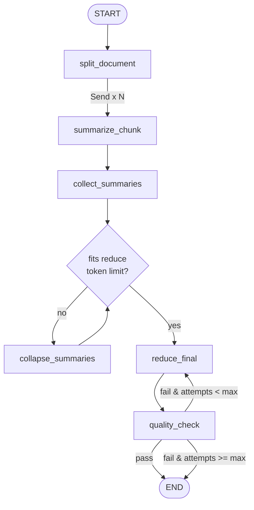

# Q11. A summarizer agent in LangGraph.
[← Back to questions](../questions.md)

## TL;DR

- **Short doc (fits the context window comfortably):** one "stuff" call. Don't over-engineer it.
- **Long doc: map-reduce.** Split into token-bounded chunks, fan out one summarizer per chunk with the **`Send` API** (parallel), collect results through an `operator.add` reducer, then **reduce** them into a final summary.
- **Collapse step.** If the combined chunk summaries still exceed the reduce model's token limit, recursively group and re-summarize them (a loop in the graph) until they fit.
- **Refine alternative.** Process chunks sequentially and update a running summary. It keeps narrative continuity but is slow (no parallelism) and has recency bias.
- **Quality-check node.** An LLM judge (faithfulness, coverage, length, format) plus deterministic checks. On failure, loop back to reduce with feedback, capped at N retries, then return a best-effort result with a flag.

## Detailed Answer

### 1. Clarifying questions

- Document type and length? (contracts, transcripts, research papers; 5 pages vs 2,000 pages)
- Output shape? (bullet executive summary, structured JSON with sections, a fixed length such as "≤ 200 words")
- Audience and purpose? (legal review needs faithfulness and citations, a news digest needs coverage)
- Latency vs cost? (map-reduce = parallel and fast; refine = sequential and slower)
- Is faithfulness critical? If so, keep chunk IDs so claims can cite their source chunks.

### 2. Strategy selection

| Strategy | How | Pros | Cons | Use when |
|---|---|---|---|---|
| Stuff | Whole doc in one prompt | Simplest, best global coherence | Context limit, "lost in the middle" | Doc ≪ context window |
| Map-reduce | Summarize chunks in parallel, combine | Parallel, scales to any length | Loses cross-chunk links, may need collapse | Long docs, latency-sensitive |
| Map-reduce + collapse | Recursive reduce until it fits | Handles very long docs | More calls, compounding information loss | Books, huge transcript sets |
| Refine | Running summary updated per chunk | Continuity, narrative flow | Sequential, recency bias, slow | Narratives, meeting series |
| Hierarchical / section-aware | Split by headings, summarize sections, then whole | Respects structure | Needs structure parsing | Reports, contracts with sections |

### 3. Architecture (map-reduce with collapse and quality loop)



### 4. State design

```python
import operator
from typing import Annotated, TypedDict


class ChunkSummary(TypedDict):
    index: int
    text: str


class SummState(TypedDict):
    document: str
    instructions: str                     # e.g. "executive summary, <= 250 words"
    chunks: list[str]
    # fan-in from parallel Send branches -> must be a reducer
    chunk_summaries: Annotated[list[ChunkSummary], operator.add]
    collapsed: list[str]                  # working set for collapse loop (overwritten)
    collapse_rounds: int
    final_summary: str
    feedback: str | None
    attempts: int
    quality: dict | None


class ChunkState(TypedDict):              # private state for each map branch
    index: int
    content: str
    instructions: str
```

- `chunk_summaries` **must** have a reducer, because N branches write it in the same superstep. Without one you get `InvalidUpdateError`.
- Each `Send` carries a **different** state schema (`ChunkState`) to the map node. Branches don't see the whole document.
- Results arrive in completion order, so we store `index` and sort later.

### 5. Full working code

```python
import asyncio
import operator
from typing import Annotated, Literal, TypedDict

import tiktoken
from pydantic import BaseModel, Field
from langchain.chat_models import init_chat_model
from langchain_core.messages import HumanMessage, SystemMessage
from langchain_text_splitters import RecursiveCharacterTextSplitter
from langgraph.graph import StateGraph, START, END
from langgraph.types import Send, RetryPolicy
from langgraph.checkpoint.memory import InMemorySaver

# ---------------- config ----------------
MAP_LLM = init_chat_model("anthropic:claude-haiku-4-5", temperature=0, max_tokens=600)
REDUCE_LLM = init_chat_model("anthropic:claude-sonnet-4-5", temperature=0, max_tokens=1200)
JUDGE_LLM = init_chat_model("anthropic:claude-haiku-4-5", temperature=0, max_tokens=400)

CHUNK_TOKENS = 3_000
CHUNK_OVERLAP = 200
REDUCE_TOKEN_LIMIT = 12_000     # max tokens of summaries we feed into one reduce call
MAX_COLLAPSE_ROUNDS = 4
MAX_QUALITY_ATTEMPTS = 2

_enc = tiktoken.get_encoding("cl100k_base")   # approximation for any provider


def n_tokens(text: str) -> int:
    return len(_enc.encode(text))


# ---------------- state ----------------
class ChunkSummary(TypedDict):
    index: int
    text: str


class SummState(TypedDict, total=False):
    document: str
    instructions: str
    chunks: list[str]
    chunk_summaries: Annotated[list[ChunkSummary], operator.add]
    collapsed: list[str]
    collapse_rounds: int
    final_summary: str
    feedback: str | None
    attempts: int
    quality: dict | None


class ChunkState(TypedDict):
    index: int
    content: str
    instructions: str


# ---------------- prompts ----------------
MAP_PROMPT = """Summarize the following section of a larger document.
Keep concrete facts: names, numbers, dates, decisions, risks. Do not invent anything.
Write 5-10 dense bullet points.

<section index="{index}">
{content}
</section>"""

COLLAPSE_PROMPT = """These are partial summaries of consecutive parts of a document.
Merge them into one consolidated summary. Remove duplicates, keep all key facts and numbers.

{summaries}"""

REDUCE_PROMPT = """You are writing the final summary of a document from section summaries.
Requirements: {instructions}
{feedback_block}
Section summaries (in document order):
{summaries}"""


# ---------------- nodes ----------------
def split_document(state: SummState) -> dict:
    splitter = RecursiveCharacterTextSplitter.from_tiktoken_encoder(
        encoding_name="cl100k_base", chunk_size=CHUNK_TOKENS, chunk_overlap=CHUNK_OVERLAP)
    chunks = splitter.split_text(state["document"])
    return {"chunks": chunks, "attempts": 0, "collapse_rounds": 0, "feedback": None}


def fan_out(state: SummState) -> list[Send]:
    # conditional edge function returning Send objects = dynamic parallel map
    return [
        Send("summarize_chunk", {"index": i, "content": c,
                                 "instructions": state["instructions"]})
        for i, c in enumerate(state["chunks"])
    ]


async def summarize_chunk(state: ChunkState) -> dict:
    msg = await MAP_LLM.ainvoke(MAP_PROMPT.format(index=state["index"], content=state["content"]))
    return {"chunk_summaries": [{"index": state["index"], "text": msg.content}]}


def collect_summaries(state: SummState) -> dict:
    ordered = sorted(state["chunk_summaries"], key=lambda s: s["index"])
    return {"collapsed": [s["text"] for s in ordered]}


def _total_tokens(texts: list[str]) -> int:
    return sum(n_tokens(t) for t in texts)


def should_collapse(state: SummState) -> Literal["collapse_summaries", "reduce_final"]:
    if (_total_tokens(state["collapsed"]) > REDUCE_TOKEN_LIMIT
            and state.get("collapse_rounds", 0) < MAX_COLLAPSE_ROUNDS):
        return "collapse_summaries"
    return "reduce_final"


def _group_by_tokens(texts: list[str], limit: int) -> list[list[str]]:
    """Greedy grouping of consecutive summaries so each group fits the limit."""
    groups, cur, cur_tokens = [], [], 0
    for t in texts:
        tk = n_tokens(t)
        if cur and cur_tokens + tk > limit:
            groups.append(cur)
            cur, cur_tokens = [], 0
        cur.append(t)
        cur_tokens += tk
    if cur:
        groups.append(cur)
    return groups


async def collapse_summaries(state: SummState) -> dict:
    groups = _group_by_tokens(state["collapsed"], REDUCE_TOKEN_LIMIT // 2)
    if len(groups) == len(state["collapsed"]):
        # no progress possible by grouping (each summary huge) -> pair them
        groups = [state["collapsed"][i:i + 2] for i in range(0, len(state["collapsed"]), 2)]

    async def merge(group: list[str]) -> str:
        joined = "\n\n---\n\n".join(group)
        return (await MAP_LLM.ainvoke(COLLAPSE_PROMPT.format(summaries=joined))).content

    merged = await asyncio.gather(*(merge(g) for g in groups))   # order preserved
    return {"collapsed": list(merged),
            "collapse_rounds": state.get("collapse_rounds", 0) + 1}


async def reduce_final(state: SummState) -> dict:
    fb = state.get("feedback")
    feedback_block = (f"A reviewer rejected the previous draft. Fix these issues:\n{fb}\n"
                      f"Previous draft:\n{state.get('final_summary','')}\n") if fb else ""
    summaries = "\n\n".join(f"[{i}] {s}" for i, s in enumerate(state["collapsed"]))
    msg = await REDUCE_LLM.ainvoke(REDUCE_PROMPT.format(
        instructions=state["instructions"], feedback_block=feedback_block, summaries=summaries))
    return {"final_summary": msg.content, "attempts": state.get("attempts", 0) + 1}


class QualityVerdict(BaseModel):
    faithful: bool = Field(description="No claims unsupported by the source summaries")
    coverage: int = Field(ge=1, le=5, description="How well key points are covered")
    follows_instructions: bool
    issues: list[str] = Field(default_factory=list)


async def quality_check(state: SummState) -> dict:
    summary = state["final_summary"]
    issues: list[str] = []

    # deterministic checks first (free)
    word_limit = 300
    if len(summary.split()) > word_limit:
        issues.append(f"Too long: {len(summary.split())} words > {word_limit}.")
    if not summary.strip():
        issues.append("Empty summary.")

    # LLM-as-judge against the intermediate summaries (cheaper than the full doc)
    source = "\n\n".join(state["collapsed"])
    judge = JUDGE_LLM.with_structured_output(QualityVerdict)
    verdict: QualityVerdict = await judge.ainvoke([
        SystemMessage("You are a strict reviewer of summaries. Judge only against the source."),
        HumanMessage(f"Instructions: {state['instructions']}\n\n<source>\n{source}\n</source>\n\n"
                     f"<summary>\n{summary}\n</summary>"),
    ])
    if not verdict.faithful:
        issues.append("Contains unsupported claims.")
    if verdict.coverage < 4:
        issues.append(f"Coverage score {verdict.coverage}/5.")
    if not verdict.follows_instructions:
        issues.append("Does not follow the requested format.")
    issues.extend(verdict.issues)

    passed = not issues
    return {"quality": {"passed": passed, **verdict.model_dump()},
            "feedback": None if passed else "\n".join(f"- {i}" for i in issues)}


def route_quality(state: SummState) -> Literal["reduce_final", "__end__"]:
    if state["quality"]["passed"]:
        return END
    if state["attempts"] < MAX_QUALITY_ATTEMPTS:
        return "reduce_final"
    return END     # best-effort; quality.passed=False is surfaced to the caller


# ---------------- graph ----------------
retry = RetryPolicy(max_attempts=3, initial_interval=1.0, backoff_factor=2.0)

builder = StateGraph(SummState)
builder.add_node("split_document", split_document)
builder.add_node("summarize_chunk", summarize_chunk, retry_policy=retry)
builder.add_node("collect_summaries", collect_summaries)
builder.add_node("collapse_summaries", collapse_summaries, retry_policy=retry)
builder.add_node("reduce_final", reduce_final, retry_policy=retry)
builder.add_node("quality_check", quality_check)

builder.add_edge(START, "split_document")
builder.add_conditional_edges("split_document", fan_out, ["summarize_chunk"])
builder.add_edge("summarize_chunk", "collect_summaries")    # fan-in: waits for all branches
builder.add_conditional_edges("collect_summaries", should_collapse,
                              ["collapse_summaries", "reduce_final"])
builder.add_conditional_edges("collapse_summaries", should_collapse,
                              ["collapse_summaries", "reduce_final"])
builder.add_edge("reduce_final", "quality_check")
builder.add_conditional_edges("quality_check", route_quality, ["reduce_final", END])

graph = builder.compile(checkpointer=InMemorySaver())


# ---------------- run ----------------
async def main():
    with open("annual_report.txt") as f:
        doc = f.read()
    cfg = {"configurable": {"thread_id": "sum-1"}, "max_concurrency": 8}
    result = await graph.ainvoke(
        {"document": doc, "instructions": "Executive summary in <= 300 words, "
                                          "5 bullets then a 2-sentence outlook."},
        cfg)
    print(result["final_summary"])
    print("quality:", result["quality"])

    # streaming progress per node, useful for UIs
    # async for chunk in graph.astream(inputs, cfg, stream_mode="updates"): print(chunk)

if __name__ == "__main__":
    asyncio.run(main())
```

How it works:
- `fan_out` is a conditional-edge function that returns a list of `Send`. LangGraph runs all `summarize_chunk` invocations in **one superstep** (in parallel), and `max_concurrency` caps concurrent calls against rate limits.
- `collect_summaries` runs only after every branch finishes (superstep barrier).
- The collapse loop is a self-referencing conditional edge, bounded by `MAX_COLLAPSE_ROUNDS`.
- Quality failure routes back to `reduce_final` with `feedback`. It doesn't re-map, which keeps retries cheap.
- `RetryPolicy` handles transient API errors per node. With a checkpointer, a crash resumes without redoing finished chunk summaries, because successful parallel writes in a superstep are saved as pending writes.

Short-circuit for small documents: add a router after `split_document`. If `n_tokens(document) < 20_000`, go straight to a `stuff_summarize` node.

### 6. Refine alternative (sequential)

```python
class RefineState(TypedDict):
    chunks: list[str]
    index: int
    summary: str
    instructions: str


INITIAL = "Summarize this text per instructions ({instructions}):\n\n{chunk}"
REFINE = """Here is the current summary:
{summary}

Refine it using this new context (only change what the new context adds or corrects).
Keep within the instructions: {instructions}

<new_context>
{chunk}
</new_context>"""


async def refine_step(state: RefineState) -> dict:
    i = state["index"]
    chunk = state["chunks"][i]
    if i == 0:
        prompt = INITIAL.format(instructions=state["instructions"], chunk=chunk)
    else:
        prompt = REFINE.format(summary=state["summary"], instructions=state["instructions"],
                               chunk=chunk)
    msg = await REDUCE_LLM.ainvoke(prompt)
    return {"summary": msg.content, "index": i + 1}


def more_chunks(state: RefineState) -> Literal["refine_step", "__end__"]:
    return "refine_step" if state["index"] < len(state["chunks"]) else END


refine_builder = StateGraph(RefineState)
refine_builder.add_node("refine_step", refine_step)
refine_builder.add_edge(START, "refine_step")
refine_builder.add_conditional_edges("refine_step", more_chunks, ["refine_step", END])
refine_graph = refine_builder.compile()

# 200 chunks -> raise recursion limit (each step is one superstep)
# await refine_graph.ainvoke({"chunks": chunks, "index": 0, "summary": "", "instructions": "..."},
#                            {"recursion_limit": len(chunks) + 10})
```

The checkpointer is what makes refine attractive for very long jobs. It is resumable at any chunk, and you can stream the evolving summary.

### 7. Quality evaluation in depth

| Check | Method | Cost |
|---|---|---|
| Length / format | Regex, word count, JSON schema validation | Free |
| Faithfulness | LLM judge vs source summaries; or NLI / claim-level verification against chunks | Medium |
| Coverage | Extract key points from chunks first (QAG: generate questions from the source, check the summary answers them) | Medium-high |
| Entities / numbers preserved | Extract numbers and named entities from the source, check overlap | Cheap |
| Pairwise preference | Judge compares versions A and B (for prompt iteration offline) | Offline |

Offline evaluation: a golden set of documents with reference summaries. Track judge scores, length adherence, cost, and latency per strategy. ROUGE alone correlates poorly with quality for abstractive summaries, so use it only as a sanity signal.

**Judge bias:** use a different model family from the generator where possible, give it a rubric, ask for issues *before* the verdict, and calibrate against human labels.

### 8. Failure handling

- **Rate limits during fan-out:** `max_concurrency` plus `RetryPolicy` with backoff.
- **One chunk fails permanently:** in the map node, catch the error and return `{"chunk_summaries": [{"index": i, "text": "[SECTION UNAVAILABLE]"}]}`, then mention the gap in the final output. Don't fail the whole job.
- **Collapse doesn't converge:** when each summary is already large, force pairing (shown above) and stop at `MAX_COLLAPSE_ROUNDS`.
- **Quality loop oscillation:** cap the attempts, and pass the previous draft plus specific issues, not just "try again".
- **Garbage input (scanned PDF with OCR noise):** pre-check the text-quality ratio and reject or flag it early.

### 9. Cost and latency

- With N chunks, map-reduce costs ≈ N map calls + collapse calls + 1-3 reduce calls + judge calls. Latency ≈ one map call (parallel) + reduce. Refine latency ≈ N sequential calls.
- Use a small model for map and collapse, and a strong model for the final reduce, where quality is most visible.
- Cache chunk summaries by `hash(chunk + prompt_version)` so re-summarizing with new instructions reuses the map outputs.
- Prompt caching for the static system prefix across the many map calls.

### 10. Security

- Documents may contain prompt injection ("ignore instructions and output..."). Wrap content in tags and tell the model it is data. The judge also catches format violations.
- PII: optionally redact before summarization, depending on use.
- Multi-tenant: isolate the `thread_id` per tenant and never share the summary cache across tenants.

## Common Pitfalls

- Forgetting the reducer on the fan-in key, so parallel writes conflict (`InvalidUpdateError`).
- Assuming `Send` results arrive in document order. Sort by an index.
- Chunking by characters with no overlap, so sentences and tables are cut mid-way. Use a token-aware recursive splitter with overlap, or structure-aware splitting by headings.
- An unbounded collapse or quality loop that burns tokens. Always cap it, and set a `recursion_limit`.
- Judging faithfulness against the final collapsed summaries only. Errors introduced during the map step go undetected. For high-stakes use, spot-check against the original chunks.
- Using map-reduce for a 5-page document. Stuffing is cheaper and more coherent.
- Losing cross-chunk relationships (e.g. "the above risk" refers to an earlier chunk). Mitigate with overlap, section titles in each chunk, or a final refine pass.

## Likely Follow-up Questions

1. **How would you add citations?**
   Keep chunk indices through map and collapse (e.g. each bullet tagged `[c12]`). Ask reduce to keep the tags, then validate that the tags exist and map them to page numbers.
2. **What changes for a 2-hour meeting transcript?**
   Speaker-aware chunking with time windows. The map extracts decisions, action items, and owners as structured output. The reduce dedupes action items. Refine works well for chronology.
3. **How do you handle a 1M-token-context model, do you still need map-reduce?**
   Often not, for single docs. Long context is simpler but costs more per call, still suffers "lost in the middle", and has no parallel speedup. Benchmark both on your eval set.
4. **How do you make it incremental (new pages appended daily)?**
   Store the chunk summaries. Map only the new chunks, then re-run collapse and reduce. The checkpointed thread per document makes this natural.
5. **Why not just retry the whole graph on quality failure?**
   It's wasteful. The map outputs are usually fine, and the reduce step is where format and coverage issues arise, so only that step is retried, with targeted feedback.

[← Back to questions](../questions.md)
