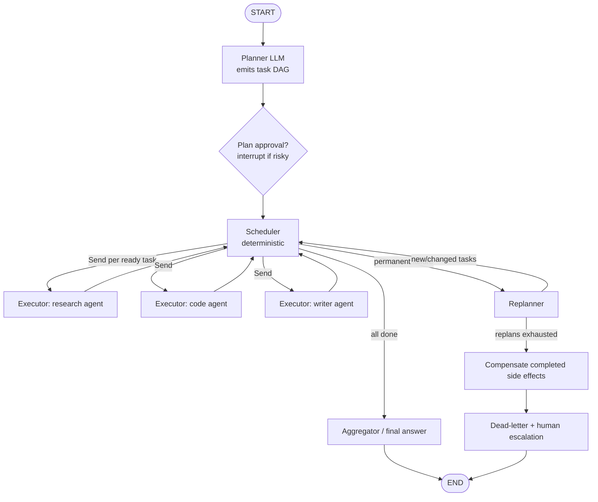

# Q12. Orchestrate multiple agents: planner vs executors, shared state, failure recovery.
[← Back to questions](../questions.md)

## TL;DR

- **Pick the topology for the problem.** *Plan-and-execute* suits decomposable, mostly-known workflows: a planner emits a task DAG and executors run it. A *supervisor* fits dynamic routing among specialist agents, where an LLM picks the next agent each turn. *Hierarchical* nesting (supervisors of supervisors as subgraphs) is for large teams and keeps context isolated.
- **Shared state is a typed contract.** Use a `TypedDict` with **reducers** for every key that parallel workers write (`operator.add` for logs, a dict-merge for `results`). Executors get a *scoped* view through `Send`, not the whole state.
- **The plan is a DAG of tasks with IDs, dependencies, status, and attempts.** A deterministic scheduler, not an LLM, dispatches ready tasks in parallel with `Send`.
- **Failure recovery is layered.** Per-node `RetryPolicy` handles transient errors, per-task timeouts prevent hangs, idempotency keys guard side effects, and checkpoints (`PostgresSaver`) let a crashed run resume. Permanent failures trigger **replanning**. Unrecoverable tasks go to a **dead-letter** list and a human. For aborted multi-step side effects, **compensation** (saga pattern) undoes completed steps in reverse.
- **Bound everything:** max replans, a recursion limit, a token/cost budget, and wall-clock deadlines.

## Detailed Answer

### 1. Clarifying questions

- How predictable is the workflow? A fixed pipeline argues for a static graph. Open-ended research argues for a planner or supervisor.
- Do tasks have side effects (send email, create PR, charge card)? Then idempotency and compensation are mandatory.
- Parallelism needs and rate limits?
- Latency budget? Planning adds a round-trip, and supervisors add one LLM call per hop.
- Who handles unrecoverable failures: a human queue, or a fail-fast return?
- Observability and audit requirements?

### 2. Topologies compared

| Pattern | Control flow decided by | Strengths | Weaknesses | Example |
|---|---|---|---|---|
| Static workflow (no agents choosing) | Developer | Predictable, testable, cheap | Inflexible | ETL + summarization pipeline |
| Plan-and-execute | Planner LLM once (plus replans), deterministic scheduler | Parallelism, explicit plan you can inspect or approve, cheaper executors | Plan may be wrong; needs a replanning loop | "Research 5 competitors and write a report" |
| Supervisor (router) | Supervisor LLM every step | Adaptive, simple mental model | One LLM call per hop, supervisor context grows, can loop | Customer-ops agent routing to billing/tech/shipping |
| Hierarchical | Top supervisor → team supervisors (subgraphs) | Scales to many agents, context isolation per team | Latency, harder debugging | Software "company": research team + coding team |
| Network / swarm (peer handoffs) | Each agent via `Command(goto=other)` | Flexible, low overhead | Hard to reason about, loop risk | Agents handing off to each other in a conversation |

**Rule of thumb:** use the least agentic structure that works. Put LLM decisions only where they're needed.

### 3. Architecture (plan-and-execute with recovery)



### 4. Shared state schema

```python
import operator
from typing import Annotated, Literal, TypedDict
from langchain_core.messages import AnyMessage
from langgraph.graph.message import add_messages

TaskStatus = Literal["pending", "running", "done", "failed", "dead", "skipped", "compensated"]


class Task(TypedDict):
    id: str
    agent: Literal["researcher", "coder", "writer", "emailer"]
    instruction: str
    depends_on: list[str]
    side_effect: bool             # needs idempotency + compensation
    max_attempts: int
    timeout_s: int


class TaskResult(TypedDict, total=False):
    status: TaskStatus
    output: str
    error: str
    attempts: int
    compensation: dict | None     # data needed to undo (e.g. created resource id)


def merge_dicts(left: dict, right: dict) -> dict:
    """Reducer: shallow-merge per key; later writes for the same task win."""
    out = dict(left or {})
    for k, v in (right or {}).items():
        out[k] = {**out.get(k, {}), **v}
    return out


class OrchestratorState(TypedDict, total=False):
    run_id: str                                             # stable id for idempotency keys
    goal: str
    messages: Annotated[list[AnyMessage], add_messages]
    tasks: Annotated[dict[str, Task], merge_dicts]          # the plan (replanner can add/modify)
    results: Annotated[dict[str, TaskResult], merge_dicts]  # written by parallel executors
    event_log: Annotated[list[dict], operator.add]          # append-only audit
    dead_letter: Annotated[list[dict], operator.add]
    replans: int
    final_answer: str
    budget_tokens_used: Annotated[int, operator.add]


class ExecutorInput(TypedDict):
    """Scoped view sent to an executor: just its task and its deps' outputs."""
    task: Task
    dep_outputs: dict[str, str]
    attempt: int
    run_id: str
```

Design principles:
- **Single writer per key, or a reducer.** `results` is keyed by task ID, so parallel executors never touch the same entry, and the merge reducer combines them.
- **Executors are given minimal context** (`ExecutorInput`). This saves tokens, avoids cross-task contamination, and keeps a task reproducible.
- `event_log` is append-only, for audit and debugging.
- The plan sits **in state**, so it is checkpointed. After a crash, the scheduler resumes from the persisted statuses.

### 5. Planner, scheduler, executors, replanner (code)

```python
import asyncio
import hashlib
from pydantic import BaseModel, Field
from langchain.chat_models import init_chat_model
from langgraph.graph import StateGraph, START, END
from langgraph.types import Send, Command, interrupt, RetryPolicy
from langgraph.prebuilt import create_react_agent
from langgraph.checkpoint.postgres import PostgresSaver

planner_llm = init_chat_model("anthropic:claude-sonnet-4-5", temperature=0)
worker_llm = init_chat_model("anthropic:claude-haiku-4-5", temperature=0)


# ---------- planner ----------
class PlannedTask(BaseModel):
    id: str = Field(description="short unique id like t1, t2")
    agent: Literal["researcher", "coder", "writer", "emailer"]
    instruction: str
    depends_on: list[str] = []
    side_effect: bool = False


class Plan(BaseModel):
    tasks: list[PlannedTask]


def validate_dag(tasks: list[PlannedTask]) -> None:
    ids = {t.id for t in tasks}
    for t in tasks:
        missing = set(t.depends_on) - ids
        if missing:
            raise ValueError(f"{t.id} depends on unknown {missing}")
    # cycle check (Kahn)
    indeg = {t.id: len(t.depends_on) for t in tasks}
    children = {t.id: [] for t in tasks}
    for t in tasks:
        for d in t.depends_on:
            children[d].append(t.id)
    q = [i for i, d in indeg.items() if d == 0]
    seen = 0
    while q:
        n = q.pop(); seen += 1
        for c in children[n]:
            indeg[c] -= 1
            if indeg[c] == 0:
                q.append(c)
    if seen != len(tasks):
        raise ValueError("plan has a cycle")


def planner(state: OrchestratorState) -> dict:
    plan: Plan = planner_llm.with_structured_output(Plan).invoke(
        f"Decompose the goal into a minimal DAG of tasks for agents "
        f"[researcher, coder, writer, emailer]. Maximize parallelism.\nGoal: {state['goal']}")
    validate_dag(plan.tasks)          # on ValueError, RetryPolicy re-runs the planner
    tasks = {t.id: {**t.model_dump(), "max_attempts": 3,
                    "timeout_s": 120 if t.agent != "coder" else 600} for t in plan.tasks}
    return {"tasks": tasks,
            "results": {tid: {"status": "pending", "attempts": 0} for tid in tasks},
            "event_log": [{"event": "plan_created", "n_tasks": len(tasks)}]}


def approve_plan(state: OrchestratorState) -> dict:
    risky = [t for t in state["tasks"].values() if t["side_effect"]]
    if not risky:
        return {}
    decision = interrupt({"type": "plan_approval",
                          "side_effect_tasks": [(t["id"], t["instruction"]) for t in risky]})
    if not decision.get("approved"):
        # mark side-effect tasks as skipped; downstream ones will be skipped by scheduler
        return {"results": {t["id"]: {"status": "skipped"} for t in risky}}
    return {}


# ---------- scheduler (deterministic) ----------
def scheduler(state: OrchestratorState) -> dict:
    """Bookkeeping only: propagate skips to dependents of dead/skipped tasks."""
    tasks, results = state["tasks"], state["results"]
    updates = {}
    for tid, t in tasks.items():
        if results[tid]["status"] == "pending" and any(
                results[d]["status"] in ("skipped", "dead") for d in t["depends_on"]):
            updates[tid] = {"status": "skipped"}
    return {"results": updates} if updates else {}


def dispatch(state: OrchestratorState) -> list[Send] | str:
    tasks, results = state["tasks"], state["results"]
    statuses = {tid: r["status"] for tid, r in results.items()}

    if any(s == "failed" for s in statuses.values()):
        return "replanner"                       # permanent failure of some task
    ready = [t for tid, t in tasks.items()
             if statuses[tid] == "pending"
             and all(statuses[d] == "done" for d in t["depends_on"])]
    if ready:
        run_id = state["run_id"]                 # set at invoke time (e.g. = thread_id)
        return [Send("executor", {
                    "task": t,
                    "dep_outputs": {d: results[d]["output"] for d in t["depends_on"]},
                    "attempt": results[t["id"]].get("attempts", 0) + 1,
                    "run_id": run_id})
                for t in ready]
    if all(s in ("done", "skipped") for s in statuses.values()):
        return "aggregator"
    return "replanner"    # stuck: nothing ready, not finished (should not happen with valid DAG)


# ---------- executors ----------
AGENTS = {
    "researcher": create_react_agent(worker_llm, tools=[web_search, fetch_url],
                                     prompt="You are a focused research agent. Cite sources."),
    "coder": create_react_agent(worker_llm, tools=[run_python, read_repo_file]),
    "writer": create_react_agent(worker_llm, tools=[]),
    "emailer": create_react_agent(worker_llm, tools=[send_email]),   # side-effecting tool
}


class TransientError(Exception):
    ...


async def executor(inp: ExecutorInput) -> dict:
    task, attempt = inp["task"], inp["attempt"]
    # idempotency key: stable across retries/resumes for the same task in the same run
    idem_key = hashlib.sha256(f"{inp['run_id']}:{task['id']}".encode()).hexdigest()[:16]
    context = "\n".join(f"[{k}] {v}" for k, v in inp["dep_outputs"].items())
    agent = AGENTS[task["agent"]]
    try:
        out = await asyncio.wait_for(
            agent.ainvoke(
                {"messages": [("user", f"{task['instruction']}\n\nInputs:\n{context}")]},
                {"configurable": {"idempotency_key": idem_key}, "recursion_limit": 20}),
            timeout=task["timeout_s"])
        answer = out["messages"][-1].content
        return {"results": {task["id"]: {"status": "done", "output": answer, "attempts": attempt,
                                         "compensation": extract_compensation(out)}},
                "event_log": [{"event": "task_done", "task": task["id"], "attempt": attempt}]}
    except (asyncio.TimeoutError, TransientError) as e:
        if attempt < task["max_attempts"]:
            # back to pending -> scheduler re-dispatches (task-level retry with fresh context)
            return {"results": {task["id"]: {"status": "pending", "attempts": attempt,
                                             "error": repr(e)}},
                    "event_log": [{"event": "task_retry", "task": task["id"], "err": repr(e)}]}
        return {"results": {task["id"]: {"status": "failed", "attempts": attempt, "error": repr(e)}},
                "event_log": [{"event": "task_failed", "task": task["id"], "err": repr(e)}]}
    except Exception as e:   # non-transient: bad instruction, tool refused, etc.
        return {"results": {task["id"]: {"status": "failed", "attempts": attempt, "error": repr(e)}},
                "event_log": [{"event": "task_failed", "task": task["id"], "err": repr(e)}]}


# ---------- replanner ----------
MAX_REPLANS = 2


class Replan(BaseModel):
    action: Literal["modify", "abort"]
    replace: list[PlannedTask] = []      # replaces failed tasks / adds alternatives
    reason: str


def replanner(state: OrchestratorState) -> Command[Literal["scheduler", "compensate"]]:
    failed = {tid: r for tid, r in state["results"].items() if r["status"] == "failed"}
    if state.get("replans", 0) >= MAX_REPLANS:
        return Command(goto="compensate", update={
            "results": {tid: {"status": "dead"} for tid in failed},
            "dead_letter": [{"task": state["tasks"][tid], "error": r.get("error")}
                            for tid, r in failed.items()]})
    done = {tid: r["output"][:500] for tid, r in state["results"].items() if r["status"] == "done"}
    rp: Replan = planner_llm.with_structured_output(Replan).invoke(
        f"Goal: {state['goal']}\nCompleted: {done}\nFailed: "
        f"{ {tid: (state['tasks'][tid]['instruction'], r.get('error')) for tid, r in failed.items()} }\n"
        "Propose replacement tasks (reuse ids of failed tasks to replace them, keep dependencies "
        "on completed tasks) or abort.")
    if rp.action == "abort":
        return Command(goto="compensate", update={
            "results": {tid: {"status": "dead"} for tid in failed},
            "dead_letter": [{"task": state["tasks"][tid], "error": failed[tid].get("error")}
                            for tid in failed]})
    new_tasks = {t.id: {**t.model_dump(), "max_attempts": 3, "timeout_s": 180} for t in rp.replace}
    merged = {k: PlannedTask(**{f: v[f] for f in PlannedTask.model_fields})
              for k, v in state["tasks"].items()}
    merged.update({t.id: t for t in rp.replace})
    validate_dag(list(merged.values()))      # reject a replan that introduces cycles
    return Command(goto="scheduler", update={
        "tasks": new_tasks,
        "results": {tid: {"status": "pending", "attempts": 0, "error": None} for tid in new_tasks},
        "replans": state.get("replans", 0) + 1,
        "event_log": [{"event": "replanned", "reason": rp.reason, "tasks": list(new_tasks)}]})


# ---------- compensation (saga) ----------
COMPENSATORS = {
    "emailer": lambda comp: send_email.invoke({"to": comp["to"], "subject": "Correction",
                                               "body": "Please disregard the previous message."}),
    "coder": lambda comp: close_pull_request(comp["pr_id"]),
}


def compensate(state: OrchestratorState) -> dict:
    # undo completed side-effect tasks in reverse completion order
    done_order = [e["task"] for e in state["event_log"] if e["event"] == "task_done"]
    updates, log = {}, []
    for tid in reversed(done_order):
        t, r = state["tasks"][tid], state["results"][tid]
        if t["side_effect"] and r.get("compensation"):
            try:
                COMPENSATORS[t["agent"]](r["compensation"])
                updates[tid] = {"status": "compensated"}
                log.append({"event": "compensated", "task": tid})
            except Exception as e:
                log.append({"event": "compensation_failed", "task": tid, "err": repr(e)})
    notify_oncall(state["dead_letter"])          # human escalation
    return {"results": updates, "event_log": log,
            "final_answer": "Run aborted; see dead-letter queue."}


def aggregator(state: OrchestratorState) -> dict:
    outputs = {tid: r["output"] for tid, r in state["results"].items() if r["status"] == "done"}
    final = planner_llm.invoke(
        f"Goal: {state['goal']}\nCombine these task results into the final deliverable:\n{outputs}")
    return {"final_answer": final.content}


# ---------- wiring ----------
b = StateGraph(OrchestratorState)
b.add_node("planner", planner, retry_policy=RetryPolicy(max_attempts=3))
b.add_node("approve_plan", approve_plan)
b.add_node("scheduler", scheduler)
b.add_node("executor", executor,
           retry_policy=RetryPolicy(max_attempts=2, retry_on=ConnectionError))
b.add_node("replanner", replanner)
b.add_node("compensate", compensate)
b.add_node("aggregator", aggregator)

b.add_edge(START, "planner")
b.add_edge("planner", "approve_plan")
b.add_edge("approve_plan", "scheduler")
b.add_conditional_edges("scheduler", dispatch, ["executor", "replanner", "aggregator"])
b.add_edge("executor", "scheduler")          # fan-in: runs once after all parallel executors
b.add_edge("compensate", END)
b.add_edge("aggregator", END)

with PostgresSaver.from_conn_string(DB_URI) as cp:
    cp.setup()
    graph = b.compile(checkpointer=cp)
```

Notes on the design:
- The **scheduler is deterministic**. The LLM plans, and code decides what runs. This makes execution testable and cheap.
- **Two retry layers:** `RetryPolicy` on the node covers infrastructure blips (it re-runs the node with the same input). Task-level retry (status back to `pending`) re-dispatches with a fresh agent run and counts attempts in state, which is visible and checkpointed.
- **Timeouts** use `asyncio.wait_for` per task, plus a global deadline that is checked in `dispatch`, plus `recursion_limit` as a backstop.
- **Idempotency:** the key comes from `run_id + task_id`, so it survives retries and crash resumes. Side-effecting tools must honor it (e.g. the email API dedupes on the key, and the PR tool checks "PR for branch X already exists").

### 6. Supervisor pattern (dynamic routing)

```python
from langgraph.graph import MessagesState

MEMBERS = ["researcher", "coder", "writer"]


class Route(BaseModel):
    next: Literal["researcher", "coder", "writer", "FINISH"]
    reason: str


class SupState(MessagesState):
    hops: int


def supervisor(state: SupState) -> Command[Literal["researcher", "coder", "writer", "__end__"]]:
    if state.get("hops", 0) >= 8:
        return Command(goto=END)                       # loop guard
    r: Route = planner_llm.with_structured_output(Route).invoke(
        [("system", f"You manage workers {MEMBERS}. Pick who acts next or FINISH."),
         *state["messages"]])
    if r.next == "FINISH":
        return Command(goto=END)
    return Command(goto=r.next, update={"hops": state.get("hops", 0) + 1})


def make_worker(name: str):
    agent = AGENTS[name]

    def node(state: SupState) -> Command[Literal["supervisor"]]:
        out = agent.invoke({"messages": state["messages"]})
        # return only the final message, tagged, to keep supervisor context small
        return Command(goto="supervisor", update={
            "messages": [("ai", f"[{name}] {out['messages'][-1].content}")]})
    return node


sb = StateGraph(SupState)
sb.add_node("supervisor", supervisor)
for m in MEMBERS:
    sb.add_node(m, make_worker(m))
sb.add_edge(START, "supervisor")
supervisor_graph = sb.compile()
```

**Hierarchical:** compile `supervisor_graph` (a "research team") and add it as a node in a parent graph: `parent.add_node("research_team", research_team_graph)`. A subgraph shares keys with the parent schema, or you wrap it in a function that maps state in and out. A child can jump to a parent node with `Command(goto="x", graph=Command.PARENT)`. Each team has its own context, so the top-level supervisor only sees team-level summaries.

### 7. Failure recovery: the full picture

| Failure | Detection | Recovery |
|---|---|---|
| Transient API error / rate limit | Exception type | `RetryPolicy` with exponential backoff and jitter |
| Task hangs | `asyncio.wait_for` timeout | Task-level retry, then fail, then replan |
| Wrong or low-quality output | Validator / LLM critic on task output | Retry with critique, or replan |
| Plan is infeasible | Repeated failures, stuck DAG | Replanner (bounded `MAX_REPLANS`) |
| Process / pod crash | Run not completed | Re-invoke with the same `thread_id` (`graph.invoke(None, cfg)`) to resume from the last checkpoint |
| Duplicate side effect on resume | Idempotency key | Tool dedupes; executor checks for an existing resource first |
| Unrecoverable | Replans exhausted / abort | Dead-letter list + alert + human `interrupt` or ticket |
| Partial side effects on abort | Completed side-effect tasks | Compensation in reverse order (saga) |
| Infinite agent loop | `recursion_limit`, hop counter | `GraphRecursionError` → fail task |
| Budget blown | `budget_tokens_used` reducer | Stop dispatching, aggregate partial results |

**Checkpoint resume semantics:** LangGraph checkpoints after every superstep. If 3 of 5 parallel executors finished before a crash, their writes are stored as pending writes. On resume, only the unfinished ones re-run. This is why executors must be idempotent: a task can be cut off mid-execution and run again.

**Time travel / manual fix:** `graph.get_state_history(cfg)` lets you inspect earlier states. `graph.update_state(cfg, {"results": {"t3": {"status": "pending"}}})` lets an operator fix a task and resume.

### 8. Shared state vs message passing

| Approach | Pros | Cons |
|---|---|---|
| Shared blackboard state (typed keys + reducers) | Single source of truth, checkpointed, easy to inspect | Schema coupling between agents; must design reducers |
| Shared message list (all agents see all messages) | Simple, natural for chat | Context bloat, cross-talk, high token cost |
| Scoped inputs via `Send` + outputs into keyed results | Minimal context per agent, parallel-safe | Need explicit dependency wiring |
| Subgraphs with private state | Isolation, reusable teams | Mapping in and out of the parent state |

For production, use typed shared state for orchestration metadata and scoped inputs for executors. Keep full transcripts out of the orchestrator's context and store them as artifacts (S3/DB) referenced by ID.

### 9. Evaluation and observability

- **Trace every agent run** (LangSmith / OpenTelemetry) tagged with `thread_id`, `task_id`, and `attempt`.
- **Metrics:** task success rate per agent, replan rate, mean attempts, dead-letter rate, end-to-end latency, and cost per goal.
- **Planner evals:** a golden set of goals with acceptable plan structures. Check DAG validity, over- or under-decomposition, and parallelism.
- **Chaos tests:** inject timeouts and exceptions into tools, kill the process mid-run, and assert that the run completes on resume with no duplicate side effects.
- **End-to-end:** task-completion judges on the final deliverable, plus human review on a sample.

### 10. Security

- **Least privilege per agent:** the researcher has no email tool, and the coder runs in a sandbox (container, no network or restricted egress).
- **Plan approval** (`interrupt`) before side-effect tasks, in high-risk domains.
- **Prompt injection spreading between agents:** web content fetched by the researcher can contain instructions aimed at the emailer. Treat inter-agent outputs as data, validate side-effect arguments deterministically, and keep allowlists (e.g. permitted email domains).
- Secrets live in tool implementations and config, never in state or prompts. Checkpoints are persisted, so encrypt them at rest.

### 11. Cost

- Planner and aggregator on a strong model, executors on small models. That usually covers most of the token volume cheaply.
- Supervisor patterns cost one extra LLM call per hop. Plan-and-execute costs ~1 planning call plus the executor calls.
- Cap tokens per task and globally (reducer counter), and use cached prompts for agent system prompts.

## Common Pitfalls

- Letting an LLM supervisor schedule every step when the workflow is mostly deterministic. It's slow, expensive, and nondeterministic.
- No reducer on keys written by parallel branches, causing `InvalidUpdateError` or lost updates.
- Giving every agent the entire message history, which leads to context bloat, confusion, and leaks between tasks.
- Retrying side-effecting tasks without idempotency keys, so duplicate emails go out and duplicate charges are made.
- Unbounded replanning loops. Always cap replans and hops.
- Not validating the planner's output (unknown dependencies, cycles, nonexistent agents).
- Treating a crash as a failure instead of resuming from the checkpoint with the same `thread_id`.
- No compensation strategy, so an aborted run leaves the world half-modified.
- Changing the state schema or node names between deploys while threads are paused. Old checkpoints can fail to resume, so version the graph and migrate.

## Likely Follow-up Questions

1. **When would you choose supervisor over plan-and-execute?**
   When the next step genuinely depends on the previous result and you can't plan ahead (interactive troubleshooting, conversation routing). Plan-and-execute wins when tasks are decomposable and parallelizable.
2. **How do you prevent two agents from writing conflicting values?**
   Partition the state so each task writes its own key (`results[task_id]`), and use reducers for shared aggregates. For true conflicts (two agents editing one doc), use an explicit merge or critic node, or optimistic versioning.
3. **How do you resume a run after the server restarts?**
   With a durable checkpointer (`PostgresSaver`), call `graph.invoke(None, {"configurable": {"thread_id": tid}})`. It continues from the last completed superstep. A worker scans for threads that are unfinished and not interrupted and resumes them.
4. **What is the saga pattern here?**
   Each side-effecting task records the data its compensating action needs. On abort, compensations run in reverse order. Compensations must also be idempotent and may themselves fail, in which case they are logged and escalated.
5. **How do you scale executors horizontally?**
   Run the graph on a platform with task queues (LangGraph Platform / a custom worker pool), or have executors enqueue work to Celery/Kafka and resume the graph on completion via `Command(resume=...)` (async human-or-machine callback pattern).
6. **How do you test this?**
   Unit-test the scheduler and DAG validation as pure functions. Use mocked agents for graph-level tests with `InMemorySaver`. Inject faults for recovery paths, and kill and resume in integration tests.

[← Back to questions](../questions.md)
