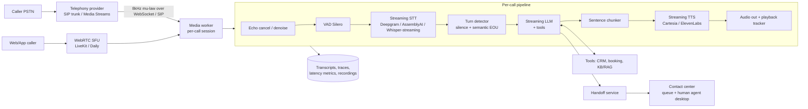
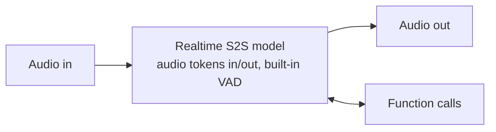
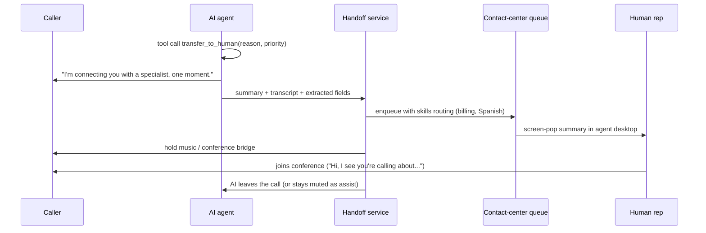

# Q14. A voice calling agent: sub-second latency, interruptions, human handoff.
[← Back to questions](../questions.md)

## TL;DR
- **Stream every stage.** The pipeline is telephony (SIP/PSTN or WebRTC) → **VAD** → **streaming STT** → **turn detection** → **streaming LLM** → **streaming TTS** → audio out. Each stage starts on partial input from the one before it. Target **~500–800 ms voice-to-voice** (time from the user stopping to hearing the first audio).
- **Turn detection drives perceived latency.** Combine VAD silence (~200–500 ms) with a semantic end-of-turn model, so the agent neither cuts people off nor waits too long. Start the LLM speculatively on partial transcripts.
- **Barge-in.** When VAD detects user speech during agent playback, **stop TTS within ~100–200 ms**, flush buffered audio, cancel the in-flight LLM/TTS, and **truncate the assistant message in context to what was actually played**.
- **Speech-to-speech models** (e.g., OpenAI Realtime, Gemini Live) give the lowest latency and the most natural prosody. The cascaded pipeline gives more control, auditability, model choice and lower cost. Many production systems use the cascade, or a hybrid.
- **Human handoff = warm transfer.** Trigger on intent, sentiment, repeated failures, policy or explicit request. Generate a structured summary, place the caller on hold or conference in the agent (SIP REFER or a conference bridge), whisper or screen-pop the summary to the human, and keep the AI out of the call afterwards. Handle **recording consent** and disclosure at call start.

## Detailed Answer

### 1. Requirements

**Functional**
- Inbound and outbound phone calls (PSTN through Twilio/Telnyx/Vonage SIP trunks) plus web/app calls (WebRTC).
- Natural conversation: the user can interrupt, the agent can call tools (look up an order, book an appointment), and the agent can transfer to a human.
- Multilingual, with DTMF fallback ("press 1") for noisy lines.

**Non-functional**
- **Latency:** p50 voice-to-voice < 800 ms, p95 < 1.2 s. Barge-in stop < 200 ms.
- **Concurrency:** thousands of simultaneous calls, each a stateful long-lived session.
- **Reliability:** a call must never go dead-air. On any component failure, play a fallback and transfer.
- **Compliance:** AI disclosure, recording consent (one-party vs two-party consent states, GDPR), PCI (no card numbers in transcripts; use DTMF masking or pause-and-resume recording), TCPA for outbound.

### 2. Architecture (cascaded pipeline)



**Speech-to-speech alternative**



### 3. Latency budget (target ~700 ms voice-to-voice)

| Stage | Typical | Optimized | Notes |
|---|---|---|---|
| Network in (PSTN/jitter buffer) | 50–150 ms | 40–80 ms | Co-locate media workers with the telephony POP |
| Endpointing (silence wait) | 500–1000 ms | 200–400 ms | The single biggest knob; a semantic EOU model allows shorter silence |
| STT final transcript | 100–300 ms | 50–150 ms | Streaming STT; use partials and finalize on endpoint |
| LLM time-to-first-token | 300–800 ms | 150–350 ms | Small/fast model, prompt caching, short system prompt, warm connections |
| First sentence chunk ready | +50–150 ms | +30–80 ms | Flush TTS at the first clause/punctuation |
| TTS time-to-first-byte | 150–400 ms | 75–150 ms | Streaming TTS over WebSocket |
| Network out + playout buffer | 50–150 ms | 40–80 ms | |
| **Total** | **1.2–3 s** | **~600–900 ms** | |

Ways to shave latency:
- **Co-locate** STT, LLM and TTS in the same region or VPC as the media servers. Keep persistent WebSocket/HTTP2 connections open.
- **Speculative generation:** start the LLM on a stable partial transcript. If the final transcript differs materially, discard and restart.
- **Prompt caching** for the long system prompt and tool definitions.
- **Small model for the conversation loop** (fast tier), escalating to a larger model only for complex reasoning, or running the large model async behind a filler phrase.
- **Filler phrases / backchannels** while slow tools run: "Let me pull that up for you…". Pre-synthesize common fillers and cache the audio.
- **Pre-generated audio** for greetings, disclosures and hold messages.

### 4. Turn detection and endpointing

The hard part is "has the user finished?" versus "are they pausing to think?"

- **VAD** (Silero, WebRTC VAD) gives speech/no-speech frames every 10–30 ms.
- **Silence threshold alone:** short (200 ms) means cutting people off mid-sentence ("my account number is… 4 5 …"). Long (1 s) feels sluggish.
- **Semantic end-of-utterance model:** a small transformer classifies whether the transcript so far is a complete turn ("I want to cancel my" → not complete). LiveKit's turn detector and Pipecat's smart-turn are examples. Raise the silence threshold dynamically when the model predicts the turn is incomplete.
- **Context-aware thresholds:** after asking for a phone number, card digits or an address, allow longer pauses. After a yes/no question, use shorter ones.
- **DTMF** finishes digit entry deterministically.

```python
def end_of_turn(silence_ms: int, eou_prob: float, expecting_digits: bool) -> bool:
    if expecting_digits:
        return silence_ms > 1500
    if eou_prob > 0.85:
        return silence_ms > 250
    if eou_prob > 0.5:
        return silence_ms > 600
    return silence_ms > 1200          # likely mid-thought
```

### 5. Barge-in (interruption) handling

Sequence when the user speaks while the agent is talking:

1. **Detect.** VAD fires on inbound audio during playback. Acoustic echo cancellation (AEC) is essential so the agent's own voice doesn't trigger it. Require ~150–300 ms of speech, or a few recognized words, to ignore coughs and "mm-hmm" backchannels.
2. **Stop audio.** Stop the TTS stream, **flush the outbound buffer** (on Twilio Media Streams, send a `clear` message), and cancel the in-flight LLM generation and TTS requests.
3. **Truncate context.** The LLM may have generated three sentences while only 1.5 were played. Replace the assistant turn in history with **only the text actually spoken**, using TTS word or character timestamps and the playback position. Otherwise the model believes the user heard things they never heard.
4. **Resume listening.** Treat the interruption as a new user turn.

```python
import asyncio
from dataclasses import dataclass, field

@dataclass
class SpokenTracker:
    """Maps playback position to text, using TTS word timestamps."""
    words: list[tuple[str, float]] = field(default_factory=list)   # (word, end_time_s)
    played_s: float = 0.0

    def add_alignment(self, word: str, end_s: float) -> None:
        self.words.append((word, end_s))

    def spoken_text(self) -> str:
        return " ".join(w for w, t in self.words if t <= self.played_s)

class CallSession:
    def __init__(self, llm, tts, transport, history):
        self.llm, self.tts, self.transport, self.history = llm, tts, transport, history
        self.speaking_task: asyncio.Task | None = None
        self.tracker = SpokenTracker()

    async def respond(self, user_text: str) -> None:
        self.history.append({"role": "user", "content": user_text})
        self.tracker = SpokenTracker()
        self.speaking_task = asyncio.create_task(self._speak())

    async def _speak(self) -> None:
        full = []
        try:
            async for sentence in sentence_chunks(self.llm.stream(self.history)):
                full.append(sentence)
                async for audio, alignment in self.tts.stream(sentence):
                    for word, end_s in alignment:
                        self.tracker.add_alignment(word, end_s)
                    played = await self.transport.send_audio(audio)   # returns seconds played
                    self.tracker.played_s = played
            self.history.append({"role": "assistant", "content": " ".join(full)})
        except asyncio.CancelledError:
            spoken = self.tracker.spoken_text()
            if spoken:
                # Record only what the caller actually heard, mark interruption
                self.history.append({"role": "assistant", "content": spoken + " —"})
            raise

    async def on_user_speech_start(self) -> None:
        if self.speaking_task and not self.speaking_task.done():
            await self.transport.clear_playback()      # e.g. Twilio 'clear' event
            self.speaking_task.cancel()
            try:
                await self.speaking_task
            except asyncio.CancelledError:
                pass

async def sentence_chunks(token_stream):
    buf = ""
    async for tok in token_stream:
        buf += tok
        # flush at clause boundaries for low TTS TTFB; min length avoids choppy prosody
        if len(buf) > 20 and buf.rstrip()[-1:] in ".?!;:,":
            yield buf.strip()
            buf = ""
    if buf.strip():
        yield buf.strip()
```

**Tool calls interrupted mid-flight.** Read-only calls can be abandoned. For writes ("booking confirmed"), either let them complete and tell the user afterwards, or make them idempotent and confirm before committing.

### 6. Frameworks

- **Pipecat** (open source, Python): a frame-based pipeline (`transport.input() → stt → context_aggregator.user() → llm → tts → transport.output()`). It has built-in VAD and interruptions, plus many STT/LLM/TTS and telephony integrations.
- **LiveKit Agents** (open source): built on a WebRTC SFU, with `AgentSession` wiring STT/LLM/TTS or a realtime model, a turn-detector plugin, SIP telephony integration and agent workers that scale horizontally.
- **Managed platforms** (Vapi, Retell, Bland) are fastest to ship but give less control and cost more per minute at scale.

A skeleton Pipecat-style pipeline (illustrative of the structure):

```python
pipeline = Pipeline([
    transport.input(),            # telephony/WebRTC audio in
    stt,                          # streaming STT service
    context_aggregator.user(),    # builds user turns
    llm,                          # streaming LLM with tools
    tts,                          # streaming TTS
    transport.output(),           # audio out; handles interruption frames
    context_aggregator.assistant()# records what was spoken
])
```

### 7. Cascaded vs speech-to-speech

| Aspect | Cascaded (STT → LLM → TTS) | Speech-to-speech (realtime model) |
|---|---|---|
| Latency | 600–1000 ms optimized | ~300–600 ms |
| Prosody / emotion | Loses tone in STT; TTS adds expression | Hears tone, laughs, hesitations; more natural |
| Control / debuggability | Text at every step: easy to log, guardrail, redact | Harder; transcripts are secondary outputs |
| Model choice | Best-of-breed per stage, swap vendors | Locked to provider |
| Tool calling / reasoning | Strong text LLMs | Good, but usually weaker than top text models |
| Cost | Usually cheaper per minute | Audio tokens are expensive |
| Compliance (PCI, redaction) | Easy to insert filters | Harder |
| Custom voice / brand | Any TTS voice, cloning | Limited voice set |

**Hybrid:** use an S2S model for chit-chat and a cascade (or text LLM tool calls) for transactional steps, or use S2S with a text guardrail model watching the transcript.

### 8. Human handoff (warm transfer)

**Triggers**
- Explicit request ("agent", "representative"). Always honor it promptly; in many jurisdictions it is effectively expected.
- Low confidence: repeated STT failures, the same intent asked twice, the LLM signalling `needs_human`.
- Negative sentiment or escalation keywords, or vulnerable-customer signals.
- Policy: refunds over a threshold, legal threats, complaints, authentication failures.

**Flow**



Handoff summary schema (generated by the LLM, validated):

```python
from pydantic import BaseModel
from typing import Literal

class HandoffSummary(BaseModel):
    caller_name: str | None
    verified: bool                       # did identity verification succeed?
    intent: str                          # "dispute double charge on Nov invoice"
    key_facts: list[str]                 # account id, amounts, dates
    actions_taken: list[str]             # "looked up invoice INV-123"
    sentiment: Literal["calm", "frustrated", "angry", "distressed"]
    reason_for_transfer: str
    suggested_next_step: str | None
```

**Mechanics:** SIP REFER (blind transfer, where you lose control of the call) versus a **conference bridge** (warm transfer: the AI or a hold message stays until the human joins, and the AI drops after). Pass context through SIP headers (UUI) or a CTI/CRM screen-pop using the call id. If no human is available: offer a callback, take a message, and never loop the caller endlessly.

### 9. Failure handling

| Failure | Mitigation |
|---|---|
| STT vendor slow/down | Health checks, fallback provider, timeouts → "Sorry, could you repeat that?" |
| LLM timeout | Filler at 1 s, retry on a fallback model at 2.5 s, transfer at 5 s |
| TTS down | Fallback TTS voice; pre-recorded apology + transfer |
| Tool slow | Filler phrase; async tool with progress ("still checking…") |
| Dead air | Watchdog: if no audio out for X seconds after a user turn, play a prompt |
| Media worker crash | Telephony fallback URL routes to an IVR / human queue |
| Hallucinated commitments | Restrict actions to tools; the agent confirms only results returned by tools |

### 10. Security and compliance

- **Disclosure:** "You're speaking with an automated assistant; this call may be recorded." Several jurisdictions require AI disclosure, and two-party consent states require recording consent. Offer an opt-out (no recording → transcripts only, or a human).
- **Identity verification** before account actions: OTP via SMS, knowledge-based checks, or voice biometrics (careful: voice cloning makes voice-only auth weak).
- **PCI:** collect card numbers via DTMF with masking, or a secure payment IVR; pause recording and redact transcripts.
- **Prompt injection by voice:** the caller can say "ignore your instructions." Apply the same guardrails as text: tool permissions, policy checks and no secrets in the prompt.
- **Outbound:** TCPA consent, do-not-call lists, calling-hour rules, caller ID (STIR/SHAKEN).
- **Data retention:** encrypt recordings and transcripts, set retention policies, redact PII.

### 11. Evaluation

- **Latency:** per-stage p50/p95 traces (VAD end → STT final → LLM TTFT → TTS TTFB → first audio out). Report voice-to-voice per turn.
- **Conversation quality:** task completion / containment rate, transfer rate (with reasons), average handle time, CSAT, false barge-ins, missed barge-ins, cut-off rate (agent spoke over an unfinished user).
- **STT quality:** WER on domain vocabulary (names, SKUs). Use keyword boosting / custom vocabulary.
- **Simulated callers:** an LLM-driven caller bot with personas, accents and noise (TTS + noise injection) runs regression suites before each release.
- **Human review** of sampled calls with a rubric. Auto-flag calls with negative sentiment or long silences.

### 12. Cost (rough per-minute view)

| Component | Ballpark |
|---|---|
| Telephony (PSTN) | ~$0.005–0.02/min |
| Streaming STT | ~$0.004–0.015/min |
| LLM (fast tier, cached prompt) | ~$0.002–0.02/min depending on model and turns |
| TTS | ~$0.01–0.10/min (premium voices costlier) |
| S2S realtime models | often ~$0.05–0.30/min |

Cost levers: prompt caching, a smaller conversation model, caching common TTS phrases, ending idle calls, self-hosted STT/TTS at high volume.

## Common Pitfalls
- **Waiting for full LLM completion before TTS.** Always stream and chunk by sentence or clause.
- **Not truncating context on barge-in.** The model then references content the caller never heard.
- **No echo cancellation.** The agent interrupts itself on speakerphone.
- **Fixed silence threshold** for everything, so it cuts off digit sequences or feels slow on yes/no answers.
- **Treating backchannels ("uh-huh") as interruptions**, which makes the agent stop constantly.
- **Cross-region hops.** STT in one region and the LLM in another add 100+ ms per hop.
- **Blind transfers with no context**, so the customer repeats everything to the human.
- **Letting the LLM speak numbers, dates and URLs unnormalized.** Normalize text before TTS ("$1,250" → "twelve hundred fifty dollars"), or use SSML.
- **No dead-air watchdog or fallback path** when a vendor stalls.

## Likely Follow-up Questions
1. **How do you measure voice-to-voice latency precisely?** Timestamp the last user speech frame (VAD end) and the first outbound audio frame on the media server, then compute the difference per turn. Add per-stage spans with OpenTelemetry. Client-side measurement (a recorded call) validates it, including network.
2. **How do you handle the LLM calling a slow tool?** Speak a filler immediately, run the tool async, and stream a progress update if it takes more than ~3 s. If the user interrupts, cancel the tool where it is safe to.
3. **How would you support multiple languages?** Use STT with language ID (or per-number language), a multilingual LLM and TTS voices per language, and pass the locale through to the handoff routing.
4. **When would you choose speech-to-speech?** When natural conversation and the lowest latency matter more than control: concierge, coaching, companionship. Avoid it for regulated, transactional flows that need redaction and deterministic tool control.
5. **How do you prevent the agent from talking over the user after an interruption?** Use AEC, a minimum speech duration, a backchannel classifier and a short "hold" window after barge-in before responding. Use the semantic EOU model to wait for the full new turn.
6. **How do you scale to 10k concurrent calls?** Stateless orchestration with sticky per-call media workers (one process handles N calls), autoscaling on active sessions, regional deployment near telephony POPs, and vendor concurrency limits negotiated or load-balanced across providers.

[← Back to questions](../questions.md)
