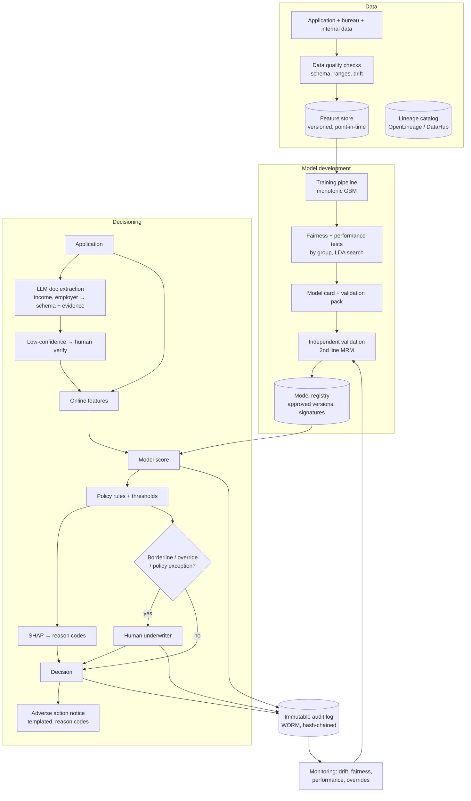

# Q17. Responsible AI for regulated decisions: bias testing, explainability, audit trails.
[← Back to questions](../questions.md)

## TL;DR
- **Treat the model as a governed decision system, not just a model.** Regulated decisions include credit, insurance, hiring, healthcare and housing. Governance means a documented purpose, validated data, fairness and performance testing, explainability, human oversight, change control and immutable audit trails, under **model risk management (SR 11-7 / OCC 2011-12)** and, in the EU, the **AI Act high-risk** obligations.
- **Bias testing uses several fairness metrics,** chosen to fit the harm. *Demographic parity / disparate impact ratio* (four-fifths rule) checks outcome rates. *Equalized odds / equal opportunity* checks error rates. *Calibration within groups* checks that scores mean the same thing for everyone. These metrics conflict mathematically when base rates differ, so choose deliberately, document why, and search for less discriminatory alternatives.
- **Explainability:** use SHAP (TreeSHAP for GBMs) or LIME, mapped to **reason codes** for **adverse action notices** under **ECOA/Reg B and FCRA**. Reasons must be specific and accurate ("debt-to-income ratio too high"); CFPB says "the algorithm decided" is not acceptable. Prefer inherently interpretable or monotonic-constrained models where stakes are high.
- **Audit trail:** for every decision, log inputs (or hashes plus a feature-store snapshot), model and version, features, score, threshold, reason codes, human reviewer action and outcome, in **append-only / WORM** storage with data lineage, retained for the regulatory periods (e.g., 25 months under Reg B for applications).
- **LLM-specific issues:** non-determinism, unfaithful self-explanations, prompt or model drift, hidden proxies in text, and hallucinated reasons. Keep LLMs out of the final decision (use them for extraction or summarization), or constrain and validate them heavily, and pin versions.

## Detailed Answer

### 1. Scope and requirements

Example: **consumer credit-line decisioning** with a GBM scorecard, plus an LLM that extracts income data from documents and drafts customer letters.

**Regulatory**
- **ECOA / Regulation B:** no discrimination on protected bases (race, color, religion, national origin, sex, marital status, age, public-assistance income). Adverse action notices must give **specific principal reasons**.
- **FCRA:** adverse action based on consumer report info → notice, credit score disclosure, bureau info, dispute rights.
- **Fair lending:** disparate treatment and **disparate impact** analysis, and a search for less discriminatory alternatives (LDA).
- **SR 11-7 (Fed) / OCC 2011-12:** model inventory, sound development, **independent validation**, ongoing monitoring, governance, effective challenge.
- **EU AI Act:** creditworthiness assessment of natural persons and insurance pricing (life/health) are **high-risk (Annex III)**. Requirements cover risk management, data governance, technical documentation, logging, transparency, human oversight, accuracy/robustness, conformity assessment and post-market monitoring.
- **GDPR Art. 22:** rights around solely automated decisions (human intervention, the right to contest, meaningful information about the logic). Also Art. 15 access requests.
- Others: Colorado AI Act, NAIC model bulletin (insurers), state insurance unfair discrimination laws, HIPAA for health.

**Non-functional**
- Reproducibility: any past decision can be replayed exactly.
- Explanations produced within the decision SLA (e.g., < 200 ms).
- Segregation of duties: developers ≠ validators ≠ approvers.

### 2. Architecture



### 3. Fairness metrics

Let Ŷ be the decision (1 = approve), Y the true outcome (1 = repays), and A the protected group.

| Metric | Definition | Use when |
|---|---|---|
| Demographic parity | P(Ŷ=1 \| A=a) equal across groups | Outcome rates matter (hiring, access) |
| Disparate impact ratio (AIR) | P(Ŷ=1 \| A=a) / P(Ŷ=1 \| A=ref); flag < 0.8 | Legal screening (four-fifths rule, fair lending practice) |
| Equal opportunity | TPR equal: P(Ŷ=1 \| Y=1, A=a) | Qualified people should be approved equally |
| Equalized odds | TPR and FPR equal across groups | Both error types carry harm |
| Predictive parity / calibration | P(Y=1 \| score=s, A=a) equal | Scores must mean the same thing per group (credit pricing) |
| Standardized mean difference (SMD) | Score mean gap / pooled std | Continuous scores, pricing |

**Impossibility result** (Kleinberg et al.; Chouldechova): when base rates differ, you cannot have calibration and equalized odds at the same time (except in degenerate cases). Document which notion fits the harm, the legal standard and the business need.

```python
import numpy as np
import pandas as pd
from sklearn.metrics import roc_auc_score

def fairness_report(df: pd.DataFrame, group: str, y_true="y", y_pred="approved", score="score",
                    ref: str | None = None) -> pd.DataFrame:
    rows = []
    for g, d in df.groupby(group):
        tp = ((d[y_pred] == 1) & (d[y_true] == 1)).sum()
        fn = ((d[y_pred] == 0) & (d[y_true] == 1)).sum()
        fp = ((d[y_pred] == 1) & (d[y_true] == 0)).sum()
        tn = ((d[y_pred] == 0) & (d[y_true] == 0)).sum()
        rows.append({
            group: g, "n": len(d),
            "approval_rate": d[y_pred].mean(),
            "tpr": tp / max(tp + fn, 1),
            "fpr": fp / max(fp + tn, 1),
            "auc": roc_auc_score(d[y_true], d[score]) if d[y_true].nunique() > 1 else np.nan,
            "mean_score": d[score].mean(),
        })
    rep = pd.DataFrame(rows).set_index(group)
    ref = ref or rep["approval_rate"].idxmax()
    rep["air"] = rep["approval_rate"] / rep.loc[ref, "approval_rate"]
    rep["tpr_gap"] = rep["tpr"] - rep.loc[ref, "tpr"]
    rep["fpr_gap"] = rep["fpr"] - rep.loc[ref, "fpr"]
    pooled_sd = df[score].std()
    rep["smd"] = (rep["mean_score"] - rep.loc[ref, "mean_score"]) / pooled_sd
    rep["flag_air"] = rep["air"] < 0.8
    return rep
```

Fairlearn's `MetricFrame`, `demographic_parity_ratio` and `equalized_odds_difference` provide the same metrics. AIF360 is an alternative.

**Practical points**
- **Protected attributes are often not collected** in credit, outside mortgages under HMDA. Lenders estimate them for testing with **BISG** (Bayesian Improved Surname Geocoding), used only in the testing pipeline and never as a model input.
- **Proxy detection:** check how well model features predict protected class (a proxy model AUC). Review high-correlation features such as ZIP code, certain merchant categories and device type.
- **Less Discriminatory Alternatives (LDA) search:** train candidate models (feature removal, constraints, reweighting, fairness-constrained optimization) and pick one with comparable performance and better AIR. Document the search, because regulators increasingly expect it.
- **Mitigation options:** pre-processing (reweighing, removing proxies), in-processing (fairness constraints, adversarial debiasing), post-processing (threshold adjustment). Using group-specific thresholds based on protected class is generally **disparate treatment** and illegal in US credit, so prefer pre/in-processing and feature-level fixes.
- **Intersectionality and small samples:** report confidence intervals (bootstrap) and pool across time windows.

### 4. Explainability and reason codes

**Model choice first.** In high-stakes credit, prefer **monotonic-constrained GBMs** (XGBoost/LightGBM `monotone_constraints`), GAMs/EBMs (InterpretML) or scorecards. Monotonicity keeps explanations logical: higher utilization never improves the score.

```python
import xgboost as xgb
import shap
import numpy as np

FEATURES = ["utilization", "dti", "months_since_delinquency", "num_inquiries_6m",
            "credit_history_months", "income_verified"]
# +1 = score increases with feature, -1 = decreases
MONO = (-1, -1, 1, -1, 1, 1)

model = xgb.XGBClassifier(n_estimators=400, max_depth=4, learning_rate=0.05,
                          monotone_constraints=MONO, eval_metric="auc")
model.fit(X_train[FEATURES], y_train)

explainer = shap.TreeExplainer(model)

REASON_CODES = {   # feature -> (code, consumer-facing text); reviewed by compliance
    "utilization": ("R01", "Proportion of balances to credit limits is too high"),
    "dti": ("R02", "Debt obligations are high relative to income"),
    "months_since_delinquency": ("R03", "Recent delinquency on accounts"),
    "num_inquiries_6m": ("R04", "Number of recent credit inquiries"),
    "credit_history_months": ("R05", "Length of credit history is insufficient"),
    "income_verified": ("R06", "Unable to verify income"),
}

def reason_codes(x_row: "pd.DataFrame", top_k: int = 4) -> list[dict]:
    """Top features pushing toward denial (negative contribution to P(repay))."""
    sv = explainer.shap_values(x_row[FEATURES])[0]          # log-odds contributions
    order = np.argsort(sv)                                   # most negative first
    out = []
    for i in order[:top_k]:
        if sv[i] >= 0:
            break
        f = FEATURES[i]
        code, text = REASON_CODES[f]
        out.append({"feature": f, "value": float(x_row[f].iloc[0]),
                    "contribution": float(sv[i]), "code": code, "text": text})
    return out
```

Implementation points:
- **Baseline choice matters.** SHAP explains relative to the background distribution. Many lenders instead explain relative to the **approval threshold** or a "best possible" reference applicant. Document the method and have validation approve it.
- **Stability:** explanations shouldn't flip with tiny input changes. Test explanation stability and consistency.
- **Correlated features:** SHAP can split credit unintuitively. Group related features into one reason code (e.g., all delinquency features → R03).
- **LIME** is local surrogate modeling. It is model-agnostic but less stable and less reproducible than TreeSHAP. Use it with care, and not as the sole basis for legal notices.
- **Counterfactual explanations** ("if utilization were below 30%, you would be approved") are useful for customer guidance, but they must be feasible and actionable.
- **CFPB Circulars 2022-03 and 2023-03:** creditors must give specific, accurate reasons even with complex models, and checklist reasons that don't reflect the actual drivers are insufficient.

### 5. Adverse action notice generation

- Fill a **template**: reason texts come from the approved catalog (top 4 principal reasons is common practice). Add FCRA disclosures when bureau data was used (score, range, key factors, bureau contact, the right to a free report and to dispute).
- An LLM may *polish* the language within guardrails. Do not let an LLM invent reasons. Validate that the generated letter contains exactly the approved reason codes and required disclosures.

### 6. Audit trails and lineage

Decision record (one per decision, immutable):

```python
import hashlib, json, datetime as dt

def decision_record(app_id, features: dict, model_meta: dict, score: float, threshold: float,
                    decision: str, reasons: list[dict], reviewer: dict | None, prev_hash: str) -> dict:
    body = {
        "app_id": app_id,
        "ts": dt.datetime.utcnow().isoformat() + "Z",
        "model": model_meta,            # {"name": "cli-gbm", "version": "4.2.1", "registry_sha": "...",
                                        #  "validation_id": "MRM-2026-117", "approved_by": "..."}
        "feature_snapshot_id": features["_snapshot_id"],   # pointer to point-in-time feature store
        "features_hash": hashlib.sha256(json.dumps(features, sort_keys=True).encode()).hexdigest(),
        "score": score, "threshold": threshold, "policy_rules_version": "pr-2026.10",
        "decision": decision, "reason_codes": [r["code"] for r in reasons],
        "explanation_method": "TreeSHAP-v0.46 background=approved-2025Q4",
        "human_review": reviewer,       # {"user": "...", "action": "override_approve", "reason_code": "..."}
        "llm_components": [{"task": "income_extraction", "model": "provider/model@2026-08-01",
                            "prompt_version": "inc-ext-v9", "confidence": 0.93}],
        "prev_hash": prev_hash,
    }
    body["hash"] = hashlib.sha256(json.dumps(body, sort_keys=True).encode()).hexdigest()
    return body
```

- **Storage:** append-only, with WORM object storage (S3 Object Lock in compliance mode) or a ledger database. Hash-chain the records for tamper evidence, and sign batches.
- **Lineage:** data source → transformations → features → training dataset version → model artifact → deployment → decision. Use OpenLineage/Marquez, DataHub, MLflow, and the registry.
- **Reproducibility:** pin library versions (container digest), seed, and training data snapshot, so you can **replay** any decision.
- **Retention:** Reg B requires keeping application records for 25 months (12 months for business credit in some cases). The EU AI Act requires deployers to keep logs at least 6 months. Internal MRM often requires longer, and conflicts with GDPR minimization must be documented.
- **Access control:** audit logs are readable by compliance and audit, protected attributes only by the fairness-testing role, and the access logs themselves are logged.

### 7. Human-in-the-loop

- **Where:** borderline scores (a band around the threshold), low-confidence document extraction, policy exceptions, customer appeals, and any case flagged by fairness or anomaly monitors.
- **Effective oversight** (EU AI Act Art. 14): reviewers understand the system's capabilities and limits, can override, and are trained against **automation bias**. Show evidence and reasons, not just a score.
- **Overrides** need reason codes and are monitored. Overrides can *introduce* bias, so run fairness analysis on overrides too.
- **Appeals:** customers can contest. A human reviews the case using the audit record, and corrections feed back as labelled data.

### 8. Model risk management (SR 11-7) lifecycle

| Stage | Artifacts / controls |
|---|---|
| Inventory | Model ID, owner, tier (risk materiality), use, dependencies (incl. LLM vendors) |
| Development | Conceptual soundness, data justification, feature rationale, performance, fairness, sensitivity, limitations |
| Documentation | **Model card**: intended use, out-of-scope uses, training data, metrics by group, explainability method, limitations, ethical considerations |
| Independent validation | 2nd line challenges assumptions, replicates results, benchmarks challenger models, tests outcomes and fairness |
| Approval | Model risk committee sign-off; conditions/limitations recorded |
| Deployment | Change management, champion/challenger, canary, rollback plan |
| Ongoing monitoring | PSI/CSI drift, performance (AUC/KS, default rates by score band), fairness metrics, override rates, explanation stability |
| Periodic review | Annual (or tier-based) revalidation; triggers on material change |
| Retirement | Decommission plan, archive artifacts |

Monitoring example thresholds: PSI > 0.25 on the score → investigate. AIR drop below 0.8 or more than 5 points from baseline → fair lending review. AUC drop > 0.03 → revalidate.

```python
def psi(expected: np.ndarray, actual: np.ndarray, bins: int = 10) -> float:
    qs = np.quantile(expected, np.linspace(0, 1, bins + 1))
    qs[0], qs[-1] = -np.inf, np.inf
    e = np.histogram(expected, qs)[0] / len(expected)
    a = np.histogram(actual, qs)[0] / len(actual)
    e, a = np.clip(e, 1e-6, None), np.clip(a, 1e-6, None)
    return float(np.sum((a - e) * np.log(a / e)))
```

### 9. LLM-specific concerns in regulated decisions

| Concern | Why it matters | Mitigation |
|---|---|---|
| Non-determinism | Same applicant, different outcome → unequal treatment, irreproducible | Temperature 0, pinned model snapshot, cache outputs, majority-vote, and log the exact output used |
| Unfaithful explanations | LLM "reasons" may not reflect what actually drove the output | Don't use self-explanations as adverse action reasons; LLM does extraction, an interpretable model decides |
| Hidden proxies in text | Names, writing style, dialect and addresses in free text leak protected attributes | Redact, counterfactual tests (swap names/dialect), restrict to structured extracted fields |
| Hallucinated facts | Fabricated income or employer | Evidence quotes + verification against the document, confidence thresholds → human |
| Vendor model drift | Provider updates the model silently | Pin versions, re-run validation suite on change, treat as a model change under MRM |
| Prompt as model | Prompt edits change behavior | Version prompts in the registry; prompt changes go through change control and validation |
| Third-party risk | Vendor opacity | Vendor due diligence, contractual audit rights, data residency, no training on customer data |
| Validation difficulty | Huge input space | Scenario-based tests, adversarial and counterfactual suites, outcome monitoring |

**Recommended pattern:** the LLM converts unstructured data (pay stubs, bank statements, notes) into **validated structured fields with evidence**. A **transparent, validated model** makes the decision. The LLM may draft communications from approved reason codes. Every LLM component is inventoried as a model (or model component) under MRM.

### 10. Security

- Protect against adversarial manipulation: document fraud, prompt injection inside uploaded documents, feature gaming. Use input validation, anomaly detection and document authenticity checks.
- Encrypt PII, tokenize identifiers, and apply least-privilege access.
- Separate the protected-attribute data (for testing) from decisioning systems.

### 11. Evaluation summary

- **Performance:** AUC/Gini, KS, calibration (Brier, reliability curves), overall and **per group**.
- **Fairness:** AIR, TPR/FPR gaps, SMD, calibration by group, intersectional slices, with CIs. Include the LDA search results.
- **Explainability:** reason-code accuracy (do top reasons change the decision when perturbed?), stability, compliance review of the reason catalog.
- **Robustness:** stress tests (economic scenarios), missing data, perturbations.
- **Process:** % of decisions with complete audit records (target 100%), time to reproduce a decision, override rate, appeal reversal rate.

### 12. Cost

- Governance overhead (validation, documentation, audits) usually outweighs compute. Budget validator time per model and per material change.
- SHAP for tree models is cheap at inference (milliseconds). KernelSHAP/LIME on black boxes is expensive, which is another reason to prefer tree or GAM models.
- WORM storage for decision logs is cheap compared with the regulatory penalties and remediation costs of failing to reproduce decisions.

### Trade-offs

| Choice | Benefit | Cost |
|---|---|---|
| Interpretable model (scorecard/EBM) vs black box | Faithful explanations, easier validation | Possibly lower accuracy (often small for tabular data) |
| Monotonic constraints | Logical reasons, regulator-friendly | Slight AUC loss |
| Demographic parity vs equalized odds vs calibration | Each protects a different notion of fairness | Mutually incompatible with unequal base rates |
| Post-processing thresholds by group | Easy fairness gains | Disparate treatment risk (illegal in many contexts) |
| LLM in decision path | Uses unstructured data | Reproducibility, explanation and validation burden |
| Full payload logging vs hashes + pointers | Easy replay | Privacy and storage risk; balance with feature-store snapshots |

## Common Pitfalls
- **Excluding protected attributes and assuming that makes the model fair.** Proxies remain, and you still need to test, using estimated attributes when necessary.
- **Reporting one fairness metric** without justifying the choice, or ignoring the trade-offs between metrics.
- **Group-specific thresholds based on protected class**, which is disparate treatment.
- **Generic adverse action reasons** that don't reflect the model's actual drivers.
- **Using LLM self-explanations** as the legal reason for a decision.
- **Silent vendor model or prompt updates** with no revalidation.
- **Audit logs that are mutable**, incomplete, or can't reproduce the decision (missing feature snapshots or model version).
- **Automation bias** in human review, and no fairness monitoring of overrides.
- **Treating fairness as a one-time pre-launch test** instead of continuous monitoring.

## Likely Follow-up Questions
1. **How do you test fairness if you don't collect race?** Use proxy methods (BISG) in a separate, access-controlled testing environment, report the estimation uncertainty, and never feed the estimates into decisions. For sex and age, some data may be available or inferable under legal guidance.
2. **Your model has better AUC but worse AIR than the old one. What now?** Run an LDA search: look for alternatives with similar performance and better AIR (drop proxy features, add constraints). Document the business justification and alternatives considered, and escalate to the fair lending and model risk committees.
3. **How do SHAP-based reason codes satisfy ECOA?** Map signed contributions toward denial to a compliance-approved reason catalog, group correlated features, select the principal reasons (commonly the top 4), validate stability and accuracy, and have MRM and compliance approve the method.
4. **What goes in a model card for a regulated model?** Intended and prohibited uses, data sources and time periods, feature list and rationale, performance overall and by group, fairness analysis and LDA search, explanation method, limitations, monitoring plan, validation status, owners and approval history.
5. **Can you use an LLM to make the credit decision directly?** It is strongly discouraged. Reproducibility, faithful explanation and validation are very hard. Use LLMs for extraction or assistance, with a validated interpretable model making the decision and humans reviewing edge cases.
6. **What does "effective challenge" mean in SR 11-7?** Critical analysis by objective, informed parties (independent validators with enough authority and expertise) who can identify model limitations and get changes made. It is not a rubber-stamp review.

[← Back to questions](../questions.md)
