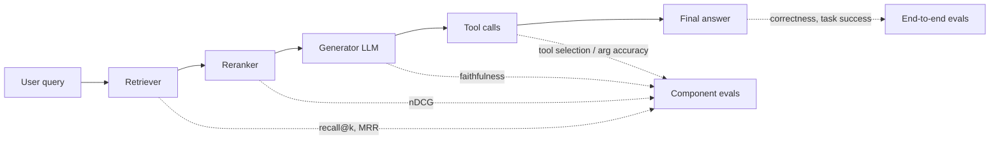
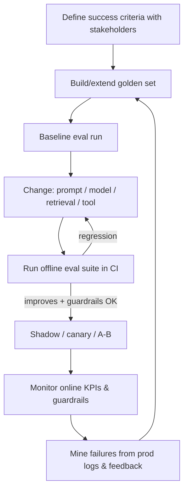

# Q18. How do you know it actually works?
[← Back to questions](../questions.md)

## TL;DR
- **Agree on what "works" means before you build.** With stakeholders, turn "make support faster" into measurable success criteria: task success rate, correctness, latency, cost per request, and the business KPI it should move.
- **Build a golden dataset** of 100-500 representative, labeled cases, including edge cases and adversarial ones, and version it like code. It is what every change gets judged against.
- **Evaluate in layers.** Component evals (retrieval recall@k, tool-call accuracy), end-to-end evals (answer correctness, groundedness), human review on a sample, then online A/B tests against business KPIs with **guardrail metrics** that must not regress.
- **Use statistics.** Report confidence intervals, use paired tests on the same eval set, and size A/B tests up front. A 2-point gain on 50 examples is noise.
- **Make it a loop (eval-driven development).** Every production failure becomes a new test case, every change runs the eval suite in CI, and you ship only when the scorecard improves without breaking guardrails.

## Detailed Answer

### 1. "Works" is a contract, not a feeling
Most failed AI projects fail on definition, not on modeling. "The chatbot should be good" can't be tested. Before writing a prompt, run a short workshop with the product owner, a domain expert, and whoever owns the business metric. Leave it with:

| Layer | Example criterion | Owner |
|---|---|---|
| Business KPI | Ticket deflection rate +10% within one quarter | Product / Ops |
| Task quality | ≥ 90% of answers judged correct and complete on the golden set | AI team + SMEs |
| Safety / guardrails | 0 PII leaks, < 1% policy-violating outputs, hallucination rate < 2% | Risk / Legal |
| Experience | p95 latency < 4 s, CSAT not lower than baseline | Product |
| Economics | Cost per resolved ticket < $0.05 | Finance / Eng |

Rules of thumb:
- **Write down the baseline**: the current human process, a rules engine, or the previous model. "90% accuracy" means nothing without a comparison.
- **Get the stakeholders to agree on acceptable failure modes.** Is a wrong answer worse than "I don't know"? Usually yes, and that changes how you design and score the system.
- **Separate leading and lagging indicators.** Offline quality metrics are leading. Business KPIs are lagging and noisy.

### 2. The golden dataset
A golden dataset is a curated, versioned set of inputs with expected outputs or grading criteria.

**How to build it**
1. **Seed from real traffic.** Sample production logs or historical tickets, stratified by intent, customer segment, language, and difficulty.
2. **Add edge cases** deliberately: ambiguous questions, out-of-scope requests, multi-hop questions, empty retrieval, prompt injection, very long inputs.
3. **Label with SMEs.** Store the reference answer, the required facts (a checklist), acceptable sources, and whether the system should abstain.
4. **Measure agreement.** Have two annotators label 10-20% of the cases and compute Cohen's kappa. If humans don't agree, the metric can't be trusted.
5. **Version it** (`golden_v3.jsonl` in git or DVC), and keep a **held-out split** you never tune prompts against, so you don't overfit.

**Size guidance (95% CI half-width for a proportion near 85%)**

| n | ± margin |
|---|---|
| 50 | ±9.9 pts |
| 200 | ±4.9 pts |
| 500 | ±3.1 pts |
| 1000 | ±2.2 pts |

Formula: `1.96 * sqrt(p(1-p)/n)`. With 200 examples you can't reliably tell 85% from 88%.

Example record:
```json
{"id": "refund-017",
 "input": "Can I get a refund on a sale item after 20 days?",
 "segment": "refunds", "difficulty": "hard",
 "must_include": ["sale items", "14-day window", "store credit"],
 "must_not_include": ["full cash refund"],
 "gold_doc_ids": ["policy_refunds_v4#s3"],
 "should_abstain": false}
```

### 3. Component vs end-to-end evaluation



| | Component evals | End-to-end evals |
|---|---|---|
| Question answered | *Where* is it broken? | *Does* it work for the user? |
| Examples | Retrieval recall@5, reranker nDCG, intent-classifier F1, tool-arg exact match, JSON schema validity | Answer correctness, task completion, groundedness, user-rated helpfulness |
| Speed / cost | Fast, cheap, deterministic | Slower, often needs an LLM judge or humans |
| Risk | Can be optimized locally and still hurt the overall result | Hard to attribute failures |

You need both. End-to-end tells you whether to ship. Component metrics tell you what to fix. A classic case: end-to-end correctness drops, and recall@5 shows retrieval is fine, so the generator prompt is the problem.

### 4. Choosing metrics per output type
- **Classification / extraction**: precision, recall, F1 (macro on imbalanced data), exact match, field-level accuracy.
- **Free-text answers**: required-fact coverage (checklist), LLM-as-judge with a rubric, groundedness against retrieved context, semantic similarity as a weak signal only.
- **Agents**: task success rate, steps to completion, tool error rate, number of human escalations, cost per task.
- **Safety**: jailbreak success rate, PII leakage, toxicity, refusal rate on benign prompts (over-refusal is also a failure).
- **Non-functional**: p50/p95 latency, tokens per request, $ per request, timeout rate.

Avoid BLEU/ROUGE for open-ended LLM answers. They correlate poorly with human judgment.

### 5. Human evaluation
Automated judges are only proxies, so calibrate them against humans:
- Have SMEs label a stratified sample (for example 100 outputs per release) with the **same rubric** the LLM judge uses.
- Measure judge-human agreement (kappa ≥ 0.6 is workable, ≥ 0.8 is strong).
- Prefer **pairwise comparisons** ("A or B?") over absolute 1-10 scores. They are faster and more consistent.
- Blind the annotators to which system produced each output.

### 6. Online evaluation: A/B tests and KPIs
Offline wins don't guarantee online wins: users phrase things differently, sessions span several turns, and behavior shifts. Use the following sequence:

```
offline eval pass → shadow (no user impact) → canary 5% → A/B 50/50 → full rollout
```

**Online signals**
- Explicit: thumbs up/down, CSAT, survey.
- Implicit: copy/accept rate, follow-up "that's wrong" messages, escalation to human, abandonment, regenerate clicks, time to resolution.
- Business: deflection, conversion, revenue, retention.

**Guardrail metrics.** These are metrics that must *not* get worse even if the primary KPI improves: latency p95, cost per request, complaint rate, safety violations, escalation rate. Decision rule: ship if the primary metric improves significantly **and** no guardrail regresses beyond its tolerance.

### 7. Statistical significance
**Offline, paired comparison.** Both prompts run on the same 400 examples. Use McNemar's test or a paired bootstrap, not two independent proportions.

```python
import numpy as np

def paired_bootstrap(a: np.ndarray, b: np.ndarray, n_boot: int = 10_000, seed: int = 0):
    """a, b: per-example scores (0/1 or float) for systems A and B on the SAME examples."""
    rng = np.random.default_rng(seed)
    n = len(a)
    diffs = np.empty(n_boot)
    for i in range(n_boot):
        idx = rng.integers(0, n, n)
        diffs[i] = b[idx].mean() - a[idx].mean()
    lo, hi = np.percentile(diffs, [2.5, 97.5])
    p_value = 2 * min((diffs <= 0).mean(), (diffs >= 0).mean())
    return b.mean() - a.mean(), (lo, hi), p_value

rng = np.random.default_rng(42)
a = rng.binomial(1, 0.82, 400)          # baseline prompt
b = np.where(rng.random(400) < 0.9, a, 1 - a)  # mostly same, some flips
b[:20] = 1                               # new prompt fixes some cases
delta, ci, p = paired_bootstrap(a, b)
print(f"delta={delta:+.3f} 95% CI={ci[0]:+.3f}..{ci[1]:+.3f} p={p:.3f}")
```

**Online, sample sizing.** To detect a lift in a thumbs-up rate from 60% to 62% (α=0.05, power=0.8):

```python
from statsmodels.stats.power import NormalIndPower
from statsmodels.stats.proportion import proportion_effectsize

effect = proportion_effectsize(0.62, 0.60)
n_per_arm = NormalIndPower().solve_power(effect_size=effect, alpha=0.05, power=0.8)
print(round(n_per_arm))  # ~9,300 users per arm
```

Worked intuition: a 2-point lift needs about 9.3k users per arm. A 5-point lift needs about 1.5k. Decide the minimum detectable effect *before* starting, and don't peek-and-stop. Use sequential testing if you must monitor continuously.

Also: randomize by **user**, not by request, to avoid contamination; watch for novelty effects; and if you have many segments, correct for multiple comparisons (Bonferroni or Benjamini-Hochberg).

### 8. Eval-driven development loop



Minimal harness:

```python
import json
from dataclasses import dataclass
from statistics import mean

@dataclass
class Result:
    id: str
    segment: str
    correct: bool
    grounded: bool
    latency_s: float
    cost_usd: float

def score_case(case: dict, output: str) -> tuple[bool, bool]:
    text = output.lower()
    has_required = all(f.lower() in text for f in case["must_include"])
    has_forbidden = any(f.lower() in text for f in case.get("must_not_include", []))
    correct = has_required and not has_forbidden
    grounded = True  # plug in a groundedness judge here
    return correct, grounded

def run_suite(path: str, system) -> list[Result]:
    results = []
    with open(path) as f:
        for line in f:
            case = json.loads(line)
            out = system(case["input"])          # returns dict with text, latency, cost
            correct, grounded = score_case(case, out["text"])
            results.append(Result(case["id"], case["segment"], correct, grounded,
                                  out["latency_s"], out["cost_usd"]))
    return results

def scorecard(results: list[Result]) -> dict:
    by_seg: dict[str, list[bool]] = {}
    for r in results:
        by_seg.setdefault(r.segment, []).append(r.correct)
    lat = sorted(r.latency_s for r in results)
    return {
        "accuracy": mean(r.correct for r in results),
        "groundedness": mean(r.grounded for r in results),
        "p95_latency_s": lat[int(0.95 * (len(lat) - 1))],
        "cost_per_req": mean(r.cost_usd for r in results),
        "per_segment": {k: mean(v) for k, v in by_seg.items()},
    }
```

Always look at the **per-segment** breakdown. An aggregate +3% can hide a −15% on a small but important segment, such as enterprise customers or a non-English locale.

### 9. Putting it together: a sample scorecard

| Metric | Baseline | Candidate | Threshold | Pass? |
|---|---|---|---|---|
| Answer correctness (golden, n=500) | 84.2% | 88.0% (CI +1.6..+6.0) | ≥ baseline | yes |
| Groundedness | 93% | 95% | ≥ 92% | yes |
| Retrieval recall@5 | 0.91 | 0.91 | ≥ 0.88 | yes |
| Refusal on benign prompts | 3% | 6% | ≤ 4% | **no** |
| p95 latency | 3.1 s | 3.4 s | ≤ 4 s | yes |
| Cost / request | $0.012 | $0.015 | ≤ $0.02 | yes |

Decision: don't ship yet. Fix the over-refusal first. This is how you answer "how do you know it works": with evidence, a threshold, and an explicit decision rule.

## Common Pitfalls
- **Vibe checks**: trying five prompts in a playground and declaring victory.
- **Overfitting the golden set**: tuning prompts against the same examples until they pass. Keep a held-out split and refresh with production data.
- **Only aggregate metrics**: regressions hide in segments.
- **Uncalibrated LLM judges**: trusting judge scores without checking agreement with humans.
- **Ignoring non-functional metrics**: a 2% quality gain that doubles latency or cost may be a net loss.
- **No significance testing**: reacting to noise, or peeking at A/B tests and stopping early.
- **Static evals**: the dataset never grows, while production failures repeat.
- **Measuring proxies forever**: never closing the loop to the business KPI the project was funded for.

## Likely Follow-up Questions
1. **What if you have no labeled data on day one?**
   Start with 50 hand-written cases from SMEs plus synthetic variations generated by an LLM and reviewed by humans. Launch to internal users, then grow the set from logs. Label in small, frequent batches.
2. **How do you evaluate multi-turn conversations?**
   Use conversation-level rubrics (was the goal achieved, number of turns, did context carry over), simulated users (an LLM playing a persona with a goal), and replays of real transcripts.
3. **Offline metrics improved but the A/B test is flat. Why?**
   The golden set isn't representative of real traffic (distribution shift), the improvement is in rare cases, the KPI is too far downstream or too noisy, or users don't notice the difference. Check the segment mix and the online implicit signals.
4. **How do you pick the guardrail thresholds?**
   Derive them from the baseline's natural variance (for example, don't allow more than one standard deviation of regression), business constraints (SLA, budget), and risk appetite agreed with stakeholders.
5. **How often do you re-run evals?**
   On every change in CI (a fast subset), nightly on the full suite, and whenever the underlying model provider updates a model version.

[← Back to questions](../questions.md)
