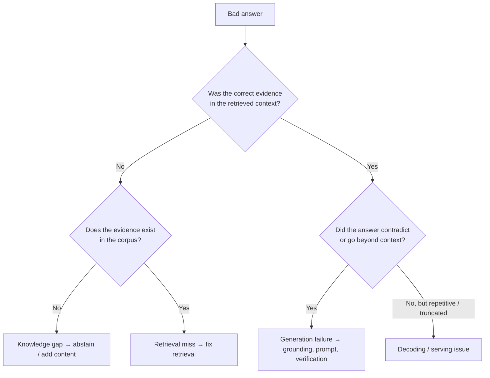
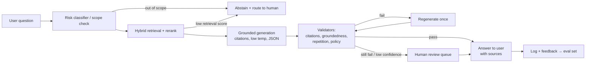

# Q20. A model hallucinates or repeats itself on high-stakes answers. Fix it.
[← Back to questions](../questions.md)

## TL;DR
- **Diagnose before fixing.** Pull the failing traces and classify each one:
  - (a) **Retrieval miss**: the right evidence wasn't in the context.
  - (b) **Generation failure**: the evidence was there but the model ignored it, mixed it up, or invented something.
  - (c) **Knowledge gap or out-of-scope question**: the system should have abstained.
  - (d) **Decoding or serving issue**: repetition loops, truncation, quantization artifacts.
- **For hallucinations**: improve retrieval (hybrid search, reranking, better chunking), **ground the answer with mandatory citations**, allow and reward **abstention** ("I don't know"), add a **verification step** (chain-of-verification or a groundedness checker that blocks unsupported claims), and use **self-consistency** to detect uncertainty.
- **For repetition**: fix the decoding parameters (sensible temperature, repetition/frequency penalties, max_tokens, stop sequences), trim **context bloat**, check for **quantization or serving bugs** and chat-template mismatches, and add a post-generation n-gram repetition detector.
- **For high stakes**: use defense in depth. Restrict scope, use structured outputs, set confidence thresholds, and send risky or low-confidence answers to **human review** before they reach users. Measure hallucination rate on a dedicated eval set and gate releases on it.

## Detailed Answer

### 1. Triage: find where it breaks
"The model hallucinates" is a symptom. The fix depends on the root cause, so start with ~50-100 failing examples from logs or user reports and label each one.



Typical breakdown from a real RAG audit: 45% retrieval miss, 30% generation unfaithful, 15% question out of scope (should have abstained), 10% repetition or truncation. Optimizing the prompt would have fixed at most a third of it.

**Useful metrics per stage**
- Retrieval: recall@k against gold documents, and context precision.
- Generation: **faithfulness/groundedness** (share of claims supported by context), answer correctness against a reference.
- Abstention: precision and recall of "I don't know" on unanswerable questions.
- Repetition: share of responses with repeated n-grams, and how often responses hit max_tokens.

### 2. Fixing retrieval misses
- **Hybrid search** (BM25 + dense) for IDs, codes, product names, and exact terms that embeddings miss.
- **Reranking** with a cross-encoder over the top 50 down to the top 5.
- **Chunking**: chunks aligned to document structure, with titles and section headers prepended, and overlap. Avoid cutting tables or clauses in half.
- **Query rewriting / multi-query** for vague or multi-part questions. Decompose multi-hop questions.
- **Metadata filters** (product, version, date, jurisdiction) so retrieval doesn't return outdated policies.
- **Freshness**: re-index on content change. Stale documents produce answers that are confidently wrong.

### 3. Fixing generation failures (hallucination)

**a) Ground with citations**
Require that every claim cites a source chunk ID, and validate the citations programmatically.

```text
SYSTEM:
You answer questions about insurance policies using ONLY the sources below.
Rules:
1. Every sentence that states a fact must end with a citation like [S2].
2. If the sources do not contain the answer, reply exactly:
   "I can't find this in the policy documents. Please contact an agent."
3. Never use outside knowledge. Never guess numbers, dates, or amounts.
4. If sources conflict, say so and cite both.

SOURCES:
[S1] ...
[S2] ...
```

```python
import re

CITE = re.compile(r"\[S(\d+)\]")

def validate_citations(answer: str, n_sources: int) -> list[str]:
    problems = []
    sentences = [s.strip() for s in re.split(r"(?<=[.!?])\s+", answer) if s.strip()]
    for s in sentences:
        ids = [int(i) for i in CITE.findall(s)]
        if not ids and not s.lower().startswith("i can't find"):
            problems.append(f"uncited: {s[:80]}")
        for i in ids:
            if i < 1 or i > n_sources:
                problems.append(f"invalid citation S{i}")
    return problems
```

A citation that exists isn't necessarily a correct one, so pair this with a groundedness check (d).

**b) Make abstention a first-class outcome**
Models hallucinate partly because prompts and training reward always answering. Fix that at several levels:
- Give the model an explicit abstain path in the prompt, with examples.
- Add **unanswerable questions** to the eval set (about 10-20% of it) and score abstention as correct on them.
- Use a retrieval-confidence gate: if the top reranker score is below a threshold, skip generation and abstain or escalate.
- In scoring, penalize a wrong answer more heavily than "I don't know". For example, correct = +1, abstain = 0, wrong = −3 in high-stakes domains.

**c) Chain-of-Verification (CoVe)**
1. Draft an answer.
2. Generate verification questions for each factual claim ("What is the deductible for plan B?").
3. Answer each verification question **independently** against the sources, without showing the draft, to avoid confirmation bias.
4. Revise the draft: drop or correct claims that failed verification.

It costs 2-4x more calls, so use it on high-stakes routes only.

**d) Groundedness checker (post-generation guard)**
Split the answer into atomic claims and check each claim against the context with an NLI model or an LLM judge. Block or regenerate if any claim is unsupported.

```python
from dataclasses import dataclass

@dataclass
class ClaimCheck:
    claim: str
    supported: bool
    evidence_id: str | None

def extract_claims(answer: str, llm) -> list[str]:
    prompt = ("Split the answer into short, self-contained factual claims. "
              "Return one claim per line.\n\nANSWER:\n" + answer)
    return [c.strip("- ").strip() for c in llm(prompt).splitlines() if c.strip()]

def check_claim(claim: str, sources: dict[str, str], llm) -> ClaimCheck:
    src = "\n".join(f"[{k}] {v}" for k, v in sources.items())
    prompt = (f"SOURCES:\n{src}\n\nCLAIM: {claim}\n\n"
              "Is the claim fully supported by one of the sources? "
              "Answer 'SUPPORTED <source_id>' or 'UNSUPPORTED'.")
    out = llm(prompt).strip()
    if out.startswith("SUPPORTED"):
        parts = out.split()
        return ClaimCheck(claim, True, parts[1] if len(parts) > 1 else None)
    return ClaimCheck(claim, False, None)

def guarded_answer(question, sources, generate, llm, max_retries=1):
    for attempt in range(max_retries + 1):
        answer = generate(question, sources)
        checks = [check_claim(c, sources, llm) for c in extract_claims(answer, llm)]
        unsupported = [c.claim for c in checks if not c.supported]
        groundedness = 1 - len(unsupported) / max(len(checks), 1)
        if not unsupported:
            return {"answer": answer, "groundedness": groundedness, "route": "auto"}
    return {"answer": None, "groundedness": groundedness,
            "unsupported": unsupported, "route": "human_review"}
```

Use a judge from a different model, or a dedicated NLI/groundedness model, so the checker doesn't share the generator's blind spots.

**e) Self-consistency as an uncertainty signal**
Sample N=5 answers at temperature around 0.7. If the key facts (amounts, dates, yes/no) disagree across samples, the model is uncertain. Abstain or escalate. If they agree, confidence is higher (though consistent wrong answers still happen, so this is a signal, not proof).

```python
from collections import Counter

def self_consistent_value(question, extract_value, generate, n=5, threshold=0.8):
    values = [extract_value(generate(question, temperature=0.7)) for _ in range(n)]
    value, count = Counter(values).most_common(1)[0]
    agreement = count / n
    return (value, agreement) if agreement >= threshold else (None, agreement)
```

**f) Other levers**
- **Lower temperature** (0-0.3) for factual answers.
- **Structured output** (JSON schema with `answer`, `citations`, `confidence`, `needs_human`), which makes validation possible.
- **Smaller scope per call**: break a task into extract-then-reason steps, instead of one huge prompt.
- **Put critical instructions and evidence at the start and end** of a long context ("lost in the middle").
- A **stronger model** for the high-stakes route only. Route by risk.
- **Fine-tuning** on grounded, citation-style answers with refusals, if prompting plateaus.

### 4. Fixing repetition
Repetition (loops like "the policy covers the policy covers...", or the same paragraph emitted three times) is usually a decoding or serving problem, not a knowledge problem.

| Cause | Symptom | Fix |
|---|---|---|
| Greedy / temperature 0 decoding on some models | Deterministic loops, especially in long outputs | Use a small temperature (0.2-0.5) with top_p ~0.9, or add a repetition penalty |
| No repetition control | Repeated phrases or lists | `frequency_penalty` 0.3-0.8 / `presence_penalty` (OpenAI-style APIs). `repetition_penalty` ~1.1-1.2 (HF / vLLM); above about 1.3 the text gets garbled |
| max_tokens too high, no stop sequence | Model keeps going and rambles, or restarts the answer | A sensible max_tokens, explicit stop sequences, and a length instruction in the prompt |
| Context bloat | Long, repetitive conversation history or duplicate retrieved chunks get echoed back | Dedupe chunks, summarize history, cap context, drop near-duplicates |
| Wrong chat template / missing EOS | Model never emits end-of-turn and continues with fake turns | Use the tokenizer's chat template (`apply_chat_template`). Check the EOS/stop token IDs |
| Aggressive quantization (e.g. 3-4 bit on a small model) | Loops, degraded coherence that FP16 doesn't show | Compare against FP16/BF16 on the same prompts. Use a higher bit width or a better quantization method (AWQ/GPTQ with calibration) |
| Inference-server bugs (KV-cache, rope scaling beyond trained context) | Degeneration past N tokens | Stay within the trained context length. Upgrade or patch the server. Regression-test long contexts |

Example decoding config for a self-hosted model with Hugging Face `transformers`:

```python
gen_kwargs = dict(
    max_new_tokens=512,
    do_sample=True,
    temperature=0.3,
    top_p=0.9,
    repetition_penalty=1.1,
    no_repeat_ngram_size=0,   # avoid for factual text: it blocks legit repeats like names
    eos_token_id=tokenizer.eos_token_id,
)
outputs = model.generate(**inputs, **gen_kwargs)
```

Post-generation repetition detector (cheap guard):

```python
def repeated_ngram_ratio(text: str, n: int = 4) -> float:
    toks = text.split()
    grams = [tuple(toks[i:i + n]) for i in range(len(toks) - n + 1)]
    if not grams:
        return 0.0
    return 1 - len(set(grams)) / len(grams)

# Calibrate the threshold on known-good answers: typical prose ~0.0-0.05
if repeated_ngram_ratio(answer) > 0.2 or finish_reason == "length":
    answer = regenerate_with(temperature=0.5, frequency_penalty=0.5)
```

### 5. High-stakes architecture: defense in depth



High-stakes principles:
- **A wrong answer costs more than no answer.** Tune thresholds for precision on what you auto-send, and accept a higher abstain or escalation rate.
- **Human in the loop** for medical, legal, financial, and safety-critical outputs: review before sending, or at least sample-based auditing with SLAs.
- **Show sources to users** so they can verify.
- **Restrict the output space**: templates and structured fields for numbers and amounts, pulled directly from systems of record instead of generated.
- **Audit trail**: log the prompt version, model version, retrieved chunk IDs, and validator results for every answer.

### 6. Worked example: measuring the fix
Eval set: 400 questions (320 answerable, 80 unanswerable).

| Metric | Before | After grounding + abstain + groundedness guard |
|---|---|---|
| Correct (answerable) | 251/320 = 78.4% | 262/320 = 81.9% |
| Hallucinated (wrong, confident) | 52/400 = 13.0% | 9/400 = 2.3% |
| Correct abstention (unanswerable) | 22/80 = 27.5% | 66/80 = 82.5% |
| Escalated to human | 0% | 9% |
| Repetition rate (4-gram ratio > 0.2) | 4.1% | 0.3% |
| Cost per answer | $0.010 | $0.017 |

The trade-off to explain to stakeholders: 9% escalation and 70% higher cost buy a reduction in confident wrong answers from 13% to about 2%. In a high-stakes domain, that's usually an easy decision.

## Common Pitfalls
- Tweaking the prompt before checking whether retrieval even surfaced the answer.
- Penalizing "I don't know" in evals, which teaches the system to guess.
- Treating citations as proof of grounding without validating that they support the claim.
- Using the same model as generator and verifier (correlated errors).
- Cranking `repetition_penalty` to 1.5+, which garbles names and numbers that legitimately repeat.
- Using `no_repeat_ngram_size` on factual text: it blocks legitimate repeats of entity names.
- Ignoring `finish_reason == "length"`: truncated answers look like hallucinations or loops.
- Shipping a quantized model without re-running the eval suite.
- Lacking a dedicated hallucination and abstention eval set, so the fix can't be proven.

## Likely Follow-up Questions
1. **How do you measure hallucination rate at scale?**
   Run claim-level groundedness scoring (NLI or a calibrated LLM judge) on sampled production traffic, plus a fixed eval set with known answers and unanswerable questions. Calibrate the judge against SME labels.
2. **Retrieval is good but the model still adds unsupported details. What next?**
   Tighten the prompt (cite every sentence, no outside knowledge), lower the temperature, add a groundedness guard that strips or regenerates unsupported claims, try a model that follows instructions more faithfully, or fine-tune on grounded answers.
3. **How do you decide the abstention threshold?**
   Plot coverage (share of questions answered) against precision of answered questions over the threshold on the eval set. Pick the point that meets the precision SLA agreed with the business (for example, ≥ 98% precision even if coverage falls to 85%).
4. **Self-consistency is expensive. Alternatives?**
   Token log-probabilities on key spans (where the API exposes them), a single verification pass, or using self-consistency only when cheaper signals (low retrieval score, a risky intent) indicate risk.
5. **Why would a quantized model repeat when FP16 doesn't?**
   Quantization noise flattens or distorts the logit distribution, so the model is more likely to fall into high-probability loops, especially small models at ≤ 4 bits or with poor calibration data. Validate with the same eval suite and decoding parameters.

[← Back to questions](../questions.md)
