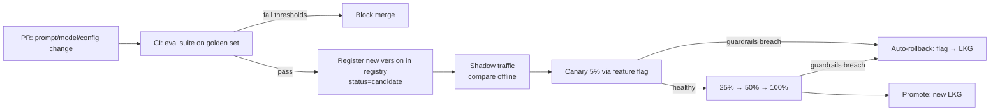

# Q22. Catch regressions when a prompt or model changes, and roll back safely.
[← Back to questions](../questions.md)

## TL;DR
- **Treat prompts, model IDs, decoding parameters, and retrieval settings as one versioned, immutable config artifact**, stored in a prompt registry or git and referenced by version. No string edits in production code.
- **Pin model versions** to dated snapshots, not floating aliases, so the provider can't change behavior under you. Treat a provider upgrade like any other change and run it through evals.
- **Use CI eval gates.** Every PR that touches a prompt or config runs the golden-set eval suite. Fail the build if any metric drops below an absolute threshold or regresses beyond its tolerance compared with the baseline.
- **Roll out progressively.** Go shadow traffic, then canary (1-5%) behind a feature flag, then ramp up, with **online guardrail metrics** (error rate, latency, cost, thumbs-down, groundedness) checked automatically at each step.
- **Roll back by flipping a pointer, not by redeploying.** Keep the **last-known-good (LKG)** config live in the registry, make rollback a single flag or alias change, and automate it when guardrails breach.

## Detailed Answer

### 1. Why LLM regressions are sneaky
- A small prompt edit ("be concise") can break format compliance, safety refusals, or tool-calling on cases nobody tested.
- Provider "same name" model updates change behavior silently.
- The output is non-deterministic, so one manual test proves nothing.
- Failures are often **segment-specific** (one language, one intent) and invisible in aggregate averages.

So you need: versioning (to know what changed), offline gates (to catch it before users do), progressive delivery (to limit blast radius), and instant rollback (to recover).



### 2. Prompts as versioned artifacts

**What goes into one "release config"**
```yaml
# prompts/support_answer/v14.yaml
id: support_answer
version: 14
model: gpt-4o-2024-08-06        # pinned dated snapshot, never an alias
temperature: 0.2
max_tokens: 600
system_prompt_file: system_v14.txt
retrieval:
  top_k: 8
  reranker: bge-reranker-v2-m3
  min_score: 0.35
tools: [lookup_order, create_ticket]
output_schema: schemas/answer_v3.json
owner: support-ai-team
changelog: "Add explicit abstain instruction; reduce top_k 10->8"
```

Principles:
- **Immutable versions**: never edit v14 in place. Make v15.
- **Aliases / labels** (`production`, `canary`, `lkg`) point to versions. Deploy or roll back by moving a label.
- The app resolves the config at runtime (with caching) and **logs the version on every request and trace**, so you can attribute metrics to versions.
- Tools: a git-backed directory plus a small registry service, or a managed prompt registry such as Langfuse prompt management, the MLflow prompt registry, or LangSmith prompt hub.

```python
import json, time
from dataclasses import dataclass
from functools import lru_cache

@dataclass(frozen=True)
class ReleaseConfig:
    prompt_id: str
    version: int
    model: str
    temperature: float
    max_tokens: int
    system_prompt: str

class PromptRegistry:
    """Minimal registry: versions are immutable; labels are movable pointers."""
    def __init__(self, store):
        self.store = store                     # e.g. DB / S3 / git-backed KV

    def get(self, prompt_id: str, label: str = "production") -> ReleaseConfig:
        version = self.store.get_label(prompt_id, label)
        return self._load(prompt_id, version)

    @lru_cache(maxsize=256)
    def _load(self, prompt_id: str, version: int) -> ReleaseConfig:
        raw = json.loads(self.store.get_version(prompt_id, version))
        return ReleaseConfig(**raw)

    def promote(self, prompt_id: str, version: int, label: str = "production"):
        current = self.store.get_label(prompt_id, label)
        self.store.set_label(prompt_id, "lkg", current)        # remember last-known-good
        self.store.set_label(prompt_id, label, version)
        self.store.audit(prompt_id, label, current, version, time.time())

    def rollback(self, prompt_id: str, label: str = "production"):
        lkg = self.store.get_label(prompt_id, "lkg")
        self.store.set_label(prompt_id, label, lkg)
        self.store.audit(prompt_id, label, None, lkg, time.time())
```

### 3. Offline regression detection: CI eval gates

**Gate design**
- **Absolute floors**: e.g. correctness ≥ 0.85, JSON validity ≥ 0.99, safety violations = 0.
- **Relative tolerance vs baseline**: e.g. no metric drops more than 2 points compared with the current production version on the same dataset.
- **Per-segment floors**: so a regression in a small segment isn't averaged away.
- **Non-functional**: p95 latency and cost per request within budget.
- **Noise handling**: run on enough cases (300+), use temperature 0 or a fixed seed where supported, run k=3 repeats for stochastic metrics, and use a paired comparison against the baseline.

**Tiered suites**
| Suite | Size | When | Time |
|---|---|---|---|
| Smoke | 20-50 cases, deterministic checks | every commit | < 2 min |
| Regression | 300-1000 golden cases + LLM judge | every PR touching prompts/config | 10-20 min |
| Full / adversarial | 2-5k incl. red-team, long-context, multilingual | nightly, and before promotion | 1 h+ |

**pytest-style eval tests**

```python
# tests/evals/test_support_answer.py
import json
import pathlib
import statistics
import pytest

from app.llm import run_pipeline              # your system under test
from app.registry import load_config_file
from evals.scorers import correctness, is_valid_json, contains_pii

GOLDEN = [json.loads(l) for l in pathlib.Path("evals/golden_v7.jsonl").read_text().splitlines()]
BASELINE = json.loads(pathlib.Path("evals/baselines/support_answer_prod.json").read_text())
CANDIDATE = load_config_file("prompts/support_answer/v15.yaml")

THRESHOLDS = {"correctness": 0.85, "json_valid": 0.99}
MAX_DROP = {"correctness": 0.02}            # vs production baseline
SEGMENT_FLOOR = 0.75


@pytest.fixture(scope="session")
def results():
    out = []
    for case in GOLDEN:
        resp = run_pipeline(case["input"], config=CANDIDATE)
        out.append({
            "id": case["id"],
            "segment": case["segment"],
            "correctness": correctness(case, resp.text),
            "json_valid": float(is_valid_json(resp.text)),
            "pii": contains_pii(resp.text),
            "latency_s": resp.latency_s,
            "cost_usd": resp.cost_usd,
        })
    pathlib.Path("eval_results.json").write_text(json.dumps(out, indent=2))
    return out


def mean(results, key):
    return statistics.mean(r[key] for r in results)


@pytest.mark.parametrize("metric", list(THRESHOLDS))
def test_absolute_thresholds(results, metric):
    assert mean(results, metric) >= THRESHOLDS[metric], f"{metric} below floor"


@pytest.mark.parametrize("metric", list(MAX_DROP))
def test_no_regression_vs_baseline(results, metric):
    drop = BASELINE[metric] - mean(results, metric)
    assert drop <= MAX_DROP[metric], f"{metric} regressed by {drop:.3f}"


def test_per_segment_floor(results):
    segments = {r["segment"] for r in results}
    for seg in segments:
        seg_scores = [r["correctness"] for r in results if r["segment"] == seg]
        assert statistics.mean(seg_scores) >= SEGMENT_FLOOR, f"segment {seg} regressed"


def test_no_pii_leaks(results):
    leaks = [r["id"] for r in results if r["pii"]]
    assert not leaks, f"PII in outputs: {leaks}"


def test_latency_and_cost(results):
    lat = sorted(r["latency_s"] for r in results)
    p95 = lat[int(0.95 * (len(lat) - 1))]
    assert p95 <= 4.0
    assert mean(results, "cost_usd") <= 0.02
```

**GitHub Actions gate**

```yaml
# .github/workflows/llm-evals.yml
name: llm-evals
on:
  pull_request:
    paths:
      - "prompts/**"
      - "app/llm/**"
      - "evals/**"
jobs:
  eval:
    runs-on: ubuntu-latest
    timeout-minutes: 45
    steps:
      - uses: actions/checkout@v4
      - uses: actions/setup-python@v5
        with:
          python-version: "3.11"
      - run: pip install -r requirements.txt
      - name: Run regression eval suite
        env:
          OPENAI_API_KEY: ${{ secrets.OPENAI_API_KEY }}
        run: pytest tests/evals -q --maxfail=20 --junitxml=eval-report.xml
      - name: Upload eval artifacts
        if: always()
        uses: actions/upload-artifact@v4
        with:
          name: eval-results
          path: |
            eval_results.json
            eval-report.xml
```

Make the job a **required status check** on the branch, so a failing eval blocks the merge. Post a diff summary (metric deltas, newly failing case IDs) as a PR comment so reviewers see *what* broke.

### 4. Pinned model versions
- Use dated snapshot IDs (e.g. `gpt-4o-2024-08-06`, `claude-3-5-sonnet-20241022`). Aliases like `gpt-4o` or `-latest` move.
- For self-hosted models, pin the weights hash, tokenizer, quantization, inference server version, and chat template. All of them can change outputs.
- Track provider deprecation dates and schedule migration evals well before the cutoff.
- A model upgrade is a config change: new version → CI eval → shadow → canary → promote.
- Also pin the **judge** model used in evals, otherwise the measurement itself drifts.

### 5. Shadow traffic
Send a copy of real production requests to the candidate asynchronously. Users only see the production response.
- Compare candidate and production outputs with an LLM judge (pairwise), deterministic checks (schema, tool-call validity), latency, and cost.
- Catches distribution issues the golden set misses.
- Caveats: costs extra (sample 5-20%); **don't execute side-effecting tools** in shadow (stub or dry-run them); be careful with PII handling.

### 6. Canary + feature flags
```python
import hashlib

def bucket(user_id: str, salt: str = "support_answer_v15") -> float:
    h = hashlib.sha256(f"{salt}:{user_id}".encode()).hexdigest()
    return int(h[:8], 16) / 0xFFFFFFFF          # stable 0..1 per user

def resolve_label(user_id: str, flags) -> str:
    if flags.get("support_answer.kill_switch"):
        return "lkg"
    pct = flags.get("support_answer.canary_pct", 0.0)   # e.g. 0.05
    return "canary" if bucket(user_id) < pct else "production"

cfg = registry.get("support_answer", label=resolve_label(user.id, flags))
```
- Bucket by **user** (sticky), not by request, so conversations stay consistent.
- Ramp up step by step: 1% → 5% → 25% → 50% → 100%, with a soak time at each step (hours to a day, depending on traffic).
- Use a flag system (LaunchDarkly, Unleash, OpenFeature, or a config-service key), so changing the percentage needs no deploy.

### 7. Online guardrails and automatic rollback

| Guardrail metric | Example trigger (canary vs control) |
|---|---|
| Error / exception rate | > 2x control or > 1% absolute |
| Schema / tool-call failure rate | > control + 1 pt |
| p95 latency | > control × 1.3 |
| Cost per request | > control × 1.25 |
| Thumbs-down / regenerate rate | > control + 3 pts (with minimum sample) |
| Groundedness (sampled judge) | < control − 3 pts |
| Safety flags | any spike over baseline |
| Escalation to human | > control + 2 pts |

```python
def should_rollback(canary: dict, control: dict, min_requests: int = 500) -> list[str]:
    if canary["requests"] < min_requests:
        return []                                # not enough evidence yet
    reasons = []
    if canary["error_rate"] > max(2 * control["error_rate"], 0.01):
        reasons.append("error_rate")
    if canary["p95_latency_s"] > 1.3 * control["p95_latency_s"]:
        reasons.append("latency")
    if canary["cost_per_req"] > 1.25 * control["cost_per_req"]:
        reasons.append("cost")
    if canary["thumbs_down_rate"] - control["thumbs_down_rate"] > 0.03:
        reasons.append("thumbs_down")
    return reasons

def guardrail_job(metrics_api, flags, registry, notifier):
    canary, control = metrics_api.window("support_answer", minutes=30)
    reasons = should_rollback(canary, control)
    if reasons:
        flags.set("support_answer.canary_pct", 0.0)       # stop exposure immediately
        notifier.page(f"Auto-rollback support_answer canary: {reasons}")
```

Rollback design rules:
- **Rollback = pointer move** (flag to 0%, or label `production` → `lkg`). That takes seconds and needs no build.
- Keep **LKG warm**: still deployed, still pinned to an available model version, with compatible schemas.
- Keep changes **backward compatible**: output schemas, tool contracts, and memory or state formats must work with both versions during the transition (expand/contract).
- **Audit log** every promote and rollback with who, when, and why.
- After a rollback, add the failing production cases to the golden set, so the same regression is caught offline next time.

### 8. Worked example
A PR changes the system prompt to "Answer in 3 sentences max".

| Metric | Prod v14 | Candidate v15 | Gate | Result |
|---|---|---|---|---|
| Correctness (n=600) | 0.881 | 0.874 | drop ≤ 0.02 | pass |
| JSON validity | 0.998 | 0.997 | ≥ 0.99 | pass |
| Segment `refunds` correctness | 0.86 | **0.71** | ≥ 0.75 | **fail** |
| p95 latency | 3.2 s | 2.4 s | ≤ 4 s | pass |
| Cost / req | $0.013 | $0.010 | ≤ $0.02 | pass |

The aggregate looks fine, even better on latency and cost, but the per-segment gate catches that refund answers now drop the required exceptions. The build is blocked. Without segment gates this would have shipped.

### 9. Trade-offs

| Technique | Catches | Cost | Blind spot |
|---|---|---|---|
| CI golden-set gate | Known behaviors, format, safety | API cost per PR, minutes | Unseen distributions |
| Shadow traffic | Real distribution, latency, cost | Doubles inference on sampled traffic | No real user reaction; side-effect tools must be stubbed |
| Canary + guardrails | Real user impact | Small user exposure | Slow for low-traffic apps; noisy metrics |
| A/B test | Business KPI impact | Weeks for significance | Too slow for safety regressions |
| Auto-rollback | Fast recovery | Engineering effort | Needs good, low-noise signals |

## Common Pitfalls
- Hardcoding prompts in the code, so you can't tell which prompt produced which output.
- Using floating model aliases, so the provider changes behavior silently.
- Gating only on aggregate scores, letting segment regressions through.
- Flaky gates from too few cases or stochastic decoding, which leads teams to ignore or bypass them.
- Rollback that requires a redeploy, or an LKG whose model version has been deprecated.
- Not logging the prompt and model version per request, which makes incident analysis impossible.
- Changing the eval judge or dataset in the same PR as the prompt, so you can't separate system change from measurement change.
- Shadow mode that accidentally executes real side-effecting tools (emails, refunds).
- Breaking schema or state compatibility, so rolling back corrupts in-flight conversations.

## Likely Follow-up Questions
1. **How do you keep eval gates from being flaky?**
   Use enough examples, temperature 0 or seeds, deterministic checks where possible, k repeats with majority voting for judge metrics, tolerances derived from the measured run-to-run variance, and a paired comparison with a baseline re-run in the same job.
2. **How do you handle a provider deprecating your pinned model?**
   Track deprecation notices, run the candidate replacement through the full suite weeks in advance, re-baseline judges, canary the change, and keep a fallback provider or model configured as an alternate LKG.
3. **Low-traffic product: canary metrics never reach significance. What then?**
   Lean more on offline and shadow evals, use longer soak times, rely on sensitive proxy metrics (judge scores on 100% of canary traffic, error rates) rather than thumbs-up, and do internal dogfooding first.
4. **Should prompt changes go through the same release process as code?**
   Yes: PR review, CI evals, versioning, staged rollout. A prompt is code that runs on a probabilistic interpreter. Non-engineers can author prompts in a registry UI, but promotion to production should still pass the gates.
5. **What do you store to make incidents debuggable?**
   Per-request trace: prompt ID and version, model snapshot, decoding parameters, retrieved document IDs, tool calls, output, latency, tokens, cost, flag bucket, and user feedback. Then you can slice any metric by version.

[← Back to questions](../questions.md)
