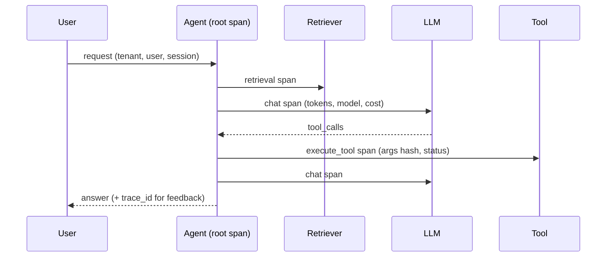
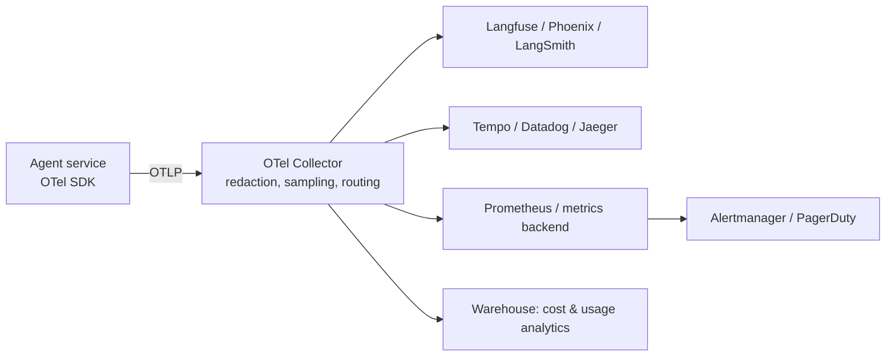

# Q23. Observability for agents: traces, cost per request, alerts.
[← Back to questions](../questions.md)

## TL;DR
- **Trace every request end to end.** Use one root span per user request or agent run, with child spans for each **LLM call**, **tool call**, **retrieval**, and **sub-agent**. Use the **OpenTelemetry GenAI semantic conventions** (`gen_ai.operation.name`, `gen_ai.request.model`, `gen_ai.usage.input_tokens`/`output_tokens`, `gen_ai.tool.name`, and so on) so any backend can read the data.
- **Attribute tokens and cost** to every span and roll them up per request, user, tenant, feature, and prompt version. Compute cost from a versioned price table, and emit metrics as well as span attributes.
- **Tools**: LangSmith, Langfuse, and Arize Phoenix (with OpenInference) for LLM-specific trace UIs, evals, and prompt versions. Datadog, Grafana/Tempo, Honeycomb, or Jaeger for general APM. OTLP lets you export to several of them at once.
- **Dashboards and SLOs**: success rate, p50/p95 latency (including time to first token), cost per request or task, tokens per request, tool error rate, steps per run, escalation rate, and quality scores (sampled online evals).
- **Alerts**: error-rate and latency SLO burn, **cost spikes** (per tenant and globally), **agent loop detection** (steps or repeated identical tool calls above a threshold), provider rate limits or outages, quality drops, and **PII appearing in logs**. Redact before export, and keep prompt/response content capture opt-in.

## Detailed Answer

### 1. Why agents need more than normal APM
A normal web request is a predictable call graph. An agent run is a **dynamic, non-deterministic loop**: the model decides which tools to call, how many times, and with which arguments. Failures are often *semantic* (a wrong tool, a looping plan, a hallucinated argument) rather than exceptions, and cost varies by 100x between requests. You have to be able to answer:
- What did the agent do, step by step, for this specific complaint?
- Which step was slow or expensive?
- How much did tenant X cost us yesterday, and why did it double?
- Is the agent stuck in a loop right now?

### 2. Trace structure

```
invoke_agent support_agent                [root span: trace_id=abc, 8.4s, $0.033]
├── retrieval kb_search                    [0.21s, 8 docs]
├── chat gpt-4o                            [1.9s, in=3,120 out=210 tokens, $0.0099]
│     finish_reason=tool_calls
├── execute_tool lookup_order              [0.35s, status=ok]
├── chat gpt-4o                            [2.1s, in=3,610 out=180, $0.0108]
├── execute_tool create_refund             [0.80s, status=error: 409 conflict]
├── chat gpt-4o                            [2.4s, in=3,900 out=260, $0.0124]
└── guardrail groundedness_check           [0.6s, score=0.92]
```



**OpenTelemetry GenAI semantic conventions (key attributes)**

| Attribute | Example | On span type |
|---|---|---|
| `gen_ai.operation.name` | `chat`, `embeddings`, `execute_tool`, `invoke_agent` | all |
| `gen_ai.provider.name` (older: `gen_ai.system`) | `openai`, `anthropic`, `aws.bedrock` | LLM |
| `gen_ai.request.model` / `gen_ai.response.model` | `gpt-4o-2024-08-06` | LLM |
| `gen_ai.request.temperature`, `gen_ai.request.max_tokens` | `0.2`, `600` | LLM |
| `gen_ai.usage.input_tokens` / `gen_ai.usage.output_tokens` | `3120` / `210` | LLM |
| `gen_ai.response.finish_reasons` | `["tool_calls"]` | LLM |
| `gen_ai.response.id` | provider response ID | LLM |
| `gen_ai.tool.name`, `gen_ai.tool.call.id` | `lookup_order` | tool |
| `gen_ai.agent.name`, `gen_ai.agent.id` | `support_agent` | agent |
| `gen_ai.conversation.id` | session/thread ID | all |
| `error.type` | `RateLimitError` | any failed span |

Span naming convention: `"{gen_ai.operation.name} {model or tool name}"`, for example `chat gpt-4o` or `execute_tool lookup_order`. The GenAI conventions were still marked **experimental** at the time of writing and attribute names have changed between versions (`gen_ai.system` → `gen_ai.provider.name`), so pin a semconv version and keep the names in one module. Standard metrics include the `gen_ai.client.token.usage` and `gen_ai.client.operation.duration` histograms.

Add your own business attributes under a namespace: `app.tenant_id`, `app.user_id` (hashed), `app.feature`, `app.prompt.version`, `app.cost_usd`, `app.agent.step`.

### 3. Instrumentation code (OpenTelemetry Python)

```python
# telemetry.py
from opentelemetry import trace, metrics
from opentelemetry.sdk.resources import Resource
from opentelemetry.sdk.trace import TracerProvider
from opentelemetry.sdk.trace.export import BatchSpanProcessor
from opentelemetry.sdk.metrics import MeterProvider
from opentelemetry.sdk.metrics.export import PeriodicExportingMetricReader
from opentelemetry.exporter.otlp.proto.grpc.trace_exporter import OTLPSpanExporter
from opentelemetry.exporter.otlp.proto.grpc.metric_exporter import OTLPMetricExporter

resource = Resource.create({
    "service.name": "support-agent",
    "service.version": "1.8.2",
    "deployment.environment": "prod",
})

tp = TracerProvider(resource=resource)
tp.add_span_processor(BatchSpanProcessor(OTLPSpanExporter(endpoint="http://otel-collector:4317", insecure=True)))
trace.set_tracer_provider(tp)

mp = MeterProvider(resource=resource, metric_readers=[
    PeriodicExportingMetricReader(OTLPMetricExporter(endpoint="http://otel-collector:4317", insecure=True))
])
metrics.set_meter_provider(mp)

tracer = trace.get_tracer("support_agent")
meter = metrics.get_meter("support_agent")

token_usage = meter.create_histogram("gen_ai.client.token.usage", unit="{token}",
                                     description="Tokens per LLM call")
op_duration = meter.create_histogram("gen_ai.client.operation.duration", unit="s")
cost_counter = meter.create_counter("app.llm.cost", unit="USD", description="LLM spend")
tool_errors = meter.create_counter("app.tool.errors")
```

```python
# agent.py
import hashlib, json, time
from opentelemetry.trace import Status, StatusCode
from telemetry import tracer, token_usage, op_duration, cost_counter, tool_errors

# USD per 1M tokens; versioned, loaded from config in real systems
PRICES = {"gpt-4o-2024-08-06": {"input": 2.50, "output": 10.00}}

def cost_usd(model: str, in_tok: int, out_tok: int) -> float:
    p = PRICES[model]
    return (in_tok * p["input"] + out_tok * p["output"]) / 1_000_000

class RunBudget:
    def __init__(self, max_steps=12, max_cost=0.50, max_repeat_tool_calls=3):
        self.steps, self.cost = 0, 0.0
        self.max_steps, self.max_cost = max_steps, max_cost
        self.max_repeat = max_repeat_tool_calls
        self.seen_calls: dict[str, int] = {}

    def check_tool_call(self, name: str, args: dict):
        key = name + ":" + hashlib.sha256(json.dumps(args, sort_keys=True).encode()).hexdigest()[:16]
        self.seen_calls[key] = self.seen_calls.get(key, 0) + 1
        if self.seen_calls[key] > self.max_repeat:
            raise RuntimeError(f"loop_detected: {name} called {self.seen_calls[key]}x with same args")

    def add_step(self, step_cost: float):
        self.steps += 1
        self.cost += step_cost
        if self.steps > self.max_steps:
            raise RuntimeError("max_steps_exceeded")
        if self.cost > self.max_cost:
            raise RuntimeError("cost_budget_exceeded")


def traced_chat(client, model, messages, tenant_id, budget: RunBudget, **params):
    with tracer.start_as_current_span(f"chat {model}") as span:
        span.set_attribute("gen_ai.operation.name", "chat")
        span.set_attribute("gen_ai.provider.name", "openai")
        span.set_attribute("gen_ai.request.model", model)
        span.set_attribute("gen_ai.request.temperature", params.get("temperature", 1.0))
        t0 = time.perf_counter()
        try:
            resp = client.chat.completions.create(model=model, messages=messages, **params)
        except Exception as e:
            span.record_exception(e)
            span.set_status(Status(StatusCode.ERROR))
            span.set_attribute("error.type", type(e).__name__)
            raise
        dt = time.perf_counter() - t0
        u = resp.usage
        c = cost_usd(model, u.prompt_tokens, u.completion_tokens)
        span.set_attribute("gen_ai.response.model", resp.model)
        span.set_attribute("gen_ai.usage.input_tokens", u.prompt_tokens)
        span.set_attribute("gen_ai.usage.output_tokens", u.completion_tokens)
        span.set_attribute("gen_ai.response.finish_reasons", [ch.finish_reason for ch in resp.choices])
        span.set_attribute("app.cost_usd", c)

        attrs = {"gen_ai.request.model": model, "app.tenant_id": tenant_id}
        token_usage.record(u.prompt_tokens, {**attrs, "gen_ai.token.type": "input"})
        token_usage.record(u.completion_tokens, {**attrs, "gen_ai.token.type": "output"})
        op_duration.record(dt, attrs)
        cost_counter.add(c, attrs)
        budget.add_step(c)
        return resp


def traced_tool(name, fn, args: dict, tenant_id, budget: RunBudget):
    with tracer.start_as_current_span(f"execute_tool {name}") as span:
        span.set_attribute("gen_ai.operation.name", "execute_tool")
        span.set_attribute("gen_ai.tool.name", name)
        span.set_attribute("app.tool.args_hash",
                           hashlib.sha256(json.dumps(args, sort_keys=True).encode()).hexdigest()[:16])
        budget.check_tool_call(name, args)
        try:
            result = fn(**args)
            span.set_attribute("app.tool.status", "ok")
            return result
        except Exception as e:
            span.record_exception(e)
            span.set_status(Status(StatusCode.ERROR))
            tool_errors.add(1, {"gen_ai.tool.name": name, "app.tenant_id": tenant_id})
            raise


def run_agent(request, client, tools):
    budget = RunBudget()
    with tracer.start_as_current_span("invoke_agent support_agent") as root:
        root.set_attribute("gen_ai.operation.name", "invoke_agent")
        root.set_attribute("gen_ai.agent.name", "support_agent")
        root.set_attribute("gen_ai.conversation.id", request.session_id)
        root.set_attribute("app.tenant_id", request.tenant_id)
        root.set_attribute("app.user_id_hash", hashlib.sha256(request.user_id.encode()).hexdigest()[:16])
        root.set_attribute("app.prompt.version", "support_answer@v14")
        try:
            # ... agent loop: traced_chat -> traced_tool -> traced_chat ...
            pass
        except RuntimeError as e:
            root.set_attribute("app.agent.termination", str(e).split(":")[0])
            root.set_status(Status(StatusCode.ERROR))
            raise
        finally:
            root.set_attribute("app.agent.steps", budget.steps)
            root.set_attribute("app.cost_usd", round(budget.cost, 6))
```

In practice you'd often start with **auto-instrumentation** (OpenTelemetry instrumentations for the OpenAI or Bedrock SDKs, OpenLLMetry, OpenInference instrumentors for LangChain or LlamaIndex) and add custom spans and business attributes on top, as above.

Return the `trace_id` to the client, so thumbs-up/down feedback can be attached back to the exact trace.

### 4. Cost attribution
**Worked example**: gpt-4o-class pricing of $2.50 per 1M input tokens and $10 per 1M output tokens.
- Step 1: 3,120 in + 210 out costs 3120×2.5e-6 + 210×1e-5 = 0.0078 + 0.0021 = **$0.0099**
- Step 2: 3,610 in + 180 out costs 0.0090 + 0.0018 = **$0.0108**
- Step 3: 3,900 in + 260 out costs 0.00975 + 0.0026 = **$0.0124**
- Request total ≈ **$0.033** plus embeddings and reranker. At 200k requests/day that's about $6.6k/day.

Input tokens dominate, because the context grows each step. That points to optimizations: prompt caching (cached input tokens are billed at a discount, so track `cached_input_tokens` separately), history summarization, and fewer tool round-trips.

**Roll-ups to build**
- Cost per request, per *successful task* (the honest unit economics), per tenant, per user, per feature, per model, per prompt version.
- Cost per tenant compared with that tenant's revenue, to spot unprofitable tenants and enforce quotas.

Tips:
- Keep the price table **versioned** with an effective date. Prices change.
- Cost is best computed in the collector or warehouse from token counts, so you can recompute history when prices change. Emitting `app.cost_usd` at runtime is still convenient for alerts.
- High-cardinality labels (user_id) are fine on spans and traces but **expensive on metrics**. Use tenant or feature on metrics, user on traces or logs.

### 5. Tooling landscape

| Tool | Strength | Notes |
|---|---|---|
| **LangSmith** | Deep LangChain/LangGraph integration, trace UI, datasets, evals, prompt hub | SaaS or self-hosted (enterprise). Accepts OTel |
| **Langfuse** | Open-source, self-hostable, traces + cost + prompt management + evals | OTel-compatible ingestion |
| **Arize Phoenix** | Open-source, OpenInference conventions, eval tooling, retrieval analysis | Built on OTel |
| **Datadog / New Relic / Dynatrace LLM observability** | Unified with existing infra APM, alerting | Cost at scale |
| **Grafana (Tempo + Prometheus + Loki)** / Jaeger / Honeycomb | Generic OTel backends, cheap, flexible | You build the LLM-specific views |
| **Helicone / gateway proxies (LiteLLM)** | Proxy-based logging, cost, caching, rate limits | No code changes, but blind to non-LLM spans |

Rule of thumb: **instrument once with OTel, export to several backends** through the OTel Collector: an LLM-specific tool for debugging and evals, plus your company APM for SLOs and paging.



### 6. Dashboards and SLOs

**Golden signals for agents**

| Category | Metric | Example SLO / target |
|---|---|---|
| Availability | Run success rate (no error, no budget kill) | ≥ 99.0% over 28 days |
| Latency | p95 end-to-end, p95 time-to-first-token | p95 < 8 s, TTFT p95 < 1.5 s |
| Quality | Task success (sampled judge), groundedness, thumbs-down rate | groundedness ≥ 0.9; thumbs-down < 8% |
| Efficiency | Steps per run (p50/p95), tokens per run, cost per successful task | p95 steps ≤ 8; cost/task < $0.05 |
| Tools | Tool error rate by tool, tool latency, retries | each tool error rate < 2% |
| Provider | 429/5xx rate, fallback activations | < 0.5% |
| Safety | Guardrail blocks, PII detections, injection detections | trend-monitored |

Slice everything by **model, prompt version, tenant, feature, and region**, so you can see whether a regression came from a deploy.

### 7. Alerts

Prefer **SLO burn-rate alerts** over raw thresholds for errors and latency. Use anomaly or ratio alerts for cost.

```yaml
# prometheus-rules.yml (metric names as exported from OTel to Prometheus; adjust to your exporter)
groups:
- name: agent-alerts
  rules:
  - alert: AgentErrorBudgetBurnFast
    expr: |
      (sum(rate(agent_runs_total{status="error"}[5m])) / sum(rate(agent_runs_total[5m]))) > (14.4 * 0.01)
      and
      (sum(rate(agent_runs_total{status="error"}[1h])) / sum(rate(agent_runs_total[1h]))) > (14.4 * 0.01)
    for: 2m
    labels: {severity: page}
    annotations: {summary: "Agent error rate burning 99% SLO budget fast"}

  - alert: TenantCostSpike
    expr: |
      sum by (app_tenant_id) (increase(app_llm_cost_USD_total[1h]))
        > 3 * sum by (app_tenant_id) (increase(app_llm_cost_USD_total[1h] offset 1d))
      and sum by (app_tenant_id) (increase(app_llm_cost_USD_total[1h])) > 20
    for: 15m
    labels: {severity: ticket}
    annotations: {summary: "Tenant {{ $labels.app_tenant_id }} LLM cost 3x vs yesterday"}

  - alert: AgentLoopDetected
    expr: sum(rate(agent_runs_total{termination="loop_detected"}[10m])) > 0.05
    for: 5m
    labels: {severity: page}
```

**Alert catalogue**
- **Error rate / latency SLO burn**: multi-window burn rate (5m and 1h, plus 30m and 6h).
- **Cost spike**: global and per tenant, against the same hour yesterday or last week. Also a hard daily budget cap per tenant enforced in code, not only alerted.
- **Loop detection**: in-process guards (max steps, same tool and arguments repeated N times, cost budget per run) terminate the run. A metric on terminations alerts when the rate rises, which usually means a prompt or tool regression.
- **Token anomalies**: average input tokens per request jumps (context bloat, retrieval returning huge chunks), or `finish_reason=length` rate rises (truncation).
- **Provider health**: 429 or 5xx spike, so you switch to the fallback model.
- **Quality drift**: online judge groundedness or thumbs-down beyond tolerance, compared with the 7-day baseline.
- **PII in logs**: the detector in the collector counts redactions. Alert on unredacted PII patterns reaching storage.

Every alert needs a **runbook**: the dashboard link, how to find example traces, and the rollback flag.

### 8. Privacy: PII and content capture
Prompts and responses are the most valuable debugging data *and* the riskiest.
- Make content capture **opt-in** per environment. OTel GenAI instrumentations default to *not* recording message content unless enabled (for example via `OTEL_INSTRUMENTATION_GENAI_CAPTURE_MESSAGE_CONTENT=true` in the instrumentations that support it).
- **Redact at the edge**: in the SDK or the Collector (attributes / transform / redaction processors) before data leaves your network. Mask emails, phone numbers, card numbers, and national IDs. Hash user IDs.
- Store full content in a separate, access-controlled store with short retention, and link to it from the trace by ID.
- Hash tool arguments instead of logging them raw, as in the code above.
- Respect tenant data-residency and deletion requests: you need to be able to find and delete traces by user.

```python
import re

PII_PATTERNS = {
    "email": re.compile(r"[\w.+-]+@[\w-]+\.[\w.-]+"),
    "card": re.compile(r"\b(?:\d[ -]?){13,16}\b"),
    "phone": re.compile(r"\+?\d[\d\s().-]{8,}\d"),
}

def redact(text: str) -> str:
    for name, pat in PII_PATTERNS.items():
        text = pat.sub(f"<{name.upper()}>", text)
    return text
```
Regexes are a baseline. Use a proper PII detector (e.g. Microsoft Presidio) for names and addresses.

### 9. Sampling strategy
- **Keep 100% of traces** for errors, budget kills, negative feedback, high cost, and slow requests (tail-based sampling in the Collector).
- **Sample** healthy traces (for example 10-20%) to control storage costs.
- **Metrics are never sampled**: derive cost and token totals from metrics or the warehouse, not from sampled traces.
- Run **online evals** (groundedness, task success) on a sample of traces and attach the scores to the trace.

## Common Pitfalls
- Logging only the final answer, so the intermediate agent steps are invisible.
- Not propagating trace context across async tasks, queues, or sub-agents, which breaks traces into orphans.
- Computing cost from sampled traces, which undercounts spend.
- Putting user_id or prompt text as metric labels, causing a cardinality explosion.
- Logging raw prompts with PII into a broadly accessible logging system.
- No per-run budget: a looping agent burns $50 before anyone notices.
- Hard-coding prices, so historical cost is wrong after a price change.
- Alerting on every error spike without SLOs, leading to alert fatigue.
- Not recording prompt and model version, so a regression can't be tied to a deploy.

## Likely Follow-up Questions
1. **How do you detect an agent loop that isn't exact repetition?**
   Track semantic repetition: embedding similarity between consecutive plans or tool arguments, no new information gained over N steps, oscillation between two tools. Combine that with hard step, time, and cost budgets.
2. **How do you link user feedback to traces?**
   Return the trace ID (or a run ID) with the response, and send feedback events carrying that ID. The backend attaches them as scores or annotations, and you can filter for "thumbs-down traces this week".
3. **How do you attribute cost in multi-agent systems?**
   Propagate the root trace context and business attributes (tenant, feature) to every sub-agent. Use OTel baggage or explicit attributes so each child LLM span carries the tenant. Roll up by `trace_id` and tenant in the warehouse.
4. **What's the difference between observability and evaluation here?**
   Observability tells you what happened (traces, metrics). Evaluation judges whether it was good. Production systems connect them: sampled traces get online eval scores, and bad traces become new offline eval cases.
5. **Streaming responses: what do you measure?**
   Time to first token, tokens per second, total duration, and the usage reported at the end of the stream (some APIs only include usage when it's requested in stream options). Keep the span open until the stream completes.
6. **How do you keep observability overhead low?**
   Batch span processors, asynchronous export, tail sampling in the Collector, no content capture by default, and bounded attribute sizes. The overhead is negligible compared with LLM latency.

[← Back to questions](../questions.md)
