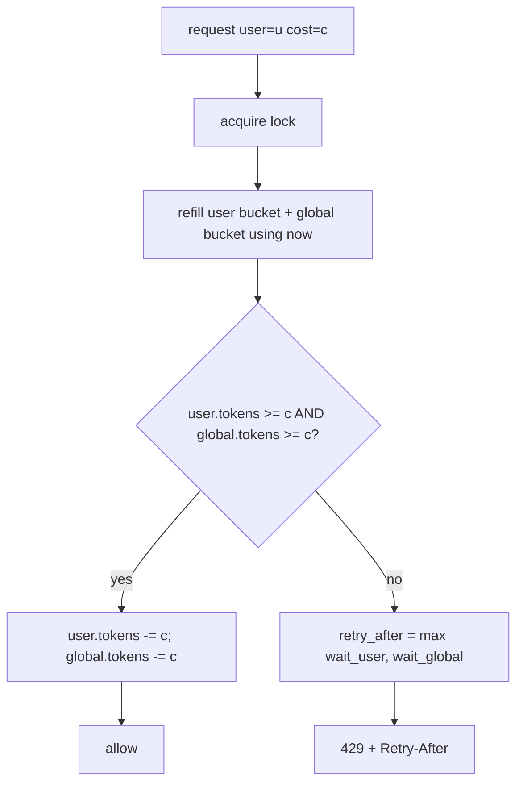

# Q24. A rate limiter with per-user and global limits.
[← Back to questions](../questions.md)

## TL;DR
- Use a **token bucket** per user plus one **global** bucket. It allows short bursts up to `capacity` and holds a steady `refill_rate`, and each bucket is O(1) memory (two floats).
- **Check both, then consume both, as one atomic step.** Refill both buckets, check that *both* can pay `cost`, and only then subtract from both. If the global bucket says no, the user's tokens stay untouched.
- Return a **Retry-After** of `max(user_wait, global_wait)`, where `wait = (cost - tokens) / refill_rate`. Map it to HTTP 429 plus a `Retry-After` header.
- Bound memory with **LRU/idle eviction** of user buckets (`OrderedDict`). An evicted user comes back with a full bucket, so set the idle TTL to at least the full-refill time.
- **Distributed:** run the same algorithm in one **Redis Lua script** (atomic and single round trip) that reads Redis `TIME`. Use hash tags for Cluster and be aware that the global key is a hot spot.
- **LLM TPM limits:** use the same buckets with `cost = estimated tokens`. Reserve `prompt + max_tokens` up front, then refund or debit the difference once the real usage is known.

## Detailed Answer

### 1. Algorithm choice

```
Fixed window          |---- 100 ----|---- 100 ----|
                      burst of 200 possible across the boundary (end of w1 + start of w2)

Sliding window log    keep timestamps of last N requests; exact, O(N) memory per user

Sliding window counter  est = cur_count + prev_count * (1 - elapsed/window)  -> O(1), approximate

Token bucket          tokens += rate * dt (capped at capacity); request costs k tokens
                      -> bursts up to capacity, long-run average = rate
```

| Algorithm | Memory / key | Burst behaviour | Accuracy | Weighted cost (LLM tokens) | Notes |
|---|---|---|---|---|---|
| Fixed window counter | 1 int + window id | 2x burst at boundary | Poor at edges | Yes (INCRBY) | Simplest; good for "1000/day" quotas |
| Sliding window log | O(requests in window) | None | Exact | Awkward | Memory grows with the limit; ZSET in Redis |
| Sliding window counter | 2 ints | Smoothed | ~approximate (Cloudflare reports <1% error) | Yes | Good default for "N per minute" |
| **Token bucket** | 2 floats | Controlled (`capacity`) | Exact for its model | **Natural** | Best fit for APIs and TPM; same thing as GCRA |
| Leaky bucket (queue) | queue | None, smooths output | Exact | Yes | Shapes traffic (adds latency) rather than rejecting |

I'd pick a **token bucket** because:
1. bursts are usually fine and users expect them,
2. variable cost (LLM tokens) is a subtraction,
3. it's O(1) and needs no background timer, since it refills lazily from elapsed time.

### 2. Hierarchical check: why it has to be atomic



A naive version calls `user.consume()` and then `global.consume()`. If the global call fails, the user has already lost tokens, and under global pressure every user drains for nothing. Another race is two threads interleaving check and consume, which overdraws the bucket. The fix is to check both and debit both inside a single critical section (or a single Lua script).

### 3. Design choices
- **Injected clock** (`time.monotonic` by default) so the code is testable and immune to wall-clock jumps.
- **Lazy refill**: no timers. Each call computes `tokens = min(cap, tokens + dt * rate)`.
- **One `threading.Lock`**: the critical section is a handful of float operations, so it doesn't block meaningfully. The same lock is safe from asyncio because nothing is awaited while it is held. For very high QPS, shard users across N locks, though the global bucket stays one contention point.
- **`OrderedDict` for LRU**: `move_to_end` on access and `popitem(last=False)` to evict, both O(1).
- **Per-user overrides** (paid tiers) through a dict of `Limit`s.
- **Refund/debit** for post-hoc token reconciliation. Buckets may go negative ("debt"), and `wait_time` handles that correctly.

Complexity: `try_acquire` is O(1) amortized. Memory is O(active users).

### 4. Implementation (thread-safe + asyncio)

```python
# rate_limiter.py
from __future__ import annotations

import asyncio
import math
import threading
import time
from collections import OrderedDict
from dataclasses import dataclass
from typing import Callable, Literal

Clock = Callable[[], float]
Scope = Literal["user", "global"]


@dataclass(frozen=True)
class Limit:
    capacity: float          # max burst
    refill_per_sec: float    # sustained rate

    def __post_init__(self) -> None:
        if self.capacity <= 0 or self.refill_per_sec < 0:
            raise ValueError("capacity must be > 0 and refill_per_sec >= 0")


@dataclass
class TokenBucket:
    capacity: float
    refill_per_sec: float
    tokens: float
    updated_at: float

    @classmethod
    def full(cls, limit: Limit, now: float) -> "TokenBucket":
        return cls(limit.capacity, limit.refill_per_sec, limit.capacity, now)

    def refill(self, now: float) -> None:
        elapsed = max(0.0, now - self.updated_at)
        self.tokens = min(self.capacity, self.tokens + elapsed * self.refill_per_sec)
        self.updated_at = now

    def wait_time(self, cost: float) -> float:
        """Seconds until `cost` tokens are available (assumes refill() was just called)."""
        if self.tokens >= cost:
            return 0.0
        if self.refill_per_sec <= 0:
            return math.inf
        return (cost - self.tokens) / self.refill_per_sec


@dataclass(frozen=True)
class Decision:
    allowed: bool
    retry_after: float              # seconds; 0 if allowed, inf if never satisfiable
    limited_by: Scope | None
    user_remaining: float
    global_remaining: float

    def headers(self) -> dict[str, str]:
        h = {"X-RateLimit-Remaining": str(int(max(0.0, self.user_remaining)))}
        if not self.allowed and math.isfinite(self.retry_after):
            h["Retry-After"] = str(math.ceil(self.retry_after))
        return h


class RateLimitExceeded(Exception):
    def __init__(self, decision: Decision) -> None:
        super().__init__(f"rate limited by {decision.limited_by}, retry after {decision.retry_after:.3f}s")
        self.decision = decision


class HierarchicalRateLimiter:
    """Per-user token buckets + one global bucket, debited atomically."""

    def __init__(
        self,
        user_limit: Limit,
        global_limit: Limit,
        *,
        max_users: int = 100_000,
        idle_ttl: float | None = None,
        user_overrides: dict[str, Limit] | None = None,
        clock: Clock = time.monotonic,
    ) -> None:
        if max_users < 1:
            raise ValueError("max_users must be >= 1")
        self._user_limit = user_limit
        self._overrides = dict(user_overrides or {})
        self._clock = clock
        self._max_users = max_users
        # Default idle TTL = time to refill fully; evicting earlier would hand out free tokens.
        if idle_ttl is None:
            idle_ttl = (user_limit.capacity / user_limit.refill_per_sec
                        if user_limit.refill_per_sec > 0 else math.inf)
        self._idle_ttl = idle_ttl
        self._global = TokenBucket.full(global_limit, clock())
        self._users: OrderedDict[str, TokenBucket] = OrderedDict()
        self._lock = threading.Lock()

    # ---------- internals (call with lock held) ----------
    def _user_bucket(self, user_id: str, now: float) -> TokenBucket:
        bucket = self._users.get(user_id)
        if bucket is not None:
            self._users.move_to_end(user_id)
            return bucket
        limit = self._overrides.get(user_id, self._user_limit)
        bucket = TokenBucket.full(limit, now)
        self._users[user_id] = bucket
        self._evict(now)
        return bucket

    def _evict(self, now: float) -> None:
        while len(self._users) > self._max_users:          # size-based LRU
            self._users.popitem(last=False)
        while self._users:                                  # idle-based (oldest first)
            _, oldest = next(iter(self._users.items()))
            if now - oldest.updated_at > self._idle_ttl:
                self._users.popitem(last=False)
            else:
                break

    # ---------- public API ----------
    def try_acquire(self, user_id: str, cost: float = 1.0) -> Decision:
        if cost <= 0:
            raise ValueError("cost must be > 0")
        with self._lock:
            now = self._clock()
            ub = self._user_bucket(user_id, now)
            gb = self._global
            ub.refill(now)
            gb.refill(now)

            if cost > ub.capacity or cost > gb.capacity:    # can never succeed
                scope: Scope = "user" if cost > ub.capacity else "global"
                return Decision(False, math.inf, scope, ub.tokens, gb.tokens)

            uw, gw = ub.wait_time(cost), gb.wait_time(cost)
            if uw == 0.0 and gw == 0.0:
                ub.tokens -= cost
                gb.tokens -= cost
                return Decision(True, 0.0, None, ub.tokens, gb.tokens)

            # Reject WITHOUT touching either bucket.
            scope = "user" if uw >= gw else "global"
            return Decision(False, max(uw, gw), scope, ub.tokens, gb.tokens)

    def adjust(self, user_id: str, delta: float) -> None:
        """Reconcile actual usage: delta > 0 refunds tokens, delta < 0 debits (may go negative)."""
        with self._lock:
            now = self._clock()
            ub = self._user_bucket(user_id, now)
            for b in (ub, self._global):
                b.refill(now)
                b.tokens = min(b.capacity, b.tokens + delta)

    async def acquire(self, user_id: str, cost: float = 1.0, timeout: float | None = None) -> Decision:
        """Wait (non-blocking for the event loop) until allowed, or raise RateLimitExceeded."""
        loop = asyncio.get_running_loop()
        deadline = None if timeout is None else loop.time() + timeout
        while True:
            d = self.try_acquire(user_id, cost)
            if d.allowed:
                return d
            if math.isinf(d.retry_after):
                raise RateLimitExceeded(d)
            if deadline is not None and loop.time() + d.retry_after > deadline:
                raise RateLimitExceeded(d)
            # Global wait is a lower bound (others may consume), hence the loop.
            await asyncio.sleep(d.retry_after)

    def __len__(self) -> int:
        with self._lock:
            return len(self._users)
```

### 5. Wiring into an HTTP service (FastAPI)

```python
from fastapi import FastAPI, Request
from fastapi.responses import JSONResponse

app = FastAPI()
limiter = HierarchicalRateLimiter(Limit(20, 2), Limit(1000, 200))

@app.middleware("http")
async def rate_limit(request: Request, call_next):
    user = request.headers.get("X-API-Key") or request.client.host
    d = limiter.try_acquire(user)
    if not d.allowed:
        return JSONResponse({"error": "rate_limited", "scope": d.limited_by},
                            status_code=429, headers=d.headers())
    resp = await call_next(request)
    resp.headers.update(d.headers())
    return resp
```

### 6. Tests (pytest)

```python
# test_rate_limiter.py
import math
import threading
import pytest
from rate_limiter import HierarchicalRateLimiter, Limit


class FakeClock:
    def __init__(self) -> None:
        self.t = 0.0
    def __call__(self) -> float:
        return self.t
    def advance(self, dt: float) -> None:
        self.t += dt


def make(user=Limit(3, 1), glob=Limit(100, 100), **kw):
    clock = FakeClock()
    return HierarchicalRateLimiter(user, glob, clock=clock, **kw), clock


def test_burst_then_reject_then_refill():
    rl, clock = make()
    assert all(rl.try_acquire("a").allowed for _ in range(3))
    d = rl.try_acquire("a")
    assert not d.allowed and d.limited_by == "user"
    assert d.retry_after == pytest.approx(1.0)
    clock.advance(1.0)
    assert rl.try_acquire("a").allowed


def test_retry_after_fractional_rate():
    rl, _ = make(user=Limit(1, 0.5))
    assert rl.try_acquire("a").allowed
    assert rl.try_acquire("a").retry_after == pytest.approx(2.0)


def test_global_rejection_does_not_consume_user_tokens():
    rl, clock = make(user=Limit(10, 1), glob=Limit(2, 1))
    assert rl.try_acquire("a").allowed
    assert rl.try_acquire("b").allowed
    d = rl.try_acquire("a")                      # global is empty
    assert not d.allowed and d.limited_by == "global"
    assert d.user_remaining == pytest.approx(9)  # unchanged by the rejection
    clock.advance(1.0)
    d = rl.try_acquire("a")
    assert d.allowed and d.user_remaining == pytest.approx(9)  # 9 + 1 refill - 1


def test_isolation_between_users():
    rl, _ = make()
    for _ in range(3):
        rl.try_acquire("a")
    assert not rl.try_acquire("a").allowed
    assert rl.try_acquire("b").allowed


def test_cost_larger_than_capacity_never_allowed():
    rl, _ = make()
    d = rl.try_acquire("a", cost=5)
    assert not d.allowed and math.isinf(d.retry_after)


def test_lru_eviction_by_size():
    rl, _ = make(max_users=2)
    rl.try_acquire("a"); rl.try_acquire("b"); rl.try_acquire("c")
    assert len(rl) == 2  # "a" evicted


def test_idle_eviction():
    rl, clock = make(user=Limit(3, 1))  # idle_ttl defaults to 3s
    rl.try_acquire("a")
    clock.advance(10)
    rl.try_acquire("b")
    assert len(rl) == 1


def test_adjust_refund_and_debt():
    rl, clock = make(user=Limit(10, 1))
    rl.try_acquire("a", cost=10)
    rl.adjust("a", -5)                      # actual usage exceeded estimate -> debt
    d = rl.try_acquire("a")
    assert not d.allowed and d.retry_after == pytest.approx(6.0)
    rl.adjust("a", 6)
    assert rl.try_acquire("a").allowed


def test_thread_safety_global_never_overdrawn():
    rl, _ = make(user=Limit(1_000_000, 0), glob=Limit(100, 0))
    allowed = []
    lock = threading.Lock()
    def worker(uid: str) -> None:
        n = sum(rl.try_acquire(uid).allowed for _ in range(100))
        with lock:
            allowed.append(n)
    threads = [threading.Thread(target=worker, args=(f"u{i % 5}",)) for i in range(50)]
    for t in threads: t.start()
    for t in threads: t.join()
    assert sum(allowed) == 100


def test_async_acquire_waits():
    import asyncio
    rl = HierarchicalRateLimiter(Limit(1, 50), Limit(100, 100))  # real clock, 20ms refill
    async def main():
        await rl.acquire("a")
        d = await rl.acquire("a", timeout=1.0)
        assert d.allowed
    asyncio.run(main())
```

### 7. Walkthrough (user cap 10 at 1/s, global cap 2 at 1/s)
1. t=0: A takes 1 (user A=9, global=1). B takes 1 (B=9, global=0).
2. A again. After refill, user A=9 and global=0. The user check passes but the global check fails, so the request is rejected with `limited_by="global"` and `retry_after=1.0`. A still has 9.
3. t=1: global refills to 1 and A to 10 (capped). Both checks pass and both are debited, leaving A=9 and global=0.

### 8. Distributed version: Redis + Lua

Several app replicas need shared state. A Lua script runs atomically on the Redis server: no other command can interleave, and the whole check costs one round trip.

```lua
-- KEYS[1] = user bucket, KEYS[2] = global bucket
-- ARGV = user_cap, user_rate, global_cap, global_rate, cost, ttl_ms
local t = redis.call('TIME')                         -- server clock: no client skew
local now = tonumber(t[1]) + tonumber(t[2]) / 1000000

local function load(key, cap, rate)
  local v = redis.call('HMGET', key, 'tokens', 'ts')
  local tokens, ts = tonumber(v[1]), tonumber(v[2])
  if tokens == nil then return cap end
  return math.min(cap, tokens + math.max(0, now - ts) * rate)
end

local ucap, urate = tonumber(ARGV[1]), tonumber(ARGV[2])
local gcap, grate = tonumber(ARGV[3]), tonumber(ARGV[4])
local cost, ttl   = tonumber(ARGV[5]), tonumber(ARGV[6])

local ut = load(KEYS[1], ucap, urate)
local gt = load(KEYS[2], gcap, grate)
local allowed, retry = 0, 0

if ut >= cost and gt >= cost then
  allowed = 1
  ut = ut - cost
  gt = gt - cost
else
  local uw, gw = 0, 0
  if ut < cost then uw = (cost - ut) / urate end
  if gt < cost then gw = (cost - gt) / grate end
  retry = math.max(uw, gw)
end

redis.call('HSET', KEYS[1], 'tokens', ut, 'ts', now)
redis.call('PEXPIRE', KEYS[1], ttl)                  -- idle users vanish = free eviction
redis.call('HSET', KEYS[2], 'tokens', gt, 'ts', now)
-- Lua numbers are truncated to integers on return, so stringify floats.
return {allowed, tostring(retry), tostring(ut), tostring(gt)}
```

```python
import redis.asyncio as redis

class RedisRateLimiter:
    def __init__(self, r: redis.Redis, lua_src: str, user: Limit, glob: Limit, prefix="{rl}"):
        self._script = r.register_script(lua_src)    # EVALSHA with auto-reload on NOSCRIPT
        self._user, self._glob, self._p = user, glob, prefix

    async def try_acquire(self, user_id: str, cost: float = 1.0) -> Decision:
        ttl_ms = int(1000 * max(1.0, self._user.capacity / max(self._user.refill_per_sec, 1e-9)))
        allowed, retry, ut, gt = await self._script(
            keys=[f"{self._p}:user:{user_id}", f"{self._p}:global"],
            args=[self._user.capacity, self._user.refill_per_sec,
                  self._glob.capacity, self._glob.refill_per_sec, cost, ttl_ms],
        )
        return Decision(bool(int(allowed)), float(retry),
                        None if int(allowed) else "user", float(ut), float(gt))
```

Production points:
- **Redis Cluster:** every key a script touches must hash to the same slot, which is what the `{rl}` hash tag guarantees. The cost is that every key then sits on one shard. The global key is a single hot key no matter what, so beyond about 50-100k ops/s use one of these:
  - shard the global budget into N sub-buckets (`{rl:3}:global`, each holding `cap/N`) and route each user to the same shard as their user key;
  - **local leasing**: each replica takes batches of global tokens (for example 100 at a time) and spends them in memory.
- **Fail open or closed:** if Redis is down, fail open with a conservative local in-memory limiter as backup (an availability choice), or fail closed for cost-sensitive LLM spend.
- Read the time from `TIME` on the server, not from clients, because clients' clocks skew.

### 9. LLM tokens-per-minute (TPM) limits

Providers enforce both RPM and TPM, so use two limiters, or one limiter per dimension:

```python
async def call_llm(user: str, prompt: str, max_tokens: int):
    est = count_tokens(prompt) + max_tokens               # worst case reservation
    await rpm.acquire(user, 1)
    await tpm.acquire(user, est)
    resp = await client.chat(prompt, max_tokens=max_tokens)
    actual = resp.usage.prompt_tokens + resp.usage.completion_tokens
    tpm.adjust(user, est - actual)                         # refund unused (or debit overage)
    return resp
```
- Configure TPM as `Limit(capacity=tpm_budget, refill_per_sec=tpm_budget/60)`.
- With streaming, reconcile at the end of the stream. If the stream is cancelled, refund using the tokens actually produced.
- Keep a separate *global* bucket per **upstream model deployment**, because the provider limits you per deployment and per key. A request may need `{user, tenant, model-deployment}`, which is three levels and still a single atomic check.

## Common Pitfalls
- Consuming the user bucket before checking the global one. That drains users during global saturation.
- Check-then-act outside a lock, or in two Redis round trips (GET then SET), which races and overdraws. Use Lua or `MULTI` with `WATCH`.
- Using `time.time()` in-process. NTP jumps break refill. Use `monotonic` locally and Redis `TIME` when distributed.
- Evicting idle buckets before they would have fully refilled. An attacker can churn users to evict their own bucket and get a free reset.
- Unbounded per-user dicts (keyed by IP), which become a memory DoS. Bound them with LRU or TTL.
- Returning Lua floats as numbers, which Redis truncates to integers.
- Sending `Retry-After: 0.3`. The header takes integer seconds or an HTTP date, so use `ceil`.
- `cost > capacity` that loops forever in `acquire`. Detect it and reject.
- A fixed window for per-minute limits, which permits a 2x burst at the window edge.
- Sleeping with `time.sleep` inside async code, which blocks the event loop.

## Likely Follow-up Questions
1. **How do you scale beyond a single Redis key for the global limit?**
   Shard the global bucket into N slices, or have each app instance lease tokens in batches and spend them locally. You trade some precision for throughput.
2. **Token bucket vs GCRA?**
   GCRA stores one timestamp (the "theoretical arrival time") instead of tokens plus a timestamp, and behaves the same as a token bucket. redis-cell and Stripe-style limiters use it. It's slightly cheaper but harder to explain.
3. **How do you rate-limit fairly when the global budget is the bottleneck?**
   Add weighted fair queueing: per-tenant queues, round-robin or deficit round robin when draining global tokens. Or give each tenant a guaranteed slice plus a shared burst pool.
4. **Multiple limits per user (per-second and per-day)?**
   Keep several buckets per key and run the same check-all-then-debit-all, with Retry-After as the max of the waits. The daily quota is usually a fixed window counter with `EXPIRE` at midnight UTC.
5. **Client side: what should callers do with 429?**
   Honour `Retry-After`, add jitter, and cap total retries (see Q25). Client-side pacing with the same token bucket avoids 429s altogether.
6. **How do you test a distributed limiter?**
   Use a fake clock for unit tests. For integration, run the Lua script against real Redis (testcontainers) with concurrent clients, and assert allowed ≤ capacity + rate·elapsed.

[← Back to questions](../questions.md)
