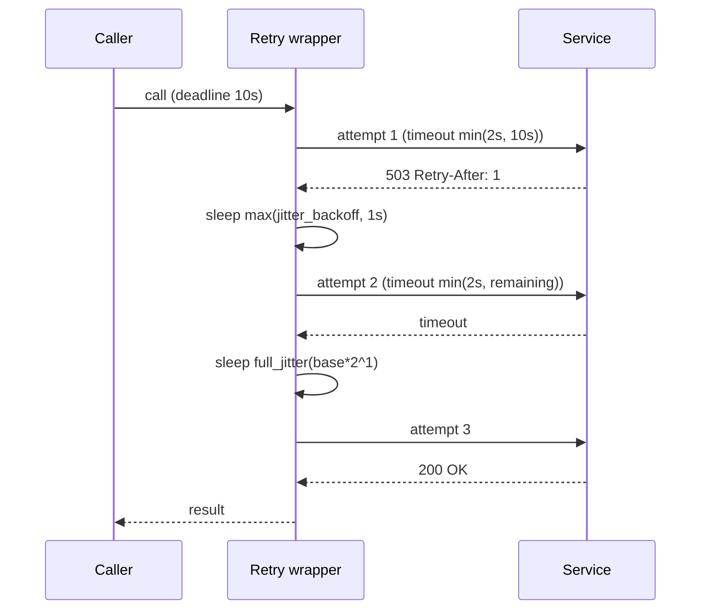

# Q25. Async retries with backoff, jitter, and timeouts.
[← Back to questions](../questions.md)

## TL;DR
- Retry **only transient failures**: timeouts, connection errors, 408/425/429/5xx. Fail fast on 400/401/403/404/422, because retrying those wastes money and hides bugs.
- **Exponential backoff with jitter**, for example *full jitter*: `sleep = uniform(0, min(cap, base * 2**n))`. Jitter de-synchronizes clients so they don't form a thundering herd.
- **Two timeouts**: a *per-attempt* timeout so one slow call can't eat the budget, and an *overall deadline* that bounds total latency. Each attempt gets `min(per_attempt, remaining)` through `asyncio.timeout()`.
- **Honour `Retry-After`** (429/503). The server knows better than your backoff formula.
- Retrying a **non-idempotent** call needs an **idempotency key**, generated once and reused across attempts.
- Protect the system as a whole with a **retry budget** (for example retries ≤ 10% of requests) and a **circuit breaker**. Retries that multiply across layers turn a blip into an outage. In production, `tenacity` covers most of this.

## Detailed Answer

### 1. Why each piece exists



| Concern | Mechanism | Without it |
|---|---|---|
| Transient blips | Retry | Users see errors that a second try would have fixed |
| Overloaded server | Exponential backoff | Retries hammer a struggling server |
| Many clients failing together | Jitter | Synchronized retry waves (thundering herd) |
| Hung connection | Per-attempt timeout | One attempt consumes the whole budget |
| User-facing latency SLO | Overall deadline | Retries stack past the SLO (5 x 30s = 150s) |
| Server-directed pacing | Retry-After | You keep getting 429 and get banned or throttled harder |
| Duplicate side effects | Idempotency key | A double charge or duplicated ticket when the first attempt succeeded but its response was lost |
| Retry amplification | Retry budget | 3 layers x 3 retries = 27x load during an incident |
| Persistent outage | Circuit breaker | Every request pays full timeout latency before failing |

### 2. Jitter strategies (from AWS's "Exponential Backoff and Jitter" article)

Let `exp(n) = min(cap, base * 2**n)` for retry number `n = 0, 1, 2…`.

| Strategy | Formula | Properties |
|---|---|---|
| None | `exp(n)` | Synchronized waves. Avoid. |
| **Full** | `uniform(0, exp(n))` | Lowest total work in AWS simulations. Good default. |
| Equal | `exp(n)/2 + uniform(0, exp(n)/2)` | Guarantees a minimum wait. Slightly more work. |
| Decorrelated | `min(cap, uniform(base, prev*3))` | Grows from the previous sleep and spreads well. Needs state. |

```
attempt:   0      1       2         3            4
no jitter: |.1|   |.2|    |.4|      |.8|         |1.6|     <- everyone at the same instant
full:      [0,.1] [0,.2]  [0,.4]    [0,.8]       [0,1.6]   <- spread uniformly
equal:     [.05,.1][.1,.2][.2,.4]   [.4,.8]      [.8,1.6]
```

### 3. Per-attempt timeout vs overall deadline
- `asyncio.timeout(delay)` (Python 3.11+) cancels the inner task and raises `TimeoutError`. `asyncio.timeout(None)` means no limit. On 3.10 and older, use `asyncio.wait_for(coro, timeout)`.
- Each attempt's timeout is `min(per_attempt_timeout, deadline - now)`.
- Before sleeping, check `now + delay < deadline`. If it isn't, give up now instead of sleeping and then failing.
- Never swallow `CancelledError`. If the *caller* cancels, stop retrying. `asyncio.timeout` turns its *own* cancellation into `TimeoutError`, so the two are distinguishable.
- Propagate the deadline downstream (a gRPC deadline header, or `timeout=` on nested calls) so lower layers don't keep working after the caller has given up.

### 4. Implementation

```python
# retry.py
from __future__ import annotations

import asyncio
import email.utils
import functools
import random
import time
from dataclasses import dataclass, field
from datetime import datetime, timezone
from enum import Enum
from typing import Any, Awaitable, Callable, Literal, ParamSpec, TypeVar

P = ParamSpec("P")
T = TypeVar("T")
Jitter = Literal["none", "full", "equal", "decorrelated"]

RETRYABLE_STATUS = frozenset({408, 425, 429, 500, 502, 503, 504})


class DeadlineExceeded(TimeoutError):
    """Overall retry deadline exhausted."""


class RetryBudgetExhausted(Exception):
    pass


class CircuitOpenError(Exception):
    def __init__(self, retry_after: float) -> None:
        super().__init__(f"circuit open, retry after {retry_after:.2f}s")
        self.retry_after = retry_after


# ---------------- classification ----------------
def default_is_retryable(exc: BaseException) -> bool:
    if isinstance(exc, (CircuitOpenError, RetryBudgetExhausted)):
        return False
    if isinstance(exc, (TimeoutError, ConnectionError)):
        return True
    status = getattr(exc, "status_code", None) or getattr(exc, "status", None)
    return isinstance(status, int) and status in RETRYABLE_STATUS


def parse_retry_after(value: str | None, now: float | None = None) -> float | None:
    """Retry-After is either delta-seconds or an HTTP-date."""
    if not value:
        return None
    value = value.strip()
    if value.isdigit():
        return float(value)
    try:
        dt = email.utils.parsedate_to_datetime(value)
    except (TypeError, ValueError):
        return None
    if dt.tzinfo is None:
        dt = dt.replace(tzinfo=timezone.utc)
    now = time.time() if now is None else now
    return max(0.0, dt.timestamp() - now)


def retry_after_of(exc: BaseException) -> float | None:
    ra = getattr(exc, "retry_after", None)
    if isinstance(ra, (int, float)):
        return float(ra)
    headers = getattr(getattr(exc, "response", None), "headers", None)
    if headers is not None:
        return parse_retry_after(headers.get("retry-after"))
    return None


# ---------------- backoff ----------------
def compute_backoff(n: int, base: float, cap: float, jitter: Jitter,
                    prev: float, rng: random.Random) -> float:
    exp = min(cap, base * (2 ** min(n, 62)))
    if jitter == "none":
        return exp
    if jitter == "full":
        return rng.uniform(0, exp)
    if jitter == "equal":
        return exp / 2 + rng.uniform(0, exp / 2)
    if jitter == "decorrelated":
        return min(cap, rng.uniform(base, max(base, prev * 3)))
    raise ValueError(f"unknown jitter {jitter}")


# ---------------- retry budget ----------------
class RetryBudget:
    """Token bucket: each first attempt deposits `ratio`, each retry withdraws 1."""

    def __init__(self, ratio: float = 0.1, min_tokens: float = 10.0, max_tokens: float = 100.0) -> None:
        self.ratio, self.max_tokens = ratio, max_tokens
        self.tokens = min_tokens

    def on_request(self) -> None:
        self.tokens = min(self.max_tokens, self.tokens + self.ratio)

    def try_spend(self) -> bool:
        if self.tokens >= 1:
            self.tokens -= 1
            return True
        return False


# ---------------- circuit breaker ----------------
class State(Enum):
    CLOSED = "closed"
    OPEN = "open"
    HALF_OPEN = "half_open"


class CircuitBreaker:
    def __init__(self, failure_threshold: int = 5, recovery_timeout: float = 30.0,
                 half_open_max_calls: int = 1, clock: Callable[[], float] = time.monotonic) -> None:
        self.failure_threshold = failure_threshold
        self.recovery_timeout = recovery_timeout
        self.half_open_max_calls = half_open_max_calls
        self._clock = clock
        self.state = State.CLOSED
        self._failures = 0
        self._opened_at = 0.0
        self._half_open_inflight = 0

    def before_call(self) -> None:
        if self.state is State.OPEN:
            elapsed = self._clock() - self._opened_at
            if elapsed < self.recovery_timeout:
                raise CircuitOpenError(self.recovery_timeout - elapsed)
            self.state, self._half_open_inflight = State.HALF_OPEN, 0
        if self.state is State.HALF_OPEN:
            if self._half_open_inflight >= self.half_open_max_calls:
                raise CircuitOpenError(self.recovery_timeout)
            self._half_open_inflight += 1

    def on_success(self) -> None:
        self.state, self._failures, self._half_open_inflight = State.CLOSED, 0, 0

    def on_failure(self) -> None:
        if self.state is State.HALF_OPEN:
            self._open()
            return
        self._failures += 1
        if self._failures >= self.failure_threshold:
            self._open()

    def _open(self) -> None:
        self.state, self._opened_at, self._half_open_inflight = State.OPEN, self._clock(), 0


# ---------------- policy + decorator ----------------
@dataclass
class RetryPolicy:
    max_attempts: int = 5
    base_delay: float = 0.2
    max_delay: float = 10.0
    jitter: Jitter = "full"
    per_attempt_timeout: float | None = 10.0
    deadline: float | None = 30.0                  # overall, seconds
    max_retry_after: float = 60.0                  # give up if server asks for longer
    is_retryable: Callable[[BaseException], bool] = default_is_retryable
    budget: RetryBudget | None = None
    breaker: CircuitBreaker | None = None
    on_retry: Callable[[int, BaseException, float], None] | None = None
    sleep: Callable[[float], Awaitable[Any]] = asyncio.sleep
    rng: random.Random = field(default_factory=random.Random)


def retry_async(policy: RetryPolicy | None = None) -> Callable[[Callable[P, Awaitable[T]]], Callable[P, Awaitable[T]]]:
    policy = policy or RetryPolicy()

    def decorator(fn: Callable[P, Awaitable[T]]) -> Callable[P, Awaitable[T]]:
        @functools.wraps(fn)
        async def wrapper(*args: P.args, **kwargs: P.kwargs) -> T:
            loop = asyncio.get_running_loop()
            end = None if policy.deadline is None else loop.time() + policy.deadline
            prev_delay = policy.base_delay
            if policy.budget:
                policy.budget.on_request()

            for attempt in range(1, policy.max_attempts + 1):
                remaining = None if end is None else end - loop.time()
                if remaining is not None and remaining <= 0:
                    raise DeadlineExceeded(f"deadline exceeded before attempt {attempt}")
                timeout = (remaining if policy.per_attempt_timeout is None
                           else policy.per_attempt_timeout if remaining is None
                           else min(policy.per_attempt_timeout, remaining))
                try:
                    if policy.breaker:
                        policy.breaker.before_call()
                    async with asyncio.timeout(timeout):
                        result = await fn(*args, **kwargs)
                except Exception as exc:          # CancelledError is BaseException -> propagates
                    retryable = policy.is_retryable(exc)
                    if policy.breaker and not isinstance(exc, CircuitOpenError):
                        if retryable:
                            policy.breaker.on_failure()  # count only transient/server-side failures
                        else:
                            policy.breaker.on_success()  # server answered (e.g. 404): it's healthy
                    if not retryable or attempt == policy.max_attempts:
                        raise
                    delay = compute_backoff(attempt - 1, policy.base_delay, policy.max_delay,
                                            policy.jitter, prev_delay, policy.rng)
                    server_hint = retry_after_of(exc)
                    if server_hint is not None:
                        if server_hint > policy.max_retry_after:
                            raise
                        delay = max(delay, server_hint)
                    prev_delay = delay
                    if end is not None and loop.time() + delay >= end:
                        raise DeadlineExceeded("no time left for another attempt") from exc
                    if policy.budget and not policy.budget.try_spend():
                        raise RetryBudgetExhausted("retry budget exhausted") from exc
                    if policy.on_retry:
                        policy.on_retry(attempt, exc, delay)
                    await policy.sleep(delay)
                else:
                    if policy.breaker:
                        policy.breaker.on_success()
                    return result
            raise AssertionError("unreachable")

        return wrapper

    return decorator
```

Notes on the code:
- `except Exception` deliberately does **not** catch `asyncio.CancelledError`, which has been a `BaseException` since 3.8, so caller cancellation stops the loop right away.
- An attempt that hits its timeout shows up as `TimeoutError`, which is retryable. If the *deadline* caused it, the next check raises `DeadlineExceeded`.
- `sleep` and `rng` are injectable, which makes tests fast and deterministic.

### 5. Idempotency keys

```python
import uuid
import httpx

class HTTPStatusError(Exception):
    def __init__(self, status_code: int, retry_after: float | None = None) -> None:
        super().__init__(f"HTTP {status_code}")
        self.status_code, self.retry_after = status_code, retry_after

@retry_async(RetryPolicy(max_attempts=4, per_attempt_timeout=5, deadline=20))
async def create_payment(client: httpx.AsyncClient, body: dict, idem_key: str) -> dict:
    r = await client.post("/payments", json=body, headers={"Idempotency-Key": idem_key})
    if r.status_code >= 400:
        raise HTTPStatusError(r.status_code, parse_retry_after(r.headers.get("retry-after")))
    return r.json()

# key generated ONCE, outside the retry loop -> every attempt carries the same key
await create_payment(client, {"amount": 100}, idem_key=str(uuid.uuid4()))
```
The server stores `(key -> response)` for about 24h. A replayed key returns the stored response instead of performing the action again. Without the key, retry only GET/PUT/DELETE, which are idempotent by HTTP semantics.

### 6. Tests (pytest, no plugin needed)

```python
# test_retry.py
import asyncio
import random
import pytest
from retry import (CircuitBreaker, CircuitOpenError, DeadlineExceeded, RetryBudget,
                   RetryBudgetExhausted, RetryPolicy, State, compute_backoff,
                   parse_retry_after, retry_async)


class Transient(ConnectionError): ...
class Fatal(ValueError): ...
class Throttled(Exception):
    status_code = 429
    def __init__(self, retry_after: float) -> None:
        self.retry_after = retry_after


def policy(**kw) -> tuple[RetryPolicy, list[float]]:
    delays: list[float] = []
    async def fake_sleep(d: float) -> None:
        delays.append(d)
    base = dict(base_delay=0.1, max_delay=5, deadline=None, per_attempt_timeout=None,
                sleep=fake_sleep, rng=random.Random(0))
    base.update(kw)
    return RetryPolicy(**base), delays


def test_succeeds_after_transient_failures():
    p, delays = policy()
    calls = 0
    @retry_async(p)
    async def f():
        nonlocal calls
        calls += 1
        if calls < 3:
            raise Transient()
        return "ok"
    assert asyncio.run(f()) == "ok"
    assert calls == 3 and len(delays) == 2


def test_non_retryable_raises_immediately():
    p, delays = policy()
    calls = 0
    @retry_async(p)
    async def f():
        nonlocal calls
        calls += 1
        raise Fatal()
    with pytest.raises(Fatal):
        asyncio.run(f())
    assert calls == 1 and delays == []


def test_exhausts_attempts_and_reraises_last():
    p, delays = policy(max_attempts=3)
    @retry_async(p)
    async def f():
        raise Transient()
    with pytest.raises(Transient):
        asyncio.run(f())
    assert len(delays) == 2


def test_honours_retry_after():
    p, delays = policy(max_attempts=2)
    @retry_async(p)
    async def f():
        if not delays:
            raise Throttled(2.0)
        return 1
    assert asyncio.run(f()) == 1
    assert delays[0] >= 2.0


def test_retry_after_too_long_gives_up():
    p, _ = policy(max_retry_after=1.0)
    @retry_async(p)
    async def f():
        raise Throttled(30)
    with pytest.raises(Throttled):
        asyncio.run(f())


def test_per_attempt_timeout_then_success():
    calls = 0
    @retry_async(RetryPolicy(base_delay=0.001, per_attempt_timeout=0.05, deadline=2))
    async def f():
        nonlocal calls
        calls += 1
        if calls == 1:
            await asyncio.sleep(1)       # hangs -> cancelled by per-attempt timeout
        return "ok"
    assert asyncio.run(f()) == "ok" and calls == 2


def test_overall_deadline():
    @retry_async(RetryPolicy(base_delay=0.01, per_attempt_timeout=10, deadline=0.1))
    async def f():
        await asyncio.sleep(1)
    with pytest.raises(TimeoutError):    # DeadlineExceeded subclasses TimeoutError
        asyncio.run(f())


def test_caller_cancellation_is_not_retried():
    calls = 0
    @retry_async(RetryPolicy(per_attempt_timeout=None, deadline=None))
    async def f():
        nonlocal calls
        calls += 1
        await asyncio.sleep(10)
    async def main():
        t = asyncio.create_task(f())
        await asyncio.sleep(0.01)
        t.cancel()
        with pytest.raises(asyncio.CancelledError):
            await t
    asyncio.run(main())
    assert calls == 1


@pytest.mark.parametrize("n", range(6))
def test_jitter_bounds(n):
    rng = random.Random(42)
    exp = min(5, 0.1 * 2 ** n)
    for _ in range(200):
        assert 0 <= compute_backoff(n, 0.1, 5, "full", 0.1, rng) <= exp
        assert exp / 2 <= compute_backoff(n, 0.1, 5, "equal", 0.1, rng) <= exp
        d = compute_backoff(n, 0.1, 5, "decorrelated", 0.4, rng)
        assert 0.1 <= d <= min(5, 1.2)


def test_parse_retry_after():
    assert parse_retry_after("7") == 7.0
    assert parse_retry_after("Wed, 21 Oct 2015 07:28:00 GMT", now=1445412470.0) == pytest.approx(10.0)
    assert parse_retry_after("garbage") is None


def test_circuit_breaker_opens_and_half_opens():
    t = [0.0]
    cb = CircuitBreaker(failure_threshold=2, recovery_timeout=5, clock=lambda: t[0])
    for _ in range(2):
        cb.before_call(); cb.on_failure()
    assert cb.state is State.OPEN
    with pytest.raises(CircuitOpenError):
        cb.before_call()
    t[0] = 6
    cb.before_call()                       # probe allowed
    assert cb.state is State.HALF_OPEN
    with pytest.raises(CircuitOpenError):
        cb.before_call()                   # only one probe at a time
    cb.on_success()
    assert cb.state is State.CLOSED


def test_retry_budget_exhaustion():
    p, _ = policy(budget=RetryBudget(ratio=0.0, min_tokens=1))
    @retry_async(p)
    async def f():
        raise Transient()
    with pytest.raises(RetryBudgetExhausted):
        asyncio.run(f())                   # 1 retry allowed, second retry refused
```

Walkthrough of `test_overall_deadline`: attempt 1 gets `timeout = min(10, 0.1) = 0.1`, the function sleeps for 1s, and `asyncio.timeout` raises `TimeoutError` at 0.1s. That error is retryable. Backoff is about 0.005s, but `now + delay >= end`, so the wrapper raises `DeadlineExceeded` without sleeping. Total time is about 0.1s.

### 7. tenacity equivalent

```python
from tenacity import (AsyncRetrying, RetryError, retry, retry_if_exception, stop_after_attempt,
                      stop_after_delay, wait_random_exponential, before_sleep_log)

def wait_with_retry_after(fallback):
    def _wait(rs):
        exc = rs.outcome.exception()
        hint = retry_after_of(exc) if exc else None
        return max(fallback(rs), hint or 0)
    return _wait

@retry(
    stop=stop_after_attempt(5) | stop_after_delay(30),            # attempts OR overall deadline
    wait=wait_with_retry_after(wait_random_exponential(multiplier=0.2, max=10)),  # full jitter
    retry=retry_if_exception(default_is_retryable),
    reraise=True,                                                  # raise original, not RetryError
    before_sleep=before_sleep_log(logger, logging.WARNING),
)
async def call_llm(prompt: str) -> str:
    async with asyncio.timeout(10):                                # per-attempt timeout
        return await client.complete(prompt)
```
- `wait_exponential_jitter` gives exponential plus additive jitter. `wait_random_exponential` is AWS full jitter.
- `stop_after_delay` is checked *between* attempts. It doesn't cancel an attempt in flight, which is why the per-attempt `asyncio.timeout` is still needed.
- The OpenAI and Anthropic SDKs already retry internally (`max_retries=2` by default, honouring `retry-after`). Set `max_retries=0` if you wrap them yourself, or the retries multiply.

## Common Pitfalls
- Retrying everything, including 400/401/422 and `KeyError` bugs. Use an explicit retryable allowlist.
- No jitter, so 10k clients retry at the same instant after an outage.
- Only a per-attempt timeout. Five attempts of 30s give a 2.5-minute request that the user abandoned long ago.
- Catching `BaseException` or `CancelledError`, which makes the task uncancellable and breaks graceful shutdown.
- Sleeping past the deadline before giving up.
- Generating the idempotency key *inside* the retried function, so each attempt is a new operation.
- Nested retries (SDK, your wrapper, the service mesh) multiply load. Retry at one layer, usually the outermost one that knows the deadline.
- Counting client errors (4xx) as circuit-breaker failures. One bad caller opens the circuit for everyone.
- `time.sleep` in async code, which blocks the event loop.
- Not logging or metering retries. Rising retry rates are an early warning, so emit `attempt`, `delay`, and `exception type`.

## Likely Follow-up Questions
1. **Retry in a streaming LLM response that fails midway?**
   Retrying the whole request duplicates output already shown. Either buffer and retry only when no tokens have been emitted yet, or resume with "continue from: …" and accept that it is imperfect. Make the stream consumer deduplicate.
2. **How do you choose base, cap, and attempts?**
   Work backwards from the latency SLO and the downstream recovery time. For example a 30s deadline, base 0.2–0.5s, cap 10s, 3–5 attempts. Use p99 attempt latency to set the per-attempt timeout (around 2–3x p99).
3. **Hedged requests vs retries?**
   Hedging sends a second request after a p95 delay *without* cancelling the first, which cuts tail latency for idempotent reads at the cost of extra load. Pair it with a budget.
4. **Distributed circuit breaker?**
   Breakers are usually per process (local signal, fast reaction). Sharing state through Redis adds latency and coupling. Service meshes (Envoy outlier detection) do the job at the proxy layer.
5. **How do retries interact with rate limiting (Q24)?**
   On 429, honour Retry-After. Client-side token-bucket pacing prevents most 429s, and the limiter's Retry-After feeds straight into `retry_after_of`.
6. **Testing retries without slow tests?**
   Inject `sleep`, `rng`, and the clock. Use fault-injection fakes (fail N times, then succeed) and keep only one or two real-time tests for the timeout paths.

[← Back to questions](../questions.md)
