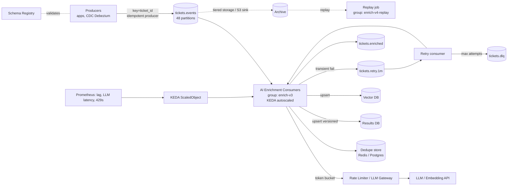

# Q27. Kafka into an AI pipeline: ordering, duplicates, consumer lag, replay.
[← Back to questions](../questions.md)

## TL;DR
- **Ordering:** Kafka only guarantees order *within a partition*. Pick a partition key that matches the unit you need ordered, such as `customer_id`, `ticket_id` or `doc_id`, and never reorder inside a key on the consumer side. Global order is almost never worth what it costs.
- **Duplicates:** treat the pipeline as **at-least-once**. Use an idempotent producer (`enable.idempotence=true`), commit offsets manually *after* the side effect, and make consumers idempotent with a dedupe key (`event_id` + `pipeline_version`) and upsert-style sinks. Kafka transactions give exactly-once only **inside Kafka**. An LLM call is an external side effect, so EOS does not cover it.
- **Consumer lag:** LLM calls take 0.5-10 s and are rate-limited, so this pipeline is lag-prone by design. Measure lag in both messages and seconds, autoscale consumers on lag (KEDA Kafka scaler, capped at the partition count), and apply **backpressure**: a token bucket matched to the provider's RPM/TPM, `pause()`/`resume()` on partitions, and bounded in-flight work.
- **Failures:** retry transient errors with backoff and jitter, route poison messages to retry topics and then a **DLQ**, and never block a partition indefinitely.
- **Replay:** keep raw events long enough (retention or tiered storage) and replay with a **new consumer group** using `offsets_for_times`. Write outputs **versioned** (`model_version`, `prompt_version`) so a replay never silently overwrites production results, and budget for the LLM cost of a replay before you start one.
- **Schema registry** (Avro/Protobuf, BACKWARD compatibility) keeps producers from breaking downstream AI consumers.

## Detailed Answer

### 1. Clarifying questions
| Question | Why it matters |
|---|---|
| What is the event, and what is the AI step? (classify a ticket, embed a doc, summarize a call, extract entities) | Sets per-message latency and cost |
| Is ordering needed per entity, or not at all? | Decides the partition key and whether ordering inside a key can be relaxed |
| Is the output a side effect (send email, update CRM) or a derived record (embedding, label)? | Derived records can be overwritten idempotently. Side effects need dedupe and an outbox |
| SLA: near-real-time (seconds) or minutes? | Decides how much lag is acceptable and whether to batch |
| LLM provider limits (RPM/TPM), self-hosted or API? | Puts a ceiling on throughput, so backpressure has to be designed in |
| How often do we reprocess (new model or prompt)? | Retention, replay tooling, versioned outputs |
| Is there PII in the events? | Encryption, ACLs, redaction before the LLM |

### 2. Requirements
**Functional**
- Consume events such as `support_ticket.created`/`updated`, enrich them with an LLM (classification, summary, embedding), and write results to the DB, vector store and a downstream topic.
- Updates for the same ticket are processed in order, so a stale summary never overwrites a newer one.
- Failed messages are retried, then parked in a DLQ with context.
- Any time range can be reprocessed with a new model or prompt.

**Non-functional**
- Throughput: 2,000 events/s peak, 300/s average.
- p95 end-to-end latency under 30 s at normal load.
- No lost events. Duplicates are tolerated in transport but must not show up in outputs.
- Cost per event is tracked, and replays are budgeted.

### 3. Capacity estimate
- Peak 2,000 ev/s. LLM classification takes about 800 ms p50 and 2.5 s p95.
- By Little's law, in-flight work = 2,000 x 0.8 s = **1,600 concurrent requests** at peak (about 5,000 at p95 latency).
- One consumer process running about 64 concurrent async LLM calls gives roughly 32 processes at p50, so plan for **48-64 partitions** to leave headroom for scaling out (consumers in a group are capped at the partition count).
- Tokens: 2,000 ev/s x 1,500 tokens = 3M tokens/s, which is 2,000 x 60 x 1,500 = **180M tokens/minute** at sustained peak. That is far above typical provider TPM quotas. **Conclusions:** (a) peaks have to buffer in Kafka, which is what Kafka is for; (b) use a small model or classifier for most events and send only the hard ones to a large LLM; (c) batch embeddings.
- Storage: 300 ev/s x 5 KB x 86,400 ≈ 130 GB/day raw. 14 days of hot retention ≈ 1.8 TB x RF3 ≈ 5.4 TB. Older data goes to tiered storage or S3 sink for replay.

### 4. Architecture



### 5. Ordering
- **Partition key = entity id** (`ticket_id`). Every event for the ticket lands on one partition and is read in order by one consumer.
- **Producer settings:** with `enable.idempotence=true`, Kafka keeps order even when `max.in.flight.requests.per.connection` is 5 or less with retries enabled. Without idempotence, a retry can reorder batches.
- **Consumer concurrency trap:** to get throughput you will want many concurrent LLM calls. Processing a partition's messages in parallel breaks per-key order. Options:
  1. **Key-level concurrency.** Run in parallel across keys but serially within a key (a per-key queue or "keyed executor"). Confluent's Parallel Consumer does this in Java. In Python you build it with asyncio and a dict of per-key locks.
  2. **Last-write-wins with versions.** Process out of order but write with a guard: `UPDATE ... WHERE source_version < :new_version`. Simplest, and usually enough for derived data such as summaries.
- **Hot keys:** one huge tenant on one partition becomes the bottleneck. Mitigate with a compound key (`tenant_id:ticket_id`), or salt the key when per-tenant order isn't needed.
- **Repartitioning breaks the key→partition mapping.** Adding partitions changes `hash(key) % N`, so in-flight keys briefly see two partitions. Over-provision partitions up front, or migrate to a new topic.

### 6. Duplicates and delivery semantics
Where duplicates come from: producer retries (idempotence fixes this), a consumer crashing after the side effect but before the commit, rebalances, replays, and upstream CDC re-emits.

**Exactly-once semantics (EOS) limits:**
- Kafka transactions plus `read_committed` plus `send_offsets_to_transaction` give exactly-once for **consume → transform → produce to Kafka**.
- They do **not** make an HTTP call to an LLM, a DB write or an email exactly-once. If the process dies after the LLM call and before the commit, the call runs again: you pay twice and may get a different answer, since LLMs are non-deterministic.
- So the pattern is **at-least-once delivery plus idempotent effects**:
  - Deterministic dedupe key: `event_id` (set by the producer, carried in the header/schema), or `hash(ticket_id, source_version, pipeline_version)`.
  - Check the dedupe store before the LLM call to save cost. Write the result with an upsert keyed on the dedupe key so a duplicate write does nothing.
  - For external side effects, use an **outbox**: write intent and result in one DB transaction, and a separate relay performs the effect with its own idempotency key. Many APIs (Stripe-style) accept `Idempotency-Key` headers.
- Optional: **cache LLM responses** keyed by `hash(model, prompt_version, input)` so retries and replays reuse the earlier result when you *want* the same answer.

### 7. Consumer code (confluent-kafka, manual commit after processing)

```python
import json, time, asyncio, hashlib
from confluent_kafka import Consumer, Producer, KafkaError, TopicPartition

consumer = Consumer({
    "bootstrap.servers": "kafka:9092",
    "group.id": "enrich-v3",
    "enable.auto.commit": False,            # commit only after side effects
    "auto.offset.reset": "earliest",
    "isolation.level": "read_committed",
    "max.poll.interval.ms": 600000,         # LLM calls are slow; avoid spurious rebalances
    "partition.assignment.strategy": "cooperative-sticky",
})
producer = Producer({
    "bootstrap.servers": "kafka:9092",
    "enable.idempotence": True,             # implies acks=all, ordered retries
    "compression.type": "zstd",
    "linger.ms": 20,
})

PIPELINE_VERSION = "clf-v3:prompt-2026-11-01"

def dedupe_key(evt: dict) -> str:
    raw = f"{evt['event_id']}|{PIPELINE_VERSION}"
    return hashlib.sha256(raw.encode()).hexdigest()

def process(msg):
    evt = json.loads(msg.value())
    key = dedupe_key(evt)
    if dedupe_store.exists(key):            # Redis SETNX / PG unique index
        return "duplicate"
    rate_limiter.acquire(tokens=estimate_tokens(evt))   # backpressure
    result = call_llm_classify(evt)                       # retries inside, w/ timeout
    results_db.upsert(                                    # idempotent sink
        ticket_id=evt["ticket_id"],
        source_version=evt["version"],
        pipeline_version=PIPELINE_VERSION,
        result=result,
    )
    dedupe_store.set(key, ttl_days=14)
    producer.produce("tickets.enriched", key=evt["ticket_id"],
                     value=json.dumps({**result, "event_id": evt["event_id"]}))
    return "ok"

consumer.subscribe(["tickets.events"])
try:
    while True:
        msg = consumer.poll(1.0)
        if msg is None:
            continue
        if msg.error():
            if msg.error().code() != KafkaError._PARTITION_EOF:
                log.error(msg.error())
            continue
        try:
            process(msg)
        except TransientError:
            send_to_retry(msg, topic="tickets.retry.1m")
        except Exception as e:
            send_to_dlq(msg, error=repr(e))
        producer.poll(0)
        consumer.commit(message=msg, asynchronous=False)  # after side effects
finally:
    producer.flush()
    consumer.close()
```

This is the simple serial version. For throughput, run batches from `consume(num_messages=200)` concurrently with key-level serialization, and commit only the **highest contiguous completed offset per partition**. Committing offset N implies everything before N is done.

```python
# Track completion per partition; commit the low-watermark of completed offsets
from collections import defaultdict
done = defaultdict(set)      # partition -> completed offsets
next_commit = {}             # partition -> next offset expected

def mark_done(tp, offset):
    done[tp].add(offset)
    nxt = next_commit.setdefault(tp, offset)
    while nxt in done[tp]:
        done[tp].remove(nxt); nxt += 1
    next_commit[tp] = nxt
    consumer.commit(offsets=[TopicPartition(tp[0], tp[1], nxt)], asynchronous=True)
```

### 8. Transactional variant (Kafka-to-Kafka stages)
For stages that only read and write Kafka, such as fan-out or a pure transform after the LLM result is already on a topic:

```python
p = Producer({"bootstrap.servers": "kafka:9092", "transactional.id": "enrich-router-1"})
p.init_transactions()
msgs = consumer.consume(num_messages=500, timeout=1.0)
p.begin_transaction()
for m in msgs:
    p.produce("tickets.routed", key=m.key(), value=route(m.value()))
p.send_offsets_to_transaction(
    consumer.position(consumer.assignment()),
    consumer.consumer_group_metadata())
p.commit_transaction()     # abort_transaction() on error
```
Use EOS where it applies, and say clearly that it stops at the edge of Kafka.

### 9. Consumer lag, autoscaling and backpressure
**Metrics**
- `records-lag-max` per partition (client metric), or the group lag from Burrow or kafka-exporter (`kafka_consumergroup_lag`).
- **Time lag** (now minus the timestamp of the last committed message) is what the SLA is written in. 100k messages of lag might be 10 seconds or 2 hours depending on throughput.
- LLM p50/p95 latency, 429 rate, tokens/s, DLQ rate, processing rate.

**Autoscale by lag with KEDA**
```yaml
apiVersion: keda.sh/v1alpha1
kind: ScaledObject
metadata:
  name: enrich-consumer
spec:
  scaleTargetRef:
    name: enrich-consumer
  minReplicaCount: 4
  maxReplicaCount: 48          # never more than partition count
  cooldownPeriod: 300
  triggers:
    - type: kafka
      metadata:
        bootstrapServers: kafka:9092
        consumerGroup: enrich-v3
        topic: tickets.events
        lagThreshold: "500"     # target lag per replica
        offsetResetPolicy: earliest
```

**Scaling does not help when the bottleneck is the LLM quota.** Adding consumers just produces more 429s. Backpressure:
- A **shared token bucket** sized to the provider's RPM/TPM, kept in Redis or an LLM gateway such as LiteLLM or Envoy so all replicas share it.
- When the bucket is empty or 429s spike, call `consumer.pause(partitions)` and `resume` later. The consumer keeps calling `poll()` so it stays in the group.
- Cap in-flight requests per pod with a semaphore.
- **Adaptive concurrency (AIMD):** add concurrency slowly on success and halve it on a 429.
- **Load shedding and priority:** send premium-tenant or high-priority events to a separate topic and consumer group with reserved quota. Under heavy lag, fall back to a cheaper model or a "summary-lite" path.
- Set KEDA's maximum to what the quota can sustain, not just the partition count.

### 10. Retries and DLQ
- Retry **in-process** a few times (about 3, with exponential backoff and jitter) for timeouts and 5xx.
- Then republish to a **retry topic** (`retry.1m`, `retry.10m`) that carries a `not_before` header. The retry consumer waits until that time (or pauses), so the main partition is never blocked.
- After N attempts the message goes to **`tickets.dlq`** with headers for the original topic/partition/offset, the error, the attempt count and the pipeline version.
- Non-retryable errors (schema invalid, content-policy refusal, input over the context limit) go straight to the DLQ or a specialized handler, for example chunking oversized inputs.
- **Ordering caveat:** if event v2 of a key goes to retry while v3 succeeds, v2 must not overwrite v3 later. The version guard on the sink handles this.
- DLQ needs an owner, a dashboard and a **redrive tool** that republishes to the main topic once the fix ships.

### 11. Replay
Reasons to replay: a new model or prompt, a bug fix, backfilling a new feature, or recovering a corrupted sink.
- **Retention:** keep the raw topic long enough (`retention.ms`), or use tiered storage or an S3 sink connector plus a reader job. Compacted topics keep only the latest value per key, which is fine for "reprocess current state" but not for full history.
- **Mechanics:**
  - Preferred: a **new consumer group** (`enrich-v4-replay`) starting from a timestamp, leaving production untouched.
  - Or reset an existing group, with the consumers stopped: `kafka-consumer-groups --bootstrap-server kafka:9092 --group enrich-v3 --reset-offsets --to-datetime 2026-11-01T00:00:00.000 --topic tickets.events --execute`.
  - In code: `offsets_for_times`, then `assign`.

```python
from confluent_kafka import TopicPartition
ts_ms = 1761955200000  # 2025-11-01T00:00Z
md = consumer.list_topics("tickets.events").topics["tickets.events"].partitions
tps = [TopicPartition("tickets.events", p, ts_ms) for p in md]
offsets = consumer.offsets_for_times(tps, timeout=10)
consumer.assign(offsets)   # start each partition at the first offset >= ts
```

- **Versioned outputs:** a replay writes to `pipeline_version = v4` rows, a shadow table or a new vector index. Compare against v4 with an offline eval and a sample review, then **flip a pointer** (alias swap) to cut over. Never overwrite v3 in place, because that removes your rollback.
- **Side-effect suppression:** replays must not resend emails or webhooks. Use a `replay=true` header or a separate consumer that writes only derived data.
- **Cost and quota:** replaying 30 days x 26M events x 1.5k tokens is a large bill. Estimate it first, use batch APIs (OpenAI and Anthropic batch endpoints are about 50% cheaper, with async turnaround) and a cache, run replays in a **lower-priority quota lane**, and throttle so production traffic isn't starved.
- **Determinism:** LLM outputs vary between runs. Pin model snapshots, use `temperature=0`, store the raw response, and expect replay results to differ somewhat. That is the reason for versioning.

### 12. Data model
```sql
CREATE TABLE enrichment_results (
  ticket_id        TEXT NOT NULL,
  pipeline_version TEXT NOT NULL,        -- model+prompt version
  source_version   BIGINT NOT NULL,      -- entity version from the event
  event_id         UUID NOT NULL,
  result           JSONB NOT NULL,
  model            TEXT NOT NULL,
  tokens_in        INT, tokens_out INT, cost_usd NUMERIC(10,6),
  kafka_partition  INT, kafka_offset BIGINT,
  created_at       TIMESTAMPTZ DEFAULT now(),
  PRIMARY KEY (ticket_id, pipeline_version)
);

-- idempotent + ordering-safe upsert
INSERT INTO enrichment_results AS r (ticket_id, pipeline_version, source_version, event_id, result, model)
VALUES (:ticket_id, :pv, :sv, :eid, :result, :model)
ON CONFLICT (ticket_id, pipeline_version) DO UPDATE
  SET result = EXCLUDED.result, source_version = EXCLUDED.source_version,
      event_id = EXCLUDED.event_id, model = EXCLUDED.model, created_at = now()
  WHERE r.source_version < EXCLUDED.source_version;   -- stale event can't overwrite newer
```

### 13. Schema registry
- Use Avro or Protobuf with Confluent/Apicurio Schema Registry under **BACKWARD** compatibility (new consumers can read old data), which matters for replays of old events.
- Required fields: `event_id`, `entity_id`, `entity_version`, `occurred_at`, `schema_version`, `tenant_id`.
- Additive changes only. Evolve with optional fields and defaults. CI checks compatibility before deploy.
- Validate the LLM *output* too. Parse JSON against a Pydantic schema and send failures to retry with a repair prompt, or to the DLQ.

### 14. Failure modes
| Failure | Symptom | Mitigation |
|---|---|---|
| LLM provider outage or 429 storm | Lag climbs, 429s | Pause partitions, circuit breaker, fallback model or provider, alert on time-lag |
| Poison message (huge input) | One partition stuck | Bounded retries, then DLQ, size guard before the LLM |
| Rebalance storms (long processing > `max.poll.interval.ms`) | Duplicates, thrash | Raise the interval, cooperative-sticky assignment, static membership (`group.instance.id`), smaller batches |
| Crash after side effect, before commit | Duplicate LLM call and write | Dedupe store, idempotent upsert, response cache |
| Hot partition | One consumer lags | Better key, salting, a dedicated topic for the big tenant |
| Schema break | Deserialization errors | Registry compatibility checks, DLQ for undeserializable messages |
| Replay overwrites prod | Quality regression | Versioned outputs, alias swap |
| Lag from a slow DB sink | Lag with LLM healthy | Batch writes, async sink, separate stage |

### 15. Security and compliance
- TLS plus SASL/mTLS, topic ACLs per service, encryption at rest.
- PII: redact or tokenize before the LLM call, apply data residency rules to the provider, and avoid logging prompts that contain PII.
- DLQ and retry topics hold the same sensitive data, so give them the same ACLs and retention policy.

### 16. Evaluation and observability
- Pipeline SLOs: time-lag p95 < 30 s, DLQ rate < 0.1%, duplicate effect rate about 0 (audited via unique constraints).
- Quality: sampled human labels against LLM outputs per `pipeline_version`, and drift dashboards (label distribution per day).
- Trace each event with an OpenTelemetry span from produce → consume → LLM → sink, carrying the `event_id`.

### 17. Rollout plan
1. Shadow consumer group writing to a shadow table and comparing against the current pipeline.
2. Canary: route 5% of keys (hash-based) to write production results.
3. Full cutover. Keep the old group's offsets for rollback.
4. Run a replay drill quarterly so the tooling is known to work.

### 18. Cost levers
- Classifier or small model first, LLM for the uncertain tail.
- Batch APIs for replays, a response cache, batched embeddings (up to the provider's batch size per request).
- Compression (zstd), and tiered storage instead of large broker disks.

## Trade-offs

| Decision | Option A | Option B | Guidance |
|---|---|---|---|
| Delivery | At-least-once + idempotent sink | Kafka EOS transactions | EOS only for Kafka→Kafka stages. External LLM calls always need idempotency |
| Ordering | Strict per-key serial processing | Parallel + version guard (LWW) | LWW is simpler and faster for derived data. Serial when the steps depend on each other |
| Partition count | Few (simple) | Many (parallelism) | Size for peak parallelism; adding partitions later breaks key mapping |
| Scaling | Autoscale on lag | Fixed fleet + rate limiter | Autoscale up to the quota ceiling. Beyond that, buffer |
| Retry | In-partition blocking retry | Retry topics + DLQ | Retry topics avoid head-of-line blocking but break ordering, so add a version guard |
| Replay | Reset same group | New consumer group + versioned output | A new group is safe and parallel to prod. Reset only for small fixes |
| Dedupe store | Redis (fast, TTL) | Postgres unique constraint (durable) | Redis to skip LLM calls early, DB constraint as the source of truth |

## Common Pitfalls
- Leaving `enable.auto.commit=true` on. Offsets get committed before processing, so a crash loses messages.
- Assuming Kafka EOS covers the LLM call or the DB write.
- Parallelizing within a partition without key-level ordering or a version guard, so stale summaries overwrite newer ones.
- Scaling consumers past the partition count (idle pods) or past the LLM quota (429 storms).
- Measuring lag only in messages, not time.
- Doing long LLM work without heartbeats or a raised `max.poll.interval.ms`, which leads to a rebalance loop and duplicates.
- Having no DLQ owner or redrive tooling, so the DLQ becomes a black hole.
- Replaying into the production table or index and re-triggering side effects.
- Forgetting that a replay costs real money and can eat the production quota.
- Using a random partition key and losing per-entity order.

## Likely Follow-up Questions
1. **How do you get exactly-once results from a non-deterministic LLM?**
   You can't make the call exactly-once. You make the *effect* exactly-once: a dedupe key plus an idempotent upsert, and optionally a response cache keyed by input hash so retries return the first answer.
2. **A single tenant produces 40% of traffic. What happens?**
   Their partition becomes hot. Use a compound key (`tenant:ticket`) so they spread across partitions while each ticket stays ordered. Give them a dedicated topic or quota lane, and fair-share scheduling in the rate limiter.
3. **How do you handle a rebalance in the middle of an LLM call?**
   Use cooperative-sticky assignment and static membership. On `on_revoke`, stop taking new work, finish or abandon in-flight calls, and commit completed offsets. Abandoned ones get reprocessed and dedupe absorbs them.
4. **Lag is growing but CPU is low. Diagnose it.**
   The consumer is I/O-bound on the LLM. Check the 429 rate and LLM latency first. If quota is the limit, scaling won't help: add a cheaper model tier, batching or more quota. If it isn't, raise per-pod concurrency.
5. **How would you replay only the tickets whose summaries were bad?**
   Don't replay the whole topic. Query the IDs from the results DB, re-fetch their latest state (compacted topic or source DB), and publish targeted reprocess events to a `reprocess` topic with `pipeline_version=v4`.
6. **Why not just use a queue like SQS?**
   SQS gives you visibility timeouts and a DLQ, and FIFO groups give per-key order. But it lacks long-retention replay by timestamp and multiple independent consumer groups. Kafka is the better fit when replay and fan-out matter.

[← Back to questions](../questions.md)
