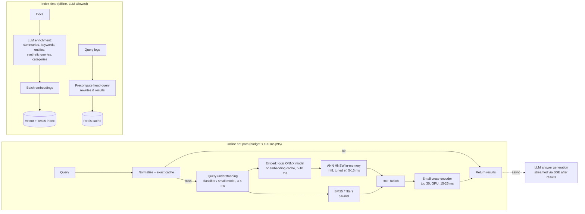

# Q29. Cut an LLM search from 1.5s to under 100ms.
[← Back to questions](../questions.md)

## TL;DR
- **Profile first.** Break the 1.5 s into stages: query rewrite (LLM), embedding call, ANN search, metadata fetch, rerank, answer generation, and network. In most "LLM search" systems, 70-90% of the time goes to **one or two LLM calls on the hot path**.
- **Take the generative LLM out of the hot path.** A 100 ms budget can't hold a network round trip to a large LLM plus decoding. Move the LLM work to **index time** (doc enrichment, synthetic queries, summaries, entity tags) and to **async/after-results** (stream the AI answer *after* the result list renders).
- **Replace online LLM steps with fast models:** a classifier or small fine-tuned model for query understanding, a **local small embedding model** (ONNX/CPU, 5-15 ms) or an embedding cache, **tuned HNSW** (`ef_search`, quantized vectors, in-memory), and a **small or distilled cross-encoder** reranking only the top 20-50.
- **Cache aggressively:** exact query cache (normalized), embedding cache, semantic cache for the head queries. Search queries are heavily Zipfian, so 30-60% hit rates are common.
- **Engineer for the tail:** colocate services in the same AZ, run independent calls in parallel (BM25 ‖ vector ‖ filters), keep connections warm, set timeouts with graceful degradation (skip the rerank if over budget), and **measure p95/p99**, not the average.
- State the target precisely: **p95 < 100 ms server-side for results**. The generated answer, if kept, streams in afterward and doesn't count against that budget.

## Detailed Answer

### 1. Clarifying questions
- **What does "LLM search" do today?** Typical pipeline: LLM rewrites the query → embed via API → vector DB → fetch docs → LLM reranks or generates an answer. Which of these does the user actually need?
- **Is 100 ms for the results list or for a generated answer?** Generating a full answer from a large model in under 100 ms is essentially impossible (time to first token alone is often 200-500 ms on hosted APIs). Results under 100 ms is very achievable.
- **p50 or p95? Server-side or end-to-end including the client network?**
- **Corpus size and update rate:** 1M docs or 1B? Real-time indexing?
- **QPS and peak:** they drive the caching and replica math.
- **What quality bar must hold?** Current NDCG@10 and click-through rate. We can't regress quality to win latency.

### 2. Requirements
**Functional:** keyword + semantic search with filters (category, date, permissions), top-10 results, optional AI summary.
**Non-functional:** p95 < 100 ms server-side for results at 500 QPS peak, NDCG@10 at least the current baseline minus 1%, and the AI summary (if kept) streaming with first token under 1 s and not blocking results.

### 3. Step 1: profile the current 1.5 s
Instrument every stage with OpenTelemetry spans and look at p50/p95 per stage, not just the total.

| Stage (current) | p50 | p95 | Notes |
|---|---|---|---|
| Client → API (TLS, LB) | 20 ms | 40 ms | |
| Query rewrite with GPT-class LLM | 450 ms | 900 ms | Generative call on the hot path |
| Embedding API call (remote) | 80 ms | 200 ms | Cross-region, cold connections |
| Vector search (managed, other region) | 60 ms | 150 ms | `ef_search=512`, float32 |
| Fetch 50 docs from DB (N+1 queries) | 70 ms | 160 ms | Sequential lookups |
| LLM rerank of 50 docs (listwise prompt) | 600 ms | 1,200 ms | Generative call on the hot path |
| Serialization, misc | 20 ms | 40 ms | |
| **Total (serial)** | **~1.3 s** | **~2.5 s** | |

Takeaway: two generative LLM calls make up about 80% of the time. Everything else is fixable with ordinary engineering.

### 4. Target architecture



### 5. Step 2: move LLM work out of the hot path

#### 5.1 Index-time enrichment (doc-side expansion)
Whatever the online LLM was doing to *understand documents* can be done once per document offline:
- Generate a **summary**, **keywords/synonyms**, **entities**, a **category taxonomy** and **hypothetical questions** (doc2query) for each doc, and index them as extra BM25 fields and extra vectors.
- This recovers much of the recall that online query rewriting provided, because the vocabulary gap is closed from the document side.
- Cost is paid once at ingest, using batch APIs (cheaper) and incremental updates.

```python
ENRICH_PROMPT = """Given the document, return JSON with:
"summary" (<=50 words), "keywords" (10 synonyms/related terms),
"entities", "category", "questions" (5 questions this document answers).
Document:
{doc}"""

def enrich(doc):
    out = llm.complete(ENRICH_PROMPT.format(doc=doc.text[:8000]), response_format="json")
    return {**doc.meta, **json.loads(out)}
```

#### 5.2 Query understanding without a large LLM
- **Intent and category classifier:** distill the LLM's rewrite and intent labels from logs into a small model (logistic regression on embeddings, or a fine-tuned MiniLM/DistilBERT). Runs in 1-5 ms on CPU.
- **Spell correction and synonyms:** a dictionary built from query logs, SymSpell-style.
- **Structured filter extraction** ("red shoes under $50" → `color=red, price<50`): a small NER/seq-tagger model or rules. If an LLM is truly needed, run it only on cache misses with a strict 50 ms timeout and fall back to raw keywords, or precompute it for head queries.
- **Head-query precompute:** the top 10-20k queries often cover 40-60% of traffic. Run the full slow LLM pipeline on them offline and cache the results with a TTL.

#### 5.3 Answer generation becomes async
- Return the result list immediately (under 100 ms). Open a separate SSE/WebSocket stream for the "AI overview" from a fast model, using the top-k already retrieved.
- Cache generated answers for head queries.
- Trigger generation only when intent calls for it (question-like queries), not for navigational ones.

### 6. Step 3: make each remaining stage fast

#### 6.1 Embeddings
- **Local model instead of a remote API:** `bge-small-en-v1.5` / `e5-small-v2` (384-d, ~33M params) via ONNX Runtime or a small GPU server takes about 3-10 ms for a short query, versus 80-200 ms for a remote API call.
- If you have to keep a larger embedding model for quality, **distill** it into a small query encoder that is asymmetric with the doc encoder, or use a model that supports **Matryoshka** truncated dims.
- **Embedding cache:** `hash(normalized_query) → vector` in local LRU plus Redis.

```python
from functools import lru_cache
import numpy as np
import onnxruntime as ort
from tokenizers import Tokenizer

tok = Tokenizer.from_file("bge-small/tokenizer.json")
tok.enable_truncation(max_length=64)
sess = ort.InferenceSession("bge-small/model.onnx", providers=["CPUExecutionProvider"])

@lru_cache(maxsize=200_000)
def embed_query(q: str) -> bytes:
    enc = tok.encode(q)
    ids = np.array([enc.ids], dtype=np.int64)
    mask = np.array([enc.attention_mask], dtype=np.int64)
    out = sess.run(None, {"input_ids": ids, "attention_mask": mask,
                          "token_type_ids": np.zeros_like(ids)})[0]
    v = out[0, 0]                         # CLS pooling for bge
    v = v / np.linalg.norm(v)
    return v.astype(np.float32).tobytes()
```

#### 6.2 ANN tuning
- Keep the index **in memory**, in the **same AZ** as the service.
- **HNSW parameters:** `M` (16-32) and `ef_construction` (100-200) are build-time. `ef_search` is the latency/recall knob. Sweep `ef_search` ∈ {32, 64, 100, 200} and pick the smallest that gives recall@10 ≥ 0.95 against exact search.
- **Smaller vectors:** 384-d instead of 1536-d means 4x less memory bandwidth per distance computation. Add int8 scalar quantization or binary quantization with rescoring.
- **Filtering:** use the engine's filtered HNSW (Qdrant payload index, OpenSearch efficient filter, pgvector with iterative scans in 0.8+). Post-filtering forces a large k and wastes time.

```python
import time, hnswlib, numpy as np
idx = hnswlib.Index(space="cosine", dim=384)
idx.load_index("docs.hnsw")
for ef in (32, 64, 100, 200):
    idx.set_ef(ef)
    t0 = time.perf_counter()
    labels, _ = idx.knn_query(eval_queries, k=10)
    ms = (time.perf_counter() - t0) / len(eval_queries) * 1000
    print(ef, f"{ms:.2f} ms/query", recall_at_10(labels, exact_labels))
```

#### 6.3 Hybrid retrieval in parallel
Run BM25, vector and the filters/permissions lookup **concurrently**, then fuse with Reciprocal Rank Fusion, which takes microseconds.

```python
import asyncio

async def search(q, user):
    qv = embed_query(q)                                   # ~5 ms, cached
    bm25_t = asyncio.create_task(bm25.search(q, k=100, filters=user.filters))
    vec_t  = asyncio.create_task(vdb.search(qv, k=100, filters=user.filters))
    bm25_res, vec_res = await asyncio.wait_for(asyncio.gather(bm25_t, vec_t), timeout=0.040)
    fused = rrf([bm25_res, vec_res], k=60)[:30]
    try:
        ranked = await asyncio.wait_for(rerank(q, fused), timeout=0.030)
    except asyncio.TimeoutError:
        ranked = fused                                    # degrade gracefully
    return ranked[:10]

def rrf(result_lists, k=60):
    scores = {}
    for results in result_lists:
        for rank, doc_id in enumerate(results):
            scores[doc_id] = scores.get(doc_id, 0) + 1.0 / (k + rank + 1)
    return sorted(scores, key=scores.get, reverse=True)
```

#### 6.4 Reranking
- Replace the LLM listwise rerank with a **small cross-encoder** (`cross-encoder/ms-marco-MiniLM-L-6-v2` or `bge-reranker-base`) over **only the top 20-50**, with short passages (first 256 tokens or the summary field from enrichment).
- On a GPU (T4/L4) with batch=30 and seq=256 that is about 10-25 ms. On CPU it's too slow for 50 docs, so use 10-20 docs or a distilled model.
- Even better, **distill the LLM reranker** into the cross-encoder: label query-doc pairs offline with the LLM, then fine-tune the cross-encoder on those labels. You keep most of the quality at about 1/50th of the latency.
- Or skip online reranking and use **learned-to-rank features** (BM25 score, vector score, popularity, freshness) with a GBDT model (LightGBM), which takes under 1 ms.

#### 6.5 Data fetch
- Store display fields (title, snippet, URL, price) **in the index payload** so you don't need a second DB round trip. Otherwise use one batched `WHERE id = ANY($1)` query or a Redis MGET, not N+1 queries.

#### 6.6 Network and infrastructure
- Colocate the API, embedder, vector DB and reranker in one region and AZ. A cross-region round trip alone is 30-80 ms.
- Keep connections alive (HTTP/2, gRPC, pooled connections). Avoid a TLS handshake per request.
- Avoid cold starts: no scale-to-zero on the hot path, and warm the models at startup.
- Measure GC pauses and event-loop blocking (CPU-bound ONNX in an async loop needs a thread pool).

### 7. Caching strategy
| Cache | Key | Hit rate (typical) | Latency | Notes |
|---|---|---|---|---|
| Exact result cache | normalized query + filters + user segment/ACL | 20-50% (Zipfian head) | 1-2 ms (Redis) / <0.1 ms local | TTL tied to index freshness, invalidated on reindex |
| Embedding cache | normalized query | 40-70% | <1 ms | Very safe: same input gives the same vector |
| Semantic cache | query embedding, similarity > 0.95 | +5-15% | 2-5 ms | Risky ("cheap flights to Paris" vs "to Paris, TX"). Use a high threshold, only for answers, and never across ACL boundaries |
| Precomputed head queries | top-N queries | 40-60% of traffic | 1 ms | Batch-refresh nightly |
| Generated answer cache | query + doc-set hash | varies | ms | Invalidate when the top docs change |

Normalize the query: lowercase, Unicode NFKC, trim, collapse whitespace, and optionally sort tokens for bag-of-words caching.

### 8. Latency budget (target)
| Stage | p50 | p95 budget |
|---|---|---|
| LB + TLS (warm connection) + auth | 3 ms | 8 ms |
| Normalize + exact cache lookup | 1 ms | 2 ms |
| Query understanding (classifier) | 2 ms | 5 ms |
| Query embedding (local ONNX / cache) | 4 ms | 10 ms |
| BM25 ‖ ANN (parallel, in-memory, same AZ) | 10 ms | 25 ms |
| Fusion (RRF) | <1 ms | 1 ms |
| Cross-encoder rerank top 30 (GPU) | 15 ms | 30 ms |
| Payload / serialization | 2 ms | 5 ms |
| Headroom | | 14 ms |
| **Total (cache miss)** | **~40 ms** | **< 100 ms** |
| Cache hit | ~3 ms | ~8 ms |

Note that p95s don't add up linearly (stages are only partly correlated). Validate end to end with load tests at peak QPS. Track **p99** too, because one slow dependency dominates the tail.

### 9. Quality guardrails while cutting latency
- Build an **offline eval set** from click logs and human labels, and measure NDCG@10, recall@50 (pre-rerank) and MRR for every change.
- Distillation targets: the small reranker should reach at least 95-98% of the LLM reranker's NDCG.
- **Online A/B test:** CTR, success rate (click with no requery), zero-result rate and abandonment. Latency cuts usually *increase* engagement, so you can sometimes give up a little offline NDCG and still win online.
- Watch the **long tail**. Cache-miss and rare queries are where the LLM rewrite helped most, so consider a slow-path fallback for zero or low-result queries (show results, then "Did you mean...", or refine async).

### 10. Failure modes
| Failure | Mitigation |
|---|---|
| Reranker GPU saturated | Timeout → return fused results, autoscale on queue depth |
| Cache stampede on index refresh | Request coalescing (single-flight), staggered TTLs, warm the cache after reindex |
| Stale cache after a doc update | Versioned cache keys (`index_version` in the key) |
| ANN recall drops after a big ingest | Rebuild or compact the segments, monitor recall with canary queries against exact search |
| Embedding model update | Requires a full re-embed of the corpus. Version the index and swap the alias |
| Query-understanding classifier drift | Retrain from fresh LLM-labelled logs monthly |

### 11. Rollout plan
1. Instrument and baseline (latency per stage, quality metrics).
2. Quick wins: colocation, connection pooling, batched fetch, parallel BM25 ‖ vector, `ef_search` tuning. Often takes 1.5 s → 1.1 s.
3. Make the AI answer async/streamed, which removes generation from the critical path.
4. Replace the online query rewrite with index-time enrichment, a classifier and the head-query cache.
5. Replace the LLM rerank with a distilled cross-encoder.
6. Local embedder plus caches.
7. A/B test each step behind feature flags, with a kill switch back to the old path.

### 12. Cost impact
- Removing two LLM calls per query at 500 QPS is about 43M queries/day. At $0.0005-$0.002 per call that's **$40-170k/day** saved.
- New costs: a few GPU nodes for the reranker (an L4 is roughly $0.7-1/hr), CPU for embeddings, Redis, and the one-time LLM enrichment of the corpus (batch API).
- Latency and cost usually improve together here.

## Trade-offs

| Choice | Faster option | Slower/higher-quality option | Guidance |
|---|---|---|---|
| Query rewrite | Classifier + doc-side enrichment | Online LLM rewrite | Offline enrichment + head cache. LLM only async for zero-result cases |
| Embedding | Small local model, 384-d | Large API model, 1536-3072-d | Small + domain fine-tuning usually closes the gap. Validate on the eval set |
| ANN | Low `ef_search`, quantized | High `ef`, float32 | Pick `ef` at the recall knee (~0.95) |
| Rerank | GBDT LTR / tiny cross-encoder | LLM listwise rerank | Distill the LLM into a cross-encoder |
| Answer | Async streamed after results | Inline before results | Always async for latency-sensitive search |
| Semantic cache | Higher hit rate | Correctness risk | High threshold, ACL-scoped, answers only |

## Common Pitfalls
- Optimizing without per-stage profiling (tuning HNSW when 80% of the time is the LLM).
- Promising a generated answer in under 100 ms. Be clear about what the 100 ms covers.
- Reporting the average instead of p95/p99.
- Running the embedding API or vector DB in a different region from the API.
- Post-filtering ANN results (a large k is slow and recall suffers).
- Semantic caching that ignores filters or permissions, which serves wrong or unauthorized results.
- Cutting latency and silently losing relevance, with no offline or online quality gate.
- Running CPU-heavy inference on the async event loop.
- Forgetting the cache-invalidation story when the index updates.

## Likely Follow-up Questions
1. **The PM insists on the AI summary. How do you keep it?**
   Render results in under 100 ms and stream the summary over SSE from a fast model using the already-retrieved top-5. Precompute and cache summaries for head queries. Show a skeleton loader. Perceived latency stays low.
2. **How do you know the small reranker is "good enough"?**
   Offline NDCG@10 against the LLM-reranker baseline on a labelled set (target ≥ 95-98%), then an online A/B on CTR and reformulation rate. Distill from the LLM labels to close the gap.
3. **What if the query needs the LLM, like complex natural language with constraints?**
   Use a two-tier path. The fast path returns best-effort results immediately. A slow path (LLM parse) refines asynchronously and updates the results, or is triggered only when the classifier is uncertain or results are poor.
4. **How do you pick `ef_search`?**
   Sweep it on held-out queries against exact KNN ground truth, plot recall@10 against p95 latency, and choose the knee. Re-check after the corpus grows, since recall falls as the index grows at a fixed `ef`.
5. **Could you use a smaller embedding dimension without retraining?**
   Yes, if the model was trained with Matryoshka representation learning (for example OpenAI's text-embedding-3 `dimensions` parameter, nomic-embed). Otherwise truncation hurts quality, so use PCA or retrain and validate.
6. **How do you handle personalization within the budget?**
   Precompute user embeddings or features offline and store them in a low-latency KV store. Combine them in the GBDT ranker or as a vector bias. A feature fetch is about 1-2 ms.

[← Back to questions](../questions.md)
