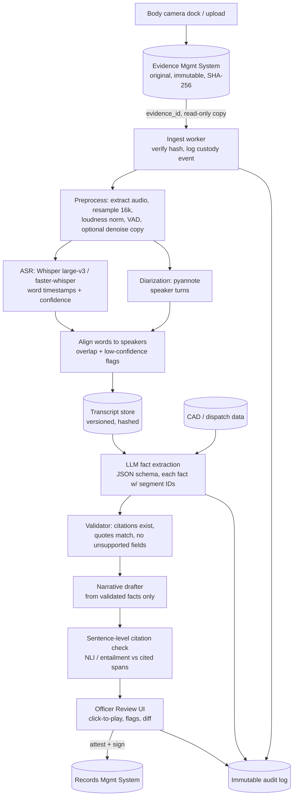

# Q30. Turn body-camera audio into a draft incident report that stays accurate and human-reviewed.
[← Back to questions](../questions.md)

## TL;DR
- **Framing:** the system produces a **draft** that the officer must review, edit and attest to. It never files a report on its own. Every factual statement in the draft is **cited to a transcript segment and timestamp**, and the model is forbidden from inferring anything the audio doesn't contain (intent, emotions, identities, actions that were not spoken).
- **Pipeline:** evidence ingest (hash, chain of custody, read-only original) → audio preprocessing (denoise, VAD) → **ASR with word timestamps** (Whisper-class, or a CJIS-compliant cloud ASR) → **speaker diarization** (pyannote) → transcript with confidence scores → **constrained extraction** into a structured report template (JSON schema) → narrative drafting from the extracted facts only → **citation validation** → officer review UI.
- **Uncertainty is first-class:** low-confidence words, overlapping speech, unknown speakers and missing information are **flagged inline** (`[inaudible 00:03:12]`, `[speaker unclear]`). Required fields that the audio doesn't support stay **blank with a prompt for the officer**, never guessed.
- **Human review:** a side-by-side UI with click-to-play audio for each sentence, mandatory review of flagged items, a tracked diff between the AI draft and the final report, an **attestation** step, and a disclosure on the report that AI assisted drafting.
- **Compliance and governance:** CJIS Security Policy (encryption, MFA/advanced authentication, audit, personnel screening, a GovCloud or CJIS-attested environment), an immutable audit trail, no training on evidence without agreement, retention aligned to the evidence policy. Engage prosecutors and defense discovery requirements early.
- **Evaluation:** WER and diarization error rate (DER) on representative noisy field audio, **claim-level precision** (unsupported claims ≈ 0), recall of key facts, citation accuracy, officer edit rate, and **bias audits** across accents, languages and demographics.

## Detailed Answer

### 1. Clarifying questions
- **Who uses the draft, and what is it legally?** Is it a first draft of the officer's narrative, a supplementary summary, or a "transcript-derived summary" attached alongside the report? Which state laws apply? Some jurisdictions are setting rules for AI-drafted police reports, such as disclosure requirements or retaining the AI draft.
- **Prosecutor and defense requirements:** must the AI draft and the edit history be preserved as discoverable material? Assume **yes** and design for it.
- **Inputs:** audio only, or video too? Multiple cameras at one incident? Radio traffic? CAD (computer-aided dispatch) data such as incident type, location and time?
- **Languages:** English only, or Spanish and other languages, with interpretation on scene?
- **Deployment:** the agency's DEMS (digital evidence management system) vendor cloud, a GovCloud tenant, or on-prem? Is CJIS compliance mandatory? (Yes if criminal justice information (CJI) is involved.)
- **Turnaround:** a draft within minutes of upload, before the end of shift?
- **Which report types are in scope?** Start narrow, with low-severity incidents (property damage, minor theft, traffic), and **exclude** high-stakes ones initially (use of force, officer-involved shootings, sexual assault) per policy.

### 2. Requirements
**Functional**
- Ingest the audio track from the DEMS by evidence ID, with hash verification.
- Produce a diarized, timestamped transcript with confidence scores.
- Produce a draft report in the agency's template: incident type, date/time, location, involved parties (by role), chronology, statements, actions taken, property, plus a narrative.
- Every sentence links to one or more transcript spans.
- Officer review: edit, accept or reject each section, resolve flags, attest, then export to the RMS (records management system).
- Retain the original audio, the transcript, the AI draft, all edits and the final report, all linked.

**Non-functional**
- Accuracy: unsupported-claim rate < 0.5% before review and **0 after attestation** (the human is accountable). Key-fact recall ≥ 95%.
- Latency: a 30-minute recording turned into a draft in under 5 minutes.
- Security: CJIS-aligned controls, FIPS 140-2/3 validated encryption, MFA, audit, US-only data residency.
- Availability: 99.5%, with queueing allowed.

### 3. Capacity estimate
- A mid-size agency has 1,000 officers. About 20 hours of footage per officer per week is captured, but only the recordings tied to a report get processed: say 2,000 reports/week at ~25 min average audio, about **830 audio-hours/week**.
- Whisper large-v3 on an A10G/L4 with faster-whisper (CTranslate2) runs at roughly 20-40x real time. 830 h / 30 ≈ 28 GPU-hours/week of ASR, plus diarization (pyannote at around 2.5% real-time factor on GPU) at about 21 GPU-hours. A **couple of GPUs** covers this, sized for end-of-shift peaks.
- LLM: a 25-minute conversation is about 4,000 words ≈ 6k tokens of transcript. Extraction plus drafting is about 10-15k input tokens and 1.5k output per report. 2,000/week is small.
- Storage: audio is already in the DEMS. Transcripts and drafts are KB-scale.

### 4. Architecture



### 5. Component deep dives

#### 5.1 Evidence handling and chain of custody
- **Never modify the original.** Work on a derived copy. Record the SHA-256 of the original and the derived audio, and log each processing step as a custody event: who/what system, when, input hash, output hash, software and model versions.
- Store the transcript and drafts as **derived evidence artifacts** linked to the evidence ID, also hashed and versioned.
- Integrate with the DEMS API so access permissions come from the evidence system (case-level access, sealed cases).
- Denoised audio is only for ASR. The UI plays the **original** audio by default so reviewers hear the real evidence.

#### 5.2 ASR and diarization
- **Noise:** sirens, wind, traffic, radio chatter, running, overlapping shouting, and the camera mic rubbing on clothing. Mitigate with:
  - VAD (Silero, or Whisper's built-in VAD filter in faster-whisper) to skip silence and reduce hallucination on non-speech. Whisper is known to **hallucinate text on silence or noise**, which is a serious risk here.
  - Conservative decoding: `temperature=0`, `condition_on_previous_text=False` to reduce repetition loops, and thresholds on `no_speech_prob` and avg logprob for each segment.
  - Domain vocabulary via `initial_prompt` (street names, unit codes, 10-codes), used carefully because it can bias the output.
- **Diarization:** pyannote speaker-diarization 3.x gives turns as "SPEAKER_00..." labels. Map them to *roles* only with evidence: the officer's voice can be enrolled (with consent and policy approval) or identified as the closest speaker to the mic. Others stay "Speaker 2" until the officer labels them ("Speaker 2 = complainant"). **The AI never assigns real identities from voice.**

```python
from faster_whisper import WhisperModel
from pyannote.audio import Pipeline
import torch

asr = WhisperModel("large-v3", device="cuda", compute_type="float16")
segments, info = asr.transcribe(
    "evidence_123.wav",
    language=None,                    # auto-detect; log info.language
    word_timestamps=True,
    vad_filter=True,
    temperature=0.0,
    condition_on_previous_text=False,
    beam_size=5,
)
words = []
for seg in segments:
    flag_seg = seg.no_speech_prob > 0.6 or seg.avg_logprob < -1.0
    for w in seg.words:
        words.append({"start": w.start, "end": w.end, "text": w.word,
                      "prob": w.probability, "seg_flag": flag_seg})

dia = Pipeline.from_pretrained("pyannote/speaker-diarization-3.1",
                               use_auth_token=HF_TOKEN)   # weights mirrored internally in prod
dia.to(torch.device("cuda"))
diarization = dia("evidence_123.wav")
turns = [(t.start, t.end, spk) for t, _, spk in diarization.itertracks(yield_label=True)]

def speaker_for(word):
    mid = (word["start"] + word["end"]) / 2
    hits = [spk for s, e, spk in turns if s <= mid <= e]
    if len(hits) == 1: return hits[0], False
    return (hits[0] if hits else "UNKNOWN"), True   # overlap or gap -> flag
```

- **Segment schema:** `segment_id, start, end, speaker_label, text, min_word_prob, flags[overlap, low_conf, possible_hallucination, non_english]`.
- **Non-English and interpretation:** detect the language per segment. Translation must be marked as machine translation, with the original text kept. Many agencies require certified interpretation for statements, so flag these rather than relying on the translation.

#### 5.3 Fact extraction (constrained, cited)
Extract **atomic facts with citations** first, then write the narrative. The model gets the transcript with segment IDs and a strict schema:

```python
from pydantic import BaseModel, Field
from typing import Literal, Optional

class Fact(BaseModel):
    fact_id: str
    category: Literal["time", "location", "party", "statement", "officer_action",
                      "observation_spoken", "property", "injury_reported", "other"]
    text: str = Field(description="Neutral restatement; no inference")
    speaker: Optional[str]                     # SPEAKER_01 or role if labeled
    is_direct_quote: bool
    quote: Optional[str]                       # verbatim substring if quote
    citations: list[str]                       # segment_ids, >=1 required
    confidence: Literal["high", "medium", "low"]

class Extraction(BaseModel):
    facts: list[Fact]
    missing_required: list[str]                # template fields not supported by audio
    uncertainties: list[str]
```

System prompt rules:
- "Use only what is said in the transcript. Do not infer intent, emotion, guilt, identity, race or ethnicity, intoxication, or actions not described verbally."
- "Attribute every statement to its speaker ('Speaker 2 stated ...'). Do not present a claim as fact."
- "If a required field is not explicitly supported, list it in `missing_required`."
- "Mark segments flagged low-confidence and cite them with confidence=low."

**Deterministic validation** after extraction:
- Every citation ID exists, and the cited span's time range is plausible.
- `quote` must be a (normalized) **verbatim substring** of the cited segments, otherwise the fact is rejected.
- Times and addresses must appear in the cited text or the CAD record (CAD-sourced facts are cited to the CAD field, not to audio).
- An **NLI/entailment check** (cross-encoder NLI model or a second LLM judge) for each fact against its cited spans. Non-entailed facts are dropped or flagged.

#### 5.4 Narrative drafting
- Input: **only the validated facts** plus the template, not the raw transcript. That limits the model's room to add things.
- The output is sentences, each tagged with `fact_ids`, in neutral, chronological, first-person-officer style if that is agency policy.
- A post-check confirms each sentence maps to facts, and runs a sentence-level entailment check against the cited segments.
- Banned content: legal conclusions ("suspect committed burglary"), characterizations ("aggressive", "nervous") unless that word was literally spoken and is attributed as a quote.
- Required-but-missing fields render as `[OFFICER TO COMPLETE: Vehicle plate not stated in audio]`.

#### 5.5 Officer review UI
- **Three panes:** draft report | transcript with speaker colors and confidence shading | audio player.
- Clicking a sentence highlights its cited segments and plays the **original** audio from that timestamp.
- **Flag queue:** low-confidence words, overlaps, unknown speakers, machine-translated segments and missing fields. The officer must resolve each flag (confirm, correct or delete) before submitting.
- **Speaker labeling:** the officer assigns roles (complainant, witness 1). The draft updates.
- **Edit tracking:** every edit is recorded. The final report keeps a **diff** against the AI draft (stored, possibly discoverable).
- **Attestation:** "I have reviewed this report in full and attest that it accurately reflects my recollection and the evidence." Sign with MFA. Optionally, mandatory minimum review time or a confirmation for each section, to counter rubber-stamping.
- **Disclosure line** on the report: "Portions of this report were drafted with AI assistance from body-worn camera audio and reviewed by the reporting officer."
- **Officer-only facts:** things the officer saw but didn't say (visual observations) are added by the officer and marked as officer-authored, not audio-derived.

#### 5.6 Guardrails against rubber-stamping and "laundering"
- Insert **canary errors** in training or QA modes (never in production evidence) to measure whether reviewers catch mistakes. Measure review time and edit rates by officer.
- Supervisor review queue, with random sampling for QA against the audio.
- Policy: the AI draft is not a substitute for the officer's own recollection. Officers add what they observed.

### 6. Data model
```sql
CREATE TABLE transcript_segment (
  evidence_id   TEXT NOT NULL,
  transcript_v  INT  NOT NULL,
  segment_id    TEXT NOT NULL,
  start_s       NUMERIC(9,3) NOT NULL,
  end_s         NUMERIC(9,3) NOT NULL,
  speaker_label TEXT,
  text          TEXT NOT NULL,
  min_word_prob REAL,
  flags         TEXT[] DEFAULT '{}',
  PRIMARY KEY (evidence_id, transcript_v, segment_id)
);

CREATE TABLE report_draft (
  draft_id      UUID PRIMARY KEY,
  case_id       TEXT NOT NULL,
  evidence_ids  TEXT[] NOT NULL,
  model_bundle  TEXT NOT NULL,   -- asr+diarization+llm+prompt versions
  draft_json    JSONB NOT NULL,  -- sentences with fact_ids and citations
  status        TEXT NOT NULL,   -- generated, in_review, attested, rejected
  created_at    TIMESTAMPTZ DEFAULT now()
);

CREATE TABLE report_edit (
  draft_id   UUID REFERENCES report_draft,
  seq        INT,
  user_id    TEXT, ts TIMESTAMPTZ,
  op         TEXT,               -- edit, accept, reject, resolve_flag, label_speaker
  before     JSONB, after JSONB,
  PRIMARY KEY (draft_id, seq)
);

CREATE TABLE custody_event (
  event_id    UUID PRIMARY KEY,
  evidence_id TEXT, ts TIMESTAMPTZ, actor TEXT,  -- user or service identity
  action      TEXT, input_sha256 TEXT, output_sha256 TEXT, software_version TEXT
);
```

### 7. Security and compliance (CJIS and legal)
- **CJIS Security Policy:** host in a CJIS-attested environment (for example AWS GovCloud or Azure Government with a signed CJIS Security Addendum and state CSA agreement). Personnel with access to unencrypted CJI need fingerprint-based background checks. Advanced authentication (MFA). FIPS-validated encryption in transit and at rest. Audit logging with retention. Incident response.
- **The LLM must run inside that boundary:** self-hosted, or a government-cloud model service authorized for this data. No commercial public endpoint.
- **No training on evidence** unless the contract explicitly allows it. Fine-tuning on de-identified or synthetic data only, with agency approval.
- **Access control:** case-based (from DEMS/RMS), sealed or juvenile case restrictions, least privilege.
- **Immutable audit:** every view, play, generation and edit is logged (WORM storage).
- **Retention:** transcripts and drafts follow the evidence retention schedule for the case type. Legal holds override deletion.
- **Discovery (Brady/Giglio implications):** preserve the AI draft, the edits and the model versions. Be able to explain the process in court. Provide documentation of system limitations.
- **Privacy:** bystanders, minors and medical information are present in recordings. Apply redaction workflows for public release separately (FOIA).

### 8. Evaluation
| Layer | Metric | Target (example) | How |
|---|---|---|---|
| ASR | WER on field audio, by noise level and accent | < 15% overall, tracked per subgroup | 200+ hours of human-transcribed, representative BWC audio |
| ASR | Hallucination rate (words in silence/noise) | ≈ 0 in non-speech regions | Inject silence/noise test clips |
| Diarization | DER, speaker confusion | < 20% DER | Human-labelled turns |
| Extraction | Claim precision (supported by audio) | ≥ 99.5% | Annotators verify each fact against audio |
| Extraction | Key-fact recall (template fields) | ≥ 95% | Gold reports from experienced officers/supervisors |
| Narrative | Unsupported or inferential statements | 0 per report (pre-review target ≤ 0.5%) | NLI + human audit |
| Citations | Citation accuracy (cited span supports sentence) | ≥ 98% | Human audit |
| Workflow | Officer edit distance, time saved, flags resolved | Monitor | Product analytics |
| Fairness | WER/precision gaps by accent, language, speaker demographic (where lawful to label) | Gaps within an agreed tolerance | Stratified test sets |

- **Red-team set:** sarcasm, hypotheticals ("what if I said I hit him?"), people repeating someone else's words, radio chatter mixed in, sirens over statements, and code-switching speech. The system must attribute and flag these, not convert them into facts.
- **Regression gating:** any change to the model bundle reruns the suite and needs sign-off before deployment. Version the bundles.

### 9. Bias, legal and ethical concerns
- **ASR accuracy gaps** across accents and dialects are documented in research. Errors could fall unevenly on particular communities. Measure, disclose, and require review of low-confidence spans.
- **Automation bias:** officers may accept fluent drafts. Use the design countermeasures above and train officers on them.
- **Narrative framing:** LLMs may adopt the officer's framing or add characterizations. Neutral-language constraints and banned-term checks address this.
- **Adversarial use:** officers narrating for the camera ("stop resisting") to shape the draft. That's a policy issue, but the system should attribute quotes rather than state them as facts.
- **Transparency:** public-facing policy, disclosure on reports, and making the AI draft available to prosecutors and defense.
- Engage the **DA's office, public defender, union and civil liberties stakeholders** before launch.

### 10. Failure modes
| Failure | Impact | Mitigation |
|---|---|---|
| Whisper hallucinated sentence in noise | Fabricated statement in the report | VAD, segment no-speech/logprob thresholds, flag, click-to-play verification, NLI |
| Speaker misattribution | Statement attributed to the wrong person | Overlap flags, officer speaker labeling, "Speaker N stated" language |
| Model infers intent | Prejudicial content | Prompt rules, banned-term classifier, entailment check |
| Missing key fact | Incomplete report | `missing_required` list, officer prompts |
| Multiple cameras, conflicting audio | Duplicates or contradictions | Time-sync by device clock and CAD. Present sources side by side, don't merge silently |
| Officer rubber-stamps | Errors filed | Mandatory flag resolution, supervisor sampling, QA metrics |
| Model version drift | Inconsistent output, court challenges | Pinned model bundle per draft, recorded in custody events |

### 11. Rollout plan
1. **Policy first:** a written agency policy on AI-assisted reports, legal review, DA consultation, disclosure language.
2. **Offline pilot:** run on historical, already-filed cases (with approval) and compare drafts with the final reports. Measure the metrics. Nothing is filed.
3. **Limited live pilot:** 20-50 volunteer officers, low-severity report types, supervisor review of 100% of drafts against audio.
4. **Expand gradually** by report type and unit. Keep excluded categories excluded until the evidence supports including them.
5. **Ongoing:** quarterly bias and accuracy audits, published metrics, a feedback loop from edits into prompts and eval sets (not into training without approval).

### 12. Cost
- ASR and diarization: a few GPUs (L4/A10G) in GovCloud, roughly $2-5k/month including headroom.
- LLM: a self-hosted 8-70B instruct model, or an authorized gov-cloud service. 2k reports/week at ~15k tokens is small, so GPU capacity for burst latency dominates.
- The main value is officer time saved (reports often take 30-60+ minutes), balanced against the reviewer time the process deliberately requires.

## Trade-offs

| Decision | Option A | Option B | Guidance |
|---|---|---|---|
| ASR | Self-hosted Whisper | CJIS-compliant cloud ASR | Self-hosted for control and versioning. Cloud if it's inside the CJIS boundary and more accurate on your audio (test both) |
| Generation | Direct transcript → narrative | Facts with citations → narrative | Two-stage. It's auditable and constrains hallucination |
| Speaker identity | Voice ID / enrollment | Officer labels roles | Officer labels. Voice biometrics raise legal and privacy issues |
| Missing fields | Model fills in from context | Leave blank and prompt | Always blank and prompt |
| Review | Optional | Mandatory flags + attestation | Mandatory |
| Draft retention | Discard after final | Retain draft + diff | Retain. It's discoverable and protects integrity |

## Common Pitfalls
- Letting the LLM write fluent narrative straight from a noisy transcript (hallucination plus framing bias).
- Ignoring Whisper's tendency to hallucinate on silence and noise.
- Treating diarization labels as identities.
- No citation-to-timestamp mapping, so reviewers can't verify quickly.
- Playing denoised audio in review instead of the original evidence.
- Not preserving the AI draft and edits, which creates discovery problems later.
- Running the LLM outside the CJIS boundary.
- Starting with high-stakes report types (use of force).
- Measuring only WER, not claim-level precision and fairness gaps.

## Likely Follow-up Questions
1. **How do you prevent the model from inferring?**
   Structurally: extract atomic facts with mandatory citations, check verbatim quotes, run NLI entailment against the cited spans, use banned-term classifiers, and generate the narrative only from validated facts. Prompts alone are not enough.
2. **What if the officer disagrees with the transcript?**
   They correct it in the UI. The correction is logged as an edit with the original kept, the audio remains the source of truth, and the report reflects the officer's attested version.
3. **How would defense counsel challenge this, and how do you prepare?**
   They'd attack accuracy, bias and process. Be ready with retained drafts and diffs, model versions, validation studies, bias audits, chain of custody logs and documented policy. Make sure the officer can testify independently of the AI.
4. **How do you handle multiple officers' cameras at one scene?**
   Sync clocks using device timestamps and CAD, transcribe each recording, cite by `evidence_id + timestamp`, and present the sources side by side. Each officer reviews their own report, and contradictions are surfaced rather than merged.
5. **Would you fine-tune?**
   Only with explicit agency approval and on de-identified or consented data. Start with prompting plus a strong validation layer. Domain ASR adaptation (vocabulary) gives more benefit than LLM fine-tuning.
6. **How do you measure "time saved" without encouraging rubber-stamping?**
   Track time saved alongside quality metrics (supervisor audit error rate, flags resolved, edit rates). Don't set targets on review time, and alert on unusually fast attestations.

[← Back to questions](../questions.md)
