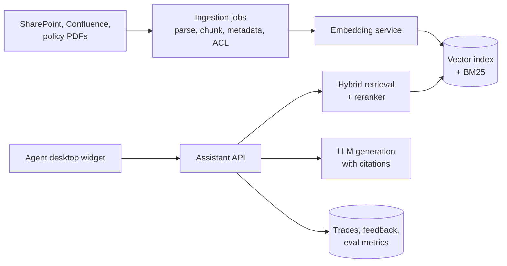

# Q32. Walk through a system you owned end to end: what broke, and what you changed.
[← Back to questions](../questions.md)

## TL;DR
- This is a **behavioral + technical depth** question. The interviewer is testing **ownership** (did *you* drive it?), **technical depth** (can you go 3 levels down?), **judgment under failure** (how you detected, triaged and fixed it), and **learning** (what systemic changes you made so it can't recur).
- Structure: **Context → System → Your role → What broke → Detection → Diagnosis/root cause → Fix (immediate + systemic) → Results (numbers) → What you'd do differently.** That's STAR with an engineering-postmortem core.
- Pick a system with **real metrics**, a **non-trivial failure** (not "a typo in config"), and **changes you personally drove**. For AI/FDE roles, an LLM/RAG/agent system with a quality or cost incident is ideal.
- Use "I" for your decisions and "we" for team execution. Quantify impact. Own the mistake without blaming others.
- Have a **2-minute version** and be ready for a **20-minute deep dive** with a whiteboard architecture.

## Detailed Answer

### 1. What interviewers are scoring
| Signal | What a strong answer shows | Red flags |
|---|---|---|
| Ownership | You owned design, on-call, metrics, stakeholder comms | "The team did X". Vague about your role |
| Technical depth | Precise architecture, numbers, trade-offs, why you chose X over Y | Buzzwords, can't explain internals |
| Debugging rigor | Hypotheses, data, isolation, root cause vs symptom | "We restarted it and it went away" |
| Impact | Quantified before/after (latency, cost, quality, revenue, tickets) | No metrics |
| Systemic learning | Process, tests, monitors and guardrails added | Fixed only the instance |
| Communication | Clear, structured, adapts depth to the audience | Rambling, jargon without context |
| Customer focus (FDE) | Managed customer impact, trust, expectations | Ignored the users affected |
| Humility | Admits own mistakes, what you'd change | Blames others, perfect hero story |

### 2. Answer framework (STAR + postmortem)
1. **Context (15-20 s):** company/customer, problem, scale, why it mattered.
2. **The system (45-60 s):** architecture in 4-6 boxes, key tech choices and *why*, the main metrics.
3. **Your role (10 s):** what you owned (design, build, on-call, customer relationship).
4. **What broke (20-30 s):** the symptom, user and business impact, how it was detected (or *not* detected, which is itself a lesson).
5. **Diagnosis (45-60 s):** hypotheses, data you looked at, how you isolated the cause, the **root cause** and the contributing factors.
6. **Fix (45-60 s):** immediate mitigation (stop the bleeding), permanent fix, **systemic changes** (tests, monitors, process).
7. **Results (15-20 s):** numbers before and after, and the recurrence rate.
8. **Reflection (15 s):** what you'd do differently, what you learned and now apply.

Total: about 3-4 minutes for the first pass. Then let them drill in.

### 3. Worked EXAMPLE (sample story to adapt, not a real claim)

> **Note:** this is an illustrative example. Replace every detail with your own real experience. Interviewers probe details, so never present a story you didn't live.

#### 3.1 Context
"At my last company I was the tech lead and owner of an **enterprise knowledge assistant** for a 6,000-person financial services customer. It was a RAG assistant answering policy, product and operations questions for contact-center agents and back-office staff. It handled about **25k questions a day**, and the business case was reducing average handle time and escalations to the policy team."

#### 3.2 The system

- Ingestion: nightly plus webhook-driven updates. Section-aware chunking (~400 tokens). ACL metadata from SharePoint groups.
- Retrieval: BM25 + vector with RRF, a cross-encoder reranker on the top 40, top 6 into the prompt.
- Generation: a hosted LLM, answers with mandatory citations, "I don't know" when context was insufficient.
- Metrics: answer helpfulness (thumbs), a weekly human-graded eval set of 400 questions (correctness, groundedness), retrieval recall@6 on a labelled set, p95 latency of about 3.2 s, cost per question of about $0.012.
- **My role:** I designed the retrieval and eval architecture, owned the ingestion and retrieval services, carried the on-call pager, and was the technical point of contact for the customer's platform team.

#### 3.3 What broke
"Six months in, over about four days, thumbs-down rate went from **9% to 23%**, and the policy team saw a spike in escalations. Agents reported that the assistant 'stopped knowing things', such as answering 'I don't have information on that' for common fee-waiver questions. Our latency and error-rate dashboards were green, so **our monitoring didn't catch it**. A customer ops manager escalated it to me."

#### 3.4 Diagnosis
- **Step 1, scope it.** I pulled traces of the thumbs-down conversations. The "I don't know" rate had gone from 4% to 17%, and the retrieved chunks were frequently irrelevant (low reranker scores), so the problem was **retrieval**, not generation.
- **Step 2, find what changed.** The deploy log showed no app releases in that window. But a platform team had **upgraded the embedding service to a newer model version** as part of a "routine dependency update". The new model was served under the same endpoint name.
- **Step 3, confirm the mechanism.** Query embeddings were now produced by **model v2** while the index held document embeddings from **model v1**. The vector spaces don't line up, so vector retrieval became near-random. BM25 still worked, which is why it degraded rather than failing completely: keyword-heavy questions were fine, while paraphrased questions collapsed. On the labelled set, recall@6 fell from **0.86 to 0.41**.
- **Contributing factors:**
  1. No **model version pinned** in the index metadata or checked at query time.
  2. Monitoring covered infrastructure (latency, 5xx) but not **quality** (recall, I-don't-know rate, reranker score distribution).
  3. The weekly eval ran on a schedule that hadn't come round yet.
  4. A change-management gap: the embedding service was treated as a stateless dependency when it is really **coupled to stored data**.

#### 3.5 Fix
- **Immediate (within 2 hours):** pinned the query path back to embedding model v1 (we had the old deployment available). Recall recovered to 0.85 on the labelled set and the thumbs-down rate went back to baseline within a day. I sent the customer a short incident note covering impact, cause and the fix.
- **Permanent:**
  1. **Index-model binding:** every index records `embedding_model_id` and `dimension`. The retrieval service **refuses to query** with a mismatched model and alerts. That turns a silent quality failure into a loud one.
  2. **Blue/green re-indexing for model upgrades:** build a new index with the new model in parallel, run the eval suite (recall@k, groundedness), then switch an **alias** atomically. Rollback is an alias flip.
  3. **Quality SLOs and alerts:** a canary of 50 golden queries run every hour (recall@6, answer match), plus online signals: "I don't know" rate, mean reranker top-1 score, thumbs-down rate. Alerts fire on deviation from a 7-day baseline.
  4. **Eval gate in CI/CD** for prompt, model, chunking and retriever changes, with a minimum recall and groundedness threshold to merge.
  5. **Change-management:** the embedding service was added to the "stateful dependency" list, requiring owner sign-off. I wrote an RFC and ran a cross-team review.
- **Later**, using the same blue/green path, we *did* upgrade to the new embedding model properly. It **improved** recall@6 from 0.86 to 0.90 after a full re-index (about 3.1M chunks, ~6 hours of batch embedding, about $40).

#### 3.6 Results
- Detection time for retrieval-quality regressions went from **~4 days to under 1 hour** (the canary caught two later issues, a SharePoint ACL sync failure and a parser regression, before users noticed).
- Thumbs-down back to 8-9%, and later down to **7%** after the proper model upgrade.
- No repeat of the embedding mismatch over the following 12 months.
- The customer's trust actually **went up**. Their platform lead cited the incident report and the quality SLOs in the renewal discussion.

#### 3.7 Reflection
"What I'd do differently: I would have defined **quality SLOs at launch, not after an incident**. We monitored the system as if it were a normal web service. With ML systems, *the system can be up and wrong*. I now treat embedding models, prompts and chunkers as versioned, data-coupled artifacts with eval gates from day one."

### 4. Alternative example incidents (pick what matches your experience)
| Incident | Root cause | Systemic fix |
|---|---|---|
| **Agent cost spike** (LLM spend 8x in a weekend) | Tool error returned an ambiguous message, and the agent retried in a loop. No max-step or budget cap | Step and token budgets per run, loop detection (same tool+args), circuit breakers, cost anomaly alerts, structured tool errors |
| **Stale answers** after a policy change | Deleted or updated docs weren't tombstoned. Old chunks kept ranking | Versioned chunks, `is_current` filter, deletion sync, freshness monitors |
| **Latency p95 doubled** | Context grew as retrieval k increased plus long docs, and the provider began throttling | Token budgets, context compression, rerank and trim, provider failover, per-tenant rate limits |
| **PII leaked into logs** | Debug logging of prompts enabled in prod | Redaction middleware, log scanning, config guardrails |
| **Model provider update changed behavior** | Unpinned model alias moved to a new snapshot | Pin snapshots, eval before switching, canary rollout |
| **Kafka consumer duplicates** produced double emails | Auto-commit plus a crash after the side effect | Manual commit after the effect, idempotency keys, outbox |

### 5. Fill-in template for your own story

```text
CONTEXT
- Company/customer, domain: ______________________
- Problem the system solved & why it mattered ($, users, risk): ______________________
- Scale (users, QPS, data size, cost): ______________________

SYSTEM
- 4–6 components: ______________________
- Key technical choices + why (and alternatives rejected): ______________________
- Key metrics before the incident (quality, latency, cost, adoption): ______________________

MY ROLE
- I owned: ______________________   (design / build / on-call / customer)

WHAT BROKE
- Symptom & user/business impact (numbers): ______________________
- How detected (and how fast): ______________________

DIAGNOSIS
- Hypotheses considered: 1) ______ 2) ______ 3) ______
- Data/tools used to isolate: ______________________
- Root cause: ______________________
- Contributing factors (monitoring, process, design): ______________________

FIX
- Immediate mitigation (time to mitigate): ______________________
- Permanent fix: ______________________
- Systemic changes (tests, monitors, process, design): ______________________

RESULTS
- Before → after numbers: ______________________
- Recurrence / later incidents caught: ______________________

REFLECTION
- What I'd do differently: ______________________
- Principle I now apply: ______________________
```

### 6. Depth-probe preparation (expect these drills)
Prepare crisp answers to each, about your own system:
- "Why that vector DB / model / chunk size? What did you benchmark?"
- "Draw the data flow for a single request. Where is the latency?"
- "How did you measure quality? How was the eval set built? Inter-annotator agreement?"
- "What does on-call look like? What alerts exist?"
- "How much did it cost per request? What were the cost levers?"
- "What was the hardest stakeholder conversation?"
- "If you rebuilt it today, what would you change?"
- "What did *you* do versus the team?"

### 7. Delivery tips
- **Lead with impact.** One sentence of context, then the system, then the incident. Don't spend 3 minutes on company background.
- **Use numbers**, even approximate ones ("about 25k/day", "recall 0.86 → 0.41").
- **Show the debugging process**, not just the answer. Interviewers want to see how you think.
- **Separate mitigation from root-cause fix from systemic change.** That's a senior signal.
- **Name your own mistake** if you made one. Credibility goes up.
- **Mind confidentiality.** Anonymize customer names and sensitive numbers ("a top-10 US bank", "~X% improvement").
- **Have a whiteboard version.** Practice drawing the architecture in 60 seconds.
- **Prepare two stories**, one technical-failure focused and one stakeholder/customer-failure focused, since the interviewer may ask for a second.
- **For FDE roles,** emphasize customer communication: how you informed them, managed expectations and rebuilt trust.

## Trade-offs (choosing which story to tell)

| Story choice | Pros | Cons | When to use |
|---|---|---|---|
| Big outage with huge impact | Memorable, shows pressure handling | Can look like you caused a disaster without safeguards | When you clearly drove the recovery and the systemic fixes |
| Silent quality regression (ML-specific) | Shows ML-system maturity (evals, SLOs) | Needs a clear explanation for non-ML interviewers | AI Engineer / FDE roles, which is ideal |
| Cost incident | Shows business awareness | Can seem small | Startups and cost-sensitive orgs |
| Customer-facing failure | Shows FDE skills (trust, comms) | Less technical depth | FDE or solutions roles, paired with technical detail |
| A project that failed overall | Shows humility, judgment | Risky if no learning is shown | Only with a strong "what I changed" |

## Common Pitfalls
- Describing a system you didn't own, or exaggerating your role. Deep dives expose this.
- Spending too long on context and too little on the failure and the fix.
- Fixing only the instance ("we rolled back"), with no systemic change.
- No numbers.
- Blaming another team or the customer.
- Picking a trivial failure (a typo) or a story where nothing actually broke.
- Getting lost in jargon without explaining *why* the root cause produced that symptom.
- Not preparing for "what would you do differently?"
- Revealing confidential customer details.
- Presenting a sample story (like the one above) as your own. Adapt it from real experience.

## Likely Follow-up Questions
1. **Why didn't your monitoring catch it?**
   Answer honestly. We monitored availability and latency but not quality signals. Then explain the specific quality SLOs you added and how they've performed since.
2. **How did you decide between rolling back and fixing forward?**
   Rollback was safe (old model still deployable), fast and fully reversible, and user impact was ongoing. So: mitigate first, then root-cause and do the proper upgrade via blue/green.
3. **How did you communicate with the customer?**
   Acknowledge quickly, give a mitigation ETA, then a written incident report (impact, timeline, root cause, actions) within a few days, then follow-up on the preventive measures. Be transparent without excessive detail.
4. **What would you do differently from day one?**
   Quality SLOs and canary eval at launch, versioned data-coupled artifacts (embedding model, chunker, prompt), eval gates in CI, and explicit ownership of shared dependencies.
5. **How did you prioritize the systemic fixes against feature work?**
   Quantify the risk (4 days of degraded service affecting 25k questions/day) and the cost (about 2 sprint-weeks). Got PM and customer agreement. Shipped the cheapest high-leverage items first (index-model binding check, canary queries).
6. **Tell me about a time the fix itself caused a problem.**
   Have a second short story ready, for example an alert threshold that was too sensitive and caused alert fatigue until it was tuned with a baseline-relative threshold.

[← Back to questions](../questions.md)
