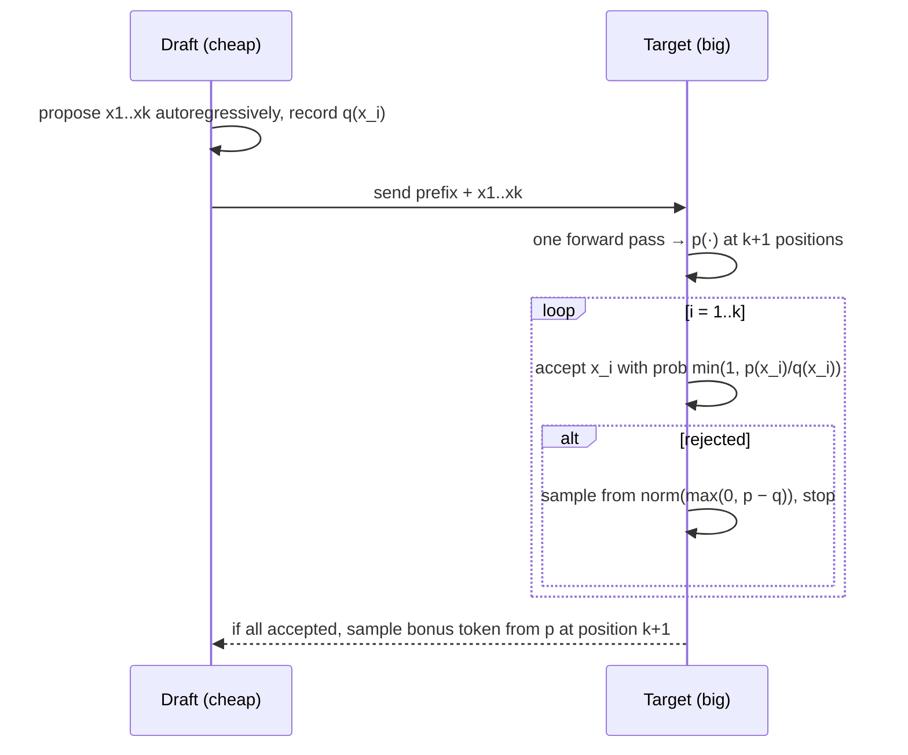

# Q33. How does speculative decoding speed up inference, and when does it not help?
[← Back to questions](../questions.md)

## TL;DR
- Decoding is **memory-bandwidth-bound**. Verifying *k* tokens in one forward pass of the big model costs about the same as generating one. Speculative decoding uses that spare compute: a cheap **drafter** proposes *k* tokens, and the **target** model checks them all in one pass, accepting the longest correct prefix plus one bonus token.
- With rejection sampling, the output distribution is **exactly the target model's** (lossless), and greedy outputs are identical.
- Speedup depends on the **acceptance rate α** and on draft cost. Expected tokens per target pass = `(1 − α^(k+1)) / (1 − α)`. Typical real-world speedups are **1.5–3×** on per-request decode latency.
- Kinds of drafter: a **small draft model** (same tokenizer), **Medusa** (extra decoding heads), **EAGLE / EAGLE-3** (a light feature-level autoregressive head, currently the strongest), **n-gram / prompt lookup** (free, and great for RAG, editing, code), and MTP heads (DeepSeek-V3).
- It **doesn't help** (and can hurt) when **batch sizes are large** (the GPU is already compute-bound, so verification wastes FLOPs), when acceptance is low (high temperature, creative text, a drafter mismatched to the domain), when TTFT is the bottleneck, or when KV/VRAM headroom is too tight for the drafter.

## Detailed Answer

### 1. Why it works
At batch size 1, generating one token reads all weights (about 16 GB for 8B FP16) for about 16 GFLOPs of work, which leaves the GPU compute units mostly idle. Scoring *k+1* positions in one forward pass reads the **same weights once**, so its latency is about the same as one decode step while k is small.

```
Normal decoding:     [T] → t1   [T] → t2   [T] → t3   [T] → t4        4 target passes
Speculative (k=4):   [d][d][d][d] → draft t1..t4
                     [T verify t1..t4 in ONE pass] → accept t1,t2,t3 ✗t4 → + correction t4'
                     => 4 tokens for 1 target pass + 4 cheap draft passes
```

### 2. The algorithm (Leviathan et al. 2023; Chen et al. 2023)

- Accepting with `min(1, p/q)` and resampling rejected positions from the **residual** `max(0, p−q)` gives samples drawn **exactly** from p. This is a theorem, not an approximation.
- In greedy mode, accept a token if it equals the target's argmax.
- Every iteration yields at least 1 token (the correction or bonus), so it is never slower in *token count*, only possibly in *wall time*.

### 3. Speedup math
Let α be the per-token acceptance probability (assumed i.i.d.), k the draft length, and c = cost of one draft step / cost of one target step.

```
E[tokens per iteration] = (1 − α^(k+1)) / (1 − α)
time per iteration       ≈ k·c + 1          (in units of target steps; assumes verify ≈ 1 step)
speedup                  ≈ E[tokens] / (k·c + 1)
```
| α | k | c | E[tokens] | speedup |
|---|---|---|---|---|
| 0.6 | 4 | 0.05 | 2.31 | 1.92× |
| 0.8 | 4 | 0.05 | 3.36 | 2.80× |
| 0.8 | 8 | 0.05 | 4.33 | 3.09× |
| 0.5 | 8 | 0.05 | 2.00 | 1.43× |
| 0.8 | 4 | 0.25 (big drafter) | 3.36 | 1.68× |
| 0.9 | 5 | 0.0 (n-gram) | 4.69 | ~4×+ (when the lookup hits) |

The takeaways: **α matters most**, a drafter that is too big eats the gain, and a large k has diminishing returns when α is moderate. vLLM and other engines report *acceptance rate* and *mean acceptance length*, and those are what you tune on.

### 4. Drafter options
| Method | How drafts are produced | α / speedup | Cost to adopt | Notes |
|---|---|---|---|---|
| **Draft model** (e.g. Llama-3.2-1B for Llama-3-70B) | separate small LM | good when same family | need compatible tokenizer; extra VRAM + KV | classic; draft KV also consumes memory |
| **Medusa** | k extra heads on target's last hidden state predict t+1..t+k; tree attention verifies candidates | ~2× | train heads (hours) | heads predict independently → lower α at deep positions |
| **EAGLE / EAGLE-2 / EAGLE-3** | tiny autoregressive head over target's *features* (+ token), dynamic draft trees | ~2.5–4× at low batch | train head or use published ones | state of the art; supported in vLLM, SGLang, TRT-LLM |
| **MTP** (multi-token prediction heads trained with the model) | model's own MTP modules | high α (DeepSeek-V3 reports ~85–90% for 2nd token) | comes with model | model must be trained with MTP |
| **N-gram / prompt lookup** | match last n tokens in the prompt/history, copy what followed | very high on copy-heavy tasks, ~0 otherwise | zero training, ~zero cost | RAG with quotes, code edits, summarization, rewriting |
| **Lookahead decoding** | Jacobi iteration + n-gram pool | 1.5–2× | no training | less common in production |
| **Self-speculative / layer-skip** | early-exit layers of target as drafter | moderate | needs layer-skip training | no extra model |

### 5. vLLM configuration
```bash
# Draft model
vllm serve meta-llama/Llama-3.1-70B-Instruct --tensor-parallel-size 4 \
  --speculative-config '{"model": "meta-llama/Llama-3.2-1B-Instruct", "num_speculative_tokens": 5}'

# N-gram / prompt lookup (no extra model)
vllm serve meta-llama/Llama-3.1-8B-Instruct \
  --speculative-config '{"method": "ngram", "num_speculative_tokens": 5, "prompt_lookup_max": 4, "prompt_lookup_min": 2}'

# EAGLE head
vllm serve meta-llama/Llama-3.1-8B-Instruct \
  --speculative-config '{"method": "eagle", "model": "yuhuili/EAGLE-LLaMA3.1-Instruct-8B", "num_speculative_tokens": 4}'
```
```python
from vllm import LLM, SamplingParams

llm = LLM(
    model="meta-llama/Llama-3.1-8B-Instruct",
    speculative_config={"method": "ngram", "num_speculative_tokens": 5, "prompt_lookup_max": 4},
)
doc = open("contract.txt").read()
out = llm.generate([f"Rewrite with clause numbers fixed:\n{doc}"],
                   SamplingParams(temperature=0.0, max_tokens=2048))
```
(The flag format has changed across vLLM versions. Older releases used `--speculative-model` and `--num-speculative-tokens`. Check the docs for your version.)

Hugging Face Transformers has the same idea as *assisted generation*: `model.generate(..., assistant_model=draft)` or `prompt_lookup_num_tokens=10`.

### 6. When it does NOT help
1. **High batch sizes / high load.** With 64–256 concurrent sequences, decode is already closer to compute-bound. Verifying k drafts per sequence multiplies FLOPs by about (k+1), and rejected tokens are wasted compute. Throughput can **drop**, and ITL can get worse. Speculative decoding is mostly a **latency-at-low-to-moderate-load** optimization. Some engines adapt k dynamically, or turn speculation off above a batch threshold.
2. **Low acceptance rate**:
   - high temperature or creative sampling (more entropy means the drafter guesses wrong);
   - domain mismatch (a general drafter on medical or code text, a different language);
   - drafter much weaker than the target, or not aligned to the target's chat template or fine-tune;
   - n-gram lookup on novel generation (nothing to copy).
3. **The bottleneck is TTFT / prefill.** Speculation only speeds up decode. Long-prompt, short-answer workloads (classification, extraction with short outputs) gain nothing.
4. **Memory pressure.** Draft model weights plus *draft KV cache* take VRAM, which reduces KV for the target and so reduces concurrency (see Q2).
5. **Very short outputs** (fewer than about 20 tokens): the overhead isn't amortized.
6. **Heavy structured or constrained decoding**: grammar masks can lower α or interact poorly, depending on the engine.
7. **Already-fast small models**: an 8B on an H100 at batch 1 is already about 200 tok/s, so the drafter overhead is a bigger fraction.

```
Speedup vs. concurrency (typical shape)
speedup
 3x |*
    |  *
 2x |     *
    |        *
 1x |------------*-----------  ← break-even
    |                 *   *    (can go < 1x at high batch)
    +---------------------------> concurrent requests
      1   4   16   32   64  128
```

### 7. How to evaluate it in your stack
1. Measure **acceptance rate and mean accepted length** on *production-like prompts* (vLLM logs and metrics expose spec decode stats).
2. Sweep `num_speculative_tokens` ∈ {2, 3, 4, 5, 8} at your **real concurrency levels**, not just batch 1.
3. Compare **TPOT p50/p95, throughput (tok/s/GPU), and goodput** against the baseline.
4. Check correctness: greedy outputs should be token-identical. For sampling, compare distributions or task metrics. Mismatches usually point to numerical-precision differences, not to the algorithm.
5. Decide per route. Turn it on for interactive and copy-heavy endpoints, and off for high-throughput batch pools.

### 8. Interaction with other optimizations
| Combined with | Interaction |
|---|---|
| Continuous batching | works, but each sequence has variable accepted length → scheduler complexity; gains shrink as batch grows |
| Quantization | quantized target lowers step cost; drafter must still be well-aligned (quantization can slightly lower α) |
| Prefix caching | independent; both help |
| Tensor parallelism | draft can run with TP=1 alongside a TP target; communication overhead per verify step matters |
| Reasoning models | long outputs → large absolute savings; reasoning text is often predictable (high α) |

## Common Pitfalls
- Benchmarking only at batch 1 and then enabling it on a saturated cluster, where throughput drops.
- Using a drafter with a different tokenizer, which classic draft-model mode doesn't support.
- Picking a drafter that is too large (c ≈ 0.2–0.3), which eats the gain.
- Setting k too high with moderate α, which wastes verification compute.
- Not accounting for draft KV cache memory, which reduces concurrency.
- Expecting gains at temperature 1.0 on creative tasks.
- Treating it as lossy and running a quality eval instead of a correctness check. It is mathematically lossless, so investigate any differences as bugs or precision effects.

## Likely Follow-up Questions
1. **Why is it lossless?**
   Accepting with probability min(1, p/q) and resampling rejections from normalized max(0, p−q) gives exactly p. The proof is a coupling argument.
2. **Medusa vs EAGLE?**
   Medusa heads each predict a fixed future position independently from the last hidden state, so α drops at deeper positions. EAGLE drafts autoregressively at the feature level with the sampled token as input, which captures dependencies, gives higher α, and generally a larger speedup.
3. **Why does it hurt at high batch?**
   The GPU stops being bandwidth-bound, so extra verification tokens cost real compute, and rejected drafts are pure waste. Throughput per GPU can fall below the baseline.
4. **When would you use prompt lookup specifically?**
   When the output copies spans from the input: RAG answers with citations, code refactoring and edits, document rewriting, summarization with quotes. It needs no training and costs almost nothing.
5. **Does it help TTFT?**
   No. It only accelerates decode. For TTFT, use prefix caching, chunked prefill and capacity.
6. **How would you train a custom drafter?**
   Distill it on the *target's* outputs for your traffic (sequence-level KD, see Q4), or train EAGLE or Medusa heads on target hidden states over in-domain data. Aligning the drafter to the target matters more than its size.

[← Back to questions](../questions.md)
