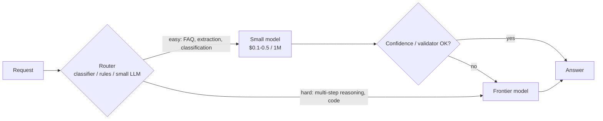

# Q34. How do you cut LLM inference cost by 50%+ without hurting quality?
[← Back to questions](../questions.md)

## TL;DR
- **Measure first.** Cost = Σ (input_tokens × in_price + output_tokens × out_price) × calls. Attribute it per feature, route and tenant, and find the 20% of flows that drive 80% of spend.
- **Prompt/prefix caching**: put static content (system prompt, tools, few-shot examples, documents) first and keep it byte-identical. Cached input is billed at a steep discount by providers (e.g. Anthropic cache reads at about 10% of the base input price; OpenAI automatic caching discounts cached input substantially). Self-hosted, it removes prefill compute.
- **Model routing and cascades**: send easy requests to a small or cheap model and escalate on low confidence. Often 60–80% of traffic doesn't need the frontier model, which typically cuts cost by 40–70%.
- **Cut tokens**: trim RAG context (fewer, better chunks plus reranking), summarize chat history, use concise output instructions, set `max_tokens`, use structured outputs, and set reasoning-effort budgets. Output tokens usually cost **3–5× input tokens**.
- **Batch APIs** (about 50% off) for anything not interactive; **semantic and exact caching** for repeated queries; **self-host plus quantization** at high steady volume.
- **Guard quality** with an offline eval set plus online A/B. Every optimization ships behind a flag with a quality gate.

## Detailed Answer

### 1. Build the cost model before optimizing
```
monthly_cost = Σ_routes  calls × ( in_tok × p_in  +  cached_in_tok × p_cache_read
                                   + cache_write_tok × p_cache_write + out_tok × p_out )
```
Log per call: route/feature, model, input, cached and output tokens, latency, and a quality signal (thumbs, task success, judge score). Then:

| Question | Typical finding |
|---|---|
| Which routes dominate spend? | 1–3 flows (e.g. agent loop, RAG answer) are 70–90% |
| Input or output heavy? | RAG and agents: input-heavy (big contexts repeated each step). Generation: output-heavy |
| How much input is repeated? | system prompt + tools + docs often 50–90% of input tokens |
| Calls per user action? | agents: 5–30 LLM calls per task |
| Which model per route? | frontier model used for trivial classification steps |

```python
# minimal per-call cost accounting (prices are placeholders: load from config)
PRICES = {  # USD per 1M tokens
    "big-model":   {"in": 3.00, "cache_read": 0.30, "cache_write": 3.75, "out": 15.00},
    "small-model": {"in": 0.25, "cache_read": 0.03, "cache_write": 0.30, "out": 1.25},
}

def call_cost(model, in_tok, out_tok, cache_read_tok=0, cache_write_tok=0):
    p = PRICES[model]
    uncached = in_tok - cache_read_tok - cache_write_tok
    return (uncached * p["in"] + cache_read_tok * p["cache_read"]
            + cache_write_tok * p["cache_write"] + out_tok * p["out"]) / 1e6
```

### 2. The levers, ranked by typical impact
| Lever | Typical saving | Quality risk | Effort |
|---|---|---|---|
| Prompt/prefix caching | 30–90% of input cost on repeated prefixes; lower TTFT too | none | low (prompt layout) |
| Model routing / cascades | 40–70% | medium, needs evals | medium |
| Context trimming (RAG top-k, history summarization) | 20–60% of input | low–medium | medium |
| Output length control | 20–50% of output | low if done well | low |
| Batch API for offline jobs | 50% of that traffic | none | low |
| Exact / semantic response caching | 10–40% (depends on repetition) | medium for semantic (false hits) | medium |
| Fewer agent steps / parallel tool calls | 20–50% on agent flows | medium | medium–high |
| Fine-tune / distill small model for narrow tasks (Q4) | 70–95% on that route | medium, eval-gated | high |
| Self-host + quantization + high utilization | 50–80% at high steady volume | low (FP8) | high (ops) |

Stacking several of these usually gets past 50%.

### 3. Prompt / prefix caching
Providers and engines reuse the KV cache for an identical **prefix**, so the order of prompt parts matters:

```
┌──────────────────────────── cacheable (stable, byte-identical) ──────────────────────────┐┌── dynamic ──┐
[ tool definitions ][ system prompt ][ few-shot examples ][ long document / codebase ][ history ]  [ user query ]
```
Rules:
- Static content goes **first**, variable content **last**. Never put timestamps, request IDs or user names at the top.
- Keep serialization deterministic (sorted JSON keys, stable tool order).
- Mind the minimum cacheable length and the TTL. Providers require a minimum prefix size (on the order of 1K tokens) and evict after minutes of inactivity. Extended TTLs cost more to write.
- In multi-turn chat, the conversation so far is a growing prefix. Caching it incrementally makes each turn pay only for new tokens.

Anthropic-style explicit cache breakpoints:
```python
import anthropic

client = anthropic.Anthropic()
LONG_POLICY_DOC = open("policy.md").read()

resp = client.messages.create(
    model="claude-sonnet-4-5",          # use whichever model your account targets
    max_tokens=500,
    system=[
        {"type": "text", "text": "You are a support assistant for ACME. Answer only from the policy."},
        {"type": "text", "text": LONG_POLICY_DOC,
         "cache_control": {"type": "ephemeral"}},        # cache everything up to here
    ],
    messages=[{"role": "user", "content": "Can I return an opened item after 20 days?"}],
)
u = resp.usage
print(u.cache_creation_input_tokens, u.cache_read_input_tokens, u.input_tokens, u.output_tokens)
```
- Anthropic: cache writes cost about 1.25× base input (5-minute TTL), and cache reads cost about 0.1×. Break-even comes after about 1–2 reuses.
- OpenAI: caching is automatic for long enough prompts, and `usage.prompt_tokens_details.cached_tokens` reports hits.
- Gemini: implicit caching plus explicit `CachedContent` objects with a TTL.
- **Self-hosted**: vLLM `--enable-prefix-caching` / SGLang RadixAttention, plus prefix-aware routing across replicas (see Q2/Q3).

Watch **cache hit rate = cached_input_tokens / total_input_tokens** as a first-class KPI.

### 4. Model routing and cascades

- **Routing**: decide up front, using rules (task type), an embedding classifier trained on "did the small model succeed" labels, or a learned router (RouteLLM-style).
- **Cascade**: try the cheap model first and escalate when a *verifier* fails: JSON schema validation, unit tests, a self-consistency check, logprob confidence, or a judge model. The cost is extra latency on escalated requests.
- **Per-step model choice in agents**: planning and the final answer use the big model, while tool-argument filling, summarization and routing use the small one.
- Measure: % routed to small, escalation rate, quality per route against an all-big baseline.

```python
def answer(query: str) -> str:
    tier = router.predict(query)                      # "small" | "big"
    if tier == "small":
        out = small_llm(query, max_tokens=300)
        if validator(query, out):                     # schema / grounding / confidence check
            return out
    return big_llm(query, max_tokens=600)
```

### 5. Reduce tokens
**Input:**
- RAG: retrieve top-20, **rerank** to top-3–5, and send compact chunks instead of 20 raw chunks. Fewer tokens often *improves* quality (less distraction, avoids "lost in the middle").
- Conversation memory: keep the last N turns verbatim plus a running summary, and drop tool outputs that are no longer needed.
- Tool schemas: agents re-send every tool definition on every call. Prune to the tools relevant to the current step, and shorten descriptions.
- Compress verbose formats: strip HTML, avoid pretty-printed JSON, and use IDs instead of repeating documents.
- Prompt compression (LLMLingua-style) only for very long, low-value context, and only after evaluating it.

**Output** (usually the pricier tokens):
- Instructions: "Answer in at most 3 sentences," "Return only JSON matching the schema."
- `max_tokens` per route; stop sequences.
- Structured outputs or JSON mode cut verbose prose and failed parses (retries cost money).
- Reasoning models: set the **reasoning effort / thinking budget** per route. Hidden reasoning tokens are billed as output.
- Don't ask the model to repeat the input ("Here is your rewritten text: ...").

### 6. Response caching (exact and semantic)
| Type | Key | Hit rate | Risk | Use for |
|---|---|---|---|---|
| Exact | hash(model, normalized prompt, params) | low–medium | none | deterministic calls (temp 0), repeated tool/LLM sub-steps, eval reruns |
| Semantic | embedding similarity > threshold | higher | **false hits** (similar question, different answer) | FAQ-style, public, non-personalized queries |

```python
import hashlib, json
import numpy as np

def exact_key(model, messages, **params):
    blob = json.dumps({"m": model, "msg": messages, "p": params}, sort_keys=True)
    return hashlib.sha256(blob.encode()).hexdigest()

def semantic_lookup(query_vec, index, threshold=0.95):
    # index: list of (vec, answer, metadata); vecs L2-normalized
    if not index:
        return None
    sims = np.array([v @ query_vec for v, _, _ in index])
    i = int(sims.argmax())
    return index[i][1] if sims[i] >= threshold else None
```
Safety rules for semantic caching: scope it per tenant or permission set, never cache personalized or time-sensitive answers, set TTLs, and invalidate on source-document updates. Tune the threshold on labelled pairs to keep false hits under about 1%.

### 7. Batch / async APIs and scheduling
- Provider batch APIs (OpenAI Batch, Anthropic Message Batches, Vertex/Bedrock batch) are about **50% cheaper**, with results within 24 h. Use them for evals, backfills, nightly summaries, enrichment and embeddings.
- Self-hosted: run offline jobs at high batch sizes on off-peak capacity, so you get far higher tokens/s per GPU than in interactive serving.

### 8. Self-hosting economics
Self-hosting pays off with **high, steady utilization**:
```
cost per 1M output tokens ≈ (GPU $/hour) / (tokens/s per GPU × 3600 / 1e6)
e.g. H100 @ $3/h, 8B model at 2,500 tok/s sustained → $3 / 9.0M ≈ $0.33 per 1M tokens
     same GPU at 20% utilization → ~$1.67 per 1M tokens
```
Levers: FP8/AWQ quantization (Q4), continuous batching (Q1), prefix caching, speculative decoding at low load (Q33), right-sizing the GPU (L4/L40S for small models), spot capacity for batch work, and multi-LoRA to consolidate fine-tunes onto one base. Include ops/engineering cost and idle capacity in the comparison.

### 9. Protecting quality
1. **Golden eval set** per route (several hundred real examples plus edge cases), with task metrics and an LLM-judge pairwise comparison against the current production config.
2. Each optimization gets a **flag** and runs **offline eval → shadow → A/B (5–10%) → rollout**.
3. Online guardrail metrics: task success, thumbs-down rate, retry or regenerate rate, escalation to a human, and format-error rate.
4. Track **cost per successful task**, not cost per call. A cheaper model that causes retries or extra agent steps can cost *more*.
5. Re-run evals whenever a provider updates the model behind an alias.

### 10. Example: a realistic 60% reduction
| Step | Monthly cost |
|---|---|
| Baseline: frontier model, 12K-token RAG prompts, verbose answers | $100K |
| Reorder prompt + caching for system and tools (≈45% of input cached) | $78K |
| Rerank to top-4 chunks (12K → 5K input) | $62K |
| Concise output + `max_tokens` (avg 450 → 250 out) | $50K |
| Route 60% of traffic (FAQ / simple) to small model, 8% escalation | $33K |
| Nightly report generation moved to Batch API | $30K |
| **Total** | **−70%**, quality flat on eval set (±1 pt) |

## Common Pitfalls
- Optimizing without per-route attribution, which means guessing at the wrong flows.
- Breaking prefix caching with dynamic content at the top of the prompt (a date in the system prompt, a shuffled tool order).
- Semantic caching across tenants or for personalized answers, which leaks data and returns wrong answers.
- Routing to a cheap model without a validator or escalation path, so quality drops quietly.
- Measuring cost per call instead of **cost per resolved task**.
- Over-trimming context, so recall drops and hallucinations rise.
- Ignoring hidden reasoning tokens on reasoning models.
- Moving to self-hosting without a realistic utilization estimate, so idle GPUs cost more than the API did.

## Likely Follow-up Questions
1. **What is the single highest-ROI change?**
   Usually prompt reordering for prefix caching (hours of work, no quality risk), followed by output length control.
2. **How do you build a router?**
   Label historical traffic by whether the small model's answer was as good as the big one's (judge or human). Train a light classifier on embeddings plus features (length, task type), choose a threshold that meets the quality target, and monitor the escalation rate.
3. **Prompt caching vs semantic caching?**
   Prompt caching reuses *computation* on identical prefixes. It is exact and safe, and the model still generates a fresh answer. Semantic caching reuses *answers* to similar questions. It is cheaper per hit, but carries a correctness risk.
4. **When is fine-tuning a small model better than prompting a big one?**
   For high-volume, narrow, stable tasks where a golden dataset exists. You also save on prompt tokens, because the instructions are baked into the weights.
5. **How do you keep costs from creeping back up?**
   Use per-feature cost budgets and alerts, dashboards for tokens per request and cache hit rate, CI checks on prompt size, and reviews of prompt changes for cache-breaking edits.
6. **Does caching affect latency too?**
   Yes, for the better. Cached prefixes skip prefill, so TTFT on long prompts can drop by more than half.

[← Back to questions](../questions.md)
