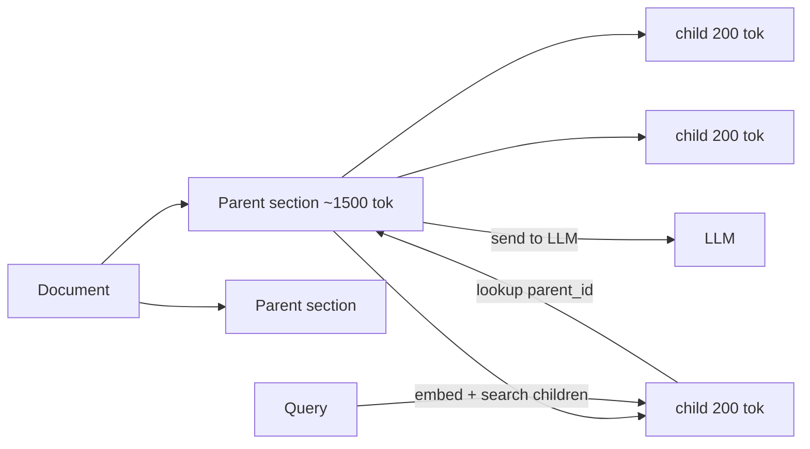
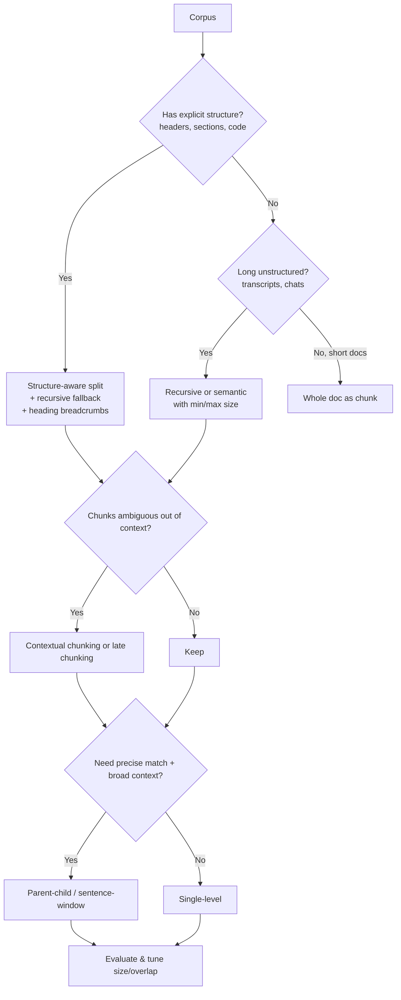

# Q35. How do you choose a chunking strategy?
[← Back to questions](../questions.md)

## TL;DR
- A chunk is the **unit of retrieval** and the **unit of context**. It should be small enough to embed one idea precisely, and large enough to make sense on its own. These two goals pull in opposite directions, so many systems **decouple them** (small-to-big / parent-child).
- Default: **recursive character/token splitting** at ~300–800 tokens with ~10–15% overlap, splitting on paragraph → sentence → word boundaries.
- Prefer **structure-aware chunking** when documents have structure (Markdown headers, HTML, code ASTs, legal sections, tables), and prepend the heading path to every chunk.
- **Semantic chunking** (split where embedding similarity drops) and **late chunking** (embed the whole document with a long-context model, then pool per chunk) help in some corpora. Neither is a guaranteed win.
- Match chunk size to the **embedding model's limit and training regime** and to the **query type** (factoid → small, explanatory → larger).
- **Decide with evals**: sweep strategy × size × overlap and measure recall@k / context precision on a golden set.

## Detailed Answer

### 1. Why chunking matters
- **Embedding dilution:** a 2,000-token chunk covering five topics produces a vector that represents none of them well.
- **Context fragmentation:** a 100-token chunk may contain "It must be submitted within 30 days" without saying *what* "it" is.
- **Cost and context budget:** top-k × chunk size = prompt tokens.
- **Citations:** chunk granularity defines how precisely you can cite.

```
Too small                      Sweet spot                     Too large
"within 30 days."        "Expense reports must be       [Entire 6-page policy:
 (no subject)             submitted within 30 days       travel, meals, per-diem,
                          of travel. Late reports        approvals, exceptions...]
 high precision,          require VP approval."          high recall per chunk,
 low self-containment     self-contained, focused        diluted embedding
```

### 2. Strategy catalog

| Strategy | How | Pros | Cons | Use when |
|---|---|---|---|---|
| Fixed-size (tokens/chars) | Slice every N tokens | Simple, predictable | Cuts mid-sentence/idea | Baselines, homogeneous text |
| Recursive | Split on `\n\n`, `\n`, `. `, ` ` until size fits | Respects natural boundaries; strong default | Ignores semantics/structure | Most prose |
| Structure-aware | Split by headers, sections, HTML tags, code AST, slides, pages | Chunks align with author intent; heading context | Sections vary wildly in size, so a recursive fallback is needed | Docs, wikis, manuals, code, legal |
| Semantic | Embed sentences; break where adjacent similarity drops | Topic-coherent chunks | Extra embedding cost; threshold tuning; mixed results in benchmarks | Long unstructured transcripts, essays |
| Sentence-window | Index single sentences; return ±N sentences | Very precise matching + local context | Many vectors | Factoid QA |
| Parent-child / small-to-big | Index small child chunks; return parent section | Precision of small + context of large | Two stores; dedupe parents | Most production RAG |
| Proposition / LLM-based | LLM rewrites into atomic, self-contained statements | Excellent precision | Expensive ingestion; can lose nuance | High-value, small corpora |
| Contextual chunking | LLM prepends a 1–2 sentence doc-level context to each chunk before embedding (Anthropic "Contextual Retrieval") | Fixes "what does 'it' refer to"; large recall gains reported | LLM cost per chunk (mitigate with prompt caching) | Corpora with many ambiguous chunks |
| Late chunking | Run long-context embedding model over the whole doc, mean-pool token embeddings per chunk span | Chunk vectors carry document context; no LLM | Needs long-context embedding model that exposes token embeddings (e.g., jina-embeddings-v2/v3) | Docs with lots of cross-references |
| Document-level / no chunking | Whole doc as unit | Max context | Only works for short docs | FAQs, tickets, product cards |

### 3. Recursive splitting (the default)

```python
from langchain_text_splitters import RecursiveCharacterTextSplitter

splitter = RecursiveCharacterTextSplitter.from_tiktoken_encoder(
    encoding_name="cl100k_base",
    chunk_size=500,        # tokens
    chunk_overlap=60,      # ~12%
    separators=["\n\n", "\n", ". ", " ", ""],
)
chunks = splitter.split_documents(docs)
```

Measure size in **tokens**, not characters, because embedding limits are in tokens. Characters per token vary by language and by code vs prose.

### 4. Structure-aware chunking with heading context

```python
from langchain_text_splitters import MarkdownHeaderTextSplitter, RecursiveCharacterTextSplitter

headers = [("#", "h1"), ("##", "h2"), ("###", "h3")]
md_splitter = MarkdownHeaderTextSplitter(headers_to_split_on=headers, strip_headers=False)
sections = md_splitter.split_text(markdown_text)       # Documents with header metadata

fallback = RecursiveCharacterTextSplitter.from_tiktoken_encoder(chunk_size=600, chunk_overlap=60)
chunks = fallback.split_documents(sections)

for c in chunks:
    path = " > ".join(c.metadata[h] for h in ("h1", "h2", "h3") if h in c.metadata)
    c.page_content = f"[{path}]\n{c.page_content}"      # heading breadcrumb improves embeddings
```

Other structure-aware splitters:
- Code: `RecursiveCharacterTextSplitter.from_language(Language.PYTHON, ...)`, or tree-sitter AST chunking by function/class.
- HTML: `HTMLHeaderTextSplitter`.
- PDFs: use a layout parser (Docling/Unstructured) to get titles, sections, and tables first, then chunk by element (`chunk_by_title` in Unstructured).

### 5. Semantic chunking

```python
from langchain_experimental.text_splitter import SemanticChunker
from langchain_openai import OpenAIEmbeddings

chunker = SemanticChunker(OpenAIEmbeddings(model="text-embedding-3-small"),
                          breakpoint_threshold_type="percentile",
                          breakpoint_threshold_amount=95)
chunks = chunker.create_documents([long_transcript])
```

How it works: embed each sentence (or a small window), compute cosine distance between neighbors, and split where the distance exceeds the threshold (percentile, std-dev, or interquartile).

Caveat: independent benchmarks have shown that semantic chunking does **not consistently beat** well-tuned recursive chunking, and it produces highly variable chunk sizes. Enforce min/max sizes.

### 6. Parent-child (small-to-big)



```python
from langchain.retrievers import ParentDocumentRetriever
from langchain.storage import InMemoryStore
from langchain_chroma import Chroma
from langchain_openai import OpenAIEmbeddings
from langchain_text_splitters import RecursiveCharacterTextSplitter

retriever = ParentDocumentRetriever(
    vectorstore=Chroma(collection_name="children", embedding_function=OpenAIEmbeddings()),
    docstore=InMemoryStore(),
    child_splitter=RecursiveCharacterTextSplitter(chunk_size=400, chunk_overlap=40),
    parent_splitter=RecursiveCharacterTextSplitter(chunk_size=2000, chunk_overlap=200),
)
retriever.add_documents(docs)
parents = retriever.invoke("late expense report approval")
```

LlamaIndex equivalents: `HierarchicalNodeParser` + `AutoMergingRetriever` (merges children into the parent when enough siblings hit), and `SentenceWindowNodeParser` + `MetadataReplacementPostProcessor`.

### 7. Contextual chunking (cheap, high impact)
Before embedding (and before BM25 indexing), prepend LLM-generated context:

```python
from langchain_openai import ChatOpenAI
llm = ChatOpenAI(model="gpt-4o-mini", temperature=0)

PROMPT = """<document>{doc}</document>
Here is a chunk from the document:
<chunk>{chunk}</chunk>
Give a short (1-2 sentence) context situating this chunk within the overall document
to improve search retrieval. Answer only with the context."""

def contextualize(doc_text: str, chunk_text: str) -> str:
    ctx = llm.invoke(PROMPT.format(doc=doc_text, chunk=chunk_text)).content
    return f"{ctx}\n\n{chunk_text}"
```

Use provider prompt caching for the repeated `<document>` prefix to keep the cost manageable.

### 8. Overlap
- Purpose: keep ideas that straddle a boundary retrievable.
- Typical: 10–20% of chunk size. More overlap means more duplicates in top-k and more storage.
- With structure-aware splits on clean boundaries, overlap matters less. With fixed-size splits, it matters more.
- Deduplicate overlapping neighbors before building the prompt, or merge adjacent hits.

### 9. Chunk size vs embedding model
| Consideration | Guidance |
|---|---|
| Hard token limit | Many models truncate silently: older sentence-transformers at 256–512 tokens, OpenAI `text-embedding-3-*` at 8,191. Chunks above the limit lose their tail. |
| Training distribution | Models trained on short passages (MS MARCO-style ~100–300 tokens) often retrieve best near that size even if they accept more |
| Query–chunk asymmetry | Short queries vs long chunks lower similarity; use asymmetric models/instructions (e.g., `query:` / `passage:` prefixes for E5) |
| Long-context embedders | Enable larger chunks and late chunking, but bigger chunks still dilute |

Starting points:
- Factoid / FAQ / support: 150–400 tokens.
- Technical docs / policies: 400–800 tokens, structure-aware, with parent expansion.
- Narrative / legal reasoning: larger parents (1–2k) via small-to-big.
- Code: function or class level.

### 10. Metadata on every chunk
`doc_id`, `chunk_index`, `heading_path`, `page`, `source_url`, `doc_version`, `acl`, `created/updated`, `content_type` (text/table/code). Metadata enables filtering, citation, neighbor expansion (`chunk_index ± 1`), and freshness control (see Q6).

### 11. How to choose: evaluate

```python
import itertools

configs = list(itertools.product(
    ["recursive", "markdown_header", "semantic"],
    [256, 512, 1024],          # chunk size
    [0, 0.1, 0.2],             # overlap ratio
))

def recall_at_k(retriever, golden, k=5):
    hits = 0
    for q in golden:   # q = {"question": ..., "relevant_doc_ids": {...}, "answer_span": ...}
        got = retriever.invoke(q["question"])[:k]
        if any(q["answer_span"] in d.page_content for d in got):
            hits += 1
    return hits / len(golden)

# for each config: build index -> compute recall@5, MRR, context precision, avg prompt tokens
```

Evaluation notes:
- Relevance labels must be **chunking-independent**. Use answer spans or doc-level labels, not chunk IDs, because chunk IDs change with the strategy.
- Track **tokens per query** next to recall. A strategy that wins recall by sending 3x the tokens may not be worth it.
- Also measure end-to-end faithfulness and correctness. Better retrieval metrics usually, but not always, mean better answers.

### 12. Decision guide



## Common Pitfalls
- Picking 1,000 characters and 200 overlap because a tutorial did, and never evaluating it.
- Measuring in characters while the embedding limit is in tokens, which leads to silent truncation.
- Splitting tables and code with a prose splitter.
- Losing heading and document context, so chunks say "this" and "the above".
- Labeling the eval set by chunk IDs, which makes strategies incomparable.
- Huge overlap that floods top-k with near-duplicates.
- Re-chunking without re-indexing everything, leaving mixed chunk regimes and orphans (see Q6).

## Likely Follow-up Questions
1. **Is semantic chunking better than recursive?** Not reliably. It can help on unstructured topic-shifting text, but it costs more and gives variable sizes. Benchmark it on your own data.
2. **What is late chunking?** Encode the full document with a long-context embedding model, then mean-pool token embeddings within each chunk's span, so every chunk vector is conditioned on the whole document.
3. **How does contextual retrieval differ from late chunking?** Contextual retrieval uses an LLM to write explicit context text (which also helps BM25). Late chunking does it implicitly in embedding space, with no LLM.
4. **How do you choose k with chunk size?** Fix a context token budget (e.g., 4k) and trade k against size. Smaller chunks with larger k plus reranking often beat a few large chunks.
5. **How do you chunk code?** By AST units (function, class), including the signature, docstring, and file path, and optionally imports.
6. **How do you handle documents with mixed content?** Parse into typed elements (text, table, image, code) and use a different chunker per type, sharing a `doc_id`.

[← Back to questions](../questions.md)
