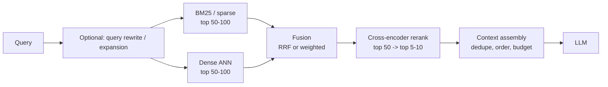

# Q36. Why use hybrid search (BM25 + dense) and rerankers?
[← Back to questions](../questions.md)

## TL;DR
- **Dense retrieval** captures meaning (paraphrases, synonyms) but misses **exact tokens**: error codes, SKUs, names, acronyms, rare terms. **BM25** is the reverse. Their failure modes barely overlap, so combining them raises recall.
- Fuse the result lists with **Reciprocal Rank Fusion**: `RRF(d) = Σ_r 1 / (k + rank_r(d))`, with k ≈ 60. It needs no score normalization and is robust. Weighted score fusion (`α·dense + (1-α)·bm25` after normalization) is the tunable alternative.
- Then **rerank** the fused top 50–200 with a **cross-encoder** (e.g., `bge-reranker`, Cohere Rerank, Voyage). It reads query and document together, so it's far more precise than bi-encoder similarity, but too slow to run over the whole corpus.
- **ColBERT / late interaction** sits in between: per-token vectors with MaxSim scoring give near-cross-encoder quality at retrieval-time speed, at the cost of more storage.
- Budget it: BM25 + ANN take ~10–50 ms, and a cross-encoder over 50–100 docs takes ~50–300 ms on GPU or via an API. Tune candidate counts to fit the latency SLO, and verify with recall@k / nDCG.

## Detailed Answer

### 1. Why neither retriever alone is enough
| Query | BM25 | Dense |
|---|---|---|
| "error E1047 on checkout" | Finds exact code | May return generic checkout errors |
| "how do I get my money back" (doc says "refund policy") | Misses (no term overlap) | Finds it |
| "Kubernetes HPA scaling lag" | Good on rare terms "HPA" | Okay; may drift to general autoscaling |
| Non-English / typos | Weak without analyzers | Often robust |
| Brand-new jargon not in embedding training | Works (lexical) | Poor |

Dense embeddings compress text into one vector, so rare tokens get washed out. BM25 has no notion of meaning. Hybrid search typically improves recall by several points over either retriever alone on mixed query workloads, as seen on BEIR-style benchmarks and in most production reports.

### 2. Architecture



Apply **the same metadata filters** (tenant, ACL, is_current) to both retrievers *before* fusion.

### 3. BM25 refresher
For a query term t in document d:

```
score(d, q) = Σ_t IDF(t) · ( f(t,d) · (k1 + 1) ) / ( f(t,d) + k1 · (1 - b + b · |d| / avgdl) )
```
- `k1` (≈1.2–2.0) controls term-frequency saturation, and `b` (≈0.75) controls length normalization.
- Analyzers (tokenization, lowercasing, stemming, stopwords, synonyms) matter a lot. Code and IDs often need custom tokenizers so that `E1047` or `user_id` don't get split badly.

**Learned sparse** models (SPLADE, BGE-M3 sparse, Elastic ELSER) expand terms with learned weights. They keep inverted-index efficiency and add some semantics, and are often a strong replacement for BM25 in the hybrid.

### 4. Fusion methods

**Reciprocal Rank Fusion (RRF)**

```
RRF(d) = Σ_{r ∈ retrievers}  w_r / (k + rank_r(d))        (k = 60 typical, w_r = 1 by default)
```
- Uses only ranks, so it's immune to incomparable score scales (BM25 is unbounded, cosine sits in [-1, 1]).
- `k` damps how much the top ranks dominate.
- A document ranked #1 by one retriever and absent from the other still scores well.

```python
from collections import defaultdict

def rrf(result_lists: list[list[str]], k: int = 60,
        weights: list[float] | None = None) -> list[tuple[str, float]]:
    weights = weights or [1.0] * len(result_lists)
    scores: dict[str, float] = defaultdict(float)
    for w, results in zip(weights, result_lists):
        for rank, doc_id in enumerate(results, start=1):
            scores[doc_id] += w / (k + rank)
    return sorted(scores.items(), key=lambda x: x[1], reverse=True)

bm25_ids  = ["d3", "d1", "d7", "d9"]
dense_ids = ["d1", "d4", "d3", "d8"]
print(rrf([bm25_ids, dense_ids])[:3])   # d1 and d3 float to the top
```

**Weighted score fusion (convex combination)**

```
s(d) = α · norm(dense(d)) + (1 - α) · norm(bm25(d))        norm = min-max or z-score per query
```
- Tunable: raise α for semantic queries and lower it for ID-heavy queries. Some systems predict α per query.
- Sensitive to normalization and outliers. Documents missing from one list need an imputed score.

| | RRF | Weighted score |
|---|---|---|
| Needs score calibration | No | Yes |
| Tunability | Low (k, weights) | High (α per domain/query) |
| Robustness out of the box | High | Medium |
| When better | Default, heterogeneous retrievers | When you have labeled data to tune α |

### 5. Implementations

**LangChain EnsembleRetriever** (weighted RRF):

```python
from langchain_community.retrievers import BM25Retriever
from langchain.retrievers import EnsembleRetriever
from langchain_chroma import Chroma
from langchain_openai import OpenAIEmbeddings

bm25 = BM25Retriever.from_documents(chunks)
bm25.k = 50
dense = Chroma.from_documents(chunks, OpenAIEmbeddings()).as_retriever(search_kwargs={"k": 50})

hybrid = EnsembleRetriever(retrievers=[bm25, dense], weights=[0.4, 0.6])
candidates = hybrid.invoke("E1047 error during checkout")
```

**Postgres (pgvector + full-text) with RRF in SQL:**

```sql
WITH dense AS (
  SELECT id, ROW_NUMBER() OVER (ORDER BY embedding <=> :qvec) AS r
  FROM chunks WHERE tenant_id = :tenant
  ORDER BY embedding <=> :qvec LIMIT 50
),
lexical AS (
  SELECT id, ROW_NUMBER() OVER (ORDER BY ts_rank_cd(tsv, q) DESC) AS r
  FROM chunks, websearch_to_tsquery('english', :qtext) q
  WHERE tenant_id = :tenant AND tsv @@ q
  ORDER BY ts_rank_cd(tsv, q) DESC LIMIT 50
)
SELECT id, COALESCE(1.0/(60 + d.r), 0) + COALESCE(1.0/(60 + l.r), 0) AS rrf
FROM dense d FULL OUTER JOIN lexical l USING (id)
ORDER BY rrf DESC LIMIT 50;
```

(Postgres `ts_rank` is not true BM25. Extensions such as ParadeDB `pg_search` provide BM25.)

Native hybrid support also exists in Elasticsearch/OpenSearch (RRF retriever / hybrid query with normalization processor), Weaviate (`hybrid` with `alpha`), Qdrant (Query API with prefetch + `Fusion.RRF`, using sparse + dense vectors), Pinecone (sparse-dense vectors), Vespa, and Azure AI Search.

Qdrant example:

```python
from qdrant_client import QdrantClient, models
client = QdrantClient(url="http://localhost:6333")

res = client.query_points(
    collection_name="kb",
    prefetch=[
        models.Prefetch(query=models.SparseVector(indices=sp_idx, values=sp_val),
                        using="sparse", limit=50),
        models.Prefetch(query=dense_vec, using="dense", limit=50),
    ],
    query=models.FusionQuery(fusion=models.Fusion.RRF),
    limit=50,
)
```

### 6. Rerankers

**Bi-encoder vs cross-encoder vs late interaction**

```
Bi-encoder (retrieval)          Cross-encoder (rerank)            ColBERT (late interaction)
 q -> [enc] -> vq                [CLS] q [SEP] d [SEP]             q -> [enc] -> {q1..qn}
 d -> [enc] -> vd                       -> [enc] -> score          d -> [enc] -> {d1..dm} (precomputed)
 score = cos(vq, vd)             full attention between q and d     score = Σ_i max_j qi·dj  (MaxSim)
 docs precomputed, fast          nothing precomputed, slow          docs precomputed, token-level match
```

| Type | Quality | Latency per doc | Precompute | Storage | Role |
|---|---|---|---|---|---|
| Bi-encoder | Good | ~0 (ANN) | Yes | 1 vector/chunk | First-stage |
| BM25 / SPLADE | Good on lexical | ~0 (inverted index) | Yes | Postings | First-stage |
| ColBERT (v2, PLAID) | Very good | Low | Yes | ~1 vector/token (compressed) | First-stage or rerank |
| Cross-encoder | Best | ~1–10 ms/doc on GPU | No | None | Second-stage |
| LLM reranker (listwise, e.g., RankGPT-style) | Best-ish, flexible | High (LLM call) | No | None | Niche / offline / small k |

**Cross-encoder with sentence-transformers:**

```python
from sentence_transformers import CrossEncoder

reranker = CrossEncoder("BAAI/bge-reranker-v2-m3", max_length=512)

def rerank(query: str, docs: list, top_n: int = 8):
    pairs = [(query, d.page_content) for d in docs]
    scores = reranker.predict(pairs, batch_size=32)
    ranked = sorted(zip(docs, scores), key=lambda x: x[1], reverse=True)
    return [d for d, _ in ranked[:top_n]]
```

**LangChain contextual compression with a hosted reranker:**

```python
from langchain.retrievers import ContextualCompressionRetriever
from langchain_cohere import CohereRerank

compressor = CohereRerank(model="rerank-english-v3.0", top_n=8)
retriever = ContextualCompressionRetriever(base_compressor=compressor,
                                           base_retriever=hybrid)
docs = retriever.invoke("E1047 error during checkout")
```

LlamaIndex: `SentenceTransformerRerank(model="BAAI/bge-reranker-base", top_n=8)` as a `node_postprocessor`.

### 7. Latency budget (example: p95 target 1.5 s to first token)

| Stage | Typical | Knobs |
|---|---|---|
| Query embedding | 10–40 ms (API) / 2–10 ms (local) | Local model, cache |
| BM25 | 5–30 ms | Shard, filter first |
| ANN | 5–30 ms | HNSW `ef_search`, quantization |
| Fusion | <1 ms | — |
| Cross-encoder 50 docs | 40–200 ms GPU / 100–400 ms API | Candidate count, `max_length`, distilled model (MiniLM), ONNX/TensorRT |
| LLM TTFT | 200–800 ms | Context size, model |

Rules of thumb:
- Retrieve **50–100** candidates per retriever, rerank the top **50–100** fused results, and send **5–10** to the LLM.
- Rerank cost scales with `candidates × doc_length`. Truncate documents to ~256–512 tokens for reranking.
- Run BM25 and dense **in parallel**.
- If you can't afford reranking, hybrid + RRF alone is still a large win over dense-only.

### 8. Tuning and evaluation
- Build a golden set (see Q37) that **covers query types**: keyword/ID, natural language, multi-hop.
- Measure recall@50 for first-stage fusion (it caps what the reranker can do) and nDCG@10 / MRR after reranking.
- Sweep the fusion weights or α, the candidate counts, and the reranker models. Plot quality against p95 latency.
- Slice by query type. Hybrid gains often concentrate in ID-heavy queries, and reranking gains in ambiguous ones.
- Calibrate a reranker **score threshold** to drop irrelevant chunks rather than always sending top-k. That helps abstention ("I don't know").

### 9. Domain considerations
- **Multilingual:** use multilingual embedders and rerankers (bge-m3, bge-reranker-v2-m3, Cohere multilingual) plus per-language BM25 analyzers.
- **Code search:** BM25 with identifier-aware tokenization matters more, and the dense model should be code-tuned.
- **Fine-tuning rerankers** on in-domain (query, positive, hard-negative) pairs mined from logs is often the highest-ROI retrieval improvement.

## Common Pitfalls
- Adding raw BM25 and cosine scores without normalization (BM25 dominates).
- Applying ACL/tenant filters to only one retriever, which leaks documents through the other (see Q38).
- Reranking only the top 10 from first stage. The reranker can't recover what was never retrieved, so give it 50+.
- Using a reranker with a short `max_length` on long chunks, so the relevant part gets truncated.
- Keeping BM25 and vector indexes out of sync on updates and deletes (see Q6).
- Default English analyzer on code, IDs, or non-English text.
- Never measuring latency: a big LLM reranker blows the SLO.

## Likely Follow-up Questions
1. **Why k = 60 in RRF?** It comes from the original Cormack et al. paper, where it was empirically robust. It flattens the score gap between the top ranks. Tune it, but it's rarely critical.
2. **Is hybrid always better than dense?** Usually on mixed workloads. On purely conversational, paraphrase-heavy queries, the gain can be small. Measure it.
3. **Cross-encoder vs ColBERT?** A cross-encoder has the best precision but no precompute, so it only works over a small candidate set. ColBERT precomputes token vectors and can search large corpora with near-cross-encoder quality but needs much more storage.
4. **Can an LLM be the reranker?** Yes (pointwise, pairwise, or listwise). Quality is high and it's flexible ("prefer recent docs"), but it's slower and more expensive, so use it for small k or offline.
5. **How do you pick α in weighted fusion?** Grid-search on labeled queries, or route by query classification (ID-like → low α).
6. **What's SPLADE?** A learned sparse retriever: a transformer predicts term weights over the vocabulary, including expansion terms, and serves them from an inverted index.

[← Back to questions](../questions.md)
