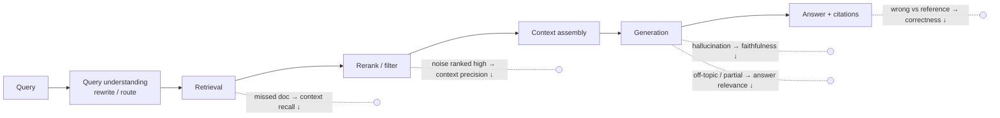
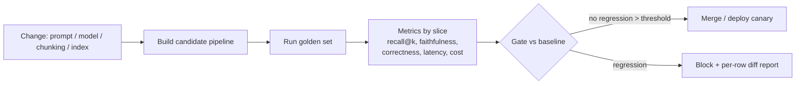

# Q37. How do you evaluate a RAG system end to end?
[← Back to questions](../questions.md)

## TL;DR
- Evaluate **components and the whole**. Retrieval asks "did we fetch the right evidence?" Generation asks "did we use it faithfully and answer the question?" End to end asks "is the answer correct and useful?"
- **Retrieval metrics:** Recall@k / Hit@k, MRR, nDCG@k, plus LLM-judged **context precision** (are retrieved chunks relevant and ranked high?) and **context recall** (does the context contain everything the reference answer needs?).
- **Generation metrics:** **faithfulness/groundedness** (claims supported by context), **answer relevance**, **answer correctness** against a reference, and citation accuracy. Also check abstention when the answer isn't in the corpus.
- Build a **golden dataset** from real user queries plus SME-labeled answers and sources, augment it with **synthetic QA** generated from the corpus, and include hard cases: multi-hop, no-answer, ambiguous, adversarial.
- Run evals **offline in CI** (regression gates on every prompt/model/index change) and **online in production** (feedback, escalations, sampled LLM-judge scoring, latency/cost dashboards). Calibrate LLM judges against human labels.

## Detailed Answer

### 1. What can go wrong, and where



Component metrics tell you **where** to fix things. End-to-end metrics tell you **whether** users are better off.

### 2. Retrieval metrics (need relevance labels)

| Metric | Formula / meaning | Notes |
|---|---|---|
| Hit@k | 1 if any relevant doc in top-k | Simple, coarse |
| Recall@k | \|relevant ∩ top-k\| / \|relevant\| | Most important for RAG; the LLM can't use what isn't retrieved |
| Precision@k | \|relevant ∩ top-k\| / k | Noise in context |
| MRR | mean of 1 / rank of first relevant | Good for single-answer queries |
| nDCG@k | DCG / ideal DCG, DCG = Σ (2^rel_i − 1) / log2(i+1) | Graded relevance, rewards good ordering |
| Context precision (RAGAS) | Precision of relevant chunks weighted by rank (LLM-judged or vs reference) | No manual chunk labels needed |
| Context recall (RAGAS) | Fraction of reference-answer claims attributable to retrieved context | Needs a reference answer |

```python
import math

def recall_at_k(retrieved: list[str], relevant: set[str], k: int) -> float:
    return len(set(retrieved[:k]) & relevant) / max(len(relevant), 1)

def mrr(retrieved: list[str], relevant: set[str]) -> float:
    for i, d in enumerate(retrieved, start=1):
        if d in relevant:
            return 1.0 / i
    return 0.0

def ndcg_at_k(retrieved: list[str], grades: dict[str, int], k: int) -> float:
    dcg = sum((2 ** grades.get(d, 0) - 1) / math.log2(i + 1)
              for i, d in enumerate(retrieved[:k], start=1))
    ideal = sorted(grades.values(), reverse=True)[:k]
    idcg = sum((2 ** g - 1) / math.log2(i + 1) for i, g in enumerate(ideal, start=1))
    return dcg / idcg if idcg else 0.0
```

**Label at document or span level, not chunk ID level**, so labels survive chunking changes (see Q35). Match a retrieved chunk as relevant if it belongs to a relevant doc or contains the answer span.

### 3. Generation metrics

| Metric | Question it answers | How measured |
|---|---|---|
| Faithfulness / groundedness | Is every claim supported by the retrieved context? | LLM decomposes answer into claims and checks each against context (RAGAS), or NLI model |
| Answer relevance | Does it address the question? | LLM judge, or RAGAS: generate questions from answer and compare embedding similarity to original |
| Answer correctness | Is it right vs reference? | Exact match / F1 for short answers; LLM judge for semantic equivalence + factual overlap |
| Citation precision/recall | Do cited sources actually support the cited sentences? Are claims cited? | LLM/NLI per (sentence, citation) |
| Abstention accuracy | Says "I don't know" when the answer is absent, answers when present | No-answer test cases |
| Completeness | Covers all required points | Rubric / checklist judge |
| Safety / policy | PII, toxicity, prompt injection compliance | Classifiers, red-team set |

Faithfulness and correctness are different. An answer can be faithful to a wrong or stale chunk and still be incorrect, and it can be correct from parametric memory while unfaithful to the context. In enterprise RAG, you want both.

### 4. Building the golden dataset

```
Sources of questions                       Labels per item
──────────────────────                     ─────────────────────────────
1. Real user queries (logs, tickets)  ──►  question
2. SME-written questions                    reference_answer
3. Synthetic from corpus (LLM)              relevant_doc_ids / answer spans
4. Adversarial / edge cases                 question_type (factoid, multi-hop,
                                              comparison, no-answer, ambiguous)
                                            metadata (tenant, user role, date)
```

Guidelines:
- Start with **50–100 high-quality items** and grow to several hundred, stratified by question type and topic. Quality beats quantity.
- **Real queries first.** Synthetic questions skew toward phrasing that copies the source text, which overestimates performance.
- Include **no-answer** questions (10–15%), **multi-hop**, **time-sensitive** questions (versioning, see Q6), and **permission-dependent** questions (see Q38).
- Version the dataset and keep a held-out split so you don't overfit prompts to it.

**Synthetic QA generation:**

```python
from langchain_openai import ChatOpenAI
from pydantic import BaseModel

class QA(BaseModel):
    question: str
    answer: str
    supporting_quote: str

gen = ChatOpenAI(model="gpt-4o", temperature=0.7).with_structured_output(QA)

def synth_qa(chunk_text: str, doc_id: str) -> dict:
    qa = gen.invoke(
        "Write one realistic question a user of an internal knowledge base might ask "
        "that is answerable ONLY from this passage. Do not copy phrasing verbatim. "
        "Return the answer and the exact supporting quote.\n\n" + chunk_text)
    return {"question": qa.question, "reference_answer": qa.answer,
            "relevant_doc_ids": [doc_id], "quote": qa.supporting_quote}
```

Then **filter**: drop questions answerable without the passage, check that the quote really exists in the chunk, deduplicate, and have humans review a sample. RAGAS (`TestsetGenerator`) and DeepEval (`Synthesizer`) offer this out of the box, including multi-hop evolutions.

### 5. Running evals with RAGAS

```python
from ragas import evaluate, EvaluationDataset
from ragas.metrics import Faithfulness, ResponseRelevancy, LLMContextPrecisionWithReference, LLMContextRecall
from ragas.llms import LangchainLLMWrapper
from ragas.embeddings import LangchainEmbeddingsWrapper
from langchain_openai import ChatOpenAI, OpenAIEmbeddings

rows = []
for item in golden:
    docs = retriever.invoke(item["question"])
    answer = rag_chain.invoke(item["question"])
    rows.append({
        "user_input": item["question"],
        "retrieved_contexts": [d.page_content for d in docs],
        "response": answer,
        "reference": item["reference_answer"],
    })

dataset = EvaluationDataset.from_list(rows)
judge = LangchainLLMWrapper(ChatOpenAI(model="gpt-4o", temperature=0))
emb = LangchainEmbeddingsWrapper(OpenAIEmbeddings())

result = evaluate(dataset,
                  metrics=[Faithfulness(), ResponseRelevancy(),
                           LLMContextPrecisionWithReference(), LLMContextRecall()],
                  llm=judge, embeddings=emb)
print(result)                     # aggregate scores
df = result.to_pandas()           # per-row scores for error analysis
```

(RAGAS metric class names have changed across versions, so check the version you have installed. DeepEval, TruLens, Arize Phoenix, LangSmith, and promptfoo provide similar metrics.)

### 6. LLM-as-judge done right
- Use **specific rubrics** with binary or 1–4 scales, not vague 1–10 scales. Ask for reasoning before the score.
- Prefer **pairwise comparison** (A vs B) for change decisions, randomizing the order to avoid position bias.
- Use a **different and stronger model** as the judge where possible to reduce self-preference bias.
- **Calibrate**: have humans label ~100 items and measure judge agreement (Cohen's kappa or accuracy). Iterate the judge prompt until agreement is acceptable.
- Watch for **verbosity bias**, where judges prefer longer answers.

```python
JUDGE_PROMPT = """You are grading an answer for factual correctness against a reference.
Question: {q}
Reference answer: {ref}
Candidate answer: {ans}

Rules:
- CORRECT if the candidate contains all key facts of the reference and no contradicting facts.
- PARTIAL if some key facts are missing but nothing contradicts.
- INCORRECT if any key fact contradicts the reference or the main question is unanswered.
First explain briefly, then output a final line: VERDICT: CORRECT|PARTIAL|INCORRECT"""
```

### 7. Offline: regression testing in CI



- Gate on **slices**, not only averages. A global +2% can hide a −15% on no-answer questions.
- Track **cost and latency** together with quality.
- Keep run artifacts (retrieved contexts, answers, judge rationales) for diffing.
- Account for non-determinism: use temperature 0 where possible, repeat runs for small datasets, and report confidence intervals. With n=100, a 3-point difference is often noise.

### 8. Online evaluation
| Signal | Type |
|---|---|
| Thumbs up/down, "report outdated" | Explicit feedback (sparse, biased) |
| Copy/click-through on citations, follow-up rephrasing, session abandonment | Implicit |
| Escalation to human / ticket created after chat | Business outcome |
| Sampled LLM-judge faithfulness/relevance on live traffic (no reference needed) | Automated |
| Retrieval score distributions, % empty retrievals, % abstentions | Health |
| Latency p50/p95, tokens, cost per query | Ops |
| A/B tests on task success / deflection rate | Causal |

Close the loop by sending low-scoring or negative-feedback traces into a review queue, labeling them, and adding them to the golden set. Track drift in query topics, since new topics mean new docs or new eval items.

### 9. Diagnosing from metric combinations
| Pattern | Likely cause | Fix |
|---|---|---|
| Low context recall | Retrieval miss | Hybrid search, query rewriting, chunking, embeddings |
| High recall, low context precision | Noise | Reranker, smaller k, score threshold |
| Good context, low faithfulness | Model ignores/embellishes | Grounding prompt, citations required, lower temperature, better model |
| Faithful but incorrect | Wrong/stale source retrieved | Versioning (Q6), source quality, dedup |
| Low answer relevance | Misunderstood question / verbose | Prompt, query understanding |
| Good offline, bad online | Golden set unrepresentative | Sample real traffic into eval set |

## Common Pitfalls
- Evaluating only end-to-end answers, so you can't tell retrieval failures from generation failures.
- Relying entirely on synthetic questions, which inflates scores.
- Labeling relevance by chunk ID, which breaks when chunking changes.
- Trusting LLM judges without human calibration.
- Comparing averages on tiny datasets without confidence intervals.
- No no-answer cases, so a system that always answers looks great.
- Eval contexts that don't match production: different filters, ACLs, or index snapshot.
- Overfitting prompts to the golden set (no held-out split).

## Likely Follow-up Questions
1. **How big should the golden set be?** Start with 50–100 curated items for iteration, then grow to 300–1000+, stratified by slice, for release gating. Use bootstrap CIs to know what difference is detectable.
2. **How do you evaluate without reference answers?** Use reference-free metrics such as faithfulness, answer relevance, and context relevance (LLM-judged), plus user feedback. Correctness still needs references.
3. **How do you evaluate multi-turn RAG?** Evaluate at turn level with conversation history as input. Test that follow-ups get rewritten into standalone queries correctly, and add conversation-level rubrics.
4. **How do you measure hallucination rate?** As the fraction of answers with at least one unsupported claim (claim-level faithfulness < 1), on a fixed set plus a production sample.
5. **What if the judge and humans disagree?** Inspect the disagreements, refine the rubric or few-shot the judge, consider a stronger judge, and report agreement alongside the scores.
6. **How do you evaluate the retriever independently of chunking?** Use doc-level or answer-span relevance labels, and map retrieved chunks to docs or spans before computing metrics.

[← Back to questions](../questions.md)
