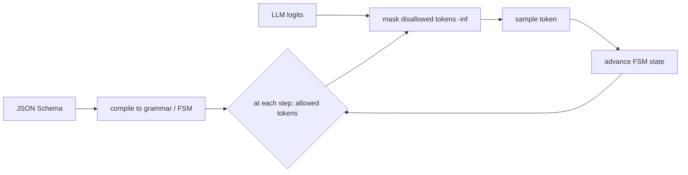

# Q39. How do you get reliable structured (JSON) output from an LLM?
[← Back to questions](../questions.md)

## TL;DR
- **Best:** use **native structured outputs / constrained decoding** (OpenAI `response_format={"type":"json_schema","strict":true}`, Gemini `response_schema`, Anthropic tool use or its structured-output mode, and vLLM/SGLang/llama.cpp grammars through Outlines/XGrammar). The decoder masks invalid tokens, so the output *parses and matches the schema* by construction.
- **JSON mode** only guarantees *valid JSON*, not *your schema*. **Function/tool calling** is schema-guided, and only guaranteed when it runs in strict mode.
- **Always validate** with Pydantic, because the schema can't express everything (cross-field rules, business logic). On failure, **retry with the validation error fed back** to the model, 1–3 times. That is exactly what `instructor` automates.
- **Schema design matters as much as the mechanism:** flat and small, enums instead of free text, descriptions on fields, nullable rather than omitted fields, and a `reasoning` field *before* the answer fields when the task needs thinking.
- For UX, **stream partial JSON** and parse it incrementally (`pydantic_core.from_json(..., allow_partial=True)` or instructor `Partial[...]`).
- Measure it: track the schema-valid rate, the retry rate, and field-level accuracy against a labelled set.

## Detailed Answer

### 1. Reliability ladder

```
Reliability ↑
 │  5. Constrained decoding (strict json_schema / grammar)  -> 100% schema-valid syntax
 │  4. Tool/function calling (strict)                         -> schema-guided args
 │  3. JSON mode                                              -> valid JSON, any shape
 │  2. Prompt + few-shot examples + "return only JSON"        -> mostly valid
 │  1. Prompt "respond in JSON"                               -> often fenced / chatty
 └───────────────────────────────────────────────────────────
     + ALWAYS: parse -> Pydantic validate -> retry with error feedback -> fallback
```

| Approach | Guarantees | Limits | Use when |
|---|---|---|---|
| Prompting only | Nothing | Code fences, trailing prose, truncated output | Prototypes, or models without API support |
| JSON mode | Syntactically valid JSON | Wrong keys or types, missing fields | Older APIs, loose schemas |
| Tool calling | Arguments follow the schema (strict mode: guaranteed) | Model may skip the tool unless `tool_choice` forces it | Agents, or picking among several schemas |
| Native structured outputs (strict) | Output matches the JSON Schema | A schema-subset limitation (e.g. all fields required, `additionalProperties:false`); first-request schema compile latency; can't enforce semantics | Production extraction and classification |
| Local grammar (Outlines, XGrammar, llama.cpp GBNF, vLLM `guided_json`) | Same, on self-hosted models | Overly tight grammars can hurt quality | Open-weight models |
| Validate + retry (instructor) | Semantic rules via validators | Extra latency and cost per retry | Always, as the outer layer |

### 2. How constrained decoding works


The schema is compiled into a context-free grammar or finite-state machine. At every decoding step, tokens that would break the grammar get their logits masked. The model can still pick *wrong values* (wrong but valid enum members, hallucinated strings), so validation and evals remain necessary. A subtle issue: forcing JSON can crowd out the model's reasoning. Either add a `reasoning` string field first, or do two calls (reason, then extract).

### 3. Schema design tips
- **Enums and `Literal`** for categories. **Booleans** instead of "yes"/"no" strings.
- Give every field a `description`. The schema is part of the prompt.
- **Put `reasoning` or `evidence` first.** Generation is left to right, so the answer fields can condition on the reasoning.
- Strict mode wants every property **required**, so express optional fields as `type | None` (nullable) rather than omitting them, and set `additionalProperties: false` (Pydantic: `model_config = ConfigDict(extra="forbid")`).
- Keep nesting shallow (≤ 3 levels) and avoid giant enums (over about 100 values). Use IDs from a provided list, plus a lookup.
- Bound lists (`max_length`) and strings, and use `pattern`/`format` for dates and IDs. Validate them in Pydantic too, because providers support only some constraint keywords.
- Allow an explicit "unknown" or null path, because a forced schema otherwise forces hallucination ("extract the invoice number" from a doc that has none).
- Version schemas (`schema_version`) and keep them backward compatible for downstream consumers.

### 4. Provider-native examples

**OpenAI structured outputs (Pydantic → strict JSON Schema):**
```python
from openai import OpenAI
from pydantic import BaseModel, Field
from typing import Literal

class Ticket(BaseModel):
    reasoning: str = Field(description="Brief justification, written first")
    category: Literal["billing", "bug", "feature_request", "other"]
    priority: Literal["low", "medium", "high"]
    customer_email: str | None = Field(description="null if not present")

client = OpenAI()
completion = client.beta.chat.completions.parse(      # newer SDKs: client.chat.completions.parse
    model="gpt-4o-mini",
    messages=[{"role": "system", "content": "Classify the support ticket."},
              {"role": "user", "content": "I was charged twice!! jane@x.com"}],
    response_format=Ticket,
)
msg = completion.choices[0].message
if msg.refusal:                    # safety refusals come back here, not as JSON
    ...
ticket: Ticket = msg.parsed
```

**Anthropic, forced tool use (schema-guided arguments):**
```python
import anthropic
client = anthropic.Anthropic()
resp = client.messages.create(
    model="claude-sonnet-4-5", max_tokens=1024,
    tools=[{"name": "record_ticket", "description": "Record the classified ticket",
            "input_schema": Ticket.model_json_schema()}],
    tool_choice={"type": "tool", "name": "record_ticket"},   # force it
    messages=[{"role": "user", "content": "I was charged twice!! jane@x.com"}],
)
args = next(b.input for b in resp.content if b.type == "tool_use")
ticket = Ticket.model_validate(args)       # still validate
```
(Anthropic also offers a native structured-output mode on newer models. Check the current docs for parameter names.)

**vLLM / open models:**
```python
# OpenAI-compatible vLLM server: guided decoding via extra_body
client.chat.completions.create(model="Qwen/Qwen2.5-7B-Instruct", messages=msgs,
                               extra_body={"guided_json": Ticket.model_json_schema()})
```

### 5. Provider-agnostic validate-and-repair loop

```python
# structured.py
from __future__ import annotations

import json
import re
from typing import Callable, TypeVar

from pydantic import BaseModel, ValidationError

M = TypeVar("M", bound=BaseModel)
Messages = list[dict[str, str]]
ChatFn = Callable[[Messages], str]


class StructuredOutputError(Exception):
    def __init__(self, message: str, attempts: list[str]) -> None:
        super().__init__(message)
        self.attempts = attempts


_FENCE = re.compile(r"`{3}(?:json)?\s*(.*?)`{3}", re.S | re.I)   # fenced code block


def extract_json(text: str) -> str:
    """Return the first complete top-level JSON object/array in `text`."""
    m = _FENCE.search(text)
    if m:
        text = m.group(1)
    start = next((i for i, ch in enumerate(text) if ch in "{["), None)
    if start is None:
        raise ValueError("no JSON object found")
    stack: list[str] = []
    in_str = esc = False
    for i in range(start, len(text)):
        ch = text[i]
        if in_str:
            if esc:
                esc = False
            elif ch == "\\":
                esc = True
            elif ch == '"':
                in_str = False
            continue
        if ch == '"':
            in_str = True
        elif ch in "{[":
            stack.append("}" if ch == "{" else "]")
        elif ch in "}]":
            if not stack or stack.pop() != ch:
                raise ValueError(f"mismatched bracket at {i}")
            if not stack:
                return text[start:i + 1]
    raise ValueError("unterminated JSON (output truncated? raise max_tokens)")


def _format_errors(e: ValidationError) -> str:
    return "\n".join(f"- {'.'.join(map(str, err['loc'])) or '<root>'}: {err['msg']}"
                     for err in e.errors())


def generate_structured(chat: ChatFn, model: type[M], messages: Messages,
                        max_retries: int = 2) -> M:
    schema = json.dumps(model.model_json_schema())
    convo: Messages = [
        {"role": "system", "content":
            "Return ONLY a JSON object matching this JSON Schema, no prose, no code fences.\n"
            f"Schema: {schema}"},
        *messages,
    ]
    attempts: list[str] = []
    for _ in range(max_retries + 1):
        raw = chat(convo)
        attempts.append(raw)
        try:
            return model.model_validate_json(extract_json(raw))
        except ValueError as e:                    # ValidationError subclasses ValueError
            feedback = (_format_errors(e) if isinstance(e, ValidationError)
                        else f"- could not parse JSON: {e}")
        convo = [*convo,
                 {"role": "assistant", "content": raw},
                 {"role": "user", "content":
                     "Your previous output was invalid:\n" + feedback +
                     "\nReturn the corrected JSON object only."}]
    raise StructuredOutputError(f"failed after {max_retries + 1} attempts", attempts)
```

Semantic validation lives in the model and turns into retry feedback for free:
```python
from datetime import date
from pydantic import BaseModel, ConfigDict, Field, field_validator, model_validator

class LineItem(BaseModel):
    model_config = ConfigDict(extra="forbid")
    description: str
    quantity: int = Field(gt=0)
    unit_price: float = Field(ge=0)

class Invoice(BaseModel):
    model_config = ConfigDict(extra="forbid")
    invoice_number: str | None
    issue_date: date
    currency: str = Field(pattern=r"^[A-Z]{3}$")
    items: list[LineItem] = Field(min_length=1, max_length=200)
    total: float

    @model_validator(mode="after")
    def total_matches(self) -> "Invoice":
        computed = round(sum(i.quantity * i.unit_price for i in self.items), 2)
        if abs(computed - self.total) > 0.01:
            raise ValueError(f"total {self.total} != sum of items {computed}")
        return self
```

### 6. Tests (pytest)

```python
# test_structured.py
import pytest
from pydantic import BaseModel, field_validator
from structured import StructuredOutputError, extract_json, generate_structured


class Person(BaseModel):
    name: str
    age: int

    @field_validator("age")
    @classmethod
    def plausible(cls, v: int) -> int:
        if not 0 <= v <= 130:
            raise ValueError("age must be 0..130")
        return v


def scripted(*replies):
    seen = []
    it = iter(replies)
    def chat(messages):
        seen.append(messages)
        return next(it)
    return chat, seen


def test_extract_json_variants():
    fence = "`" * 3
    assert extract_json(f'Sure! {fence}json\n{{"a": 1}}\n{fence} hope it helps') == '{"a": 1}'
    assert extract_json('prefix {"a": "}{", "b": [1, {"c": 2}]} suffix') == '{"a": "}{", "b": [1, {"c": 2}]}'
    assert extract_json('{"q": "say \\"hi\\" {"}') == '{"q": "say \\"hi\\" {"}'
    with pytest.raises(ValueError):
        extract_json('{"a": [1, 2')
    with pytest.raises(ValueError):
        extract_json("no json here")


def test_success_first_try():
    chat, seen = scripted('{"name": "Ana", "age": 31}')
    assert generate_structured(chat, Person, [{"role": "user", "content": "Ana, 31"}]).age == 31
    assert len(seen) == 1


def test_repair_with_validation_feedback():
    chat, seen = scripted('{"name": "Bob", "age": 999}', '{"name": "Bob", "age": 52}')
    p = generate_structured(chat, Person, [{"role": "user", "content": "Bob"}])
    assert p.age == 52
    feedback = seen[1][-1]["content"]
    assert "age" in feedback and "0..130" in feedback


def test_repair_after_unparseable_output():
    chat, _ = scripted("I think the name is Cy", '{"name": "Cy", "age": 5}')
    assert generate_structured(chat, Person, []).name == "Cy"


def test_gives_up_after_retries():
    chat, _ = scripted("nope", "still nope", "never")
    with pytest.raises(StructuredOutputError) as ei:
        generate_structured(chat, Person, [], max_retries=2)
    assert len(ei.value.attempts) == 3
```

Walkthrough of `test_repair_with_validation_feedback`: the first reply parses, but the `age` validator rejects 999. The loop appends the bad assistant message plus a user message along the lines of `- age: Value error, age must be 0..130`. The model fixes it on the second call. Specific, field-level error messages are what make repair work. "Invalid, try again" mostly doesn't.

### 7. instructor (the same loop as a library)

```python
import instructor
from openai import OpenAI

client = instructor.from_openai(OpenAI())        # also from_anthropic, from_gemini, litellm...
invoice = client.chat.completions.create(
    model="gpt-4o-mini",
    response_model=Invoice,        # Pydantic model -> tool/JSON schema under the hood
    max_retries=3,                 # re-asks with the ValidationError text
    messages=[{"role": "user", "content": invoice_text}],
)
```
instructor chooses a mode per provider (tools, JSON, or structured outputs), validates, and re-asks. It also supports `Partial[Invoice]` streaming and `Iterable[Item]` for lists.

### 8. Streaming partial JSON

```python
from pydantic_core import from_json

buf = ""
for delta in stream:                                 # text deltas from the LLM
    buf += delta
    try:
        partial = from_json(buf, allow_partial=True)  # pydantic >= 2.7: closes open containers
    except ValueError:
        continue                                     # e.g. mid-escape; wait for more
    render(partial)                                  # dict with whatever fields are complete so far
final = Invoice.model_validate_json(buf)             # strict validation only at the end
```
- By default an unfinished trailing string is dropped (`'{"a": [1, {"b": "xy'` gives `{'a': [1, {}]}`). Pass `allow_partial="trailing-strings"` to keep the text typed so far, which is useful for streaming a `summary` field into the UI.
- Validate *fully* only once the stream finishes. Partial objects violate `required` constraints by nature.
- To show a field only once it's complete, order the schema so short fields come first. instructor's `create_partial` yields progressively filled `Partial[Model]` instances.

### 9. Production checklist

| Concern | Practice |
|---|---|
| Truncation | Watch `finish_reason == "length"` and raise `max_tokens`. Truncated JSON is the top cause of parse errors |
| Refusals | Handle the `refusal` field or stop reason separately from parse errors |
| Temperature | 0–0.3 for extraction |
| Observability | Log raw output, validation errors, retry count, and schema version |
| Fallbacks | After N failures, try a stronger model, then a human queue or a default value |
| Evals | Schema-valid %, field-level exact match/F1, null-vs-hallucination rate on a labelled set |
| Cost | Retries multiply cost, so alert when the retry rate exceeds about 2% |

## Common Pitfalls
- Treating JSON mode as schema enforcement. It only guarantees parseable JSON.
- `json.loads(resp)` with no fence stripping or extraction when the API has no native structured mode.
- Required fields with no "null/unknown" option, which forces the model to invent values.
- Putting the answer field before the reasoning field, which removes chain-of-thought benefits.
- Vague retry feedback. Include the field path and the exact constraint.
- Unbounded retries, or retrying when the cause was truncation (`finish_reason=length`). Raise the token limit instead.
- Assuming the strict schema supports every JSON-Schema keyword. Unsupported keywords are rejected or ignored, so enforce them in Pydantic.
- Huge, deeply nested schemas. Split them into several focused calls.
- Validating partial streaming objects as if they were final.

## Likely Follow-up Questions
1. **Does constrained decoding hurt quality?**
   It can, when the format suppresses reasoning or the grammar forces unnatural tokenization. Add a reasoning field first, or reason freely and then extract in a second, cheap call. Measure on your evals.
2. **How do you handle multiple possible output types?**
   Use a discriminated union (`Annotated[A | B, Field(discriminator="type")]`), or several tools and let the model choose. Keep each variant small.
3. **Function calling vs structured outputs, when to use which?**
   Use tools when the model must *decide* whether and which action to take. Use structured output when you *always* want one shape back (extraction, classification).
4. **How do you extract long lists reliably?**
   Chunk the input and extract per chunk, then merge and deduplicate. Or stream `Iterable[Item]`. Bound `max_length` and watch for truncation.
5. **How do you evaluate an extraction pipeline?**
   Use a labelled set with per-field metrics (exact match for enums, normalized match for strings, tolerance for numbers), separate null-precision vs hallucination tracking, and a confusion matrix for categories.
6. **What about open-source models?**
   Use vLLM/SGLang guided decoding (XGrammar, Outlines) or llama.cpp GBNF grammars, and fine-tune on schema-following data if accuracy still lags.

[← Back to questions](../questions.md)
