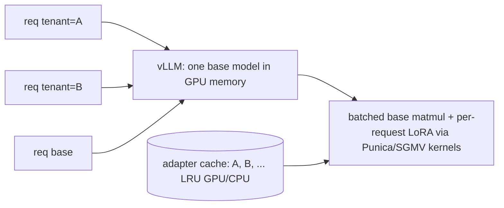

# Q40. How does LoRA/QLoRA fine-tuning work, and how do you run it?
[← Back to questions](../questions.md)

## TL;DR
- **LoRA:** freeze the pretrained weight `W₀ (d×k)` and learn a low-rank update `ΔW = B·A` with `B (d×r)`, `A (r×k)`, `r ≪ min(d,k)`. The forward pass is `h = W₀x + (α/r)·B·A·x`. `B` starts at zero, so training starts *exactly* at the base model.
- Trainable parameters drop from `d·k` to `r·(d+k)`, about **0.1–1%** of the model. There are no gradients or optimizer states for the frozen weights, so memory falls by **3–4x** and checkpoints are megabytes.
- **QLoRA:** keep the frozen base in **4-bit NF4** (with double quantization and paged optimizers) and train LoRA adapters in bf16 on top. A 7–8B model fits on one 16–24 GB GPU, a 70B model on one 48–80 GB GPU.
- **Knobs:** `r` 8–64, `alpha` ≈ r to 2r, target **all linear layers** (q,k,v,o,gate,up,down), LR about **1e-4 to 2e-4** (roughly 10x full fine-tuning), 1–3 epochs.
- **Stack:** HF `transformers` + `peft` + `trl.SFTTrainer` (+ `bitsandbytes`). Train on chat-templated data with the loss on assistant tokens only. Evaluate against the base model, then **merge** (`merge_and_unload`) or **serve many adapters** on one base (vLLM multi-LoRA, S-LoRA, LoRAX).
- **When to use it:** behaviour, format, style, and domain adaptation. Not for injecting fresh facts, which is RAG's job.

## Detailed Answer

### 1. The math

```
            x (k)
            │
   ┌────────┴────────┐
   │                 │
 W₀ (d×k)         A (r×k)   <- trainable, init Kaiming/Gaussian
 frozen              │
   │              B (d×r)   <- trainable, init ZERO
   │                 │ × (α / r)
   └──────(+)────────┘
           h (d)
```

- `h = W₀x + ΔWx = W₀x + (α/r)·B(Ax)`.
- The *hypothesis* (Hu et al. 2021) is that fine-tuning updates have low "intrinsic rank", so a rank-r factorization captures most of the useful change.
- **Init:** `B=0` means `ΔW=0` at step 0, so outputs equal the base model and training is stable.
- **Scaling `α/r`:** it decouples the effective step size from `r`, so you can change `r` without re-tuning LR as much. **rsLoRA** uses `α/√r`, which behaves better at high ranks (`use_rslora=True`).
- **Parameter count:** for one 4096×4096 projection with r=16, LoRA trains `16·(4096+4096) = 131,072` parameters vs `16.7M`, which is **0.78%**.
- **Inference:** merge `W = W₀ + (α/r)BA` and there's zero added latency. Or keep the adapter separate and swap it per request.
- **Variants:** DoRA (splits magnitude and direction, often closer to full FT), LoRA+ (different LR for A and B), PiSSA (initialize from the principal singular vectors), AdaLoRA (adaptive rank budget).

### 2. Memory math (7B model, rough)

| Item | Full FT (bf16 + AdamW mixed precision) | LoRA (bf16 base) | QLoRA (NF4 base) |
|---|---|---|---|
| Weights | 14 GB (bf16) + 28 GB fp32 master | 14 GB frozen | ~3.5–4 GB (4-bit + quant constants) |
| Gradients | 14 GB | adapters only (~MBs) | adapters only |
| Optimizer (Adam m,v fp32) | 56 GB | ~2x adapter params x 4 B (~0.3 GB for 40M params) | same, paged |
| Activations | depend on batch x seq; cut by gradient checkpointing | same | same |
| **Total (approx.)** | **~110+ GB → multi-GPU** | **~18–24 GB** | **~8–12 GB** |

The rule of thumb is about 16 bytes/param for full fine-tuning with Adam, vs about 2 bytes/param (LoRA, bf16 base) or about 0.5–0.6 bytes/param (QLoRA) plus activations.

### 3. QLoRA's three tricks (Dettmers et al. 2023)
1. **NF4 (4-bit NormalFloat):** quantization levels sit at the quantiles of a normal distribution, which is information-theoretically optimal for normally distributed weights. Blockwise (64 weights per block) with an absmax scale.
2. **Double quantization:** the per-block fp32 scales are themselves quantized to 8-bit, saving about 0.37 bits/param (around 3 GB on a 65B model).
3. **Paged optimizers:** optimizer states live in NVIDIA unified memory and page to CPU on memory spikes (long sequences), which avoids OOM.

Compute still happens in bf16. Each 4-bit weight block is dequantized on the fly for the matmul, and gradients flow *through* the frozen quantized weights into the LoRA adapters. The cost is roughly 20–40% slower steps than bf16 LoRA. Quality closely matches 16-bit LoRA in the paper.

### 4. LoRA from scratch (to show you understand it)

```python
# lora.py
from __future__ import annotations

import math
import torch
from torch import nn


class LoRALinear(nn.Module):
    def __init__(self, base: nn.Linear, r: int = 8, alpha: float = 16.0, dropout: float = 0.0) -> None:
        super().__init__()
        if r <= 0:
            raise ValueError("r must be > 0")
        self.base = base
        for p in self.base.parameters():
            p.requires_grad_(False)
        self.r, self.scaling = r, alpha / r
        self.lora_A = nn.Parameter(torch.empty(r, base.in_features))
        self.lora_B = nn.Parameter(torch.zeros(base.out_features, r))
        nn.init.kaiming_uniform_(self.lora_A, a=math.sqrt(5))
        self.dropout = nn.Dropout(dropout) if dropout > 0 else nn.Identity()
        self.merged = False

    def forward(self, x: torch.Tensor) -> torch.Tensor:
        out = self.base(x)
        if self.merged:
            return out
        return out + (self.dropout(x) @ self.lora_A.T @ self.lora_B.T) * self.scaling

    @torch.no_grad()
    def merge(self) -> None:
        if not self.merged:
            self.base.weight += (self.lora_B @ self.lora_A) * self.scaling
            self.merged = True

    @torch.no_grad()
    def unmerge(self) -> None:
        if self.merged:
            self.base.weight -= (self.lora_B @ self.lora_A) * self.scaling
            self.merged = False


def inject_lora(model: nn.Module, target: set[str], r: int = 8, alpha: float = 16.0) -> nn.Module:
    """Freeze everything, then wrap nn.Linear children whose attribute name is in `target`."""
    for p in model.parameters():
        p.requires_grad_(False)
    for module in list(model.modules()):
        for name, child in list(module.named_children()):
            if isinstance(child, nn.Linear) and name in target:
                setattr(module, name, LoRALinear(child, r, alpha))
    return model


def trainable_fraction(model: nn.Module) -> float:
    total = sum(p.numel() for p in model.parameters())
    train = sum(p.numel() for p in model.parameters() if p.requires_grad)
    return train / total
```

```python
# test_lora.py
import torch
from torch import nn
from lora import LoRALinear, inject_lora, trainable_fraction


class Block(nn.Module):
    def __init__(self, d: int = 64) -> None:
        super().__init__()
        self.q_proj, self.v_proj, self.mlp = nn.Linear(d, d), nn.Linear(d, d), nn.Linear(d, d)
    def forward(self, x):
        return self.mlp(torch.relu(self.q_proj(x) + self.v_proj(x)))


def test_initial_output_equals_base():
    torch.manual_seed(0)
    base = nn.Linear(32, 16)
    x = torch.randn(4, 32)
    ref = base(x)
    assert torch.allclose(LoRALinear(base, r=4)(x), ref)      # B = 0


def test_only_adapters_train_and_merge_is_exact():
    torch.manual_seed(0)
    model = inject_lora(Block(), {"q_proj", "v_proj"}, r=4, alpha=8)
    assert 0 < trainable_fraction(model) < 0.3
    frozen_before = model.mlp.weight.clone()
    opt = torch.optim.AdamW([p for p in model.parameters() if p.requires_grad], lr=1e-2)
    x, y = torch.randn(16, 64), torch.randn(16, 64)
    for _ in range(5):
        opt.zero_grad()
        nn.functional.mse_loss(model(x), y).backward()
        opt.step()
    assert torch.equal(model.mlp.weight, frozen_before)       # frozen untouched
    assert model.q_proj.lora_B.abs().sum() > 0                # adapter learned
    model.eval()
    with torch.no_grad():
        unmerged = model(x)
        model.q_proj.merge(); model.v_proj.merge()
        assert torch.allclose(model(x), unmerged, atol=1e-5)  # merge == adapter path
        model.q_proj.unmerge()
        assert torch.allclose(model(x), unmerged, atol=1e-5)
```

### 5. Real training run: QLoRA with HF `peft` + `trl`

```python
# train_qlora.py   pip install "transformers>=4.45" peft trl bitsandbytes datasets accelerate
import torch
from datasets import load_dataset
from peft import LoraConfig
from transformers import AutoModelForCausalLM, AutoTokenizer, BitsAndBytesConfig
from trl import SFTConfig, SFTTrainer

MODEL_ID = "meta-llama/Llama-3.1-8B-Instruct"

bnb = BitsAndBytesConfig(
    load_in_4bit=True,
    bnb_4bit_quant_type="nf4",
    bnb_4bit_use_double_quant=True,
    bnb_4bit_compute_dtype=torch.bfloat16,
)
tok = AutoTokenizer.from_pretrained(MODEL_ID)
tok.pad_token = tok.pad_token or tok.eos_token
model = AutoModelForCausalLM.from_pretrained(
    MODEL_ID, quantization_config=bnb, torch_dtype=torch.bfloat16,
    device_map="auto", attn_implementation="sdpa",   # or "flash_attention_2"
)

lora = LoraConfig(
    r=16, lora_alpha=32, lora_dropout=0.05, bias="none",
    target_modules="all-linear",            # q,k,v,o,gate,up,down (not lm_head)
    task_type="CAUSAL_LM",
)

# JSONL rows: {"messages": [{"role":"system",...},{"role":"user",...},{"role":"assistant",...}]}
ds = load_dataset("json", data_files={"train": "train.jsonl", "eval": "eval.jsonl"})

args = SFTConfig(
    output_dir="out/llama31-8b-support-lora",
    num_train_epochs=2,
    per_device_train_batch_size=4,
    gradient_accumulation_steps=4,          # effective batch 16
    learning_rate=2e-4,
    lr_scheduler_type="cosine",
    warmup_ratio=0.03,
    weight_decay=0.0,
    max_grad_norm=0.3,
    bf16=True,
    gradient_checkpointing=True,
    optim="paged_adamw_8bit",
    max_length=2048,                        # older TRL: max_seq_length
    packing=False,                          # True = higher throughput; needs proper attention masking
    assistant_only_loss=True,               # mask system/user tokens (recent TRL; else use a completion-only collator)
    eval_strategy="steps", eval_steps=100,
    save_strategy="steps", save_steps=100,
    load_best_model_at_end=True, metric_for_best_model="eval_loss",
    logging_steps=10, report_to="none",
)

trainer = SFTTrainer(
    model=model, args=args, peft_config=lora,   # TRL wraps the model and prepares k-bit training
    train_dataset=ds["train"], eval_dataset=ds["eval"],
    processing_class=tok,                        # older TRL: tokenizer=tok
)
trainer.model.print_trainable_parameters()       # ~42M / 8B ≈ 0.5%
trainer.train()
trainer.save_model("out/adapter")                # adapter_config.json + adapter_model.safetensors (~80-170MB)
```
TRL and PEFT argument names change between versions (`max_seq_length` became `max_length`, `tokenizer` became `processing_class`). Pin your versions.

### 6. Data preparation
- **Format:** chat messages rendered through the **model's own chat template**. A mismatched template at inference time is the top silent failure.
- **Quality over quantity:** 1k–10k clean, diverse, deduplicated examples usually beat 100k noisy ones. Remove near-duplicates and PII, and balance the task mix.
- **Loss masking:** train only on assistant tokens so the model learns to *answer*, not to predict user prompts.
- **Hold out** an eval split *by source* (different customers or documents) to catch memorization.
- Mix in some general instruction data (5–20%) if you see **catastrophic forgetting** of general skills.
- Respect sequence length. Check the token-length distribution and truncate or filter beyond `max_length`.

### 7. Evaluation

| Check | How |
|---|---|
| Training health | train vs eval loss curves; eval loss rising means overfitting, so stop early or cut epochs/LR |
| Task quality | held-out task metrics (exact match, F1, schema validity, LLM judge with a rubric) **vs the base model and a prompted baseline** |
| Regression | general benchmarks (MMLU subset, IFEval) and safety refusal tests, to detect forgetting |
| Behaviour | side-by-side human review on 50–100 real prompts |
| Serving parity | evaluate the *merged / quantized* artifact you will actually ship |

### 8. Merging and exporting

```python
import torch
from peft import PeftModel
from transformers import AutoModelForCausalLM, AutoTokenizer

base = AutoModelForCausalLM.from_pretrained(MODEL_ID, torch_dtype=torch.bfloat16)  # NOT 4-bit
merged = PeftModel.from_pretrained(base, "out/adapter").merge_and_unload()
merged.save_pretrained("out/merged", safe_serialization=True)
AutoTokenizer.from_pretrained(MODEL_ID).save_pretrained("out/merged")
# optional: quantize merged model for serving (AWQ/GPTQ/GGUF)
```
- Merge into the **bf16** base, not the 4-bit one. Merging into quantized weights adds rounding error.
- **Merge** gives one artifact with zero overhead, which suits a single-task deployment. **Keep separate** when you serve many tasks or tenants on one base.
- Several adapters can be combined (`add_weighted_adapter`, TIES/DARE merging), but evaluate the result, because merges interfere.

### 9. Multi-LoRA serving


```bash
vllm serve meta-llama/Llama-3.1-8B-Instruct --enable-lora \
  --lora-modules support=./out/adapter sql=./adapters/sql --max-loras 8 --max-lora-rank 64
# client: model="support" selects the adapter per request
```
A single base serves hundreds of adapters (S-LoRA, LoRAX, vLLM), with LRU swapping of adapters between GPU and CPU. Per-request overhead is small, so per-customer fine-tunes become cheap.

### 10. LoRA vs alternatives

| Method | Trainable | Memory | Quality | Notes |
|---|---|---|---|---|
| Full fine-tune | 100% | Highest (~16 B/param) | Best ceiling | Needed for big domain shifts or continued pre-training |
| LoRA | 0.1–1% | Low | ≈ full FT on most SFT tasks | Default choice |
| QLoRA | 0.1–1% | Lowest | ≈ LoRA, slightly slower | Single-GPU large models |
| DoRA | ~LoRA | ~LoRA (+) | Often > LoRA at low rank | `use_dora=True` |
| Prompt/prefix tuning | <0.1% | Very low | Weaker on big changes | Rarely used now |
| Prompting/RAG | 0 | 0 | Depends | Try first; fine-tune when prompting plateaus |

## Common Pitfalls
- Targeting only `q_proj`/`v_proj` (the original paper's default). `all-linear` usually wins noticeably.
- Using full fine-tuning learning rates (1e-5) with LoRA so nothing learns, or 1e-3 so training diverges.
- A chat template mismatch between training and inference, or a missing EOS token so the model never stops.
- Computing loss on prompt tokens, so the model learns to parrot users.
- Merging into a 4-bit base, or evaluating the adapter and then shipping a differently quantized merge.
- Expecting LoRA to teach new facts reliably. Use RAG for knowledge, fine-tuning for behaviour and format.
- Overfitting small data (3+ epochs). Watch eval loss and use early stopping.
- Calling `get_peft_model` yourself *and* passing `peft_config` to SFTTrainer, which wraps the model twice.
- Forgetting `gradient_checkpointing` plus `use_cache=False`, then hitting OOM on long sequences.

## Likely Follow-up Questions
1. **How do you choose rank r?**
   Start at 16 with α=32. Raise it (32–64, or rsLoRA) for harder or larger datasets, lower it (4–8) for simple style tasks. Returns diminish quickly, so sweep 8/16/64 on eval metrics.
2. **Why is B initialized to zero and not A?**
   One of them must be zero so ΔW=0 at the start. If both were zero, the gradients would be zero too. Zeroing B keeps A's random projection, so B gets a useful gradient immediately.
3. **LoRA for embeddings or rerankers?**
   Yes, with `task_type="FEATURE_EXTRACTION"` and a contrastive loss (sentence-transformers supports PEFT). It's a common way to domain-adapt retrieval.
4. **How do you do preference tuning with LoRA?**
   The same adapters with TRL `DPOTrainer`/`ORPOTrainer` (`peft_config=`). With PEFT the reference model is just "adapter disabled", so no second copy is needed.
5. **Multi-GPU?**
   Accelerate/DeepSpeed ZeRO-2/3 or FSDP (QLoRA plus FSDP is supported). Data parallelism suffices for 8B. Use FSDP/ZeRO-3 for 70B in bf16 LoRA.
6. **When would you not fine-tune?**
   When prompting, few-shot examples, or RAG reach the target, when data is under a few hundred quality examples, or when the knowledge changes frequently.

[← Back to questions](../questions.md)
