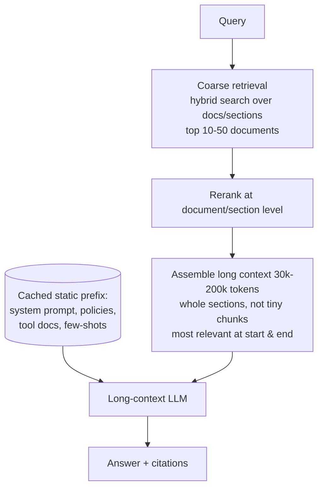

# Q41. With 1M-token context windows, do we still need RAG?
[← Back to questions](../questions.md)

## TL;DR
- **Yes, for most production systems.** Long context changes the *granularity* of RAG (retrieve whole documents instead of tiny chunks) but doesn't remove the need to select.
- **Scale:** enterprise corpora are gigabytes to terabytes, far beyond 1M tokens (~750k words, a few thousand pages). You still have to choose what goes in.
- **Cost and latency:** a 1M-token prompt costs dollars and takes tens of seconds per call, versus cents and sub-second for RAG. **Context caching** reduces the cost of a *static* prefix but not of changing per-user content.
- **Quality:** models still degrade with distractors and position ("lost in the middle"). Needle-in-a-haystack tests flatter them, and multi-fact reasoning over long contexts is harder.
- **Governance:** RAG gives per-user **access control**, **freshness** without re-sending everything, and **citations / auditability**.
- **Long context wins** for a bounded set of documents analyzed deeply (one contract, a codebase snapshot, a book, a long transcript), for cross-document synthesis where you can't predict what's relevant, and for prototypes. Best practice is a **hybrid**: retrieve coarsely, then put generous, well-ordered context into a long window, with caching for stable prefixes.

## Detailed Answer

### 1. Why the question comes up
Context windows grew from 4k (2022) to 128k–200k (common), and to 1M–2M (Gemini 1.5/2.x, some GPT-4.1 / Claude tiers). The pitch is "just put everything in the prompt": no chunking, no embeddings, no retrieval failures. That's partly true for small corpora and false at enterprise scale.

### 2. Dimension-by-dimension comparison

| Dimension | Long context (stuff it all) | RAG |
|---|---|---|
| Corpus size limit | ~1M tokens ≈ 1,500–3,000 pages | Unbounded (billions of tokens) |
| Cost per query | Proportional to context; 1M tokens ≈ $1–$3+ input at typical frontier rates (much less with caching hits) | Retrieval cost negligible; ~2–10k prompt tokens |
| Latency (TTFT) | Seconds to tens of seconds for 500k–1M tokens | ~0.3–1.5 s |
| Freshness | Re-send the updated content each call (or rebuild cache) | Update index incrementally |
| Access control | Must build per-user context anyway, which is retrieval with extra steps | Filter at retrieval |
| Citations / audit | Possible but coarse; model may cite wrong location | Chunk-level provenance |
| Recall of relevant info | No retrieval misses, but attention misses | Retrieval misses possible |
| Multi-hop / global synthesis | Strong when everything fits | Weak unless iterative/agentic or GraphRAG |
| Engineering complexity | Low | Medium–high (ingestion, index, eval) |
| Determinism / debugging | Hard to tell what the model attended to | Inspect retrieved chunks |

### 3. Quality: "lost in the middle" and beyond
- **Lost in the Middle** (Liu et al., 2023): accuracy on multi-document QA was highest when the relevant document sat at the start or end of the context, and dropped notably in the middle. Newer models have improved but haven't fully eliminated position effects.
- **Needle-in-a-haystack** (one inserted fact, retrieved verbatim) is close to saturated for frontier models, but it's a weak test. Benchmarks like **RULER**, **LongBench**, **NoLiMa**, and **Michelangelo** show that *effective* context, the length at which multi-fact retrieval, aggregation, and reasoning hold up, is often far below the advertised window.
- **Distractors hurt.** Semantically similar but irrelevant passages (old versions, other products) degrade answers more than random filler does. RAG's selection plus reranking strips distractors, and long context invites them.
- **Reasoning over many facts** ("count all clauses mentioning X across 300 contracts") is unreliable in a single pass. Map-reduce or structured extraction does better.

```
Accuracy
  │ ●                                   ●
  │   ●                               ●
  │     ●                         ●
  │        ●   ●   ●   ●   ●  ●
  └───────────────────────────────────── position of relevant doc
   start                middle               end
   (illustrative U-shape from "Lost in the Middle")
```

### 4. Cost and latency math (illustrative)
Assume an input price of $P per 1M tokens, 10,000 queries/day.

| Approach | Tokens/query | Daily input tokens | Relative cost |
|---|---|---|---|
| RAG (8 chunks × 500 + prompt) | ~5k | 50M | 1× |
| Long-context, 200k-token corpus, no cache | 200k | 2B | 40× |
| Long-context, 200k, with context caching (cached tokens billed at a steep discount, often ~10–25% of base, plus storage) | 200k (mostly cached) | 2B cached-rate | ~5–10× |
| Long-context, 1M | 1M | 10B | 200× |

Latency: prefill time grows with input length. Even with caching, which also reduces prefill latency on hits, 1M-token calls are much slower than a 5k-token RAG call, and some providers' long-context tiers charge a premium above a threshold (e.g., >200k tokens).

### 5. Where long context genuinely wins
- **Single large artifact, deep analysis:** "Review this 300-page contract for indemnity risks", "summarize this 4-hour transcript", "explain this repository".
- **Unknown relevance / global questions:** "What are the main themes across these 40 interviews?" Similarity search can't find "themes".
- **Cross-references:** documents that refer to each other heavily (legal definitions sections, specs) and break under chunking.
- **Small, stable corpora:** a product manual under 200k tokens, a policy handbook, plus context caching. Simpler than running a vector DB.
- **Prototyping:** prove value before building ingestion.
- **Agentic coding / tool use** where the working set (files, logs) is assembled dynamically. Selection still happens; the window is just bigger.

### 6. Where RAG remains necessary
- Corpus far bigger than the window (almost every enterprise knowledge base).
- **Multi-tenant / per-user permissions** (see Q38): you must select per user.
- **High QPS / low latency / cost-sensitive** applications (support bots, search).
- **Frequently changing** data (see Q6).
- **Auditable citations** required (regulated industries).
- **Structured or numeric data**: tools and SQL, not context stuffing (see Q7).

### 7. Hybrid patterns (what senior teams actually do)



1. **Retrieve big, not small.** Retrieve documents or sections (parent-child, Q35) rather than 200-token snippets, and give the model plenty of surrounding context. Long windows make retrieval misses at chunk boundaries less costly.
2. **Context caching for the stable part.** Put system instructions, a product manual, a codebase snapshot, or few-shot examples in a cached prefix, and append the per-query retrieved content after it.
3. **Route by query type.** Factoid → classic RAG with small context. Global or summary → long context over a pre-filtered document set, or map-reduce. Analytical → SQL/tools.
4. **Self-route** (Li et al., 2024, "Retrieval Augmented Generation or Long-Context LLMs?"): try RAG first, let the model judge whether the retrieved context is sufficient, and fall back to long context only when needed. This kept most of long context's quality at a fraction of the cost.
5. **Map-reduce / agentic reading** for corpora above the window: chunk into window-sized pieces, extract per piece, then reduce.
6. **Order matters:** place the most relevant material at the beginning and the end, and put the question at the end (some providers recommend placing long documents first and the query last).

**Context caching example (Anthropic Messages API):**

```python
import anthropic

client = anthropic.Anthropic()

with open("product_manual.md") as f:
    manual = f.read()             # e.g., ~150k tokens, changes rarely

def ask(question: str, retrieved_snippets: str) -> str:
    resp = client.messages.create(
        model="claude-sonnet-4-5",          # use a current model id
        max_tokens=1024,
        system=[
            {"type": "text", "text": "You answer support questions. Cite manual sections."},
            {"type": "text", "text": manual, "cache_control": {"type": "ephemeral"}},
        ],
        messages=[{
            "role": "user",
            "content": f"Recent tickets/KB updates:\n{retrieved_snippets}\n\nQuestion: {question}",
        }],
    )
    return resp.content[0].text
```

The manual is billed at the cached rate on subsequent calls within the cache TTL. The fresh, per-user retrieved snippets go after the cached prefix. OpenAI applies automatic prompt caching for long, repeated prefixes, and Gemini offers explicit context caching via its `CachedContent` API.

**LangChain: retrieve whole parent documents for a long-context model**

```python
from langchain.retrievers import ParentDocumentRetriever
from langchain_core.prompts import ChatPromptTemplate
from langchain_openai import ChatOpenAI

# parent_retriever configured with large parent sections (e.g., 4-8k tokens)
docs = parent_retriever.invoke(question)[:10]          # ~40-80k tokens of context
# put best docs at the edges to mitigate lost-in-the-middle
ordered = docs[0::2] + docs[1::2][::-1]
context = "\n\n".join(f"<doc id='{d.metadata['doc_id']}'>\n{d.page_content}\n</doc>" for d in ordered)

prompt = ChatPromptTemplate.from_messages([
    ("system", "Answer only from the documents. Cite doc ids. Say 'not found' if absent."),
    ("human", "{context}\n\nQuestion: {question}"),
])
answer = (prompt | ChatOpenAI(model="gpt-4.1")).invoke({"context": context, "question": question})
```

(LangChain also ships `LongContextReorder` in `langchain_community.document_transformers`, which implements the same edge-placement idea.)

### 8. How to decide for a given system

| Question | If yes → |
|---|---|
| Is the total relevant corpus < ~100–200k tokens and fairly static? | Long context + caching may be simplest |
| Do different users see different documents? | RAG (filtered retrieval) required |
| QPS high or latency SLO < 2 s? | RAG |
| Questions are global / thematic over a bounded set? | Long context or map-reduce |
| Need precise citations and audit? | RAG (or long context with structured doc IDs + verification) |
| Data changes hourly/daily? | RAG |

Then **measure** both on your own eval set (see Q37): quality, p95 latency, and cost per query. Don't rely on vendor needle tests.

### 9. Where this is heading
- Effective context keeps improving, and caching keeps getting cheaper. The break-even point shifts toward "retrieve more, chunk less".
- Retrieval becomes **context engineering**: selecting, ordering, compressing, and caching what goes into a large window, often driven by agents that search iteratively.
- The selection problem doesn't disappear, because corpora, permissions, freshness, and cost scale faster than context windows.

## Common Pitfalls
- Treating needle-in-a-haystack scores as proof of long-context reasoning quality.
- Dumping everything, including old versions and near-duplicates, into context, so distractors cause wrong answers.
- Ignoring cost and latency at production QPS (a demo at 1 query/minute ≠ production at 50 QPS).
- Assuming caching makes per-user dynamic content cheap. It only helps for identical prefixes.
- Putting the question at the top of a 500k-token prompt, with no structure or doc IDs.
- Concluding "RAG is dead" and losing access control and citations.
- Conversely, insisting on tiny chunks and top-3 when a long-context model could take whole sections.

## Likely Follow-up Questions
1. **What is "lost in the middle"?** LLMs use information at the start and end of a long context better than information in the middle, so relevance-aware ordering and less context help.
2. **How does context caching work and when does it help?** The provider stores the KV cache of a repeated prompt prefix, so later calls with the same prefix are cheaper and faster. It helps with large static content and repeated system prompts, not with per-query retrieved text.
3. **What is effective context length?** The length at which a model maintains a given accuracy on non-trivial tasks (multi-needle, aggregation). It's often much shorter than the advertised maximum. RULER measures it.
4. **How would you handle a 10M-token corpus with a 1M window?** Retrieve or route to the relevant subset, or map-reduce (process window-sized shards, then combine). Consider GraphRAG for global questions.
5. **Does long context reduce hallucination?** Not inherently. More distractors can increase errors. Grounding instructions, citations, and verification still matter.
6. **When would you remove RAG from an existing system?** When the corpus is small and static, there are no per-user ACLs, evals show long context matches or beats RAG quality, and cost/latency with caching fit the budget.

[← Back to questions](../questions.md)
