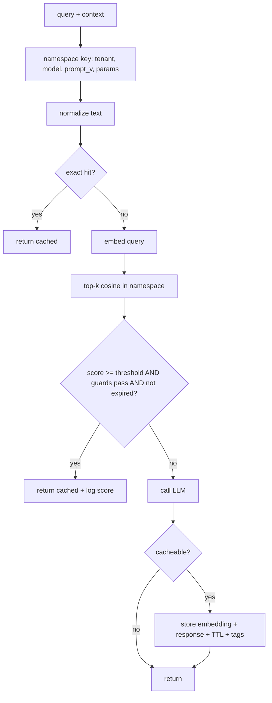

# Q42. Implement a semantic cache for LLM responses.
[← Back to questions](../questions.md)

## TL;DR
- **Two tiers:** first an **exact cache** (hash of the normalized prompt, O(1), zero risk), then a **semantic cache**. Embed the query, find the nearest cached query, and return its response if `cosine ≥ threshold` (typically 0.90–0.97, *tuned per embedding model*).
- **Namespace everything.** The key must include `tenant + model + prompt/template version + generation params (+ tool/RAG corpus version)`. A hit must never cross tenants or survive a prompt change.
- **The real risk is false hits.** "Cancel my order" vs "don't cancel my order", or "plan 10" vs "plan 20", embed almost identically. Add guards (number and negation match, entity check, optional cross-encoder or LLM verification) and choose the threshold for **precision ≥ 98–99%**, not for hit rate.
- **Freshness:** a TTL per entry, **tag-based invalidation** (e.g. `doc:123` when a source document changes), wholesale invalidation when the prompt version bumps, and LRU caps.
- **Don't cache** personalized, time-sensitive, tool-side-effect, or high-temperature creative responses.
- **Tune with data:** label query pairs as "same answer acceptable?", sweep the threshold, and plot precision vs hit rate. Monitor hit rate, user regenerations after hits, and sampled audits of hits.

## Detailed Answer

### 1. Flow



### 2. What's in the key, and why

| Key component | Why |
|---|---|
| `tenant` / user scope | Data isolation. Never leak tenant A's answer to tenant B |
| `model` | Different models give different answers and quality |
| `prompt_version` | Changing the system prompt or template must invalidate |
| generation params (`temperature`, `max_tokens`, tools, response schema) | They change output shape and content |
| retrieval corpus version (RAG) | Answers depend on documents. Alternatively use tags for finer invalidation |
| locale / language | Same question, different expected language |

Only the **user query** gets embedded. If you embed the whole prompt (system prompt plus retrieved context), the dominant shared text makes every vector look similar.

### 3. False-hit risks and mitigations

| Risk | Example | Mitigation |
|---|---|---|
| Negation | "Is X safe?" vs "Is X not safe?" | Negation-token parity guard |
| Numbers/entities | "Refund for order 123" vs "order 456" | Numbers/IDs must match exactly; NER entity match |
| Near-paraphrase, different intent | "How to reset password" vs "How to reset 2FA" | Higher threshold, cross-encoder verification for scores near the threshold |
| Context-dependent questions | "What about the second one?" | Don't cache multi-turn follow-ups (or include a hash of the conversation state) |
| Stale facts | Prices, inventory, policies | TTL plus tag invalidation from the data source |
| Personal data | "What's my balance?" | Cacheability policy: skip, or scope to the user |
| Cache poisoning | A bad answer cached and replayed 1000x | Cache only after quality checks (no error, guardrails passed, maybe positive feedback); allow manual purge |

### 4. Design choices in the implementation
- **Exact layer first.** It's cheap, it catches about 20–40% of traffic in many FAQ-like apps, and it can't produce a false hit.
- **A namespace object per key**, holding an `OrderedDict` for LRU, an exact map, and a lazily rebuilt normalized embedding matrix. Exact search over ≤10k entries per namespace takes microseconds to milliseconds. Beyond that, use FAISS/HNSW or Redis/pgvector vector indexes.
- **Embedding happens outside the lock.** It's the slow part, and the lock only guards the in-memory structures.
- **Top-k (3) candidates** are checked against the guards, so a guard-rejected best match doesn't hide a valid second match.
- **Injected clock and embedder**, so tests are deterministic.
- `get_or_generate` embeds once and reuses the vector for both the lookup and the insert.

### 5. Implementation

```python
# semantic_cache.py
from __future__ import annotations

import hashlib
import json
import re
import threading
import time
from collections import OrderedDict
from dataclasses import dataclass, field
from typing import Callable, Iterable, Literal

import numpy as np

EmbedFn = Callable[[str], np.ndarray]
Guard = Callable[[str, str], bool]


@dataclass(frozen=True)
class CacheKey:
    tenant: str
    model: str
    prompt_version: str
    params: str = "{}"

    @staticmethod
    def build(tenant: str, model: str, prompt_version: str, **params) -> "CacheKey":
        return CacheKey(tenant, model, prompt_version, json.dumps(params, sort_keys=True, default=str))


@dataclass
class Entry:
    id: int
    query: str
    norm: str
    embedding: np.ndarray
    response: str
    created_at: float
    expires_at: float
    tags: frozenset[str]
    hits: int = 0


@dataclass(frozen=True)
class Hit:
    response: str
    kind: Literal["exact", "semantic"]
    score: float
    matched_query: str


_WS = re.compile(r"\s+")
_NUM = re.compile(r"\d+(?:[.,]\d+)*")
_NEG = re.compile(r"\b(?:not|no|never|without|cannot|can't|don't|doesn't|isn't|won't|shouldn't)\b|n't\b")


def normalize(text: str) -> str:
    return _WS.sub(" ", text.strip().lower()).rstrip("?!. ")


def default_guard(query: str, candidate: str) -> bool:
    """Reject semantically-close but materially different queries."""
    q, c = query.lower(), candidate.lower()
    if set(_NUM.findall(q)) != set(_NUM.findall(c)):
        return False
    return bool(_NEG.search(q)) == bool(_NEG.search(c))


def _unit(v: np.ndarray) -> np.ndarray:
    v = np.asarray(v, dtype=np.float32).ravel()
    n = float(np.linalg.norm(v))
    return v / n if n > 0 else v


class _Namespace:
    def __init__(self) -> None:
        self.entries: OrderedDict[int, Entry] = OrderedDict()
        self.exact: dict[str, int] = {}
        self._ids: list[int] = []
        self._matrix: np.ndarray | None = None
        self._dirty = True

    def mark_dirty(self) -> None:
        self._dirty = True

    def matrix(self) -> tuple[list[int], np.ndarray | None]:
        if self._dirty:
            self._ids = list(self.entries)
            self._matrix = (np.stack([self.entries[i].embedding for i in self._ids])
                            if self._ids else None)
            self._dirty = False
        return self._ids, self._matrix


class SemanticCache:
    def __init__(
        self,
        embed: EmbedFn,
        *,
        threshold: float = 0.93,
        default_ttl: float = 3600.0,
        max_entries_per_namespace: int = 10_000,
        top_k: int = 3,
        guard: Guard | None = default_guard,
        clock: Callable[[], float] = time.time,
    ) -> None:
        self._embed = embed
        self.threshold = threshold
        self.default_ttl = default_ttl
        self.max_entries = max_entries_per_namespace
        self.top_k = top_k
        self.guard = guard
        self._clock = clock
        self._ns: dict[CacheKey, _Namespace] = {}
        self._tags: dict[str, set[tuple[CacheKey, int]]] = {}
        self._next_id = 0
        self._lock = threading.Lock()
        self.stats = {"exact": 0, "semantic": 0, "miss": 0, "guard_reject": 0}

    # ----- internal helpers (lock held) -----
    def _remove(self, key: CacheKey, ns: _Namespace, eid: int) -> None:
        e = ns.entries.pop(eid, None)
        if e is None:
            return
        if ns.exact.get(e.norm) == eid:
            del ns.exact[e.norm]
        for t in e.tags:
            refs = self._tags.get(t)
            if refs:
                refs.discard((key, eid))
                if not refs:
                    del self._tags[t]
        ns.mark_dirty()

    def _purge_expired(self, key: CacheKey, ns: _Namespace, now: float) -> None:
        for eid in [i for i, e in ns.entries.items() if e.expires_at <= now]:
            self._remove(key, ns, eid)

    def _touch(self, ns: _Namespace, e: Entry) -> None:
        ns.entries.move_to_end(e.id)            # LRU order only; matrix order unaffected
        e.hits += 1

    # ----- public API -----
    def lookup_exact(self, key: CacheKey, query: str) -> Hit | None:
        with self._lock:
            ns = self._ns.get(key)
            if ns is None:
                return None
            self._purge_expired(key, ns, self._clock())
            eid = ns.exact.get(normalize(query))
            if eid is None:
                return None
            e = ns.entries[eid]
            self._touch(ns, e)
            self.stats["exact"] += 1
            return Hit(e.response, "exact", 1.0, e.query)

    def lookup_semantic(self, key: CacheKey, query: str, vec: np.ndarray) -> Hit | None:
        q = _unit(vec)
        with self._lock:
            ns = self._ns.get(key)
            if ns is None:
                self.stats["miss"] += 1
                return None
            self._purge_expired(key, ns, self._clock())
            ids, m = ns.matrix()
            if m is None:
                self.stats["miss"] += 1
                return None
            scores = m @ q
            k = min(self.top_k, len(ids))
            order = np.argpartition(-scores, k - 1)[:k]
            order = order[np.argsort(-scores[order])]
            for idx in order:
                s = float(scores[idx])
                if s < self.threshold:
                    break
                e = ns.entries[ids[idx]]
                if self.guard is not None and not self.guard(query, e.query):
                    self.stats["guard_reject"] += 1
                    continue
                self._touch(ns, e)
                self.stats["semantic"] += 1
                return Hit(e.response, "semantic", s, e.query)
            self.stats["miss"] += 1
            return None

    def put(self, key: CacheKey, query: str, response: str, vec: np.ndarray | None = None,
            ttl: float | None = None, tags: Iterable[str] = ()) -> int:
        v = _unit(self._embed(query) if vec is None else vec)
        now = self._clock()
        with self._lock:
            ns = self._ns.setdefault(key, _Namespace())
            norm = normalize(query)
            if norm in ns.exact:                                  # replace existing
                self._remove(key, ns, ns.exact[norm])
            eid, self._next_id = self._next_id, self._next_id + 1
            e = Entry(eid, query, norm, v, response, now,
                      now + (self.default_ttl if ttl is None else ttl), frozenset(tags))
            ns.entries[eid] = e
            ns.exact[norm] = eid
            for t in e.tags:
                self._tags.setdefault(t, set()).add((key, eid))
            ns.mark_dirty()
            while len(ns.entries) > self.max_entries:             # LRU eviction
                self._remove(key, ns, next(iter(ns.entries)))
            return eid

    def get_or_generate(self, key: CacheKey, query: str, generate: Callable[[], str], *,
                        cacheable: Callable[[str], bool] = lambda r: bool(r.strip()),
                        ttl: float | None = None, tags: Iterable[str] = ()) -> tuple[str, Hit | None]:
        hit = self.lookup_exact(key, query)
        if hit:
            return hit.response, hit
        vec = self._embed(query)                                  # slow part, outside lock
        hit = self.lookup_semantic(key, query, vec)
        if hit:
            return hit.response, hit
        response = generate()
        if cacheable(response):
            self.put(key, query, response, vec=vec, ttl=ttl, tags=tags)
        return response, None

    # ----- invalidation -----
    def invalidate_tag(self, tag: str) -> int:
        with self._lock:
            refs = list(self._tags.get(tag, ()))
            for key, eid in refs:
                ns = self._ns.get(key)
                if ns:
                    self._remove(key, ns, eid)
            return len(refs)

    def invalidate_namespace(self, key: CacheKey) -> None:
        with self._lock:
            ns = self._ns.pop(key, None)
            if ns:
                for e in ns.entries.values():
                    for t in e.tags:
                        refs = self._tags.get(t)
                        if refs:
                            refs.discard((key, e.id))
                            if not refs:
                                del self._tags[t]

    def invalidate_tenant(self, tenant: str) -> None:
        for key in [k for k in list(self._ns) if k.tenant == tenant]:
            self.invalidate_namespace(key)

    def size(self, key: CacheKey) -> int:
        with self._lock:
            ns = self._ns.get(key)
            return len(ns.entries) if ns else 0
```

Usage:
```python
cache = SemanticCache(embed=lambda t: st_model.encode(t, normalize_embeddings=True), threshold=0.94)
key = CacheKey.build(tenant="acme", model="gpt-4o-mini", prompt_version="support-v7", temperature=0)
answer, hit = cache.get_or_generate(key, user_query, lambda: llm(user_query),
                                    tags=[f"doc:{d}" for d in retrieved_doc_ids])
# when doc 42 changes:
cache.invalidate_tag("doc:42")
```

### 6. Tests (pytest)

```python
# test_semantic_cache.py
import hashlib
import re
import numpy as np
from semantic_cache import CacheKey, SemanticCache


def bow_embed(text: str, dim: int = 512) -> np.ndarray:
    v = np.zeros(dim, dtype=np.float32)
    for w in re.findall(r"[a-z0-9]+", text.lower()):
        v[int(hashlib.md5(w.encode()).hexdigest(), 16) % dim] += 1
    return v


class Clock:
    def __init__(self) -> None:
        self.t = 1000.0
    def __call__(self) -> float:
        return self.t


KEY = CacheKey.build("acme", "m1", "v1", temperature=0)


def make(**kw):
    clock = Clock()
    return SemanticCache(bow_embed, clock=clock, **{"threshold": 0.8, **kw}), clock


def test_exact_hit_after_normalization():
    c, _ = make()
    c.put(KEY, "How do I reset my password?", "Go to settings.")
    hit = c.lookup_exact(KEY, "  how do i RESET my password ")
    assert hit and hit.kind == "exact" and hit.response == "Go to settings."


def test_semantic_hit_and_miss():
    c, _ = make()
    c.put(KEY, "how do i reset my password", "Go to settings.")
    q = "how can i reset my password"                     # cosine = 5/6 ≈ 0.83
    hit = c.lookup_semantic(KEY, q, bow_embed(q))
    assert hit and hit.kind == "semantic" and hit.score >= 0.8
    q2 = "what is the capital of france"
    assert c.lookup_semantic(KEY, q2, bow_embed(q2)) is None


def test_namespace_isolation():
    c, _ = make()
    c.put(KEY, "how do i reset my password", "A")
    other = CacheKey.build("globex", "m1", "v1", temperature=0)
    assert c.lookup_exact(other, "how do i reset my password") is None
    bumped = CacheKey.build("acme", "m1", "v2", temperature=0)
    assert c.lookup_exact(bumped, "how do i reset my password") is None


def test_ttl_expiry():
    c, clock = make(default_ttl=60)
    c.put(KEY, "hello there", "hi")
    clock.t += 61
    assert c.lookup_exact(KEY, "hello there") is None and c.size(KEY) == 0


def test_number_guard_blocks_false_hit():
    c, _ = make(threshold=0.7)
    c.put(KEY, "price of plan 10", "$10")
    q = "price of plan 20"                                # cosine 0.75 but different entity
    assert c.lookup_semantic(KEY, q, bow_embed(q)) is None
    assert c.stats["guard_reject"] == 1
    c_noguard, _ = make(threshold=0.7, guard=None)
    c_noguard.put(KEY, "price of plan 10", "$10")
    assert c_noguard.lookup_semantic(KEY, q, bow_embed(q)) is not None


def test_negation_guard():
    c, _ = make(threshold=0.7)
    c.put(KEY, "should i cancel my order", "Yes")
    q = "should i not cancel my order"
    assert c.lookup_semantic(KEY, q, bow_embed(q)) is None


def test_tag_invalidation():
    c, _ = make()
    c.put(KEY, "refund policy", "30 days", tags=["doc:policy"])
    c.put(KEY, "shipping time", "3 days", tags=["doc:shipping"])
    assert c.invalidate_tag("doc:policy") == 1
    assert c.lookup_exact(KEY, "refund policy") is None
    assert c.lookup_exact(KEY, "shipping time") is not None


def test_lru_eviction():
    c, _ = make(max_entries_per_namespace=2)
    c.put(KEY, "q one", "1"); c.put(KEY, "q two", "2")
    c.lookup_exact(KEY, "q one")                          # touch -> most recent
    c.put(KEY, "q three", "3")
    assert c.lookup_exact(KEY, "q two") is None
    assert c.lookup_exact(KEY, "q one") is not None


def test_get_or_generate_calls_llm_once():
    c, _ = make()
    calls = []
    gen = lambda: calls.append(1) or "answer"
    r1, h1 = c.get_or_generate(KEY, "how do i reset my password", gen)
    r2, h2 = c.get_or_generate(KEY, "how can i reset my password", gen)
    assert (r1, r2) == ("answer", "answer") and h1 is None and h2.kind == "semantic"
    assert len(calls) == 1
```

Walkthrough of `test_number_guard_blocks_false_hit`: the bag-of-words vectors share `price, of, plan` out of 4 words, so cosine is 3/4 = 0.75, above the 0.7 threshold. Without the guard, "plan 20" would get the "$10" answer, which is the classic semantic-cache bug. The guard compares the number sets `{10}` and `{20}`, rejects, and records `guard_reject`. Real embedding models show the same failure mode at around 0.95 similarity.

### 7. Choosing and evaluating the threshold

Collect real query pairs (nearest neighbours from logs) and label each: *would the cached answer be acceptable?* Then sweep:

```python
def sweep(pairs: list[tuple[str, str, bool]], embed, thresholds=np.arange(0.80, 0.995, 0.005)):
    """pairs = (new_query, cached_query, acceptable). Returns rows of (t, precision, hit_rate)."""
    def unit(v):
        v = np.asarray(v, dtype=np.float32)
        return v / (np.linalg.norm(v) or 1.0)
    scores = np.array([float(unit(embed(a)) @ unit(embed(b))) for a, b, _ in pairs])
    labels = np.array([y for *_, y in pairs], dtype=bool)
    rows = []
    for t in thresholds:
        served = scores >= t
        tp = int((served & labels).sum())
        fp = int((served & ~labels).sum())
        precision = tp / (tp + fp) if tp + fp else 1.0
        recall = tp / int(labels.sum()) if labels.any() else 0.0
        rows.append((round(float(t), 3), precision, recall, float(served.mean())))
    return rows

def choose_threshold(rows, min_precision=0.98):
    ok = [r for r in rows if r[1] >= min_precision]
    return min(ok, key=lambda r: r[0])[0] if ok else None   # lowest t meeting precision = most hits
```

```
precision
 1.00 |                 ●●●●●●●●
 0.98 |- - - - - - -●●- - - - - -   <- pick lowest t above the line
 0.95 |         ●●
 0.90 |    ●●●
      +--------------------------- threshold
       0.85   0.90   0.93   0.96
hit rate decreases → as threshold increases
```

- The threshold is **model-specific**. 0.9 on MiniLM is not 0.9 on `text-embedding-3`. Re-tune after any embedding change.
- **Run it in production too:** shadow mode first (compute would-be hits, still call the LLM, compare answers with an LLM judge), then serve. Track hit rate, regenerate/thumbs-down rate on hits vs misses, latency saved, and $ saved.
- Consider **a band**. At `score ≥ 0.97` serve directly; between 0.92 and 0.97, verify with a cross-encoder or a cheap LLM ("do these two questions have the same answer?"); below that, miss.

### 8. Scaling it out

| Need | Option |
|---|---|
| Shared across replicas | Redis (exact `GET` + Redis vector search / RediSearch KNN with `TAG` filter on namespace), pgvector, Qdrant with payload filters |
| Large namespaces | HNSW (FAISS / hnswlib) per namespace, or one index with a metadata filter |
| TTL | Redis `EXPIRE` on entry keys, plus periodic index cleanup |
| Off-the-shelf | GPTCache, LangChain `RedisSemanticCache`, gateway features (Portkey, LiteLLM caching) |
| Cost-free win first | Provider **prompt caching** (prefix KV caching) cuts cost on repeated long prefixes with zero false-hit risk. It complements a response cache and doesn't replace it |

## Common Pitfalls
- A global cache with no tenant or prompt-version scoping, which leaks data and serves stale behaviour after prompt changes.
- Embedding the entire prompt (system prompt plus RAG context) instead of the user query.
- Picking the threshold by intuition ("0.8 looks fine"). Without labelled pairs you will serve wrong answers at scale.
- Caching responses with `temperature > 0` for creative tasks, which kills diversity, or caching error, refusal, or empty responses.
- Caching personalized or time-sensitive answers ("my balance", "today's weather").
- Caching multi-turn follow-ups without including the conversation state.
- No invalidation path when source documents change. Use tags, or a corpus version in the key.
- Ignoring the cost of the embedding call. On tiny prompts, an embedding call plus vector lookup can cost nearly as much latency as a small LLM call, so measure.
- Unbounded growth. Cap with LRU and TTL.

## Likely Follow-up Questions
1. **How would you implement it on Redis?**
   Store each entry as a hash `{query, response, embedding, namespace, tags}` with `EXPIRE` for the TTL, and create a RediSearch index with a `VECTOR HNSW` field and a `TAG` field for the namespace. Query `@ns:{acme|m1|v7}=>[KNN 3 @emb $vec AS score]`, then apply the guard and threshold client-side. Use a plain `SET` for the exact tier.
2. **Semantic cache vs provider prompt caching?**
   Prompt caching reuses the KV cache of an identical prefix. It still generates, is always correct, and saves input cost and latency. A semantic cache skips generation entirely but can return wrong answers. Use both.
3. **How do you cache RAG answers safely?**
   Include the corpus or index version in the key, or tag entries with the retrieved doc IDs and invalidate on document update. Optionally re-check that the cached answer's sources still exist.
4. **How do you measure business impact?**
   Hit rate x average cost and latency per LLM call gives the savings. Quality cost is the regen and complaint rate on hits vs misses, plus sampled human or LLM-judge audits.
5. **Can you cache partial work instead of final answers?**
   Yes: cache embeddings, retrieval results, tool call outputs (deterministic ones), or intermediate agent plans. Those are often safer than caching final answers.
6. **How do you prevent cache poisoning?**
   Only cache responses that passed guardrails and validation, optionally only after positive feedback or N consistent generations. Provide an admin purge and an audit trail per entry.

[← Back to questions](../questions.md)
